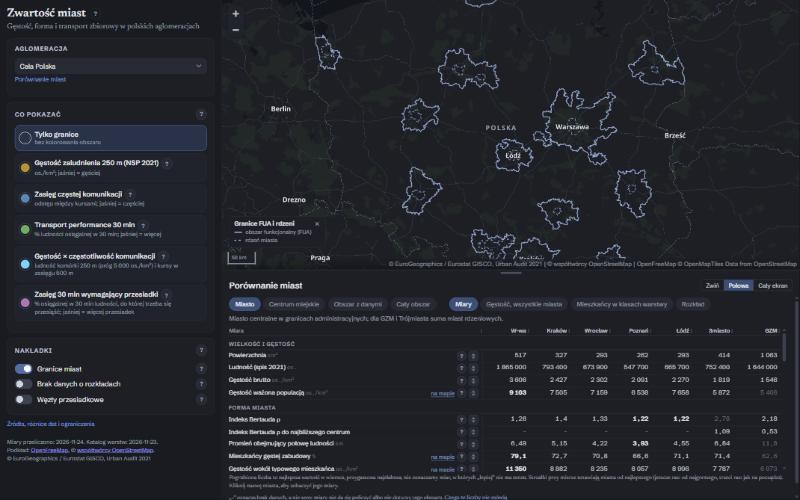
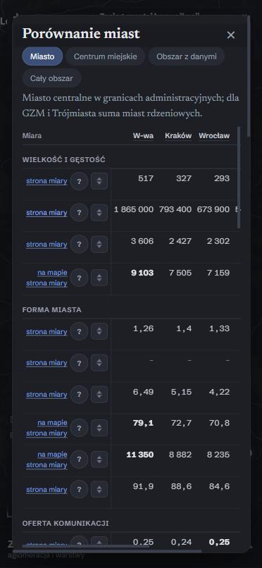

# UX review: "Zwartość miast" (bartor.github.io/compactness), 2026-11-24

First-use study by a reviewer with no prior knowledge of the app, its code or its documentation. Desktop at 1440 x 900, phone at 375 x 812 (mobile preset). Everything below was observed by clicking what was on screen; `read_page` / `get_page_text` were used only afterwards to confirm exact labels and button sizes.

**Redeploy during the review.** The live site was redeployed partway through. Screenshots `01`–`12` and the observations tagged **[PRE]** were made before it; screenshots `13`–`39` and observations tagged **[POST]** after it (reloaded with `?v=2` and later). Where I re-checked a PRE observation after the redeploy, I say so. The most visible POST change: a "strona miary" link on every comparison-table row that opens a full-screen "measure page" with a sorted bar chart of all 13 agglomerations. Help popovers in the table also gained "JAK POLICZONO" and "ŹRÓDŁO TYCH LICZB" sections.

A note on the method: the browser tool's screenshots often lagged the page by 1–3 seconds, so I waited and re-took a screenshot before judging any "nothing happened" moment. I only report something as "no reaction" when it stayed that way across repeated screenshots.

---

## 1. Summary

**Verdict.** The app holds a lot of careful, honest data, and some single pieces (the new measure page, the legend that filters the map, the linked charts) are good. But it is organised as one screen with four regions that all change one another, with no visible "where am I". The same idea shows up as several controls in different places, the state outlives the view it belongs to, and the phone version breaks the main table. A first-time resident can answer "how does my city compare" in one or two clicks. They cannot reliably answer "where in my city is it bad, and what does that colour mean here", and they will get lost the moment they try to go back.

The problems that hurt most:

1. **No clear "home" or "where am I".** "← Porównanie miast" and the sidebar "Porównanie miast" link reset the dropdown to "Cała Polska", but the map stays zoomed on the previous city with its layer still on (`12`, `28`). Nothing resets the view, and the only way back to the opening state is to reload. **[PRE and POST]**
2. **One concept, three or four controls.** Area scope ("Miasto / Centrum miejskie / Obszar z danymi / Cały obszar" chips, the "cały obszar | miasto" chips in the legend, the "cały obszar | miasto" chips in the panel, and the same four words as table columns in the city view) appears up to three times on one screen. Some copies are linked and some are not (`25`). Help appears in three different forms (modal, inline table row, inline sidebar paragraph). Data sources open from three entry points.
3. **The map cannot be inspected.** Hovering or clicking a coloured 250 m cell does nothing (`09`), so "where exactly is service poor" can only be answered by reading the background map labels. Only the transfer-hub circles have popups, and at the default panel height those popups are cut off by the bottom panel (`19`).
4. **"Cały ekran" puts a mini-map over the content.** In full-screen panel mode the map shrinks to a box in the bottom-right corner that covers chart text and table values, including the GZM column (`05`, `06`, `31`). **[PRE and POST]**
5. **The phone comparison table has no measure names.** In the phone "Porównanie miast" overlay the rows show only "strona miary", "?", a sort icon and numbers, so you cannot tell what any row is (`38`). The city table on the phone cuts names to one word, with "na mapie" overlapping them (`36`). **[POST]**
6. **Wrong or unexplained numbers in the city view.** Kielce shows "Poz." **"8/7"** (an impossible rank) and its highlights say "wśród siedmiu miast" although Kielce is not one of the seven (`32`). "Etap 1" / "Etap 2" badges have no explanation. Ranks are given for measures where better or worse means nothing ("Powierzchnia 6/7").
7. **Hidden scope: 13 cities in the dropdown, 7 in the main table.** The default comparison table silently lists 7 agglomerations, the "Gęstość, wszystkie miasta" table lists 13, and the measure page lists 13. Nothing on the first screen says why.
8. **Too much small, dense text and jargon.** Examples: "Transport performance 30 min" (English inside Polish), "brak danych GTFS", "Indeks Bertauda ρ", "Rozproszenie skupisk gęstości η", "90. percentyl", "pominięto równoległych". Many targets are 13–20 CSS px tall ("?" buttons 17–20 px, sort buttons 18 px, panel-size buttons 19 px, city column headers 12 px of text).

---

## 2. Mental model

### What I thought at first sight (desktop, cold, before clicking) (`01`)
- **Purpose:** a map of how compact Polish cities are ("Zwartość miast"), with public transport as a secondary theme. The subtitle "Gęstość, forma i transport zbiorowy w polskich aglomeracjach" confirms a three-part theme. I did *not* read it as "how good is public transport in my city", which is what the brief says the app is about.
- **Left sidebar:** "AGLOMERACJA" = choose a city; "CO POKAZAĆ" = what to colour the map with; "NAKŁADKI" = extra map layers. I guessed correctly. Unclear: what "Porównanie miast" (a small blue link under the dropdown) does, given that a big table titled "Porównanie miast" is already on screen.
- **Map (top right, about 1040 x 470 CSS px):** outlines of agglomerations. I expected that clicking a city outline would open it. It does not; nothing happens when you click an outline. The map only reacts to the dropdown, the table headers, or the "na mapie" links.
- **Bottom panel "Porównanie miast":** a big numeric table with two rows of chips I could not interpret ("Miasto / Centrum miejskie / Obszar z danymi / Cały obszar" vs "Miary / Gęstość, wszystkie miasta / Mieszkańcy w klasach warstwy / Rozkład"). They look identical but one row is a *scope filter* and the other is a *tab bar*. I did not guess this.
- **What I would click first:** the dropdown, to pick a city. That works.
- **Unclear before clicking:** whether "Tylko granice" is "off"; what "Transport performance" means; why the table has 7 cities and the dropdown 13; what "Zwiń / Połowa / Cały ekran" applies to (it applies to the panel, but sits far from the panel's top edge, at the far right).

### What it turned out to be
A single-page dashboard with four regions that constantly influence each other:

```
+-------------------+-----------------------------------------------+
| SIDEBAR           | MAP  (+ legend box, bottom-left, scrolls      |
| title + ? (modal) |       internally; + popups for hubs)          |
| AGLOMERACJA       |                                               |
|  select, link     |                                               |
| CO POKAZAĆ        +--------------- draggable divider -------------+
|  6 radio layers   | BOTTOM PANEL ("dock")  Zwiń | Połowa | Cały ekr.|
|  (each with ?)    |  mode A: "Porównanie miast" (no city)         |
| NAKŁADKI          |    scope chips + tab chips:                   |
|  3 toggles (+sub- |    Miary (7-city table) / Gęstość, wszystkie  |
|  chips for hubs)  |    miasta (13-city table) / Mieszkańcy w      |
| sources link      |    klasach warstwy (bars) / Rozkład (3 charts)|
| dates, credits    |  mode B: city view "← Porównanie miast | X |  |
|                   |    Etap n": table (scope = columns) + right   |
|                   |    column of highlights, donut, charts, hubs  |
|                   |  mode C [POST]: measure page (full screen,    |
|                   |    bar chart of 13, table, method, sources)   |
|                   |  "Cały ekran": map becomes a corner mini-map  |
+-------------------+-----------------------------------------------+
```

How views relate: the **dropdown**, a **city column header** in the table, and (on phone) nothing else open the city view. The **"na mapie"** links in table rows change the **sidebar** layer radio. Legend scope chips and panel scope chips are linked to each other. The top scope chip row is *not* linked to them. Chart hover is linked across charts but not to the map.

### Where the structure itself is the problem
- **Three axes of state with no single owner:** city (dropdown), layer (sidebar), and panel mode/tab (panel). Each can be changed from somewhere else (a "na mapie" link changes the layer; a column header changes the city; the "←" link changes the city but not the map). The user cannot see which control "owns" what they are looking at.
- **The panel is doing the job of three pages** (comparison, city profile, measure profile) and the map is demoted to a shrinking backdrop or a mini-map.
- **Scope ("which area are we counting") is a cross-cutting concept**, yet it is offered locally and repeatedly instead of once, globally.

---

## 3. Task walkthroughs

Click counts exclude scrolling.

**a. How good is transport in Wrocław compared with the others?** [PRE] *Success, 1 click, but the answer is scattered.*
1. Dropdown → "Wrocław" (1 click). The map zooms (it first lands off-centre and then re-fits about 1 s later), and the panel switches to the city view (`04`).
2. The "Poz." column gives ranks such as "2/7" for "Kursy co ≤ 10 min…" and "5/7" for "Zasięg komunikacją w 30 min". "CO WYRÓŻNIA" lists 4 highlights; 2 of the 4 are about cycling, not transport.
3. Hesitation: there is no single "transport overall" figure, and the ranks are mixed with ranks for area and population. I could also have stayed on the comparison table, where Wrocław is a column; it took a while to see that the landing table already answers the question.

**b. Where in a city is service frequent, and what do the colours mean?** [PRE] *Partial success, 2 clicks plus waiting.*
1. With Wrocław selected, click "Zasięg częstej komunikacji". The tiles took about 4–6 s to appear (`07`).
2. The legend (bottom-left of the map) lists "co ≤ 5 min 35 %" … "rzadziej niż co 30 min lub brak 20 %", "brak danych GTFS 20 %". Clicking a class pins it and filters the map (`08`), which is good. "Pokaż wszystkie klasy" undoes it.
3. Failure points: hovering or clicking a cell gives no value or place name (`09`). The legend box scrolls internally, and after switching layers its title is scrolled out of view (`11`). "brak danych GTFS" is jargon. A fifth of the Wrocław area is hatched as no data, with no on-map explanation.

**c. A number I don't understand, and whether higher is better.** [PRE] *Partial success, 1 click.*
1. In the city table, click "?" next to "Indeks Bertauda ρ" (a 17 x 17 CSS px button). A "JAK CZYTAĆ" box expands under the row (`10`).
2. It explains 1 = even, < 1 = concentrated, > 1 = dispersed, but does not say which is *better*. The table footer says bold = best and faded = worst, but the explanation does not repeat this.
3. [POST] On the phone the same "?" now also shows "JAK POLICZONO", "ŹRÓDŁO TYCH LICZB" and "Otwórz stronę miary" (`39`).

**d. Compare all cities on one measure, in order.** [PRE] partial; [POST] *success, 1 click.*
- [PRE] Clicking a row label ("Gęstość brutto") sorts the *columns* (cities) of the 7-city table. The change is easy to miss, because only the column order moves (`17`, re-checked POST). The caption reads "Miasta według: Gęstość brutto, od największej wartości. Domyślna kolejność miast".
- [POST] The "strona miary" link on a row opens a full-screen page with a sorted bar chart of all 13 agglomerations, a median line, "Obszary obok siebie", "Jak policzono" and "Źródła i daty" (`14`, `15`). This is the clearest screen in the app. Problems: the mini-map still sits over the bottom-right corner; the 13-row table below it has its own inner scroll and is in neither alphabetical nor value order (the 7 big agglomerations first, then the rest).

**e. Parts of a city with many people but poor service.** [POST] *Success once found, 3 clicks, but only by luck.*
1. Dropdown → Kraków; layer "Gęstość × częstotliwość komunikacji"; click the legend class "≥ 5 000 os./km², kursy rzadziej niż co 20 min lub brak (3 %)". Orange cells appear and the donut slice highlights (`18`).
2. Hesitation: nothing on the first screen says this layer answers this question. Its subtitle ("ludność komórki 250 m (próg 5 000 os./km²) i kursy w zasięgu 500 m") is a method, not a question. The table row "Gęsta zabudowa bez kursów co 20 min" has "na mapie", which would have been a better entry point, but I found it only later.
3. Failure: I still could not name the places, because cells cannot be clicked.

**f. Transfers.** [POST] *Partial success, 2 clicks; understanding was poor.*
1. Layer "Zasięg 30 min wymagający przesiadki"; toggle "Węzły przesiadkowe". Circles appear, and so do sub-chips "razem / dojście / czekanie" under the toggle. The legend grows a second section (`19`, `20`).
2. Clicking a hub opens a popup ("Plac Inwalidów") with about 20 rows: "Pary przesiadkowe 594 (pominięto równoległych: 6)", "Z kierunkami, 90. percentyl", "Ruchy ze schodami"… At "Połowa" the panel covers its lower half (`19`). I had to click "Zwiń" to read it (`20`).
3. The sidebar "?" for "Węzły przesiadkowe" expands a 12-line paragraph inside the sidebar and pushes everything down (`21`).

**g. Charts and how they relate to map and tables.** [POST] *Found, 1 click ("Rozkład"); the relation to the map is absent.*
- "Rozkład" shows three charts (`22`). Hover highlights a city in all three and click pins it. The map does not react.
- "Tabela" on a chart turns it into a table whose value column header is cut off ("Mieszkańcy poniżej minimalnego z") and whose values are off to the right (`23`).
- "Mieszkańcy w klasach warstwy" shows stacked bars of the current layer's classes per city, with its own "cały obszar | miasto" chips (`25`).
- In the city view, charts sit in the right column, under the mini-map in full mode (`05`, `06`).

**h. Get back to the start twice.** *Failed both times without a reload.*
- Route 1 (city view → "← Porównanie miast"): the panel returns, the dropdown shows "Cała Polska", but the map stays on Wrocław with the density layer (`12`) [PRE; same POST with Kraków].
- Route 2 (sidebar link "Porównanie miast" from Poznań): same result (`28`) [POST].
- Route 3, browser Back from the measure page: this works, but the panel's chip row ends up clipped under the table header (`16`) [POST].
- The real start state needs: "Tylko granice", all overlays reset, manual zoom-out, panel "Połowa", tab "Miary". That is 4+ clicks, plus remembering what the start looked like.

**i. Copy a link and reopen it.** [POST] *Partial.*
Reopening `?v=3#l=fua,transfer_dependence_30,transfer_total&s=density_gross:desc` restored the layer, the overlays and the sort, but not the panel tab ("Mieszkańcy w klasach warstwy" → back to "Miary"), the scope chip, the pinned city, or the map position (`26`). The coloured layer took about 10 s to appear. The city (`#a=`) and the panel height (`d=full`) are restored.

**j. Where the data comes from and how old it is.** [PRE] *Success, 1 click.*
The "?" next to the title, or the "Źródła, różnice dat i ograniczenia" link, opens the "O danych" modal (`02`, `03`). It has good, honest content ("Czego te liczby nie mówią"), but it is long and set in small text. Confusing date: the footer says "Miary przeliczono: 2026-11-24", while the modal says "Rozkłady: 2026-11-25" (a day *after* the computation date, presumably the service day in the feeds; not explained). The title "?" has no visible label on desktop. On the phone it is labelled "O danych" (`34`).

---

## 4. Findings

Severity: **B** blocker, **M** major, **m** minor, **P** polish. PRE/POST as above.

### Orientation and navigation
1. **No reset / home; "back to comparison" leaves the map on the old city.** `12`, `28`. Dropdown says "Cała Polska" but the map shows Wrocław/Kraków/Poznań with a layer. The user cannot tell what they are looking at. **M.** *Fix:* going to comparison should fit Poland and keep the layer; add a "Cała Polska" home button by the title; make the title itself a link to the start.
2. **Clicking a city on the map does nothing.** Outlines are visible and invite a click. **M.** *Fix:* clicking an FUA outline should open that city (the same as the dropdown).
3. **Three entry points to the same city view** (dropdown, column header, "Kliknij nazwę miasta" hint) and **two links to the comparison** ("Porównanie miast" in the sidebar and "← Porównanie miast" in the panel). The sidebar link is a 92 x 13 px piece of text. **m.** *Fix:* keep "←" in the panel and turn the sidebar link into a visible segmented "Porównanie | Miasto" switch, or remove it.
4. **"Cały ekran" turns the map into a mini-map that covers content.** `05`, `06`, `14`, `31`. It hides chart text, table values (the GZM column) and the measure-page corner. **M.** *Fix:* in full mode either hide the map entirely, with a "Pokaż mapę" button, or reserve a column for it; never overlay content.
5. **Dock height state is inconsistent.** `30`, `31`. After dragging the divider the URL says `d=full` but "Połowa" stays highlighted. My next click then landed on a panel that jumped to full screen unasked, so the click hit the wrong element. **m.** *Fix:* dragging sets a "custom" state with no highlighted preset; don't change mode after a drag ends.

### Information architecture and repetition
6. **Area scope repeated up to 4 times.** `25`, `04`. The top chips are "Miasto / Centrum miejskie / Obszar z danymi / Cały obszar"; the legend chips "cały obszar | miasto"; the panel chips "cały obszar | miasto" (synced with the legend); the city table *columns* use the same four words. At one point the top row showed "Miasto" while the legend and panel showed "cały obszar". **M.** *Fix:* one global scope switch (in the sidebar under the city), used by the map legend, charts and tables alike. In the city table, show only the selected scope column, with the others on demand.
7. **Two different "all cities" tables.** "Miary" (7 cities, all measures) vs "Gęstość, wszystkie miasta" (13 cities, density only) (`24`). The first screen never says why there are 7. **M.** *Fix:* one table; show all 13 and mark "brak danych o rozkładach" columns. Or state "7 aglomeracji z danymi o transporcie" in the table title.
8. **Sources in three places.** Title "?", "Źródła, różnice dat i ograniczenia", "Czego te liczby nie mówią" (footnote), plus "Źródła i daty" per measure [POST] and the attribution lines (`03`, `15`). The first three open the same modal. **m.** *Fix:* one "O danych" entry, labelled, in the header; per-measure sources stay on the measure page.
9. **Help comes in three different forms.** Modal (title), expanding row (table), expanding paragraph pushing the sidebar (`21`). **m.** *Fix:* one pattern: a popover anchored to the "?" for short text, and a "więcej" link to the measure page for long text.
10. **Attribution text repeated.** The sidebar footer repeats "wydawcy GTFS (lista w „O danych”), © współtwórcy OpenStreetMap…" twice, and the same appears in the map attribution (see page text after the transfer layer). **P.** *Fix:* only the map attribution.

### Controls and affordances (size and placement)
11. **Small targets.** Measured in CSS px at 1440 wide: table "?" 17 x 17, sort button 18 x 18, sidebar "?" 20 x 20, title "?" 20 x 20, "Zwiń / Połowa / Cały ekran" 40–70 x 19, legend "×" 17 x 18, city column headers about 27–42 x 12, "Porównanie miast" link 92 x 13, zoom 29 x 29. **M** (WCAG 2.2 minimum is 24 x 24). *Fix:* a minimum of 24 x 24, ideally 32 for the "?" and the panel-size buttons; make whole column headers clickable cells.
12. **Two chip rows that look identical but behave differently** (filter vs tabs) (`01`). **M.** *Fix:* make the panel tabs real tabs (underlined, on the panel header line) and move the scope to a global control (finding 6).
13. **The "Zwiń / Połowa / Cały ekran" control sits at the far right**, at the same height as the chip rows, away from the divider it governs. **m.** *Fix:* put a grab handle and an expand/collapse chevron on the divider itself.
14. **"na mapie" changes the sidebar.** `11`. A link inside a table row changes the radio in the left sidebar and the map layer. That is good once known, but nothing tells you the sidebar changed. **m.** *Fix:* briefly highlight the selected layer card; rename the link to "pokaż na mapie".
15. **"Tylko granice" acts as "off"**, but looks like a peer of the five data layers. **P.** *Fix:* label it "Bez warstwy (tylko granice)" and visually separate it.

### Behaviour and state
16. **Sort leaks into other views.** `s=density_gross:desc` stays in the URL while in a city view where it does nothing. **P.** *Fix:* scope the sort to the comparison view.
17. **Closing the phone city sheet ("×") deselects the city** (the URL loses `a=`) but leaves the map zoomed on it (`35`). **m.** *Fix:* "×" should only collapse the sheet; leaving the city is a separate "← Porównanie".
18. **The legend's inner scroll survives a layer change**, so the new legend's title is hidden (`11`, `07`). **m.** *Fix:* reset the legend scroll on a layer change, or don't make it scroll; give it a max height and let it collapse instead.
19. **The map lands off-centre and re-fits about 1 s later** when a city is selected (`04`). **P.**
20. **Slow and coarse loading.** A data layer takes 4–10 s to appear, and Poznań showed coarse block tiles first (`27`). On reload, even the FUA outlines are missing for several seconds. No loading indicator. **m.** *Fix:* a spinner or "Wczytywanie warstwy…" in the legend.
21. **Escape** closes the modal (good) but does nothing for popups, inline help or the city view. **P.**

### Tables
22. **Impossible ranks and wrong population in highlights.** Kielce: "Poz." "8/7" for Powierzchnia and Ludność; "Najniższa wśród siedmiu miast…" for a city outside the seven (`32`). **M** (it damages trust). *Fix:* rank among the 13 or hide "Poz." for cities outside the transport set; phrase the highlights per set.
23. **Ranks shown where "better" is meaningless** ("Powierzchnia 6/7", "Ludność 5/7"). The footer says unranked measures are not bolded, but "Poz." still ranks them. **m.** *Fix:* blank "Poz." for neutral measures.
24. **Sorting moves columns, not rows** (`17`). This is unusual and easy to miss across a 7-column table. **m.** *Fix:* on the comparison table, flash the moved column header, or prefer the measure page for "order the cities".
25. **Abbreviations differ from the dropdown:** "W-wa", "3miasto", "Bydg.-Toruń" vs "Warszawa", "Trójmiasto", "Bydgoszcz–Toruń". **m.**
26. **Truncated measure names** in the 13-city table ("Gęstość ważon…", "Indeks Bertauda ρ do najbliższego…") (`24`). Desktop city table rows wrap into 2–3 lines with the unit on a separate line. **m.**
27. **Mixed-case stop names** in "NAJRUCHLIWSZE ZESPOŁY PRZYSTANKÓW" ("DWORZEC GŁÓWNY", "GALERIA DOMINIKAŃSKA 05", "Arkady (Capitol)"). **P.**
28. **"Etap 1" / "Etap 2" badge** in the city header: no tooltip, not clickable, no explanation anywhere I saw. **m.**
29. **Back from the measure page leaves the panel chip row clipped** under the table header (`16`). **m.**

### Charts
30. **Charts don't talk to the map.** Hover or pin on a city in "Rozkład" highlights it in other charts but doesn't touch the map (`22`). **m.** *Fix:* pin a city in a chart → outline it on the map (and offer "otwórz miasto").
31. **The chart "Tabela" view hides the values** behind horizontal scroll and has a truncated header (`23`). **m.**
32. **The dumbbell chart has its own third chip row** ("30 i 45 min / Poniżej progu: szczyt i wieczór / Rdzeń i centrum miejskie") inside a panel that already has two. **P.**
33. **In the city view the charts are crammed into a ~300 px right column**, and at "Połowa" only about 1.5 charts are visible at a time. **m.**

### Map and legend
34. **No cell inspection** (`09`). **M.** *Fix:* hover tooltip with class, value and population of the cell; click to pin.
35. **Hub popup clipped by the panel** (`19`). **M.** *Fix:* auto-pan the map so the popup fits, or render the popup in the panel.
36. **The legend becomes a tall, internally scrolling box** when an overlay is on (two sections stacked), covering the left third of the map (`20`). **m.** *Fix:* collapsible sections; overlay legend collapsed by default.
37. **"Brak danych o rozkładach" overlay duplicates** the "brak danych GTFS" hatch that every transport layer already draws (`29`). **m.** *Fix:* drop the overlay, or make the hatch appear only via the overlay.
38. **Toggle "Granice miast" controls the legend entry "Granice FUA i rdzeni"** (`29`): two names for one thing. **m.**
39. **Selecting a layer that has no data for the city (Kielce) shows nothing**, and the legend shows classes without percentages, with no message (`32`). **m.** *Fix:* "Brak danych o rozkładach dla Kielc" in the legend, and disable transport layers for such cities.

### Language and labels
40. **Jargon and English:** "Transport performance 30 min" (English; also the only layer label not in Polish), "GTFS" (in "brak danych GTFS", "pokrycie GTFS"), "FUA", "Indeks Bertauda ρ", "Rozproszenie skupisk gęstości η", "Zgodność gęstości i częstotliwości", "wozokilometry", "90. percentyl", "Pary przesiadkowe … pominięto równoległych", "miara własna, składowe osobno". **M** for a public resident audience. *Fix:* plain primary label ("Ile osób dojedziesz w 30 min"), with the technical name in the help text; replace "GTFS" by "rozkładów jazdy".
41. **"Zwartość miast" as the product name** describes the urban form theme, not the transport one; the title alone does not tell a resident this is about buses and trams. **m.**
42. **The same concept under several names:** "Granice miast" / "Granice FUA i rdzeni" / "obszar funkcjonalny (FUA)"; "Brak danych o rozkładach" / "brak danych GTFS"; "Cały obszar" / "cały obszar" / "Obszar z danymi"; "Porównanie miast" as both a link and a panel title; "Mieszkańcy w klasach warstwy" (a tab) vs "MIESZKAŃCY W KLASACH WARSTWY" (a city-view block). **m.**
43. **The hidden label "O danych"** on the title "?" (desktop shows only "?"; phone shows "? O danych"). **m.** *Fix:* show "O danych" on desktop too.

### Phone
44. **Comparison overlay without measure names** (`38`). **B** on phone. *Fix:* sticky first column with the measure name (wrapped), with action icons moved under the name; or a card per measure.
45. **City table cut to one word per name, with "na mapie" overlapping the names**; nested scroll inside the sheet (`36`). **M.**
46. **The city sheet covers about 70 % of the screen and the city itself**; the map is not fitted to the visible area above the sheet (`35`). **M.** *Fix:* fit the bounds with bottom padding equal to the sheet height.
47. **Choosing a layer keeps the sheet open over the map**, so you don't see the result until you find "Zwiń". **m.** *Fix:* auto-collapse to the peek height after picking a layer.
48. **Attribution text takes 3–5 lines over the map bottom** and overlaps the scale bar (`33`, `37`). **m.** *Fix:* the collapsed "i" attribution only.
49. Positive: phone targets in the layer sheet are a comfortable size (cards about 320 x 50 px, "?" about 26 px) (`34`).

### Keyboard and accessibility
50. **The first three Tab stops are invisible.** Focus reaches the title "?" only on the 4th Tab. A 0 x 0 "Rozwiń panel" button exists in the page (seen in the DOM). **m.** *Fix:* hide desktop-irrelevant phone controls with `display:none`, not zero size.
51. Focus rings are visible on "?" buttons and on the radio group (good). The radio group is one Tab stop, operated with arrow keys (standard).
52. **Small text and low contrast:** footnotes under tables, units ("os./km²") and legend percentages appear at an estimated 10–11 px in mid-grey on near-black; the "O danych" modal body is dense small text. **m.** (Estimated from screenshots; contrast was not measured.)
53. Target sizes: see finding 11.

### Visual design and density
54. **Everything on at once.** The landing screen shows a 40-row table, two chip rows, six layer cards with descriptions and three toggles. There is no visual hierarchy telling a newcomer "start here". **M.** *Fix:* see section 5.
55. **Dark theme with similar dark-blue layer classes.** In "Zasięg częstej komunikacji" the 5 blue steps are hard to tell apart on the dark basemap (`07`). **m.**

---

## 5. Proposed structure

Keep it a single static page, but make the structure explicit through **two top-level views** plus a **measure page**, and **one place for each kind of state**.

1. **Header bar (always visible):** app name (click = home: all of Poland, no layer, comparison), a city picker (the dropdown, also reachable by clicking a city on the map), a **global scope switch** ("Miasto | Obszar z danymi | Cały obszar", with "Centrum miejskie" only where it applies), and an "O danych" button. Nothing else.
2. **View A: "Porównanie" (no city chosen).** The map shows all of Poland with outlines. The panel holds a single table of 13 agglomerations, grouped by theme. Transport rows for the 6 without data say "brak rozkładów" once per column. Clicking a row opens the **measure page** (bar chart, method, sources), which already exists POST and should become the main way to "order the cities". Charts ("Rozkład") become sections on the relevant measure pages rather than a separate tab.
3. **View B: "Miasto: X".** The map is fitted to the city, with a layer picker (the current 6 cards, condensed into a list). The panel has three tabs: "Najważniejsze" (highlights + 5–6 headline numbers with plain labels and rank among 13), "Wszystkie miary" (the table, one scope column), and "Przesiadki" (the hub list + the transfer overlay). Cell hover tooltips on the map. "← Porównanie" goes to View A and fits Poland.
4. **Layer legend** belongs to the map only, with a single scope (taken from the global switch) and no chips of its own. Overlays live in a "Więcej na mapie" disclosure under the layer list; their legends are collapsed by default.
5. **Remove or merge:** the sidebar "Porównanie miast" link (replaced by the header home button); the "Gęstość, wszystkie miasta" tab (merged into the single 13-city table); the "Mieszkańcy w klasach warstwy" tab (move it into the legend as the class bars it already resembles); the "Brak danych o rozkładach" toggle (the hatch is always on); duplicated attribution lines; the panel-level scope chips.
6. **Panel height:** a grab handle on the divider plus one expand button. In "full" mode, hide the map completely instead of showing a mini-map.
7. **URL:** add the panel tab, the pinned city in charts and the map view (`@lat,lon,z`) so links restore what the sender saw.

---

## 6. Prioritised fix list

**Quick wins (under an hour each)**
- Show measure names on the phone comparison overlay (44).
- Fix the Kielce "8/7" rank and the "wśród siedmiu miast" wording for non-transport cities (22).
- Going back to the comparison fits the map to Poland (1).
- Hide the mini-map in "Cały ekran", or at least stop it covering content (4).
- Raise "?", sort and panel-size buttons to at least 24 x 24 px (11).
- Show the "O danych" label next to the title "?" on desktop (43).
- Reset the legend scroll on a layer change (18).
- Blank "Poz." for neutral measures (23).
- Explain or remove the "Etap 1/2" badge (28).
- Rename "Transport performance 30 min" to Polish; replace "GTFS" with "rozkładów jazdy" in visible labels (40).
- Align abbreviations with the dropdown names (25).
- Remove duplicated attribution lines (10).
- Auto-collapse the phone sheet after choosing a layer (47).
- Make the phone city-sheet "×" only collapse the sheet (17).
- Use one name for boundaries ("Granice FUA i rdzeni" vs "Granice miast") (38, 42).

**Medium (a day or so each)**
- Map cell hover tooltip (34).
- Clicking an FUA outline opens the city (2).
- Auto-pan hub popups clear of the panel (35).
- Fit the city bounds to the visible map area on the phone (46).
- One global scope switch; remove the legend and panel scope chips (6).
- Link chart pins to the map (30).
- Put the panel tab and the map view in the URL (task i).
- A loading indicator for layers (20).
- Fix the chart "Tabela" layout (31).
- Repair the phone city table (45).
- Divider handle and consistent height state (5, 13).

**Larger restructuring**
- Two explicit views plus the measure page, with a header for global state (section 5; findings 1, 3, 6, 7, 12, 54).
- Merge the two comparison tables and drop the class/distribution tabs into measure pages and the legend (7, 32, 33).
- Plain-language layer and measure labels throughout, with technical names moved into help (40, 41, 42).
- One help pattern (9).

---

## 7. What works well and should be kept
- **The measure page [POST]** (`14`, `15`): sorted bars for all 13, a median line, a side-by-side table, a method and dated sources, plus "Poprzednia / Następna miara". This is the model the rest of the app should follow.
- **The legend as a filter:** clicking a class isolates it on the map and in the donut or bars (`08`, `18`). It is fast and clear.
- **Linked chart highlighting** across the three "Rozkład" charts, with a plain sentence under the chart ("Wrocław: 18,2 % (mediana siedmiu miast 15,2 %)") (`22`).
- **Honesty about limits:** "„–” oznacza brak danych, a nie zero", "Czego te liczby nie mówią", the hatched no-data areas, and the date notes in "O danych".
- **"na mapie" links** connecting a table row to the matching map layer. Keep them, but make the effect visible (14).
- **Deep links** that already restore city, layer, overlays, sort and panel height.
- **Browser Back** works for the measure page.
- **Visible focus rings** and the Escape-to-close modal.
- **Phone layer sheet:** large, readable cards (`34`).

---

## 8. What I could not test or could not figure out
- **What "Etap 1" / "Etap 2" means.** I found no explanation.
- **Why "Rozkłady: 2026-11-25" is after "Miary przeliczono: 2026-11-24".** I assume a future service day in the timetable feeds, but the app does not say.
- **Whether the 1–3 s delays I saw are the app or the screenshot tool.** The layer-tile delays (4–10 s) and the coarse tiles were clearly the app; short UI delays may be tool lag.
- **Whether a click on the title "?" sometimes fails.** My first two clicks on it appeared to do nothing, but that is probably screenshot lag (later clicks worked), so I do not report it as a finding.
- **The map on the phone with a city selected *and* a layer on, and pinch-zoom:** not tested (there are no touch gestures in the tool).
- **Contrast ratios:** not measured, only estimated from screenshots.
- **Screen reader behaviour:** not tested beyond the accessibility tree confirming that buttons have labels ("Wyjaśnienie", "Sortuj według: …", "Otwórz stronę miary: …"). Note that every "?" button has the identical name "Wyjaśnienie", which tells a screen-reader user nothing about which measure it explains.
- **Outbound links** (OpenStreetMap, OpenFreeMap, the GTFS publisher list): not followed.
- **Every one of the ~45 measure rows and all 13 cities:** I sampled Wrocław, Kraków, Poznań and Kielce, and only Kielce showed the "8/7" bug. Other small cities (Białystok, Lublin, Rzeszów, Szczecin, Bydgoszcz–Toruń) probably behave the same, but I did not verify this.
- **Changes the redeploy made to areas I had already covered before it** are known only where I re-checked them: back-to-comparison behaviour, the mini-map, and sorting were re-checked POST and are unchanged.

---

### Screenshot index
PRE: `01_landing`, `02_about_modal_top`, `03_about_modal_sources`, `04_wroclaw_selected`, `05_fullscreen_minimap_over_chart`, `06_fullscreen_minimap_covers_charts_scrolled`, `07_frequent_layer_wroclaw`, `08_legend_class_pinned`, `09_map_click_no_cell_info`, `10_inline_explanation_bertaud`, `11_na_mapie_switches_sidebar_layer`, `12_back_to_comparison_map_stays_on_wroclaw_PRE`.
POST: `13`–`39` (files prefixed with the number and `POST_`).
All are in [`ux_review_2026-11-24/`](ux_review_2026-11-24/), for example  
