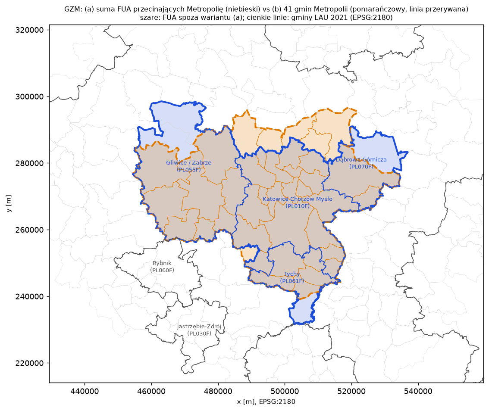

# Zwartość i potencjał transportowy polskich aglomeracji: raport (fazy 0–4)

Stan na 2026-11-24. Sekcje 1–13 opisują fazę 0 (inwentaryzację i decyzje, stan z 2026-11-23); wyniki są w sekcjach 14 (gęstość), 15 (częsta komunikacja i podaż), 17 (dostępność), 18 (mapa), 19 (gęstość × częstotliwość) i 20 (łatwość przesiadki); sekcja 21 opisuje przegląd literatury z 2026-11-24 i zmiany, które z niego wynikły. Liczby w sekcjach 1–13 są liczbami inwentaryzacyjnymi, przepisanymi z plików w `results/qa/phase0/`, `data/manifest.csv` i `config.yaml`; przy każdej podano plik źródłowy. Gdzie czegoś nie sprawdzono, stoi „nie zweryfikowano”; gdzie danych nie ma, „brak danych”.

Do czego wyniki się nadają, a do czego nie: §16.

Daty danych: ludność 2020 (GHSL) i 31.03.2021 (NSP), granice 2021, rozkłady jazdy 2026 (pobrane 2026-11-23), OSM stan na 2026-11-22. Każdy późniejszy wynik będzie podawał ludność i rozkład z osobnymi datami.

## 1. Stan prac

Faza 0 jest zakończona. Zgodnie z briefem (§9) potok zatrzymuje się tutaj i czeka na decyzje z sekcji 12.

| Faza | Zakres | Status |
|---|---|---|
| 0. Inwentaryzacja | pobranie źródeł, tabele feedów, warianty GZM, dzień referencyjny, zasięg miejsc pracy, integracja taryfowa | wykonana; STOP, czeka na decyzje (sekcja 12); pokrycie GTFS: sekcja 6 |
| 1. Gęstość | §4.1–4.4 briefu, kontrola GHSL vs NSP (§7.1) | wykonana 2026-11-23 dla 13 aglomeracji; sekcja 14 |
| 2. Częsta komunikacja i podaż | §4.5, §4.7 | wykonana 2026-11-24 dla 7 aglomeracji fazy 1; sekcja 15 |
| 3. Dostępność | §4.6 | wykonana 2026-11-24 dla 7 aglomeracji fazy 1; sekcja 17 |
| 4. Mapa | §8 | wykonana 2026-11-24 (sześć warstw kafli i warstwa punktowa zespołów przystanków, ciemny motyw); sekcja 18 |
| 5. Faza 2 miast | §4.1–4.3 dla Szczecina, Bydgoszczy–Torunia, Lublina, Rzeszowa, Kielc, Białegostoku | nie rozpoczęta |
| 6. Warstwy dodatkowe | §13 briefu | dwie warstwy spoza listy (gęstość × częstotliwość, sekcja 19; łatwość przesiadki, sekcja 20); kolejne zatwierdzone w §12.2; 6b (GTFS-RT) odłożona decyzją właściciela, sekcja 10 |
| – Przegląd literatury | metody i wyniki na tle literatury i niezależnych źródeł | wykonany 2026-11-24; wynikające z niego zmiany (kolory mapy, próg 5 000 os./km², stosunek średnich jako wynik główny, siatka spisowa w miarach formy, przesiadki jako suma dojścia i czekania): sekcje 20 i 21 |

Dwa elementy fazy 0 pozostały niepełne i są opisane w sekcjach 4 i 9: pełna kontrola GHSL vs NSP należy do fazy 1, a wartości PNFT z Atlasu ITDP dla polskich miast nie zostały uzyskane.

## 2. Dane i wersje

Źródło: [`data/manifest.csv`](../data/manifest.csv) (URL, data pobrania, SHA-256 i licencja każdego pliku). Surowe dane leżą w `data/raw/` i nie są w repozytorium.

### 2.1 Dane inne niż GTFS

| Źródło | Wersja / data danych | Pobrano | Licencja | Do czego |
|---|---|---|---|---|
| GHS-POP R2023A, 100 m, Mollweide (2 kafle R3_C20, R4_C20) | epoka 2020 (model) | 2026-11-23 | CC BY 4.0 (JRC GHSL) | ludność 100 m i 250 m: dostępność, warstwy, kontrola z NSP |
| GHS-BUILT-S R2023A, 100 m (kafle R3_C20, R4_C20) | epoka 2020 | 2026-11-23 | CC BY 4.0 (JRC GHSL) | maska terenu zabudowanego netto (§4.3–4.4) |
| NSP 2021, siatka 1 km, zmienna `RES` (GUS, ATOM PD.GRID.2021, EPSG:2180) | 2021-03-31 | 2026-11-23 | GUS INSPIRE: brak warunków dostępu i użycia; cytować GUS NSP 2021 | główna ludność do miar gęstości (§4.1–4.4) |
| Eurostat GISCO Urban Audit (URAU) 2021, skala 100K: FUA, miasta, punkty, atrybuty | 2021 | 2026-11-23 | warunki GISCO, patrz sekcja 13 | granice FUA i rdzeni |
| Eurostat GISCO LAU 2021 (1:1 mln) | 2021 | 2026-11-23 | jak wyżej | granice i powierzchnie gmin, przypisanie gmin |
| Eurostat GISCO NUTS 2021, poziom 2 | 2021 | 2026-11-23 | „GISCO / EuroGeographics, free reuse with attribution” | pomocniczo: przypisanie przystanków OSM do województw |
| OSM, `poland-latest.osm.pbf` (Geofabrik), 2 121 958 441 B | stan danych 2026-11-22T21:20:48Z | 2026-11-23 | ODbL 1.0 | przystanki (maska pokrycia), później sieć piesza i rowerowa |
| Goliszek S. (IGiPZ PAN), miejsca pracy i ludność w wieku produkcyjnym, 7 miast, doi:10.17632/mr9ywkgd9t.1 | v1, 2026-09-29 | 2026-11-23 | CC BY 4.0 | miejsca pracy w dostępności (§4.6) |
| MobilityData gtfs-validator 8.0.1 | v8.0.1 | 2026-11-23 | Apache-2.0 | walidacja feedów |

### 2.2 Feedy GTFS (12)

Źródła: [`feeds_inventory.md`](qa/phase0/gtfs/feeds_inventory.md), [`validator_summary.csv`](qa/phase0/gtfs/validator_summary.csv), [`reference_day.md`](qa/phase0/gtfs/reference_day.md), [`duplicate_trips_check.csv`](qa/phase0/gtfs/duplicate_trips_check.csv). „Ważność” to pierwszy i ostatni dzień, w którym feed ma kursy (z `calendar.txt` i `calendar_dates.txt`), nie wartość z `feed_info.txt`. Kursy w dniu 2026-11-25 po usunięciu dokładnych duplikatów. Wszystkie pobrane 2026-11-23.

| Feed | Wydawca | Ważność (dni z kursami) | Licencja | Błędy walidatora | Kursy 2026-11-25 |
|---|---|---|---|---:|---:|
| `warsaw_ztm` | ZTM Warszawa, nieoficjalne przepakowanie M. Kuranowskiego (mkuran.pl) | 2026-11-23 – 2026-12-23 | warunki ZTM Warszawa + ODbL (kształty autobusów z OSM) | 289 | 35 603 |
| `warsaw_wkd` | Warszawska Kolej Dojazdowa (mkuran.pl) | 2025-12-14 – 2026-12-12 | CC0 1.0 | 0 | 192 |
| `krakow_bus` | ZTP Kraków | 2026-11-14 – 2028-01-31 | CC BY 4.0 | 0 | 10 280 |
| `krakow_tram` | ZTP Kraków | 2026-11-21 – 2027-02-19 | CC BY 4.0 | 0 | 3 710 |
| `krakow_mobilis` | ZTP Kraków (linie podmiejskie Mobilis) | 2026-11-18 – 2028-01-31 | CC BY 4.0 | 0 | 2 590 |
| `wroclaw` | UM Wrocławia, Wydział Transportu | 2026-11-23 – 2026-12-06 | CC0 1.0 | 0 | 12 849 |
| `poznan` | ZTM Poznań | 2026-11-24 – 2026-12-05 | zasady korzystania ZTM Poznań | 0 | 12 074 |
| `lodz` | Miasto Łódź, portal Otwarte dane (MPK-Łódź) | 2026-11-22 – 2026-12-31 | licencja portalu, nazwa niepodana (sekcja 13) | 64 | 10 229 |
| `gdansk` | ZTM w Gdańsku | 2026-11-23 – 2026-12-07 | CC BY 4.0 | 0 | 7 049 |
| `gdynia` | ZDiZ Gdynia (rozkłady ZKM) | 2026-11-23 – 2027-01-29 | CC BY 4.0 | 0 | 4 911 |
| `gzm` | ZTM GZM, mirror wersji rozszerzonej | 2026-11-08 – 2026-11-28 | CC BY 4.0 | 28 962 | 22 868 (surowo 30 561) |
| `polish_trains` | PKP PLK, przepakowanie mkuran.pl | 2026-11-21 – 2026-12-23 | warunki PKP PLK i Kolei Mazowieckich | 1 | 7 453 |

Liczba tras, przystanków i kursów oraz kompletność pól (kształty, `parent_station` i inne) są w [`feeds_inventory.md`](qa/phase0/gtfs/feeds_inventory.md). `krakow_mobilis` nie było w tabeli briefu; dodany w fazie 0 jako trzeci oficjalny feed ZTP (33 trasy).

**Znane defekty feedów:**

- **GZM, duplikaty kursów.** 15 117 kursów (23,18 % feedu) to dokładne duplikaty: to samo `service_id`, linia, kierunek, przystanki i czasy, inne `trip_id`, ten sam `block_id`. Wygląda to na sklejenie kilku dobowych plików w jeden zip. W dniu 2026-11-25 duplikatów jest 7 693 z 30 561 kursów (25,17 %); stąd 22 868 kursów po usunięciu. Liczby 23,18 % i 25,17 % dotyczą różnych zakresów (cały feed vs jeden dzień). Walidator zgłasza dla tego feedu 28 962 błędów, głównie `block_trips_with_overlapping_stop_times` (20 600) i `decreasing_or_equal_stop_time_distance` (8 353), co zgadza się z obrazem sklejonych plików, ale przyczyny w kodzie nie sprawdzano.
- **GZM, nieaktualny mirror.** Okno kursów kończy się 2026-11-28. Oficjalny portal publikuje 7 plików dobowych (po ok. 11 MB) generowanych codziennie; wg [`candidate_feeds.md`](qa/phase0/gtfs/candidate_feeds.md) mirror na GitHubie jest nieaktualny od 8.11.
- **Kraków, autobusy.** W `krakow_bus` i `krakow_mobilis` po 2 `service_id` z `calendar_dates.txt` nie ma żadnego kursu w `trips.txt`, więc 117 dat nie ma kursów: wszystkie czwartki i piątki od 26.11. Dni te nie nadają się na dzień referencyjny, dopóki ZTP nie poprawi feedu. Czwartek 2026-11-26 wypada przez to ze wspólnych kandydatów. Walidator tego nie zgłasza jako błędu (0 błędów); wykrył to dopiero test kalendarza (w ostrzeżeniach jest `service_has_no_active_day_of_the_week`).
- **Łódź, błędy walidatora.** 64 błędy: 61 `foreign_key_violation`, 2 `point_near_origin`, 1 `block_trips_with_overlapping_stop_times`. Treść naruszeń kluczy obcych nie została przeanalizowana (nie zweryfikowano, których plików dotyczą). Uwaga do wcześniejszego opisu: feed łódzki zawiera `calendar.txt` (potwierdzone w zipie i w kolumnie `calendar_txt` w `feeds_inventory.csv`); `calendar.txt` nie mają natomiast `warsaw_ztm`, `warsaw_wkd`, `gdansk`, `gdynia` i `polish_trains` (używają tylko `calendar_dates.txt`, co jest dopuszczalne).
- **Warszawa.** 289 błędów walidatora (`decreasing_or_equal_stop_time_distance` 163, `block_trips_with_overlapping_stop_times` 126); wpływu na liczenie nie oceniano.
- **Koleje.** `polish_trains` ma 1 błąd (`stop_time_with_arrival_before_previous_departure_time`). PKM Gdańsk (linie PolRegio `PR_PM_*`) kursuje dopiero od 2026-12-13, więc w dniu referencyjnym go nie ma.
- **Krótkie okna.** Poznań (12 dni), Wrocław (14), Gdańsk (15) i GZM (21) wygasną w ciągu dwóch–trzech tygodni; Łódź i Poznań publikują pod stałym URL i nadpisują plik. Jedyną gwarancją odtwarzalności jest kopia w `data/raw/gtfs/<feed>/<data>/` z SHA-256 w manifeście.

## 3. Granice

Źródła: [`agglomerations.md`](qa/phase0/boundaries/agglomerations.md), [`gzm_variants.md`](qa/phase0/boundaries/gzm_variants.md), [`centres.md`](qa/phase0/boundaries/centres.md). Podstawa: Eurostat URAU 2021 (skala 100K), kody FUA (`…F`) i rdzeni (`…C`).

| Aglomeracja | Kody FUA | Pow. FUA km² | Pow. rdzenia km² | Gmin w FUA |
|---|---|---|---:|---:|
| Warszawa | PL001F | 9 296 | 516,7 | 97 |
| Kraków | PL003F | 3 345 | 326,4 | 40 |
| Wrocław | PL004F | 3 107 | 292,5 | 21 |
| Poznań | PL005F | 2 279 | 261,7 | 19 |
| Łódź | PL002F | 2 520 | 292,9 | 26 |
| Trójmiasto | PL006F, PL053F | 1 918 | 413,2 | 19 |
| GZM (wariant (a), tymczasowo) | PL010F, PL055F, PL061F, PL070F | 2 592 | 1 062 | 39 |

Faza 2: Szczecin PL007F, Bydgoszcz–Toruń PL008F + PL013F, Lublin PL009F, Rzeszów PL015F, Kielce PL012F, Białystok PL011F; kody rdzeni i pola w pliku [`agglomerations.md`](qa/phase0/boundaries/agglomerations.md). Kody rdzeni: Warszawa PL001C, Kraków PL003C, Wrocław PL004C, Poznań PL005C, Łódź PL002C, Trójmiasto PL006C + PL053C (+ Sopot jako jednostka LAU), GZM 13 miast URAU (PL010C, PL054C, PL055C, PL056C, PL057C, PL059C, PL061C, PL066C, PL069C, PL070C, PL072C, PL074C, PL075C).

**Trójmiasto.** Eurostat nie ma jednej FUA: FUA Gdańsk (PL006F) obejmuje Sopot, a Gdynia ma własną FUA (PL053F). Aglomeracja w tym projekcie to suma dwóch FUA (1 918 km²). Sopot nie jest miastem URAU, więc rdzeń to Gdańsk + Gdynia (miasta URAU) + Sopot jako jednostka LAU. Miasto jest liniowe i nadmorskie, więc miary względem jednego centrum wymagają zastrzeżenia (brief §11); w `config.yaml` Trójmiasto ma dodatkowe centra: Gdynia Główna i Sopot.

**Bydgoszcz–Toruń** (faza 2) to również dwie FUA (PL008F, PL013F), rdzeń z dwóch miast, dwa centra w `config.yaml`.

**Pola rdzeni a pola administracyjne gmin.** Pole URAU i suma pól gmin rdzenia różnią się o ułamek procenta (np. Warszawa 516,7 vs 517,2 km²); powierzchnie administracyjne nie są więc źródłem rozbieżności, ale też nie wolno ich uznawać za miarę miasta (brief §2).

### 3.1 Warianty granicy GZM

Konurbacja nie jest jedną FUA: w URAU 2021 są tu cztery FUA w większości leżące w Metropolii (PL010F Katowice, PL055F Gliwice/Zabrze, PL061F Tychy, PL070F Dąbrowa Górnicza), a PL060F Rybnik dotyka Metropolii śladowo (ok. 0,1 km², artefakt różnicy skal LAU 1:1 mln i URAU 1:100 tys.). Metropolię tworzy 41 gmin (lista wg metropoliagzm.pl; Jaworzno nie należy). Wariant nie został wybrany; liczby tymczasowe używają wariantu (a).

| Wariant | Pow. km² | Gmin | Ludność NSP 2021 | Ludność GHSL 2020 | GHSL vs NSP | Ludność LAU 2021 (BDL) |
|---|---:|---:|---:|---:|---:|---:|
| (a) suma FUA z ≥ 5 % pola w GZM (PL010F, PL055F, PL061F, PL070F) | 2 592 | 39 | 2 057 054 | 2 150 295 | 4,5 % | 2 155 292 |
| (a′) wszystkie FUA dotykające GZM (dodatkowo PL060F Rybnik) | 2 877 | 46 | 2 258 716 | 2 363 791 | 4,7 % | 2 367 727 |
| (b) granica Metropolii GZM, 41 gmin | 2 551 | 41 | 2 129 249 | 2 221 625 | 4,3 % | 2 229 806 |

Różnica (a) minus (b): 404 km² i 46 187 mieszkańców (NSP) leżą w (a) poza GZM (gminy Miedźna, Toszek, Wielowieś, Łazy). Różnica (b) minus (a): 363 km² i 118 382 mieszkańców (NSP) leżą w GZM poza (a) (Mierzęcice, Ożarowice, Siewierz, Tarnowskie Góry, Łaziska Górne, Świerklaniec).

Kompromisy, bez rekomendacji (szczegóły w [`gzm_variants.md`](qa/phase0/boundaries/gzm_variants.md)):

- **(a)** jest spójny z resztą zbioru (wszędzie FUA Eurostatu), obejmuje strefy dojazdów i nie zależy od członkostwa gmin w związku, ale nie pokrywa się z żadną jednostką administracyjną (tabele gminne wymagają reguły przypisania) i zależy od tego, że Eurostat podzielił konurbację na kilka FUA.
- **(b)** odpowiada jednostce znanej odbiorcom, łatwo się sumuje z danymi gminnymi (BDL, LAU) i obejmuje obszar feedu ZTM GZM, ale odcina część stref dojazdów, jest mniej porównywalny z pozostałymi aglomeracjami i zawiera gminy wiejskie (np. Zbrosławice, Rudziniec, Sośnicowice), których FUA nie obejmuje. Zmiana składu Metropolii zmienia obszar.
- Dla obu wariantów obowiązuje bufor 15 km jako domena celów, więc różnica wpływa głównie na miary „na obszarze”.

### 3.2 Centra i węzły

[`centres.md`](qa/phase0/boundaries/centres.md) porównuje współrzędne z `config.yaml` z wynikiem Nominatim (OSM); próg zgłoszenia to 150 m. `config.yaml` nie został zmieniony. Siedem pozycji przekracza próg, a propozycje poprawek są w sekcji 12 (decyzja 2). Białystok (140 m) i Sosnowiec (132 m) są tuż pod progiem.

## 4. Ludność: GHSL 2020 vs NSP 2021 (pierwsze spojrzenie)

Źródło: [`agglomerations.md`](qa/phase0/boundaries/agglomerations.md). Przypisanie NSP: centroid komórki 1 km wewnątrz wielokąta; GHSL: suma komórek 100 m, których środek leży w wielokącie. To pierwsze spojrzenie, nie kontrola z §7.1 briefu: ta należy do fazy 1 (rozkład na 1 km, korelacja, największe różnice, BDL). Daty: GHSL epoka 2020, NSP stan na 31.03.2021. Flaga „TAK” oznacza |różnica| > 5 %.

| Aglomeracja | NSP 2021 FUA | GHSL 2020 FUA | GHSL/NSP FUA | >5 % | NSP 2021 rdzeń | GHSL 2020 rdzeń | GHSL/NSP rdzeń | >5 % |
|---|---:|---:|---:|---|---:|---:|---:|---|
| GZM | 2 057 054 | 2 150 295 | 1,045 | nie | 1 643 705 | 1 738 107 | 1,057 | TAK |
| Kraków | 1 411 779 | 1 350 286 | 0,9564 | nie | 793 392 | 760 841 | 0,959 | nie |
| Łódź | 1 044 086 | 1 045 886 | 1,002 | nie | 665 696 | 670 405 | 1,007 | nie |
| Poznań | 974 744 | 926 610 | 0,9506 | nie | 547 682 | 527 922 | 0,9639 | nie |
| Trójmiasto | 1 089 730 | 1 064 838 | 0,9772 | nie | 752 435 | 736 930 | 0,9794 | nie |
| Warszawa | 3 485 881 | 3 334 987 | 0,9567 | nie | 1 865 105 | 1 785 716 | 0,9574 | nie |
| Wrocław | 1 011 966 | 939 076 | 0,928 | TAK | 673 906 | 634 111 | 0,9409 | TAK |
| Białystok | 448 491 | 462 842 | 1,032 | nie | 281 830 | 298 928 | 1,061 | TAK |
| Bydgoszcz–Toruń | 855 995 | 892 951 | 1,043 | nie | 510 653 | 545 377 | 1,068 | TAK |
| Kielce | 386 456 | 405 621 | 1,05 | nie | 179 303 | 193 979 | 1,082 | TAK |
| Lublin | 664 078 | 680 102 | 1,024 | nie | 322 635 | 332 983 | 1,032 | nie |
| Rzeszów | 459 020 | 458 745 | 0,9994 | nie | 185 929 | 211 037 | 1,135 | TAK |
| Szczecin | 512 051 | 524 618 | 1,025 | nie | 384 375 | 398 002 | 1,035 | nie |

Odchylenia > 5 %: Wrocław (FUA i rdzeń), GZM, Białystok, Bydgoszcz–Toruń, Kielce i Rzeszów (tylko rdzeń). Przyczyn jeszcze nie zbadano. Układ: w pięciu z sześciu aglomeracji fazy 1 poza GZM (Kraków, Poznań, Trójmiasto, Warszawa, Wrocław) GHSL jest poniżej NSP, w Łodzi prawie równy, a w GZM i większości miast fazy 2 powyżej. Przy ocenie trzeba pamiętać, że granice URAU (100K) i siatka nie pokrywają się dokładnie, więc na brzegu FUA liczy się kilka komórek; oba zbiory mają inną datę.

### 4.1 Definicja ludności w siatce spisowej: ustalenie

Pytanie: czy pole `RES` siatki NSP 2021 to ludność rezydująca (usually resident, definicja siatki spisowej UE), a suma siatki 37 019 327 różni się od ok. 38,0 mln ludności wg definicji krajowej właśnie z powodu różnicy definicji.

Wynik: **tak, najpewniej, z jedną niedoskonałością w weryfikacji.**

- Suma siatki (37 019 327, według zadania i `agglomerations.md`: „ok. 37,0 mln”) jest równa co do jednostki liczbie ludności rezydującej z ostatecznych wyników NSP 2021: wyszukiwanie, które cytuje strony GUS, podaje „liczba ludności rezydującej w Polsce liczyła 37 019 327 osób”, a ludność wg definicji krajowej 38 036 118. Różnica to 1 016 791 osób; ludność rezydująca stanowi wg GUS 97,3 % ludności krajowej.
- Definicja GUS: ludność rezydująca to osoby mieszkające lub przebywające na danym terenie co najmniej 12 miesięcy; dane GUS pod nazwą „ludność” w publikacjach i bazach opierają się na krajowej definicji zamieszkania.
- Manifest opisuje źródło jako „siatka 1 km, rezydenci”.
- Źródła: [GUS, rezydenci – ludność rezydująca](https://stat.gov.pl/obszary-tematyczne/ludnosc/ludnosc/rezydenci-ludnosc-rezydujaca,19,1.html) oraz [GUS, NSP 2021 wyniki ostateczne](https://stat.gov.pl/spisy-powszechne/nsp-2021/nsp-2021-wyniki-ostateczne/). **Zastrzeżenie:** liczby 37 019 327, 38 036 118, 1 016 791 i 97,3 % pochodzą z wyników wyszukiwania cytujących te strony; bezpośredni odczyt stron GUS się nie powiódł (strona w PDF nie dała tekstu, druga nie zawierała liczb). Zgodność sumy siatki z liczbą rezydentów co do jednostki jest mocnym, ale pośrednim potwierdzeniem; dokumentacji samej siatki (ATOM PD.GRID.2021) pod kątem definicji pola `RES` nie czytano.

Konsekwencje:

1. Siatka NSP jest o ok. 2,7 % (1,0 mln) niższa od ludności krajowej niezależnie od jakiejkolwiek różnicy w rozkładzie przestrzennym.
2. Jeżeli GHS-POP R2023A jest kalibrowany do sum krajowych zgodnych z definicją krajową (**nie zweryfikowano**; hipoteza), to stosunek GHSL/NSP byłby przesunięty w górę o rząd kilku procent bez żadnego błędu rozkładu. Wtedy flaga 5 % jest zbyt „ostra” po stronie plus i zbyt łagodna po stronie minus. Faza 1 powinna sprawdzić kalibrację GHSL (suma dla Polski) i porównać też z BDL, który używa definicji krajowej.
3. Różnica nie jest równomierna przestrzennie (rezydenci a ludność wg definicji krajowej inaczej liczą osoby przebywające czasowo za granicą lub poza miejscem zameldowania); jej rozkładu nie badano. Obserwacja pomocnicza: ludność LAU 2021 (BDL) dla GZM jest wyższa od sumy siatki o ok. 4,7–4,8 % (wariant (a): 2 155 292 vs 2 057 054), czyli więcej niż średnio 2,7 %; definicji i daty pola LAU nie sprawdzono, więc to tylko sygnał do sprawdzenia w fazie 1.

## 5. Rozkłady jazdy

Źródła: [`reference_day.md`](qa/phase0/gtfs/reference_day.md), [`anomaly_test.csv`](qa/phase0/gtfs/anomaly_test.csv), [`service_by_day.csv`](qa/phase0/gtfs/service_by_day.csv), [`rail_overlap.md`](qa/phase0/gtfs/rail_overlap.md), [`top_stops_preview.csv`](qa/phase0/gtfs/top_stops_preview.csv), [`candidate_feeds.md`](qa/phase0/gtfs/candidate_feeds.md), [`calendar.md`](qa/phase0/research/calendar.md).

### 5.1 Proponowany dzień referencyjny

- **Dzień roboczy: środa 2026-11-25.** Jedyny dzień wt–czw, w którym wszystkie 12 feedów ma kursy, obok wtorku 2026-11-24; spośród nich wybrany o najmniejszym średnim odchyleniu wozokilometrów od mediany dni roboczych w ważności feedu (remis, rozstrzygnięty na środę).
- **Sobota: 2026-11-28**, jedyna wspólna sobota.
- Wspólne dni wt–czw: 2026-11-24 i 2026-11-25. Czwartek 2026-11-26 odpada, bo oba feedy autobusowe Krakowa nie mają kursów (defekt z sekcji 2.2).
- **Dlaczego okno jest tak wąskie.** Ograniczają je najkrótsze okna ważności: GZM kończy 2026-11-28, Poznań zaczyna 2026-11-24 i kończy 2026-12-05, Wrocław kończy 2026-12-06, Gdańsk 2026-12-07. W ważności feedu mieści się: Poznań 9 dni roboczych, Wrocław 10, Gdańsk 11, GZM 14.
- **Ferie i święta.** Terminy ferii zimowych 2027 (MEN, komunikat z 19.05.2026): 18–31.01 (dolnośląskie, łódzkie, opolskie, podkarpackie, podlaskie, śląskie), 1–14.02 (lubelskie, mazowieckie, pomorskie, świętokrzyskie), 15–28.02 (kujawsko-pomorskie, lubuskie, małopolskie, warmińsko-mazurskie, wielkopolskie, zachodniopomorskie). Zimowa przerwa świąteczna 23–31.12.2026. Wigilia jest dniem wolnym od 2025 r. (źródło wtórne; nie zweryfikowano w ustawie). Między 24.11 a 23.12.2026 nie ma świąt państwowych; dni 24–25.11 i sobota 28.11 nie wypadają w feriach żadnego z siedmiu województw. W kalendarzu wspólnym dla siedmiu województw (bez uwzględnienia ważności feedów) czyste są też m.in. 1–3.12, 8–10.12, 15–17.12.2026 oraz 12–14.01.2027; od 18.01 do 28.02.2027 każdy dzień wypada w feriach co najmniej jednego z nich. Szczegóły: [`calendar.md`](qa/phase0/research/calendar.md), który w rekomendacji roboczej wskazuje 1–3.12 (bo nie uwzględnia krótkiego okna GZM); wybór z [`reference_day.md`](qa/phase0/gtfs/reference_day.md) uwzględnia ważność feedów.
- **Alternatywa: odświeżenie GZM z oficjalnych plików dobowych.** Wtedy GZM przestaje ograniczać okno, a ograniczają je Poznań (do 2026-12-05) i Wrocław (do 2026-12-06). W tabeli [`reference_day.md`](qa/phase0/gtfs/reference_day.md) dni 2026-12-01 (wt) i 2026-12-02 (śr) mają kursy w 11 z 12 feedów (bez GZM, którego mirror tych dat nie obejmuje); po odświeżeniu GZM mogłyby stać się dniami wspólnymi. Czy oficjalne pliki dobowe pokryją 2026-12-01/02 w chwili pobrania, nie zweryfikowano (pliki są generowane codziennie i jest ich 7, więc pobranie musi nastąpić blisko tej daty). Czwartek 2026-12-03 nadal odpada z powodu Krakowa.
- Jeśli dzień roboczy i sobota nie wypadną w tym samym tygodniu, trzeba to jawnie odnotować (brief §5).

### 5.2 Test anomalii i jego słabość

Test porównuje wozokilometry w dniu referencyjnym z medianą dni roboczych w ważności feedu. Dla 2026-11-25 odchylenia mieszczą się w przedziale od −0,16 % (`polish_trains`) do +0,0 %; największe poniżej progu 5 % (flaga „nie” dla wszystkich 12 feedów). Dla soboty 2026-11-28 największe odchylenie to +0,06 % (`polish_trains`). Pełne dane: [`anomaly_test.csv`](qa/phase0/gtfs/anomaly_test.csv).

Moc testu jest słaba: mediana dla krótkich feedów pochodzi z tego samego 2–3-tygodniowego okna co dzień referencyjny (liczba dni w medianie 9–14 dla dni roboczych, 2–4 dla większości sobót), a dla feedów długich (Kraków, WKD, kolej) obejmuje okresy wakacyjne i feryjne. Test nie wykryje feedu, który jest „feryjny” lub objazdowy w całym oknie; do tego potrzebne jest porównanie z poprzednim rozkładem (archiwum `data/raw/gtfs/`).

### 5.3 Deduplikacja kolei

`polish_trains` zawiera m.in. Koleje Mazowieckie, SKM Warszawa, SKM Trójmiasto, Koleje Śląskie, Koleje Dolnośląskie, Koleje Małopolskie, Koleje Wielkopolskie (linie PKM1–PKM5), ŁKA, PolRegio, PKP Intercity, Arriva RP, RegioJet i Leo Express; nie zawiera WKD (osobny feed). SKM Warszawa występuje dwukrotnie: 284 kursy w `warsaw_ztm` i 284 w `polish_trains`; dopasowanie (linia, przystanek początkowy, minuta odjazdu) daje 100,0 %. Proponowana reguła ([`rail_overlap.md`](qa/phase0/gtfs/rail_overlap.md), §5):

1. Jednostka zliczania to kurs w dniu referencyjnym; klucz dopasowania: linia, znormalizowana nazwa przystanku początkowego w promieniu 100 m, minuta odjazdu.
2. SKM Warszawa: zostaje wersja z `warsaw_ztm`, agencja `SKM` z `polish_trains` jest odrzucana przed zliczaniem.
3. Pozostała kolej regionalna: jedyne źródło to `polish_trains`, kursy liczone raz po przycięciu do FUA + bufor.
4. WKD tylko z `warsaw_wkd`.
5. Autobusową komunikację zastępczą (route_type 3) z `polish_trains` wyłączyć z miar kolejowych.
6. Ogólnie: przy powtórzeniu kursu wygrywa feed miejski; odrzucone kursy zapisywane w `results/qa/` z liczbą per aglomeracja.

PKM Gdańsk trzeba wybierać po `route_id` (`PR_PM_*`), nie po `agency_id`.

### 5.4 Podgląd przystanków o największej liczbie odjazdów

[`top_stops_preview.csv`](qa/phase0/gtfs/top_stops_preview.csv): po 10 przystanków na aglomerację, odjazdy 6:00–20:00 w dniu 2026-11-25, wszystkie linie i oba kierunki zsumowane (po 14 godzin). Zastrzeżenia:

- To podgląd kontrolny z §7.3 briefu, nie miara częstotliwości. Liczba odjazdów na godzinę to suma po liniach i kierunkach, nie odstęp.
- We wszystkich 70 wierszach kolumny `deps_metro` i `deps_rail` wynoszą 0, także dla przystanków o nazwach typu „Metro Młociny” i „Dw. Centralny”. Podgląd nie zawiera więc metra ani kolei (feed `polish_trains` nie występuje w kolumnie `feeds`). Przyczyna sprawdzona na przykładzie „Centrum” w `warsaw_ztm`: perony metra mają własną stację nadrzędną (`parent_station` = `7013M`), a przystanki naziemne o tej samej nazwie jej nie mają, więc podgląd tworzy z nich dwa osobne klastry; sam klaster metra lub kolei nie mieści się w pierwszej dziesiątce pod względem liczby odjazdów. To ograniczenie podglądu, a nie brak kursów w danych. Właściwe scalanie słupków i peronów w promieniu ok. 100 m (brief §4.5) należy do fazy 2.
- GZM: liczniki po usunięciu duplikatów (kolumna surowa je zawiera), udział duplikatów w wierszach top-10 od 22,9 % do 46,7 %; wiersze oznaczone flagą. Dodatkowo wiersze GZM 1, 3 i 10 oraz Trójmiasto (Łostowice Świętokrzyska 04, 10,7 %) mają flagę „możliwe zdublowane odjazdy tej samej linii w tej samej minucie” (`dup_same_feed_pct`).
- Współrzędne zaokrąglone do dwóch miejsc po przecinku.
- W Trójmieście osobne feedy Gdańska i Gdyni nie są łączone w jeden przystanek.

### 5.5 Kandydaci na dodatkowe feedy

Żaden nie jest w `config.yaml` ani w `data/raw/`; sprawdzono tylko odpowiedź serwera 2026-11-23 (zawartości nie analizowano). Pełna lista z URL i licencjami: [`candidate_feeds.md`](qa/phase0/gtfs/candidate_feeds.md). Do decyzji (sekcja 12):

| Aglomeracja | Kandydaci | Uwagi |
|---|---|---|
| Kraków | Skawina, Niepołomice, Koleje Małopolskie ALD (autobusy dowozowe do SKA) | |
| Wrocław | Polbus, Oleśnica, Oborniki Śląskie | Oborniki: nie sprawdzono; KD wymaga ręcznego pobrania (HTTP 401) |
| Poznań | PKS Poznań, Środa Wlkp. | Kombus Kórnik jest już agencją w feedzie ZTM Poznań |
| Łódź | Zgierz, Pabianice, Aleksandrów Łódzki, Stryków, ŁKA bus, zbiór społecznościowy | ryzyko duplikatów z MPK Łódź; zbiór społecznościowy ma nieznaną licencję |
| Trójmiasto | Tczew, Wejherowo/Rumia/Reda | Wejherowo: brak URL, nie sprawdzono |
| GZM | pliki dobowe z portalu GZM (odświeżenie), Rybnik, Jastrzębie-Zdrój, Bielsko-Biała | trzy ostatnie poza GZM; tylko jeśli FUA wejdzie do wariantu |
| Warszawa | Pruszków, GPA, Mińsk Maz., Łomianki, Ząbki i inne | ryzyko dublowania z `warsaw_ztm` |

Licencje agregatorów (`zbiorkom.live`, `files.girlc.at`) to licencje powtórnej publikacji, nie warunki organizatora; przed użyciem trzeba je sprawdzić.

## 6. Pokrycie GTFS (wstępne)

Metoda, tabele i ograniczenia: [`coverage.md`](qa/phase0/coverage/coverage.md); dane: [`coverage_summary.csv`](qa/phase0/coverage/coverage_summary.csv), [`coverage_by_gmina.csv`](qa/phase0/coverage/coverage_by_gmina.csv), [`coverage_by_ring.csv`](qa/phase0/coverage/coverage_by_ring.csv), [`unmatched_operators.csv`](qa/phase0/coverage/unmatched_operators.csv), [`population_coverage_preliminary.csv`](qa/phase0/coverage/population_coverage_preliminary.csv). Mapy i histogramy odległości per aglomeracja: `qa/phase0/coverage/map_<id>.png`, `nn_hist_<id>.png`. Kod: `pipeline/stop_coverage.py`. Przystanki OSM: stan 2026-11-22; rozkłady: dzień 2026-11-25; GZM w tymczasowym wariancie sumy FUA.

Wskaźnik pokrycia to odsetek przystanków OSM (po deduplikacji, w granicach FUA), które mają odpowiednik wśród przystanków GTFS obsługiwanych w dniu referencyjnym. Mierzy obecność przystanku w danych, nie liczbę kursów: przystanek z jednym kursem dziennie liczy się tak samo jak przystanek z dwustoma.

### 6.1 Wynik

Pokrycie w %, wszystkie tryby; w nawiasie liczba przystanków OSM w FUA (mianownik).

| Aglomeracja | FUA | Rdzeń | Poza rdzeniem | Autobus (FUA) | Tramwaj (FUA) | Kolej (FUA; liczba stacji) |
|---|---|---|---|---|---|---|
| Warszawa | 59,9 (12 781) | 97,2 | 35,8 | 56,6 | 99,1 | 98,6 (207) |
| Kraków | 59,8 (6 419) | 96,1 | 36,9 | 56,3 | 91,5 | 95,9 (73) |
| Wrocław | 71,1 (3 491) | 97,7 | 35,2 | 70,5 | 98,3 | 100 (83) |
| Poznań | 86,2 (3 770) | 94,9 | 78,9 | 87,5 | 97,1 | 100 (62) |
| Łódź | 68,2 (3 756) | 96,3 | 29,9 | 62,8 | 89,9 | 100 (56) |
| Trójmiasto | 71,1 (3 968) | 96,5 | 35,8 | 68,1 | 96,0 | 93,5 (62) |
| GZM | 94,7 (6 246) | 96,9 | 89,2 | 94,8 | 95,4 | 93,5 (77) |

Rdzenie są pokryte w 95–98 %. Poza rdzeniem dobrze pokryte są tylko GZM (89 %) i Poznań (79 %), czyli aglomeracje, w których organizator obejmuje gminy ościenne. W Warszawie, Krakowie, Łodzi, Wrocławiu i Trójmieście poza rdzeniem odpowiednik w GTFS ma 30–37 % przystanków: brakuje przewoźników gminnych i prywatnych. Kolej (feed ogólnopolski) jest pokryta niemal w całości.

### 6.2 Ludność w obszarze pokrytym (wstępnie)

Odsetek ludności FUA (NSP 2021, siatka 1 km, komórki przypisane centroidem) mieszkającej w gminach o pokryciu co najmniej równym progowi. Definicja właściwej maski należy do fazy 2; tu pokazano wrażliwość na próg.

| Aglomeracja | próg 50 % | próg 70 % | próg 85 % |
|---|---|---|---|
| Warszawa | 73,2 | 66,6 | 60,0 |
| Kraków | 71,1 | 67,3 | 65,6 |
| Wrocław | 78,5 | 74,5 | 68,5 |
| Poznań | 92,7 | 92,7 | 86,6 |
| Łódź | 68,3 | 67,4 | 65,7 |
| Trójmiasto | 77,7 | 77,7 | 75,0 |
| GZM | 98,7 | 97,5 | 96,3 |

Regułę briefu (§6: poniżej ok. 85 % ludności FUA w obszarze pokrytym wynik jest niepełny) spełniają tylko GZM i, w wariancie gminnym, Poznań (w wariancie komórkowym przy progu 85 % Poznań spada do 80,5 %). **Pięć z siedmiu aglomeracji będzie miało wyniki transportowe z §4.5–4.7 oznaczone jako niepełne dla FUA niezależnie od wyboru progu**; do porównań między miastami trzeba będzie użyć wariantu „obszar pokryty” albo „rdzeń”. Udział ludności FUA w gminach o pokryciu poniżej 50 %: Warszawa 26,6 %, Kraków 28,7 %, Łódź 31,7 %, Trójmiasto 22,3 %, Wrocław 21,4 %, Poznań 7,3 %, GZM 1,3 %.

### 6.3 Promień dopasowania

- **Autobus i tramwaj: 50 m (jak w briefie) oraz dopasowanie zapasowe po nazwie lub kodzie przystanku w promieniu 200 m.** Histogram odległości ma dwie wyraźne grupy: ostry szczyt poniżej ok. 20 m (ten sam przystanek) i długi ogon setek metrów (brak odpowiednika). Test kontrolny z losowym przesunięciem punktów OSM o 200–400 m daje 2–4 % przypadkowych dopasowań przy 50 m, 10–11 % przy 100 m i ok. 20 % przy 150 m, więc większy promień dodaje głównie sąsiednie przystanki. Z dopasowaniem zapasowym pokrycie zmienia się o 1–2,5 pkt proc. między 30 a 150 m: wybór promienia nie zmienia wniosków.
- **Kolej: 200 m oraz nazwa w promieniu 500 m.** Pokrycie kolejowe liczone samą odległością przestaje rosnąć przy 150–200 m; 300 m daje ten sam wynik.
- Dopasowanie uwzględnia tryb: przystanek autobusowy nie jest „pokryty” przez sam przystanek tramwajowy obok. Wyjątek: 35 przystanków tramwajowych w Krakowie i 42 w Łodzi nie ma w dniu referencyjnym kursów tramwajowych, ale ma obsługiwany przystanek autobusowy 5–20 m dalej (prawdopodobnie komunikacja zastępcza na czas remontu; wniosek z danych, nie zweryfikowano). W pokryciu „wszystkie tryby” liczą się jako pokryte, w kolumnie „tramwaj” nie.

### 6.4 Brakujący przewoźnicy

Na podstawie znaczników `network`/`operator` niedopasowanych przystanków OSM. Większość takich przystanków nie ma żadnego znacznika, więc to próba, nie inwentarz.

| Aglomeracja | Przewoźnicy i obszary bez danych |
|---|---|
| Warszawa | Grodziskie Przewozy Autobusowe (262 przystanki), PKS Grójec (248), Nadwiślańska Komunikacja Autobusowa (160), Pruszkowska Komunikacja Miejska (ok. 137), BKM Otwock (79), Nowodworska KA (66), powiat legionowski; bez znaczników: Mińsk Mazowiecki, Błonie, Brwinów, Żyrardów |
| Kraków | Małopolskie Linie Dowozowe (871), Niepołomicka Komunikacja Gminna (ok. 140), Skawińska KG; bez znaczników: Miechów, Krzeszowice, Myślenice, Dobczyce |
| Łódź | MZK Pabianice (miasto Pabianice pokryte w 16 %) i MUK Zgierz (miasto Zgierz 40 %): to miejskie sieci, nie linie wiejskie; także Łask, Koluszki, Stryków, Tuszyn, Brójce |
| Trójmiasto | MZK Wejherowo (163; Wejherowo 16 %, Reda 20 %), PKS Gdynia (51), Albatros (Żukowo); bez znaczników: Trąbki Wielkie, Przywidz, Cedry Wielkie, Kolbudy, gmina wiejska Pruszcz Gdański |
| Wrocław | Siechnicka Komunikacja Publiczna, autobusy gminne Czernicy i Kobierzyc; bez znaczników: Oleśnica, Trzebnica, Oborniki Śląskie, Żmigród |
| Poznań | Pobiedziska, Kostrzyn, Stęszew, Łubowo |
| GZM | tylko gminy skrajne: Rudziniec (22 %), Miedźna (25 %), Sośnicowice, Łazy |

Czy ci przewoźnicy publikują GTFS, nie sprawdzano poza listą kandydatów z sekcji 5.5; najwięcej dałyby MZK Pabianice, MUK Zgierz i MZK Wejherowo.

### 6.5 Ograniczenia

- **OSM jako mianownik.** Obsługiwane przystanki GTFS bez przystanku OSM tego samego trybu w promieniu 50 m: przedmieścia Poznania ok. 15 %, Wrocławia ok. 16 %, GZM ok. 7 %, gdzie indziej 1–6 %, kolej prawie 0. Tam, gdzie OSM jest tak niepełny, wskaźnik pokrycia jest zawyżony, bo w OSM zapewne brakuje też przystanków przewoźników nieobecnych w GTFS.
- **Błędne znaczniki peronów.** Wiele obiektów `railway=platform` w OSM to perony tramwajowe lub autobusowe. Perony w promieniu kolejowym od stacji OSM są łączone ze stacją, pozostałe traktowane jako tryb nieznany (2–56 na aglomerację, 56 w GZM). Koleje wąskotorowe, parkowe i drezynowe oraz kolej linowa w Gdyni są wyłączone z mianownika regułami po nazwie i operatorze (35 stacji). To heurystyki dodane w module pokrycia; sama ekstrakcja OSM jest bez zmian.
- Niedopasowane przystanki w rdzeniach (np. ok. 90 ze znacznikiem „ZTM Warszawa”) leżą zwykle 50–300 m od najbliższego przystanku GTFS: prawdopodobnie czasowo nieobsługiwane, przeniesione albo nieaktualne w OSM (nie zweryfikowano).
- Nie wyjaśniono: braku kursów tramwajowych na części przystanków w Krakowie i Łodzi w dniu referencyjnym; niedopasowanych przystanków ze znacznikiem „Wrocław” w Siechnicach i Długołęce oraz „ZTM Warszawa” w Sulejówku; położenia stacji Szczepanowice (w GTFS ok. 1 km od węzła OSM). Nie sprawdzono, jak granica „metropolia” zmieniłaby wynik skrajnych gmin GZM.

### 6.6 Po dodaniu feedów podmiejskich (2026-11-23)

Sekcje 6.1–6.5 opisują stan na 12 feedach z briefu. Zgodnie z decyzją 12 (sekcja 12.0) dodano 30 feedów przewoźników podmiejskich i powtórzono kontrolę. Dziennik decyzji per kandydat (dodany, odrzucony, nie znaleziono; URL, licencja, powód): [`candidate_feeds.md`](qa/phase0/gtfs/candidate_feeds.md). Zmiana pokrycia per gmina: [`coverage_change.md`](qa/phase0/coverage/coverage_change.md). Pliki CSV w `qa/phase0/coverage/` odpowiadają już stanowi po dodaniu (42 feedy).

Pokrycie w %, wszystkie tryby, przed → po:

| Aglomeracja | FUA | Rdzeń | Poza rdzeniem | Ludność w gminach o pokryciu ≥ 85 % |
|---|---|---|---|---|
| Warszawa | 59,9 → 81,0 | 97,2 → 97,2 | 35,8 → 70,6 | 60,0 → 77,8 |
| Kraków | 59,8 → 80,1 | 96,1 → 97,8 | 36,9 → 69,0 | 65,6 → 73,1 |
| Wrocław | 71,1 → 77,9 | 97,7 → 97,7 | 35,2 → 51,2 | 68,5 → 71,5 |
| Łódź | 68,2 → 89,1 | 96,3 → 96,3 | 29,9 → 79,4 | 65,7 → 84,2 |
| Trójmiasto | 71,1 → 76,4 | 96,5 → 96,5 | 35,8 → 48,5 | 75,0 → 81,2 |
| Poznań | bez zmian | bez zmian | bez zmian | 86,6 |
| GZM | bez zmian | bez zmian | bez zmian | 96,3 |

Regułę 85 % z briefu §6 nadal spełniają tylko Poznań i GZM; Łódź jest najbliżej (84,2 %). Wyniki transportowe dla FUA pozostałych pięciu aglomeracji będą oznaczone jako niepełne, ale luka jest wyraźnie mniejsza.

**Zastrzeżenie o pochodzeniu danych.** Z 30 dodanych feedów tylko dwa pochodzą od wydawcy lub mają jawnie podaną licencję u źródła (`krakow_ald`: Koleje Małopolskie, linie dowozowe; `trojmiasto_wejherowo`: MZK Wejherowo z mkuran.pl, CC0). Pozostałe 28 to nieoficjalne przepakowania rozkładów (girlc.at, zbiorkom.live, feed.gtfs.cc, kasznia.net, repozytoria GitHub). Licencje CC0, MIT lub CC BY podane w katalogach transitous i Mobility Database dotyczą samego przepakowania; warunków przewoźników nie udało się odczytać. Zgodności tych feedów z oficjalnymi rozkładami nie zweryfikowano. Trzy są ułożone ręcznie ze stałym tygodniowym wzorcem (`warsaw_czosnow`, `warsaw_zakroczym`, `wroclaw_oborniki`), a `lodz_suburban_qbx` (sześciu prywatnych przewoźników) nie ma żadnej licencji i jest oznaczony jako niskiej wiarygodności. Surowych feedów repo nie redystrybuuje; liczone są z nich tylko agregaty. Faza 2 powinna pokazać każdy wynik w dwóch wariantach: na feedach oficjalnych oraz na wszystkich, żeby było widać, ile zależy od danych nieoficjalnych.

Pozostałe ustalenia:

- Wszystkie 42 feedy mają kursy w środę 2026-11-25. W sobotę 2026-11-28 pięć feedów nie ma kursów w rozkładzie (`warsaw_halinow`, `warsaw_sulejowek`, `lodz_strykow`, `wroclaw_olesnica`, `wroclaw_oborniki`).
- Jedyny stwierdzony dubel: linie 6 i 61 MUK Zgierz to te same kursy co linie 6 i 61 MPK Łódź (148 z 447 kursów, identyczne minuty odjazdu). Są odfiltrowane kluczem `drop_routes` w `config.yaml` i liczą się raz, w feedzie `lodz`. Test dublowania: linia + nazwa pierwszego przystanku + minuta odjazdu, wobec 12 feedów bazowych i pozostałych kandydatów.
- Odrzucono 15 kandydatów (duplikaty istniejących feedów, obszary poza FUA, feed wygasły lub z licencją NC). PKS Poznań nie dał się pobrać (błąd TLS po przekierowaniu); nie obchodzono tego.
- Feedu nie znaleziono m.in. dla: PKS Grójec, Nadwiślańskiej Komunikacji Autobusowej, Legionowa (Warszawa); Miechowa, Krzeszowic, Wieliczki (Kraków); Łasku (Łódź); PKS Gdynia, Żukowa, Kolbud, Pruszcza Gdańskiego (Trójmiasto); Siechnic, Czernicy, Kobierzyc, Trzebnicy (Wrocław); Pobiedzisk, Kostrzyna, Stęszewa (Poznań). „Nie znaleziono” oznacza wynik wyszukiwania, nie dowód, że feed nie istnieje.
- Większość przepakowanych feedów ma ważność do 2026-11-28 lub kilka tygodni dłużej; surowe pliki z datą pobrania zostają w `data/raw/gtfs/` jako podstawa liczenia.

## 7. Miejsca pracy (zbiór Goliszek)

Źródło: [`jobs_inventory.md`](qa/phase0/jobs/jobs_inventory.md). Goliszek S. (IGiPZ PAN), *Spatially disaggregated working-age population and job estimates for seven Polish cities with a 2025 allocation horizon*, Mendeley Data v1, doi:10.17632/mr9ywkgd9t.1, CC BY 4.0, publikacja 2026-09-29.

**Pliki.** `Jobs_2025_7_Cities.gpkg` (50 631 obiektów, pole `Jobs_25`, suma 3 252 262 miejsc pracy) i `Workers_2025_7_Cities.gpkg` (138 601 obiektów, `Workers_25`, suma 3 618 940 osób w wieku produkcyjnym; to ludność w wieku produkcyjnym, nie zatrudnieni). Wartości ułamkowe, tylko komórki z wartością dodatnią. Pliki łączy się geometrią, nie polem `Id`.

**Siatka.** Komórki 100 m w Mollweide (siatka GHSL R2023A), zapisane w EPSG:2180 (ESRI:102173); 11 % komórek Jobs i 13 % Workers jest niepełnych. Część obiektów to kilka scalonych komórek (2 %), więc przed połączeniem z siatką 250 m trzeba rasteryzować i rozdzielać proporcjonalnie do pola. Horyzont 2025 dotyczy epoki kubatury GHSL, nie roku danych o pracy; ludność do dostępności pochodzi z epoki 2020, co trzeba wpisać w ograniczenia.

**Metoda autora.** Dane wejściowe to strefy modeli ruchu miast; rozkład wewnątrz strefy wg kubatury niemieszkaniowej GHSL (miejsca pracy) i mieszkaniowej (ludność); bez masek terenu; autor nie waliduje dokładności względem spisu ani zatrudnienia. Wyniki to estymaty alokacyjne.

| Miasto | Miejsca pracy | Wiek produkcyjny | Praca / ludność w w.p. | Lata wejściowe (wg autora) | Pokrycie miasta | Pokrycie FUA |
|---|---:|---:|---:|---|---:|---:|
| Gdańsk | 235 656 | 215 091 | 1,10 | nie podano | 58 % | 10 % |
| Kraków | 294 608 | 480 058 | 0,61 | nie podano | 70 % | 7 % |
| Łódź | 299 571 | 457 829 | 0,65 | 2023 | 71 % | 8 % |
| Poznań | 346 243 | 305 088 | 1,13 | 2019, aktualizacja do 2025 zmianą kubatury GHSL 2020–2025 | 60 % | 7 % |
| Szczecin | 125 018 | 371 441 | 0,34 | prognoza na 2025 z badania ruchu z 2016 | 33 % | 7 % |
| Warszawa | 1 506 972 | 1 343 650 | 1,12 | nie podano | 73 % | 4 % |
| Wrocław | 444 195 | 445 783 | 1,00 | nie podano | 60 % | 6 % |
| Razem | 3 252 262 | 3 618 940 | 0,90 | | | |

„Pokrycie” to udział powierzchni miasta (FUA wg URAU 2021, bez bufora) przykryty footprintem komórek z danymi. Pokrycie miasta poniżej 100 % oznacza prawdopodobnie tereny bez kubatury GHSL (lasy, wody, pola), ale to hipoteza, nie sprawdzona względem pokrycia terenu.

**Zasięg przestrzenny: kluczowe ograniczenie.** Dane obejmują miasta w granicach administracyjnych (100 % sumy w mieście, nie więcej niż 1 % footprintu poza miastem w Gdańsku), nie FUA, i nie obejmują GZM. Dla Trójmiasta jest tylko Gdańsk, bez Gdyni i Sopotu. Skutki dla miary z §4.6 briefu:

- dla GZM i Gdyni/Sopotu wynik miejsc pracy to „brak danych”;
- dla pozostałych miast dostępność miejsc pracy z gmin podmiejskich spoza footprintu jest nieobliczalna („brak danych”, nie 0), a miejsca pracy leżące poza footprintem nie są wliczone do liczby osiągalnych w 30/45 min, co zaniża wynik w pobliżu granicy zasięgu;
- porównania między miastami wymagają adnotacji o różnych latach i różnym stopniu modelowania.

**Do wyjaśnienia przed użyciem.**

- Szczecin: footprint obejmuje tylko 33 % powierzchni miasta (Jobs 62 km², Workers 94 km² przy 301 km² miasta). Przyczyna niewyjaśniona: zakres stref modelu ruchu z 2016 r. albo rozległe tereny niezabudowane; nie sprawdzono. Dane Szczecina to prognoza na 2025, co prawdopodobnie tłumaczy niski stosunek miejsc pracy do ludności (0,34).
- Brak roku danych wejściowych dla czterech miast: Gdańsk, Kraków, Warszawa, Wrocław. Opis zbioru podaje tylko ogólny horyzont 2025; rok trzeba ustalić z manuskryptu towarzyszącego, który nie jest dołączony.
- Poznań: sumy po aktualizacji nie muszą zgadzać się ze źródłowymi (autor nie renormalizował).
- Raport zasięgu liczono na surowych granicach URAU; po pojawieniu się `results/web/fua.geojson` trzeba go przeliczyć (`python -m pipeline.jobs_inventory`).

## 8. Integracja taryfowa

Źródło: [`fare_integration.md`](qa/phase0/research/fare_integration.md) (wersja CSV: `fare_integration.csv`), dostęp do źródeł 2026-11-23. Wszystkie konstrukcje są częściowe: bilet miejski honorowany na kolei obejmuje zwykle tylko bilety okresowe lub czasowe i tylko wybrany obszar. R5 traktuje przesiadkę jako darmową niezależnie od biletu, więc wariant „sieć objęta wspólnym biletem” musi uwzględniać zakres obszarowy i typ biletu.

| Aglomeracja | Co jest zintegrowane (stan wg źródeł) | Bilety jednorazowe z koleją | Zweryfikowano |
|---|---|---|---|
| Warszawa | Wspólny Bilet ZTM-KM-WKD: bilety okresowe ZTM ważne w KM (strefy 1/2, lista stacji granicznych) i WKD (Śródmieście WKD – Opacz) | nie (wyjątek: odcinek lotniskowy Lotnisko Chopina – Płudy na linii KM RL) | częściowo (strona miasta; strony ZTM nie otwarto) |
| Kraków | Bilet WSPÓLNY 70-min z KMŁ na wąskich odcinkach (stan 2021: Olszanica – Wieliczka Rynek Kopalnia, Batowice, Lubocza, Nowa Huta); Zintegrowany Bilet; bilet metropolitalny od 2023-08-01 (okresowy, KMŁ, Polregio, Koleje Śląskie) | tylko 70-min na wąskich odcinkach; zakres obecny nie zweryfikowano | częściowo; część źródeł z 2021 jest nieaktualna |
| Wrocław | Urbancard ważna w KD i Polregio między stacjami z „Wrocław” w nazwie i Iwinami (od 2024-08-01; umowa 2026–2030) | nie wymieniono | tak |
| Poznań | BTK (miesięczny, KW + Polregio REGIO + ZTM, strefy kolejowe A–G); bilety sieciowe stref A ZTM w kolejowej strefie A | nie | tak, stan XII 2024; nowszej wersji nie znaleziono |
| Łódź | WBA (miesięczny; ŁKA, Sprinter, Polregio wg warunków Polregio, komunikacja miejska Łodzi i miast aglomeracji); bilety MPK w ŁKA tylko na stacjach Lublinek, Radogoszcz Zachód/Wschód, Arturówek, Andrzejów | nie (bilety z automatu powiązane z kartą płatniczą i płatności zbliżeniowe nie są honorowane); od 2025-12-14 WBA nieważny w PKP IC | tak; zmiana oferty od 2026-09-01: nie zweryfikowano |
| Trójmiasto | MZKZG: bilety komunalne i kolejowo-komunalne (SKM + Polregio) 24 h, 72 h, 30-dniowy; FALA jako nośnik | nie (24 h i dłuższe); PKM, jednorazowe z koleją i dokładne strefy: nie zweryfikowano | częściowo |
| GZM | Metrobilet (Metro 24 h, Miasto 30, 2 Miasta 30, Obszar 30, Sieć 30): Koleje Śląskie i Polregio w GZM, 30-dniowe także PKP IC na tych trasach | nie stwierdzono | tak (zakres), nie (daty zmian) |

**Propozycja „sieci objętej wspólnym biletem” (do potwierdzenia przez właściciela).** Zasada: zachować agencje miejskie i tych przewoźników kolejowych, których bilet organizatora jest ważny, a kolej ograniczyć do stacji w obszarze ważności (R5 nie zna stref taryfowych). Nazwy agencji GTFS trzeba zmapować w fazie 1. Dla Krakowa, Poznania, Wrocławia i Łodzi wariant „bilet jednorazowy” i „bilet okresowy” dają różne sieci, więc proponowane są dwa warianty: ścisły (jednorazowy/czasowy) i szeroki (okresowy).

| Aglomeracja | Zachować | Ograniczenie obszarowe kolei | Wyłączyć |
|---|---|---|---|
| Warszawa | ZTM, KM (osobowe/aglomeracyjne), WKD, SKM | KM w obszarze stref 1/2 ZTM; WKD tylko Śródmieście – Opacz | KM dalekobieżne, przyspieszone poza strefą 1, WKD poza Opaczem, PKP IC, Polregio |
| Kraków | MPK Kraków (+ Mobilis), KMŁ | szeroki: KMŁ w strefach I–III; ścisły: tylko odcinki biletu 70-min | PKP IC, KMŁ poza strefą III |
| Wrocław | MPK Wrocław, KD, Polregio | stacje z „Wrocław” w nazwie + Iwiny | KD/Polregio poza miastem, PKP IC |
| Poznań | ZTM Poznań, KW, Polregio | podstawowy: kolej w strefie kolejowej A (miasto + Kiekrz); wariant BTK: strefy ZTM A–C i kolejowe A–G | PKP IC; KW/Polregio poza strefami BTK |
| Łódź | MPK-Łódź, ŁKA (w tym Sprinter), Polregio | podstawowy: stacje Lublinek, Radogoszcz, Arturówek, Andrzejów; wariant WBA: ŁKA i Polregio w strefach WBA | PKP IC (od 2025-12-14), pociągi dalekobieżne |
| Trójmiasto | ZTM Gdańsk, ZKM Gdynia, MZK Wejherowo (opcjonalnie), SKM, PKM, Polregio | SKM/Polregio w obszarze MZKZG (strefy do doprecyzowania) | PKP IC |
| GZM | ZTM GZM, Koleje Śląskie, Polregio | „Sieć 30”: cały obszar GZM | PKP IC poza trasą z biletem 30-dniowym, pociągi poza GZM |

**Nie zweryfikowano:** zakres obecny biletu WSPÓLNEGO w Krakowie i lista gmin biletu metropolitalnego; Taryfa Aglomeracyjna Kraków (dokumenty z lat 2020–2022); honorowanie biletów MPK przez KD poza granicami Wrocławia w 2026; wersja warunków BTK nowsza niż z 2024-12-15; zmiana oferty WBA od 2026-09-01; bilety jednorazowe z koleją i strefy w Trójmieście, w tym PKM; daty zmian ofert w GZM; strony ZTM Warszawa (czytano portal miasta); nazwa „Lokalny Transport Zbiorowy” użyta w briefie nie występuje w odczytanych źródłach.

## 9. Punkty odniesienia z literatury

### 9.1 ITDP, People Near Frequent Transport (PNFT)

Źródło: [`itdp_pnft.md`](qa/phase0/research/itdp_pnft.md). Definicja odczytana z kodu `ITDP/pedestriansfirst` (commit `b124b7ffe04a61b27dc2a594ef06b793f44a8c0a`, stan na 2026-11-23) i z tekstu metodologii Atlasu (repo `ITDP/atlas`, commit `0afefe9426c89a484a5f0ad7afe0fcf001560bb7`).

| Parametr | Wartość w kodzie / metodologii |
|---|---|
| Dojście | 500 m po sieci pieszej OSM (+ 100 m bufor, dziury < 10 000 m² wypełniane) |
| Próg | średni odstęp ≤ 10 min (`headway <= headwaylim`, `headwaylim = 10`) |
| Okno godzin | 07:00–21:00 |
| Dzień | pon–pt pierwszego tygodnia ważności feedu, średnia z 5 dni |
| Kierunki | nie rozdzielane (`split_directions = False`); opis publiczny („both directions”) nie ma odzwierciedlenia w kodzie |
| Agregacja | wszystkie linie i oba kierunki sumowane na `stop_id` |
| Wielu przewoźników | każdy feed osobno; przystanki z różnych feedów nie są łączone (metodologia to przyznaje) |
| Ludność | GHS-POP wydanie 2022, siatka 1 km |
| Granice | obiekty GHS-UCDB (> 500 tys.), nie FUA |

Co to zmienia względem założeń briefu (§4.5):

- Okno ITDP jest jawne (07:00–21:00), więc rezerwowe okno 6:00–20:00 nie jest potrzebne dla wariantu ITDP; okno DG REGIO (6:00–20:00) różni się o godzinę.
- Brief zakładał podział na kierunki; kod ITDP go nie robi. Efekt zależy od tego, czy feed ma osobne `stop_id` per kierunek (w polskich feedach zwykle tak). Proponowane: raportować wariant zgodny z kodem i wariant per kierunek.
- Odstęp jest średnią z różnic między kolejnymi odjazdami w oknie; nie wymaga równomierności w ciągu dnia (wniosek z kodu).
- Atlas używa „najnowszych” feedów z Mobility Database i pierwszego tygodnia ważności, a nie konkretnego dnia, więc nasza replikacja na dniu referencyjnym nie będzie dokładnie porównywalna.
- ITDP klasyfikuje „light rail” i „tramway” jako LRT, więc w PNRT tramwaje mogą wchodzić (o ile system jest w Transit Explorer). Różnica wobec naszego wariantu „tylko szynowe” jest mniejsza, niż zakładał brief. Czy konkretne polskie sieci tramwajowe są tam sklasyfikowane jako LRT: nie zweryfikowano.
- **Wartości Atlasu dla polskich miast: brak danych.** Aplikacja Shiny nie wystawia plików bez sesji; wiadomo (źródło wtórne), że Praga i Wrocław są na czele rankingu PNFT, procentów brak. Do odczytania ręcznie z https://atlas.itdp.org/ albo od `data@itdp.org`.

### 9.2 DG REGIO, transport performance

Źródło: [`dgregio_benchmark.md`](qa/phase0/research/dgregio_benchmark.md). **Poprawny tytuł pracy:** Poelman H., Dijkstra L., Ackermans L. (2020), *How many people can you reach by public transport, bicycle or on foot in European cities? Measuring urban accessibility for low-carbon modes*, DG REGIO Working Paper 01/2020, doi:10.2776/021137. Brief nazywa ją „Sustainable and inclusive urban transport”, co jest błędem. Próba: 42 miasta (urban centres).

Średnie próby: PT 30 min 24, PT 45 min 57, pieszo 30 min 52, rower 30 min 75.

W próbie są trzy polskie miasta (nie ma Krakowa, Wrocławia, Gdańska ani Katowic). Wartości **odczytane z wykresów** (rys. 7, 9, 10; dokładność ok. ±1 pkt; praca nie zawiera tabeli):

| Miasto | PT 30 min | PT 45 min | Pieszo 30 min | Rower 30 min |
|---|---:|---:|---:|---:|
| Warszawa | ok. 31 | ok. 62 | ok. 49 | ok. 70,5 |
| Poznań | ok. 26 | ok. 75 | ok. 43 | ok. 81 |
| Łódź | ok. 25,5 | ok. 75 | ok. 54 | ok. 81 |

Różnice metodyczne, które ograniczają porównanie (porównywać tylko rząd wielkości i kolejność):

- cele tylko w urban centre (u nas FUA + bufor 15 km);
- ludność 2011 z poligonów Urban Atlas 2012 (u nas GHSL 2020, komórki 250 m);
- router OpenTripPlanner 1.2.0, 9 odjazdów co 15 min w dwugodzinnym szczycie, średnia z 9 przebiegów (u nas R5, mediana z odjazdów co minutę);
- rozkłady z 2018 r. (u nas 2026);
- maksymalne dojście 5 km w OTP (u nas 1 km);
- kolej z UIC MERITS tam, gdzie brak w feedach miejskich; spójność dla polskich miast nie zweryfikowano;
- sposób agregacji performance po komórkach nie jest podany wprost w tekście.

Karty miast DG REGIO (przypis 15 pracy) nie zostały sprawdzone; mogą podawać dokładne wartości.

### 9.3 Kompleksowe badania ruchu (KBR), podział modalny

Źródło: [`kbr_modal_split.md`](qa/phase0/research/kbr_modal_split.md). Definicje różnią się: „wszystkie podróże” (Wrocław 2024: 21,6 %, Gdańsk 2022/23: 28,7 %, Poznań 2018: 33,7 % mieszkańców miasta) vs „podróże niepieszych” (Kraków 2023: 54 %; Poznań 2018: 42,4 %). Dla Łodzi i GZM brak zweryfikowanego badania, dla Warszawy brak jednego udziału na stronie miasta; wyłącznie opis, bez regresji (brief §7.5).

## 10. Co odrzucono lub odłożono i dlaczego

| Pozycja | Decyzja | Powód |
|---|---|---|
| Kolektor GTFS-RT i warstwa 6b (rzeczywista prędkość i punktualność) | odłożone decyzją właściciela z 2026-11-23 | czasy rozkładowe uznano za wystarczające na obecnym etapie; kod pozostaje w `collector/`, nie jest uruchamiany (`collector.enabled: false` w `config.yaml`). Przegląd feedów czasu rzeczywistego (8 miast, stan 2026-11-23) jest w `collector/FEEDS.md`; GZM ma tylko TripUpdates, a dla Wrocławia, Łodzi i Gdyni nie znaleziono lub nie zweryfikowano użytecznego feedu. |
| Projekcja GHSL 2025 | nie używana | brief §3; do ludności tylko epoka 2020 |
| GHS-SMOD do maski zabudowy | nie używany | brief §4.3: definiowany progiem ludności, obejmuje parki; maska z GHS-BUILT-S |
| Narzędzie `osmium` (CLI) | niedostępne na Windows | przystanki OSM wyciągane biblioteką pyosmium (`pipeline/osm_stops.py`); przycinanie PBF do FUA + bufor w fazie 3 do rozstrzygnięcia przy konfiguracji R5 |
| Dodatkowe feedy podmiejskie (sekcja 5.5) | nie dodane | niepobrane i nieprzeanalizowane; licencje agregatorów to licencje powtórnej publikacji; ryzyko duplikatów (Kombus Kórnik jest już w ZTM Poznań, linie wokół Warszawy w `warsaw_ztm`, część linii MPK Łódź dojeżdża do Zgierza i Pabianic); Rybnik, Jastrzębie-Zdrój i Bielsko-Biała leżą poza GZM; KD wymaga ręcznego pobrania (HTTP 401); dla Wejherowa brak URL |
| Własne feedy przewoźników kolejowych | nie dodane | KM, SKM, KŚ, KD, KMŁ, KW, ŁKA i SKM Trójmiasto są już w `polish_trains`; osobne feedy mają sens tylko dla autobusów KMŁ ALD i ŁKA |
| Feed zbiorczy PKS | nie dodany | brak ogólnopolskiego feedu; sens ma tylko PKS Poznań; Krajowy Punkt Dostępu (MMTIS) nie daje kompletnego zbioru |
| Wariant „tylko szynowe” jako „PNRT” | nazwa odrzucona | brief §4.5 i §11: PNRT to 1 km od metra, LRT lub BRT; własna nazwa |
| Wyniki PNFT z Atlasu ITDP jako punkt odniesienia | odłożone | wartości dla polskich miast nie zostały uzyskane (sekcja 9.1) |

## 11. Narzędzia i build

- **Python 3.12.10** w `.venv` (`requirements.txt`: m.in. geopandas, rasterio, rioxarray, pyarrow, matplotlib, pyyaml, requests, osmium, scipy, snakemake, openpyxl).
- **Java 21**: lokalny JDK Eclipse Temurin 21.0.13.1 w `.tools/jdk21` (dla walidatora GTFS, później dla R5).
- **MobilityData gtfs-validator 8.0.1** (`.tools/gtfs-validator-8.0.1-cli.jar`, Apache-2.0), raporty w `results/qa/gtfs_validator/`.
- **Orkiestracja: Snakemake** (`Snakefile`). Uzasadnienie: brief (§14.2) wymaga jawnych wejść i wyjść oraz przeliczania tylko tego, co się zmieniło, i rekomenduje Snakemake; działa na Windows. Kroki z wieloma plikami wyjściowymi są śledzone plikami-stemplami w `data/interim/_stamps`; krok uruchamia się ponownie, gdy zmieni się jego kod, `config.yaml` lub stempel kroku nadrzędnego. Pobieranie feedów (`fetch_gtfs`) jest uruchamiane tylko celowo (`snakemake -c1 -R fetch_gtfs`), bo okna ważności są krótkie, a niejawne ponowne pobranie zmieniłoby dane. Komendy fazy 0: `snakemake -c1 fetch`, `snakemake -c1 inventory`, `snakemake -c1 all`.
- Liczenie jest lokalne, wyniki trafiają do repo jako artefakty; GitHub Actions ma tylko wdrażać stronę (brief §14).
- **Test range requests na GitHub Pages (brief §14.4) nie może być wykonany**, dopóki nie powstanie pierwsza warstwa PMTiles; do wykonania w Firefoksie, Chrome i Safari (iOS) przed pierwszym publicznym linkiem.
- Kroki `_meta.json` (git SHA, hashe wejść) są zapisywane; w `results/qa/phase0/boundaries/_meta.json` pole `git_sha` jest puste (katalog projektu nie jest repozytorium git).

## 12. Decyzje dla Bartora

### 12.0 Decyzje podjęte 2026-11-23

| Nr | Sprawa | Decyzja |
|---|---|---|
| 1 | Granica GZM | wariant (a): suma czterech FUA (PL010F, PL055F, PL061F, PL070F) |
| 2 | Centra i węzły | sześć punktów przesuniętych na pozycję z OSM (węzeł Kraków Główny, Gdynia Główna, Bytom Rynek, Zabrze, Dąbrowa Górnicza, Kielce Rynek); Tychy i Ruda Śląska bez zmian; węzeł Warszawy to Metro Centrum |
| 3 | Dzień referencyjny | środa 2026-11-25 i sobota 2026-11-28, na feedach pobranych 2026-11-23; duplikaty kursów GZM usuwane regułą |
| 4 | Próg zabudowy | bez decyzji: faza 1 liczy indeks Bertauda dla progów 10, 20, 30 i 50 % i pokazuje wrażliwość; wybór po obejrzeniu wyników |
| 7 | Warstwa 6b (GTFS-RT) | odłożona: rozkłady przyjęte jako wystarczające przybliżenie; kolektor nie działa |
| 10 | Trójmiasto | suma dwóch FUA (PL006F + PL053F), rdzeń Gdańsk + Gdynia + Sopot |
| 12 | Feedy podmiejskie | przed fazą 2 poszukać i dodać GTFS największych brakujących przewoźników (sekcja 6.4), każdy po walidacji i teście dublowania, potem powtórzyć kontrolę pokrycia |
| – | Brief w repo | opublikowany (`zwartosc-miast-brief.md`) |

Decyzje po fazie 1 (2026-11-23):

| Nr | Sprawa | Decyzja |
|---|---|---|
| 4 | Próg zabudowy dla ρ | 20 % (2 000 m² zabudowy na komórkę 100 m); tabela wrażliwości zostaje w sekcji 14.3 |
| – | Siatka ludności dla faz 2–3 | GHSL 250 m przeskalowany tak, żeby suma w każdej komórce spisowej 1 km równała się NSP 2021 (zero tam, gdzie spis ma zero); obok liczony jest wariant na surowym GHSL, żeby było widać różnicę. Warstwa 6c (BDOT10k) pozostaje na później |
| – | Feedy nieoficjalne | każdy wynik transportowy w dwóch wariantach: feedy oficjalne (z briefu oraz dodatki pochodzące od wydawcy: `krakow_mobilis`, `krakow_ald`, `trojmiasto_wejherowo`) i wszystkie 42 |

Otwarte pozostają: 5 (integracja taryfowa), 6 (linkowanie mapy), 8, 9 (podkład i domena), 11 (odświeżenie GZM: przy wybranym dniu referencyjnym niepotrzebne), 13 (reguła deduplikacji kolei) i 14 (okno ITDP). Dla 13 i 14 fazy 2–3 przyjmą rekomendacje z listy poniżej jako założenie robocze, opisane przy wynikach, do czasu potwierdzenia.

### 12.1 Lista pytań z fazy 0 (stan sprzed decyzji)

Numeracja zgodna z briefem §12; punkty 10–14 to nowe pytania z fazy 0. Rekomendacje są oznaczone wyraźnie i są propozycjami agenta, nie ustaleniami.

1. **Granica GZM.** Warianty (a) suma czterech FUA (2 592 km², 39 gmin, NSP 2 057 054), (a′) z Rybnikiem (nie rekomendowany: ślad 0,1 km² to artefakt), (b) 41 gmin (2 551 km², NSP 2 129 249). Kompromisy w sekcji 3.1. Rekomendacja: brak jednoznacznej; (a) wybrać, jeśli priorytetem jest porównywalność z pozostałymi aglomeracjami, (b), jeśli odbiorcą ma być region i dane gminne. Do czasu decyzji wyniki tymczasowe używają (a) i są tak oznaczone.
2. **Centra i węzły.** Zatwierdzić współrzędne z `config.yaml` albo zastąpić propozycjami z [`centres.md`](qa/phase0/boundaries/centres.md) (lon, lat) dla pozycji powyżej progu 150 m: Kraków, węzeł: 19.9479, 50.0684 (176 m); Gdynia Główna: 18.5268, 54.5218 (216 m); Bytom Rynek: 18.9234, 50.3470 (208 m); Zabrze: 18.7883, 50.3038 (213 m); Tychy: 18.9837, 50.1261 (330 m; wynik OSM to stacja roweru miejskiego przy placu Baczyńskiego, nie środek); Dąbrowa Górnicza: 19.1883, 50.3255 (287 m); Ruda Śląska (Nowy Bytom): 18.8740, 50.2869 (185 m; wynik OSM to granica administracyjna dzielnicy); Kielce Rynek: 20.6321, 50.8716 (170 m). Dla placów i rynków odchylenia 100–200 m mogą być różnicą między „środkiem obiektu” a zamierzonym punktem. **Warszawa, węzeł „Metro Centrum / Warszawa Centralna” jest dwuznaczny:** współrzędne odpowiadają stacji metra Centrum (38 m), a stacja kolejowa Warszawa Centralna leży ok. 540 m dalej na zachód (21,0032; 52,2288). Trzeba wybrać jedną z dwóch i zmienić nazwę. Rekomendacja: dla punktów z pozycją OSM będącą stacją, placem lub rynkiem (Kraków, Gdynia, Bytom, Zabrze, Dąbrowa, Kielce) przyjąć propozycje; dla Tychów i Rudy Śląskiej zostawić obecne punkty lub wskazać własne, bo wynik OSM nie jest środkiem.
3. **Dzień referencyjny.** Środa 2026-11-25 i sobota 2026-11-28 (sekcja 5.1). Alternatywa: najpierw odświeżyć GZM z plików dobowych i wybrać dzień z 1–2.12 (decyzja 11). Rekomendacja: 2026-11-25 i 2026-11-28 (jedyne dni wspólne dla wszystkich 12 feedów bez ponownego pobierania). Feedy Poznania (do 2026-12-05), Wrocławia (do 2026-12-06) i Gdańska (do 2026-12-07) wygasną wkrótce, więc surowe pliki z `data/raw/gtfs/` muszą zostać jako podstawa liczenia.
4. **Próg zabudowy w masce netto.** `config.yaml` proponuje `built_up_threshold: 0.20`. GHS-BUILT-S R2023A zapisuje powierzchnię zabudowaną w m² na komórkę 100 m (zakres 0–10 000), więc 0,20 oznacza 2 000 m² na komórkę; wg dokumentacji produktu, nie sprawdzano tego w plikach fazy 0 i warto potwierdzić przed użyciem. Rekomendacji agent nie ma; faza 1 może pokazać wrażliwość wyniku na próg.
5. **Tabela integracji taryfowej** (sekcja 8): potwierdzić lub poprawić, w tym dwa warianty (ścisły i szeroki) dla Krakowa, Wrocławia, Poznania, Łodzi.
6. **Czy mapa ma być publicznie linkowana od początku**, czy dopiero po kontrolach z §7 briefu. Rekomendacja: nie linkować do czasu kontroli §7.
7. **Warstwy fazy 6.** Zgoda per warstwa, osobno. 6b jest odłożona (sekcja 10), więc pytanie o maszynę dla kolektora jest nieaktualne do czasu wznowienia.
8. **Scraping RWDZ i wniosek o dane SEWIK:** bez zmian, tylko po decyzji.
9. **Podkład i domena.** Obecnie zewnętrzny podkład OpenFreeMap z własnym stylem; alternatywa to własny wycinek (Protomaps, `pmtiles extract`) z rozmiarem pokazanym przed commitem. Domena: subdomena bartor.net przez CNAME albo `*.github.io`. Rekomendacji agent nie ma.
10. **Trójmiasto jako suma dwóch FUA** (PL006F + PL053F, 1 918 km²) z rdzeniem Gdańsk + Gdynia + Sopot (LAU). Alternatywa: tylko FUA Gdańsk (PL006F, 1 466 km²), która zawiera Sopot, ale nie Gdynię. Rekomendacja: suma dwóch FUA, bo Gdynia jest drugim biegunem aglomeracji.
11. **Odświeżenie feedu GZM z oficjalnych plików dobowych.** Opcje: zostać przy nieaktualnym mirrorze (okno do 2026-11-28, tylko dzień 2026-11-25 i sobota 2026-11-28) albo pobrać pliki dobowe z otwartedane.metropoliagzm.pl (CC BY 4.0). Rekomendacja: odświeżyć, bo mirror ma 23,18 % duplikatów kursów i 28 962 błędów walidatora, a źródło oficjalne może je mieć mniej (nie sprawdzono; nie pobrano).
12. **Dodatkowe feedy podmiejskie** (sekcja 5.5): które dodać. Rekomendacja: zacząć od tych, których luki są najlepiej udokumentowane i które nie dublują istniejących feedów (np. Skawina i Niepołomice dla Krakowa, Polbus dla Wrocławia, PKS Poznań, Tczew); każdy po pobraniu przejść przez walidator i test dublowania jak w `rail_overlap.md`.
13. **Reguła deduplikacji kolei** (sekcja 5.3): potwierdzić, w szczególności wybór wersji SKM Warszawa z `warsaw_ztm` i wyłączenie autobusowej komunikacji zastępczej z miar kolejowych.
14. **Okno godzin dla wariantu ITDP.** Zgodnie z kodem ITDP 07:00–21:00 (sekcja 9.1) zamiast 6:00–20:00 przyjętego w `config.yaml` (`frequency_window`); wariant szynowy wzorowany na DG REGIO zostaje przy 6:00–20:00. Rekomendacja: dwa okna, każde przypisane do swojego wariantu i opisane na wykresie.

### 12.2 Decyzje podjęte 2026-11-24

- Dodać warstwę „gęstość × częstotliwość komunikacji” z miarami niedopasowania (§19).
- Dodać wariant transport performance w granicach urban centre dla siedmiu miast (§17.5) i opisać ograniczenia wprost (§16).
- Nazwę „prędkość eksploatacyjna” zastąpić nazwą „prędkość komunikacyjna” (§15.3).
- Zatwierdzone do wykonania po publikacji fazy 3, w tej kolejności: miara łatwości przesiadki dla zespołu przystanków (wykonana, §20); tabele prędkości linii, prędkości wg obszaru i przeglądarka odcinków sieci tramwajowej; scenariusz „co jeśli” dla tramwajów we Wrocławiu oparty na tych danych.
- Dane o pojazdach na żywo (GTFS-RT) pozostają odłożone decyzją właściciela. Różnica między rozkładem a rzeczywistością jest więc podawana jako ograniczenie z literatury (zwykle 5–15 %), nie jest mierzona (§16.2, §17.8).
- Próg gęstości warstwy „gęstość × częstotliwość”: 5 000 os./km² na komórkach 250 m zamiast 2 500; wynik przy 2 500 zostaje jako wariant w tabeli wrażliwości (§19).
- Wynik główny transport performance do porównań między miastami: stosunek średnich, jak u DG REGIO; średnia stosunków komórek zostaje jako wartość dla typowego mieszkańca (§17).

## 13. Licencje i atrybucje

| Źródło | Licencja / warunki | Uwagi |
|---|---|---|
| OpenStreetMap (Geofabrik) | ODbL 1.0 | atrybucja „© współtwórcy OpenStreetMap”; kształty autobusów w `warsaw_ztm` pochodzą z OSM (ODbL) |
| JRC GHSL: GHS-POP, GHS-BUILT-S R2023A | CC BY 4.0 | atrybucja JRC GHSL; Schiavina i in., doi:10.2905/2FF68A52-5B5B-4A22-8F40-C41DA8332CFE |
| GUS, NSP 2021, siatka 1 km | INSPIRE: brak warunków dostępu i użycia | cytować GUS NSP 2021 |
| Eurostat GISCO: URAU 2021, LAU 2021 | warunki GISCO: wskazać „(c) EuroGeographics for the administrative boundaries”; strona mówi o użyciu niekomercyjnym | **otwarte:** redystrybucja danych pochodnych (uproszczone granice FUA w kaflach i w repo) nie jest wprost uregulowana; sprawdzić przed publikacją |
| Eurostat GISCO NUTS 2021 | swobodne ponowne użycie z atrybucją | użyte pomocniczo |
| Goliszek (IGiPZ PAN), doi:10.17632/mr9ywkgd9t.1 | CC BY 4.0 | atrybucja obowiązkowa |
| GTFS: `krakow_*`, `gdansk`, `gdynia`, `gzm` | CC BY 4.0 | atrybucja wydawców |
| GTFS: `wroclaw`, `warsaw_wkd` | CC0 1.0 | |
| GTFS: `warsaw_ztm` | warunki ZTM Warszawa + ODbL (kształty OSM) | atrybucja: ZTM Warszawa, Mikołaj Kuranowski, OpenStreetMap contributors; warunki ZTM dla danych pochodnych do sprawdzenia przed publikacją (brief §14.3) |
| GTFS: `poznan` | zasady korzystania ZTM Poznań | do sprawdzenia przed publikacją pod kątem danych pochodnych |
| GTFS: `lodz` | licencja portalu Otwarte dane Łodzi, wymagana atrybucja, **nazwa licencji nie jest podana na stronie zbioru** | **otwarte:** ustalić licencję przed publikacją wyników opartych na tym feedzie |
| GTFS: `polish_trains` | warunki PKP PLK i Kolei Mazowieckich (dane sektora publicznego) | przepakowanie mkuran.pl |
| gtfs-validator | Apache-2.0 | |
| ITDP `pedestriansfirst`, `atlas` (odczyt kodu) | licencji repozytoriów nie sprawdzano (nie zweryfikowano) | z kodu przepisano tylko parametry definicji |

Surowych feedów nie redystrybuujemy; w repo trafiają wyniki zagregowane (brief §14.3). Atrybucje na mapie: © współtwórcy OpenStreetMap, JRC GHSL, GUS, IGiPZ PAN (Goliszek), Eurostat GISCO / © EuroGeographics, wydawcy GTFS.

## 14. Faza 1: gęstość (2026-11-23)

Pełny opis metody (każda reguła, którą trzeba było doprecyzować), wszystkie tabele, kontrola §7.1, ograniczenia i lista zaskoczeń: [`qa/density/density.md`](qa/density/density.md). Liczby: [`metrics/metrics_density.csv`](metrics/metrics_density.csv) (1 556 wierszy, w tym wariant na surowym GHSL; od fazy 2 tabela zbiorcza [`metrics/metrics.csv`](metrics/metrics.csv) łączy wszystkie kroki; kolumna `tier` mówi, czy liczba może iść na grafikę: `main`, tylko do tabeli: `table`, czy jest wyłącznie kontrolna: `qa`). Dane pod wykresy: [`charts/pwdens.json`](charts/pwdens.json), [`charts/profile_cumulative_monocentric.json`](charts/profile_cumulative_monocentric.json), [`charts/profile_cumulative_polycentric.json`](charts/profile_cumulative_polycentric.json). Szkice kontrolne: `qa/density/*.png`. Kod: `pipeline/grid250.py`, `density.py`, `density_control.py`, `density_qa.py`. Dwa pełne przebiegi dały pliki identyczne co do bajta (poza `_meta.json` z czasem uruchomienia). Policzono wszystkie 13 aglomeracji (dla sześciu miast fazy 2 to ten sam kod), FUA i rdzeń.

### 14.1 Gęstość ważona populacją (§4.1)

Siatka spisowa 1 km, NSP 2021 (ludność rezydująca, 31.03.2021), os./km². Gwiazdka: układ policentryczny lub liniowy.

| Aglomeracja | PWD FUA | PWD rdzeń | Brutto FUA | Brutto rdzeń |
|---|---|---|---|---|
| Warszawa | 5 910 | 9 103 | 375 | 3 606 |
| Kraków | 4 580 | 7 505 | 421 | 2 427 |
| Wrocław | 5 220 | 7 159 | 325 | 2 302 |
| Poznań | 4 421 | 6 538 | 427 | 2 091 |
| Łódź | 5 711 | 7 658 | 414 | 2 270 |
| Trójmiasto* | 4 749 | 5 872 | 567 | 1 819 |
| GZM* | 4 809 | 5 466 | 792 | 1 546 |
| Szczecin | 6 506 | 7 810 | 376 | 1 279 |
| Bydgoszcz–Toruń* | 4 461 | 6 761 | 201 | 1 751 |
| Lublin | 3 634 | 5 976 | 187 | 2 188 |
| Rzeszów | 2 087 | 4 377 | 236 | 1 468 |
| Kielce | 3 140 | 6 397 | 166 | 1 635 |
| Białystok | 4 733 | 6 999 | 116 | 2 760 |

- Gęstość komórki liczona z jej własnej powierzchni, przypisanie do obszaru centroidem. Wariant z nominalnym 1 km² albo z ważeniem komórek brzegowych zmienia PWD najwyżej o 0,65 %.
- Najwyższe PWD w FUA ma Szczecin (6 506). Sprawdzono: najgęstsza komórka spisowa w Polsce leży w centrum Szczecina (26 043 os./km²), a GHSL daje dla niej 22 411, więc to nie artefakt spisu. Wynik zostaje.
- Liczb z siatki 1 km nie wolno porównywać z PWD z GHSL 250 m (w `metrics.csv` jako `pwdens_ghsl_250m`, poziom `table`).

### 14.2 Profil skumulowany (§4.2)

Policzono dwa warianty, pierścienie co 1 km do 40 km, GHS-POP 2020 100 m przeskalowany tak, żeby sumy w komórkach spisowych 1 km równały się NSP 2021 (od 2026-11-24; wcześniej surowy GHS-POP, porównanie obu siatek w [`qa/density/density.md`](qa/density/density.md) §5a): (i) ludność w FUA, udział w ludności FUA; (ii) bez granic: cała ludność w promieniu r od centrum. **Rekomendacja agenta na grafikę: wariant (ii) jako bezwzględna ludność skumulowana, dla pięciu jednocentrowych miast fazy 1.** Wariant (i) ustawia miasta według tego, jak duże FUA narysował Eurostat: Warszawa z ogromnym FUA wypada na 10 km na miejscu 5 z 5 (45,5 %), a w (ii) na miejscu 4 z 5 (50,0 %). Udział w wariancie (ii) wymaga arbitralnego mianownika (ludność do 40 km), a dla Rzeszowa i Kielc mierzy wtedy gęsto zaludniony region wiejski. Zgodność z siatką spisową 1 km: największa różnica krzywych wariantu (i) to 2,3 pkt proc. poza Rzeszowem i 0,8 pkt w Rzeszowie (na surowym GHSL było 4,5 i 7,4). GZM, Trójmiasto i Bydgoszcz–Toruń są w osobnym pliku, z wariantem „odległość do najbliższego z N centrów”, oznaczonym jako inna miara. Gradient Clarka: tylko tabela i QA (porównanie z Bertaudem i Malpezzim w §14.3).

### 14.3 Indeks Bertauda ρ i próg zabudowy (§4.3): do decyzji

ρ dla FUA; maska: komórki GHS-BUILT-S 100 m o udziale zabudowy ≥ X, spójne z centrum; ludność z siatki przeskalowanej do NSP 2021 (od 2026-11-24; wcześniej surowy GHS-POP, różnice w [`qa/density/density.md`](qa/density/density.md) §5a). „brak” = w masce jest mniej niż 5 % ludności.

| Aglomeracja | ρ 10 % | ρ 20 % | ρ 30 % | ρ 50 % |
|---|---|---|---|---|
| Warszawa | 1,17 | 1,41 | 1,65 | brak |
| Kraków | 1,32 | 1,44 | 1,87 | brak |
| Wrocław | 1,10 | 1,29 | 1,58 | brak |
| Poznań | 1,18 | 1,33 | 1,63 | brak |
| Łódź | 1,19 | 1,39 | 1,84 | brak |
| Trójmiasto* | 2,41 | 3,08 | 4,22 | brak |
| GZM* | 1,66 | 2,10 | 2,92 | brak |
| Szczecin | 1,53 | 1,67 | 1,72 | brak |
| Bydgoszcz–Toruń* | 4,10 | 5,29 | 6,62 | brak |
| Lublin | 1,41 | 1,40 | 1,81 | brak |
| Rzeszów | 1,65 | 1,65 | 1,58 | brak |
| Kielce | 1,52 | 1,45 | 1,54 | brak |
| Białystok | 1,08 | 1,24 | 1,51 | brak |

- **Reguła maski (doprecyzowanie agenta):** komórki z centrum w FUA; zostają skupiska 8-spójne, które sięgają komórek w promieniu 1 km od któregoś ze skonfigurowanych centrów, po zmostkowaniu przerw do ok. 600 m (przy 200 m Wisła odcina całą Pragę, a Szczecin traci Prawobrzeże; ceną 600 m jest przyłączenie Polic do Szczecina i Łańcuta do Rzeszowa przez zabudowę wzdłuż dróg). Wody nie trzeba maskować osobno: mają ok. 0 zabudowy.
- **Udział ludności FUA w masce:** 70–89 % przy progu 10 %, 42–72 % przy 20 %, 20–43 % przy 30 %; przy 50 % maska ma 0–6 km².
- **Ranking miast jednocentrowych** jest zgodny między progami 10 % i 20 % (korelacja rang 0,89), a przy 30 % się rozpada (0,20 względem 20 %). Próg przyjęty 2026-11-23: 20 % (§12.0); tabela zostaje jako wrażliwość.
- **ρ > 1 wszędzie** (każda aglomeracja, domena i próg z wartością; na surowym GHSL wyjątkiem był rdzeń Rzeszowa przy 10 %). Sprawdzono mapy masek, wrażliwość na mostkowanie i zakres wartości GHS-BUILT-S; wynik zostaje. Zgodnie z briefem ρ = 1 to walec o równomiernej gęstości, nie optimum.
- **Porównanie z Bertaudem i Malpezzim (2003; tabela 1, dane z lat 90.)** ([`qa/density/density.md`](qa/density/density.md) §4a): poziom ρ jest porównywalny dla rdzenia przy progu 10 %, czyli przy terenie zabudowanym najbliższym ich definicji (odejmują tylko duże tereny niezabudowane). Tam ρ Warszawy wynosi 1,094 wobec ich 0,99, a Krakowa 1,168 wobec 1,18 (na surowym GHSL 1,054 i 1,178); pole maski (266 i 134 km²) i liczba mieszkańców na hektar maski (68 i 56) są tego samego rzędu co u nich (235 i 112 km², 70 i 65 os./ha), a gradienty Clarka FUA (0,162 i 0,170 na km) różnią się od ich wartości (0,170 i 0,174) o kilka tysięcznych. Wartości FUA przy progu 20 % (Warszawa 1,406, Kraków 1,442) są wyższe z konstrukcji, bo maska netto zachowuje tylko część ludności i ma kształt gwiazdy; tych liczb nie należy zestawiać z wartościami Bertauda i Malpezziego. Zgodność jest wskazówką, nie dowodem: inne dane, inna dekada, inny obszar dopasowania gradientu.
- GZM w wariancie „najbliższe z 9 centrów”: 0,57 przy progu 20 % (inna miara). ρ ok. 5 dla Bydgoszczy–Torunia to po prostu dwa ośrodki oddalone o ok. 42 km; tam ma sens tylko wariant „najbliższe z N”. Trójmiasto: wynik z zastrzeżeniem (miasto liniowe).
- Gini i η (§4.4) są w `metrics.csv` z poziomem `qa` i nie idą na grafiki.

### 14.4 Kontrola GHSL 2020 vs NSP 2021 (§7.1)

- Suma siatki spisowej równa się co do osoby ludności rezydującej z BDL (37 019 327; zmienna BDL 1644331, NSP 2021, gminy, 31.03.2021). Ludność według definicji krajowej: zmienna 1639271. Zmiennej na 31.12.2020 nie udało się pobrać: po ok. 90 zapytaniach zapora GUS zablokowała API; pobieranie przerwano.
- **GHSL 2020 umieszcza w Polsce 38,47 mln osób**: 1,1 % powyżej definicji krajowej i 3,9 % powyżej ludności rezydującej. Na czym JRC kalibrował model dla Polski, nie zweryfikowano.
- Rozkład odchyleń per FUA i rdzeń (GHSL/NSP = reszta modelu × definicja krajowa/rezydująca × przypisanie komórek): we Wrocławiu (FUA −7 %, rdzeń −6 %) definicja ludności nie wyjaśnia prawie nic (czynnik ok. 1,007), reszta modelu to 0,92; Kraków, Poznań, Trójmiasto i Warszawa mają ten sam znak z resztą 0,94–0,96. W rdzeniach GZM, Bydgoszczy–Torunia, Kielc i Białegostoku (+6–8 %) definicja wyjaśnia +2–4 %, reszta jest poniżej 4 %. Rdzeń Rzeszowa (+13,5 %): definicja 1,038 × model 1,077, skupione w kilku komórkach.
- **Na poziomie komórek 1 km GHSL i spis rozchodzą się wyraźnie.** Korelacja Pearsona 0,78–0,94, ale indeks niepodobieństwa 16–26 %: GHSL lokuje inaczej co czwartą do co szóstej osoby. GHSL umieszcza ludność w hutach, portach i rafineriach, gdzie spis ma zero (Nowa Huta do ok. 5 300 osób na komórkę, Huta Katowice, Okęcie, rafineria w Gdańsku, port w Gdyni, parki logistyczne), zawyża centra (Stare Miasto w Krakowie 14 946 wobec 5 662 w spisie) i zaniża wielkie osiedla do 35–60 % wartości spisowej (Ursynów, Nowa Huta, Zaspa, Retkinia, Winogrady). Nazwy miejsc pochodzą z samych współrzędnych; nie sprawdzano ich na ortofotomapie.
- Skutek: PWD liczone z GHSL na tych samych komórkach 1 km jest o 15–29 % niższe niż spisowe (poza Rzeszowem). Dlatego wynikiem głównym jest siatka spisowa, zgodnie z briefem.

### 14.5 Co z tego wynika dla faz 2–3

Brief przewiduje GHSL (100 m i 250 m) jako siatkę ludności dla częstej komunikacji (§4.5) i dostępności (§4.6). Kontrola pokazuje, że GHSL systematycznie zaniża wielkie osiedla i zawyża centra oraz tereny przemysłowe, a właśnie te miejsca różnią się obsługą komunikacyjną. Wyniki z §4.5–4.6 liczone na GHSL trzeba więc traktować jako obciążone w nieznanym kierunku, dopóki nie powstanie siatka skorygowana. **Do decyzji Bartora:** czy przesunąć warstwę 6c (rozprowadzenie ludności spisowej z siatki 1 km na budynki z BDOT10k, potem agregacja do 250 m; brief §13) przed fazę 2, czy liczyć fazy 2–3 na GHSL z tym zastrzeżeniem i powtórzyć je po 6c. Siatka 250 m z GHSL jest już zbudowana (`data/interim/grid250/`, sumy per FUA zgodne ze źródłem 100 m do 0,035 %).

### 14.6 Nie zweryfikowano

Danych wejściowych JRC dla Polski; nazw miejsc przy największych różnicach komórek; błędu próbkowania η (próba 4 000 komórek); ratuszy wybranych ręcznie (siedziby prezydentów według wiedzy ogólnej, nie sprawdzane w BIP).

**Wrażliwość na wybór centrum (sprawdzona 2026-11-24, [`qa/density/density.md`](qa/density/density.md) §4b).** Trzy centra: punkt z `config.yaml`, ratusz miasta rdzenia z OSM i środek ciężkości ludności rdzenia; maska bez zmian. W miastach jednocentrowych ρ FUA przy 20 % zmienia się między centrami o 0,004–0,138, czyli mniej więcej tyle, ile dzieli sąsiednie miasta w rankingu: kolejność miast o podobnym ρ zależy od wyboru centrum, większe różnice są na niego odporne. Centrum leży 0,3–2,1 km od środka ciężkości ludności; najdalej: Kraków 2,1 km, Łódź 1,6 km, Poznań 1,1 km. Bertaud i Malpezzi wymieniają Kraków jako miasto z centrum przesuniętym względem ludności, w którym ρ ma mniejsze znaczenie. W aglomeracjach wielomiejskich środek ciężkości leży między miastami, co tylko potwierdza, że ρ jednocentrowe nie ma tam sensu.

## 15. Faza 2: częsta komunikacja i podaż (2026-11-24)

Opisy metody, wszystkie tabele, kontrole i ograniczenia: [`qa/transit/frequent.md`](qa/transit/frequent.md) (§4.5 briefu) i [`qa/transit/supply.md`](qa/transit/supply.md) (§4.7, warstwa kursów, test anomalii, przystanki o największej liczbie odjazdów). Liczby: [`metrics/metrics_frequent.csv`](metrics/metrics_frequent.csv) (4 508 wierszy) i [`metrics/metrics_supply.csv`](metrics/metrics_supply.csv) (760 wierszy), scalone w [`metrics/metrics.csv`](metrics/metrics.csv). Dane pod wykresy: `charts/frequent_curve.json`, `charts/frequent_rail.json`, `charts/tram_speed.json`, `charts/supply_vkm.json`. Warstwy pod mapę: `layers/frequent_cells.parquet`, `layers/gtfs_coverage_mask.parquet`, `layers/frequent_stop_clusters.parquet`. Kod: `pipeline/gtfs_service.py`, `supply.py`, `tram_speed.py`, `top_stops.py`, `popgrid.py`, `walk_network.py`, `frequent.py`.

Daty: ludność NSP 2021 (31.03.2021) w układzie GHSL 2020; rozkłady: środa 2026-11-25 (pobrane 2026-11-23); OSM 2026-11-22. Każdy wynik policzono w dwóch wariantach feedów (oficjalne i wszystkie) i na dwóch siatkach ludności (GHSL przeskalowany do spisu i surowy GHSL), zgodnie z decyzjami z sekcji 12.0. Każdy krok uruchomiono dwukrotnie; wyniki są identyczne co do bajta poza plikami `_meta`.

### 15.1 Które kursy się liczą (warstwa wspólna)

Jedno miejsce w kodzie (`pipeline/gtfs_service.py`) rozstrzyga, które kursy wchodzą do miar; korzystają z niego oba kroki fazy 2.

1. Filtry z `config.yaml` (`drop_routes`): linie 6 i 61 MUK Zgierz, 148 kursów (dubel z MPK Łódź).
2. Z feedu kolejowego usunięta agencja `SKM` (SKM Warszawa: 284 kursy, zgodne w 100 % z feedem `warsaw_ztm`). SKM Trójmiasto zostaje.
3. Feed kolejowy przycięty do kursów z co najmniej jednym przystankiem w FUA + 15 km.
4. Duplikaty wewnątrz feedu: identyczna linia, kierunek, brygada, odjazd, przystanki (porównywane po położeniu z dokładnością do 1 m) i czasy. W GZM usuwa to 7 783 kursy dokładnie zdublowane i 242 z przesuniętymi przystankami, razem 26,3 % feedu w środę. W sobotę duplikatów nie ma; przyczyny nie ustalono.
5. Duplikaty między feedami (linia + pierwszy przystanek + minuta odjazdu, próg 90 % i co najmniej 3 kursy): nie znaleziono żadnych; test wykrywa sztucznie zdublowane linie w 220 przypadkach na 220.
6. Autobusowa komunikacja zastępcza kolei jest oznaczona i wyłączona z miar kolejowych.

Kursy w środę 2026-11-25, wariant „wszystkie feedy”, przed regułami → po: Warszawa 47 662 → 41 671, Kraków 25 777 → 18 915, Wrocław 20 581 → 13 909, Poznań 19 527 → 12 687, Łódź 19 462 → 12 319, Trójmiasto 20 090 → 13 461, GZM 38 014 → 23 631 (większość różnicy to przycięcie feedu ogólnopolskiego). Tabela per feed i sobota: [`qa/transit/service_summary.csv`](qa/transit/service_summary.csv).

Błąd danych wykryty przy okazji: w feedzie `lodz` przystanki 3876 i 3877 (pl. Niepodległości) mają współrzędne (0, 0), co zawyżało wozokilometry Łodzi 15-krotnie. Są teraz traktowane jako bez położenia: 387 zdarzeń (240 odjazdów w oknie 6–20) nie wchodzi do kroków przestrzennych; główny klaster pl. Niepodległości (5 słupków, 642 odjazdy) jest nienaruszony.

Test anomalii (§5) na kursach po deduplikacji: odchylenie dnia referencyjnego od mediany dni roboczych od −0,86 % do +1,75 % (sobota od −1,16 % do +0,99 %); żaden feed nie przekracza 5 %. Test jest słaby dla feedów o krótkiej ważności, bo mediana pochodzi z tego samego okna 2–3 tygodni.

### 15.2 Ludność przy częstej komunikacji (§4.5)

**Definicja wyniku głównego (konfiguracja rekomendowana przez agenta).** Dojście 500 m po sieci pieszej OSM. Przystanki łączone w klastry: słupki wspólnej stacji nadrzędnej, potem grupowanie do 100 m (żaden klaster nie jest szerszy niż 100 m, nie powstają łańcuchy wzdłuż ulicy). Okno 6:00–20:00, środa 2026-11-25; odstęp = 840 min / liczba odjazdów. Wymagana obsługa w obu kierunkach, przy czym kierunek wynika z geometrii trasy, nie z pola `direction_id` (wiele dodanych feedów go nie ma). Częstotliwość liczona dla **najbardziej obciążonego odcinka do następnego klastra**: linie jadące wspólnym odcinkiem do następnego przystanku sumują się, linie rozchodzące się zaraz za przystankiem liczą się osobno. Wszystkie feedy; siatka przeskalowana do spisu. Do porównań między miastami służą „obszar pokryty” i „rdzeń”.

Odsetek ludności w zasięgu, %:

| Aglomeracja | Obszar | ≤ 5 min | ≤ 10 min | ≤ 15 min | ≤ 20 min | ≤ 30 min | Ludność FUA w obszarze pokrytym |
|---|---|---|---|---|---|---|---|
| Warszawa | pokryty | 38,5 | 55,2 | 63,0 | 66,8 | 71,5 | 82,5 % (niepełne) |
| | rdzeń | 58,8 | 80,4 | 87,5 | 89,5 | 90,6 | |
| Kraków | pokryty | 30,0 | 46,6 | 51,5 | 60,0 | 63,9 | 78,8 % (niepełne) |
| | rdzeń | 44,0 | 66,1 | 72,4 | 83,1 | 85,0 | |
| Wrocław | pokryty | 42,7 | 62,8 | 67,7 | 69,8 | 72,5 | 79,6 % (niepełne) |
| | rdzeń | 51,4 | 75,9 | 81,1 | 83,2 | 86,0 | |
| Poznań | pokryty | 22,3 | 42,5 | 52,2 | 60,1 | 66,7 | 85,5 % |
| | rdzeń | 34,8 | 66,0 | 75,2 | 82,6 | 85,9 | |
| Łódź | pokryty | 24,7 | 51,8 | 55,9 | 64,2 | 71,3 | 89,2 % |
| | rdzeń | 35,0 | 69,6 | 73,0 | 82,2 | 87,5 | |
| Trójmiasto | pokryty | 20,7 | 48,7 | 63,1 | 72,6 | 77,5 | 83,2 % (niepełne) |
| | rdzeń | 25,3 | 59,2 | 71,7 | 79,5 | 81,6 | |
| GZM | pokryty | 8,5 | 40,0 | 53,0 | 62,0 | 69,9 | 95,1 % |
| | rdzeń | 10,1 | 45,6 | 59,2 | 67,7 | 75,4 | |

Wartości dla całego FUA są w `metrics_frequent.csv`; dla Warszawy, Krakowa, Wrocławia i Trójmiasta noszą oznaczenie „niepełne pokrycie GTFS” i nie służą do porównań.

**Ile zależy od każdego wyboru** (próg ≤ 10 min, obszar pokryty, w pkt proc. względem wyniku głównego):

| Wybór | Zmiana wyniku |
|---|---|
| Surowy GHSL zamiast siatki przeskalowanej do spisu | −1,3 do −7,2 (w rdzeniach do −9,4 w Łodzi, −8,2 w Trójmieście, −7,8 w Poznaniu) |
| Tylko feedy oficjalne, ten sam obszar | 0 do −2,8 (przy ≤ 30 min do −5,1 w Warszawie i Łodzi) |
| Suma wszystkich linii w klastrze na kierunek (wariant i) | +2,2 do +10,8 (najwięcej w GZM i Trójmieście) |
| Bez wymogu obu kierunków | +7,6 do +25,8 |
| Bez łączenia przystanków przeciwnych kierunków w pary | −5,1 do −12,2 |
| Bufor w linii prostej zamiast sieci pieszej | +9 do +14 |
| Replika sposobu liczenia ITDP zamiast naszej definicji | +4 do +13 |
| Środek komórki zamiast 9 punktów próbkowania | −0,2 do +1,3 |

- **Siatka ludności ma znaczenie.** To pierwsza miara, w której wybór siatki zmienia wynik: surowy GHSL zaniża go w każdym mieście, bo spis przenosi ludność z terenów przemysłowych na duże, dobrze obsługiwane osiedla. Przeskalowanie wykonano na pikselach 100 m: suma w każdej komórce spisowej równa się spisowi; z komórek, w których spis nie ma nikogo, usunięto 738 tys. osób z GHSL. Po agregacji do 250 m 4,1 % ludności leży po niewłaściwej stronie krawędzi komórek spisowych (wobec 19,7 % niepodobieństwa surowego GHSL). Sumy per FUA zgadzają się ze spisem do 0,15 % (Trójmiasto 0,65 %, komórki nadbrzeżne). Ograniczenie: korekta naprawia poziom w skali 1 km, nie rozkład wewnątrz komórki.
- **Feedy nieoficjalne** zmieniają wynik na tym samym obszarze o 0 do −5 pkt proc., ale znacznie powiększają obszar pokryty: w Warszawie z 69,1 do 82,5 % ludności FUA, w Łodzi z 70,9 do 89,2 %. Wynik na samych feedach oficjalnych i ich własnej masce wychodzi wyższy o 8–10 pkt proc. tylko dlatego, że ta maska obejmuje mniejszy, bardziej miejski obszar; tych liczb nie wolno zestawiać.
- **Reguła par przystanków.** Klaster z odjazdami w jednym kierunku bierze kierunek przeciwny z klastra w promieniu 300 m obsługującego tę samą linię (dotyczy 22–42 % klastrów). Sprawdzono: mediana odległości w parze ok. 135 m, 83 % par w Warszawie ma tę samą nazwę bazową. Reguła przesuwa wynik o ok. 10 pkt proc., więc jest opisana jawnie.
- **Replika ITDP** (okno 7:00–21:00, średni odstęp między kolejnymi odjazdami, bez podziału na kierunki, per `stop_id`, ≤ 10 min) daje wynik wyższy o 4–13 pkt proc. (rdzenie: Warszawa 84,5 wobec 80,4; GZM 58,3 wobec 45,6). W danych ma identyfikatory `itdp_style_*` i nie jest wskaźnikiem ITDP. Wartości z Atlasu ITDP dla polskich miast nadal nie uzyskano, więc walidacja zewnętrzna z §7.2 pozostaje niewykonana.
- **GZM ma najniższy wynik przy ≤ 5 i ≤ 10 min mimo najlepszego pokrycia danymi.** Sprawdzono: linie rozchodzą się tam na węzłach, dlatego wariant sumujący wszystkie linie dodaje w GZM najwięcej. Wynik zostaje.
- Pojedyncza linia prawie nigdzie nie kursuje co 10 minut lub częściej (najczęstsza linia na największych węzłach: co 10–15 min); liczenie „najczęstszej pojedynczej linii” dałoby we Wrocławiu i Poznaniu ok. 0 % przy ≤ 10 min. Stąd wybór odcinka wspólnego.

**Wariant kolejowy** (wzorowany na klasach DG REGIO; stacje kolei i metra, dojście 1 km po sieci, okno 6:00–20:00, bez komunikacji zastępczej; obszar pokryty; % ludności):

| Aglomeracja | ≥ 4 odjazdy/h | w tym > 10/h | stacja z < 4/h | brak stacji w 1 km |
|---|---|---|---|---|
| Warszawa | 31,4 | 25,6 | 1,7 | 66,9 |
| Trójmiasto | 26,6 | 17,0 | 1,6 | 71,8 |
| Łódź | 10,6 | 1,6 | 5,2 | 84,2 |
| GZM | 9,1 | 0,8 | 5,3 | 85,5 |
| Wrocław | 8,0 | 2,1 | 9,1 | 82,8 |
| Kraków | 6,3 | 1,5 | 2,9 | 90,8 |
| Poznań | 4,7 | 1,6 | 6,2 | 89,1 |

Niski wynik Krakowa (6,3 %) sprawdzono: Kraków Główny ma 19,5 odjazdu/h, ale w pobliżu miejsc zamieszkania jest mało stacji. Wariant „tylko szynowe” (tramwaj + metro + kolej, ≤ 10 min, 500 m) ma identyfikatory `freq_railbound_*`, wynosi od 8,8 % (GZM) do 39,1 % (Wrocław) i **nie jest wskaźnikiem ITDP PNRT**.

**Maska pokrycia (§6).** Jednostką jest komórka 250 m: brane są przystanki OSM w promieniu 1 km od jej środka, słupki w promieniu 100 m liczone jako jedno miejsce. Miejsce „ma dane”, jeśli jest dopasowane do GTFS albo występuje w feedzie, choć w dniu referencyjnym nie ma kursów. Komórka należy do maski, gdy średni udział miejsc z danymi wynosi co najmniej 0,85 albo gdy w promieniu 1 km nie ma żadnego przystanku OSM (0,4–4,9 % ludności; liczone osobno). Poza maską wynik to brak danych, nigdy 0. Maska jest liczona osobno dla każdego wariantu feedów. W raporcie szczegółowym są tabela wrażliwości na próg (0,5 / 0,7 / 0,85 / 0,95) i alternatywa gminna. Pierwsza wersja reguły wykluczyła okolice Gdańska Głównego (9 nieobsługiwanych stanowisk dworca autobusowego); po poprawce rdzeń Poznania wzrósł z 89 do 95,5 %.

**Kontrole.** Znane miejsca (Marszałkowska w dwóch punktach, rynki we Wrocławiu, Krakowie i Poznaniu, Piotrkowska, Gdańsk Główny, Katowice Rynek) trafiają do klasy ≤ 5 min; 14 automatycznie wybranych przystanków z 1–6 odjazdami dziennie wypada jako „> 30 min” albo poza maską. Sieć piesza: największa składowa spójna ma ok. 99 % długości sieci; nie udało się przypiąć 0–5 przystanków na FUA i punktów reprezentujących nie więcej niż 0,07 % ludności.

### 15.3 Podaż i prędkość tramwajów (§4.7)

**Rozkładowa prędkość komunikacyjna tramwajów (z postojami na przystankach)**, środa 2026-11-25, km/h. To prędkość z rozkładu, nie rzeczywista i nie prędkość jazdy między przystankami.

Uwaga o nazwie: brief (§4.7) nazywa tę miarę prędkością eksploatacyjną. Liczona tu wielkość (długość kursu przez czas od pierwszego odjazdu do ostatniego przyjazdu, bez postojów na pętlach) to w polskiej praktyce prędkość komunikacyjna; prędkość eksploatacyjna obejmuje także postoje na pętlach i jest niższa. Od 2026-11-24 używamy nazwy „komunikacyjna”; definicja i liczby się nie zmieniły.

| Miasto | Mediana po kursach | Mediana ważona wozokilometrami | Kwartyle | Zakres median linii |
|---|---|---|---|---|
| Kraków | 19,8 | 20,0 | 18,9–21,0 | 15,9–23,3 |
| Poznań | 19,5 | 20,1 | 17,7–22,9 | 15,9–27,1 |
| Warszawa | 18,6 | 18,6 | 17,7–19,5 | 15,3–25,0 |
| Gdańsk | 18,0 | 18,0 | 17,5–18,4 | 17,0–19,7 |
| GZM | 17,2 | 18,2 | 15,9–20,0 | 13,9–23,3 |
| Łódź | 16,9 | 17,2 | 15,6–18,8 | 14,8–22,9 |
| Wrocław | 16,3 | 16,6 | 15,4–17,6 | 13,3–19,1 |

Długość kursu z `shapes`; gdy różni się od sumy odległości między przystankami o więcej niż 15 % albo jej brak, użyto odległości między przystankami. Pominięto kursy krótsze niż 1 km, krótsze niż 5 min, z mniej niż 3 przystankami i poza zakresem 5–60 km/h. Postoje dłuższe niż 2 min wewnątrz kursu występują w mniej niż 0,1 % kursów. Wariant feedów nie zmienia wyniku (tramwaje są tylko w feedach oficjalnych). W Krakowie linie 62 i 69 nie mają kursów w dniu referencyjnym. Feedy nie pokazują przystanków tramwajowych bez obsługi: luka z sekcji 6.3 to przystanki tramwajowe z OSM bez przystanku tramwajowego w GTFS w promieniu 75 m (44 w Krakowie, 66 w Łodzi); linie autobusowe przejeżdżające przez najwięcej z nich podano w `supply.md` wyłącznie jako kandydatów na komunikację zastępczą.

**Wozokilometry na mieszkańca na dobę** (środa; ludność NSP 2021):

| Aglomeracja | Rdzeń, feedy oficjalne | Rdzeń, wszystkie | FUA, oficjalne | FUA, wszystkie |
|---|---|---|---|---|
| Warszawa | 0,249 | 0,250 | 0,169 | 0,193 |
| Kraków | 0,243 | 0,243 | 0,184 | 0,188 |
| Wrocław | 0,249 | 0,250 | 0,193 | 0,200 |
| Poznań | 0,209 | 0,209 | 0,177 | 0,177 |
| Łódź | 0,206 | 0,209 | 0,150 | 0,171 |
| Trójmiasto | 0,202 | 0,202 | 0,164 | 0,164 |
| GZM | 0,196 | 0,196 | 0,190 | 0,190 |

Liczona jest tylko część kursu wewnątrz obszaru (odcinki przecinające granicę proporcjonalnie). Wartości dla FUA Warszawy, Krakowa, Wrocławia, Łodzi i Trójmiasta mają oznaczenie „niepełne pokrycie GTFS”. W Łodzi 525 kursów ma `shapes` krótsze niż 80 % łańcucha przystanków; użyto tam odległości między przystankami, więc wozokilometry Łodzi są lekko zaniżone. **Miejscokilometrów nie policzono:** GTFS nie podaje typu pojazdu, a źródła pojemności taboru nie było; do decyzji, czy przyjąć tabelę założeń.

**Przystanki o największej liczbie odjazdów (§7.3).** Klastry do 100 m niezależnie od feedu i stacji nadrzędnej, więc metro i kolej łączą się z przystankami naziemnymi tego samego węzła (Ratusz Arsenał: 608 odjazdów metra; Warszawa Centralna i Katowice Dworzec: kolej z autobusami). Maksimum 173 odjazdy/h w Warszawie, 116–167/h w pierwszym klastrze pozostałych miast; wszystkie listy to wiarygodne węzły. Po poprawce klucza porównania (linie ALD nie mają `direction_id`) podejrzenie duplikatów zostaje tylko na dwóch przystankach w Katowicach (Sądowa 3,4 %, Chorzowska 4,2 %), poniżej progu 5 %; nie wyjaśniono.

### 15.4 Nie zweryfikowano i ograniczenia

- Zgodności 28 nieoficjalnych feedów z oficjalnymi rozkładami.
- Wartości z Atlasu ITDP (brak danych do porównania) i wyników dla dni innych niż środa referencyjna.
- Barier pieszych nieodwzorowanych w OSM.
- Pokrycia dla wariantu „feedy oficjalne” w tabelach podaży tam, gdzie lista feedów różni się od wariantu „wszystkie” (Warszawa, Kraków, Wrocław, Łódź): pole puste z oznaczeniem.
- Dlaczego sobotni feed GZM nie ma duplikatów; dwóch przystanków w Katowicach z 3–4 % podejrzanych odjazdów; rozbieżności liczby kursów `warsaw_otwock` między kontrolą z fazy 0 (197) a feedem (138).
- Parametry dobrane w tej fazie (promień par 300 m, limity przypinania do sieci, reguły maski) są stałymi w kodzie; propozycje kluczy do `config.yaml` są w `frequent.md` §7 i `supply.md`.

## 16. Zakres stosowania i ograniczenia (2026-11-24)

Ta sekcja mówi, do czego wyniki się nadają, a do czego nie. Dotyczy wszystkich faz. Szczegółowe zastrzeżenia poszczególnych kroków są w ich sekcjach (§6.5, §14.6, §15.4) i w notach QA.

### 16.1 Co jest zgodne z przyjętą praktyką

- **Dostępność.** Czasy od drzwi do drzwi z rozkładów jazdy i sieci ulic, liczone silnikiem R5 (Conveyal), którego używa większość prac akademickich tego typu; mediana z odjazdów co minutę w dwugodzinnym oknie zamiast jednej wybranej godziny.
- **Transport performance.** Stosunek ludności osiągalnej do ludności w pobliżu to konwencja DG REGIO (WP 01/2020) i ITF/OECD do porównań miast.
- **Forma miasta.** Gęstość ważona populacją i indeks Bertauda są miarami standardowymi; jednostką jest funkcjonalny obszar miejski Eurostatu, ludność pochodzi z NSP 2021.
- **Ludność przy częstej komunikacji.** Miara pokrewna wskaźnikom ITDP (PNFT) i ONZ (SDG 11.2.1), ale liczona we własnym wariancie, więc nie nazywamy jej wskaźnikiem ITDP (§9.1).
- **Kontrole.** Porównanie z wyszukiwarką połączeń w 30 parach start–cel we wszystkich siedmiu miastach ([`qa/access/access.md`](qa/access/access.md) §9), porównanie z DG REGIO (§16.4), brak danych pokazany jako brak, a nie zero, wyniki powtarzalne co do bajta.

### 16.2 Ograniczenia

1. **Rozkład jazdy, nie rzeczywistość.** Opóźnienia, korki i niezawodność nie są uwzględnione. To zwykłe założenie w badaniach tego typu, ale zawyża wynik sieci opartych na autobusach jadących w ruchu ogólnym. W publikowanych badaniach, które porównały rozkład z danymi o rzeczywistych przejazdach, dostępność z rozkładu wypadała zwykle o 5–15 % wyżej niż obserwowana (Wessel i Farber 2019; w Anglii czasy obserwowane były dłuższe od rozkładowych w 79 % małych obszarów, Chen i Botta 2026). Przy wynikach rdzeni dla 45 min to ok. 3–9 pkt, więcej niż różnice między miastami środka tabeli. Tutaj tej różnicy nie mierzono: dane o pojazdach na żywo (GTFS-RT) są odłożone decyzją właściciela (§12.2).
2. **Porównywalność między miastami.** Transport performance zależy od tego, gdzie przebiega granica obszaru: granice administracyjne miast obejmują bardzo różną ilość przedmieść, a GZM i Trójmiasto są sumami kilku miast. Różnica kilku punktów między miastami nie jest rankingiem. Wariant w granicach urban centre (§17.5) stosuje tę samą regułę obszaru do każdego miasta, ale centra różnią się wielkością trzykrotnie. Wybór siatki ludności przesuwa wynik niektórych miast o 3–7 pkt (§17.3). Porównanie z DG REGIO pokazało, że sama zmiana obszaru przesuwa wynik 45-minutowy o kilkanaście punktów (§16.4).
3. **Niepełne dane o rozkładach.** 28 z 42 feedów to feedy nieoficjalne, których dokładności nie sprawdzono; prywatni przewoźnicy (busy) są w większości nieobecni; poza pokryciem danych leży od 5 % (GZM) do 21 % (Kraków) ludności FUA. Wyniki dla stref podmiejskich są słabsze niż dla rdzeni.
4. **Cele podróży są przybliżeniem.** „Osiągalna ludność” zastępuje miejsca pracy i usługi. Wariant z miejscami pracy korzysta ze zbioru modelowanego (§7), który obejmuje tylko miasta w granicach administracyjnych i nie obejmuje GZM, Gdyni ani Sopotu.
5. **Tylko czas.** Bez taryf, zatłoczenia i uciążliwości przesiadek. Wariant „sieć wspólnego biletu” jest odłożony do potwierdzenia tabeli taryf (§8).
6. **Jeden dzień.** Środa 2026-11-25 i sobota 2026-11-28; bez sezonowości i bez wakacyjnych rozkładów.
7. **Brak przedziałów niepewności.** Są warianty wrażliwości (feedy oficjalne i wszystkie, dwie siatki ludności, cztery okna czasu, limit przesiadek), ale nie ma błędów oszacowania.
8. **Założenia własne.** Pieszo 5 km/h, dojście do przystanku do 1 km, rower 15 km/h, poziom stresu rowerowego (LTS) odczytany z tagów OpenStreetMap, próg zabudowy 20 % w indeksie Bertauda, progi warstwy „gęstość × częstotliwość” (5 000 os./km², kursy co 10 i co 20 min).
9. **Różnica dat.** Ludność z lat 2020–2021, rozkłady z 2026 r.; nowe osiedla mogą być widoczne jako obszary bez ludności.
10. **Brak recenzji.** Metody nie czytał badacz transportu. Kod i obliczenia wykonał asystent AI, z kontrolami opisanymi w notach QA. Jedna kontrola spójności nie przechodzi w niewielkiej liczbie komórek: sieć ze wszystkimi feedami powinna dawać wynik nie gorszy niż sieć z samymi oficjalnymi, a w Warszawie w 730 z 88 926 komórek daje gorszy przy którymś z progów czasu (przyczyny nie ustalono; wynik główny rdzenia Warszawy różni się między tymi sieciami o 0,03 pkt).

### 16.3 Do czego wyników nie używać

- do rankingu miast o zbliżonych wynikach;
- do oceny konkretnej inwestycji albo zmiany przebiegu linii;
- do wniosków o grupach społecznych (w danych nie ma cech społeczno-ekonomicznych);
- do wniosków o rzeczywistym czasie podróży i punktualności.

Nadają się do porównywania ogólnych wzorców między miastami i wewnątrz miast oraz do wskazywania miejsc, w których gęsta zabudowa nie ma częstej komunikacji.

### 16.4 Porównanie z DG REGIO: co ustalono

Pełny opis: [`qa/access/dgregio/dgregio.md`](qa/access/dgregio/dgregio.md); kod: `pipeline/access_dgregio.py`. Wartości DG REGIO pochodzą z aneksu danych do pracy (dokładne liczby), nie z odczytu wykresów.

- **Braków w naszych feedach, które tłumaczyłyby różnicę, nie znaleziono.** Listy linii przewoźników, roczna praca przewozowa MPK Poznań i przystanki OSM w granicach urban centre zgadzają się z feedami (szczegóły i to, czego nie sprawdzono, w nocie).
- **Główna przyczyna to inny obszar.** DG REGIO liczy starty, cele i mianownik wyłącznie w „urban centre” z 2011 r. (Poznań i Łódź po 117 km², Warszawa 309 km²). Po odtworzeniu tego obszaru i metody różnica przy 45 min (DG REGIO minus my) maleje z +20,1 do +4,5 pkt w Poznaniu i z +23,5 do +11,0 pkt w Łodzi; w Warszawie jesteśmy 4,3 pkt powyżej. Przy 30 min jesteśmy powyżej DG REGIO we wszystkich trzech miastach (o 6,2–9,8 pkt), czyli odwrotnie, niż gdyby brakowało nam kursów.
- **Reszta jest niewyjaśniona.** Aneks DG REGIO podaje dla 2018 r. podaż autobusową w urban centre ok. 1,7 razy większą niż w naszych feedach z 2026 r. (Poznań, Łódź). Raporty roczne MPK Poznań pokazują zmianę pracy autobusowej o −6,7 % między 2017 a 2024 r., więc realna zmiana oferty tego nie tłumaczy; bardziej prawdopodobne jest zawyżenie albo inna klasyfikacja w danych wejściowych DG REGIO. Tego nie da się sprawdzić: praca nie podaje, jakich feedów użyto, a kompletnego feedu Poznania z 2018 r. nie udało się zdobyć. Dla Łodzi, gdzie reszta jest największa, podobnego sprawdzenia nie było.
- **Wniosek praktyczny.** Z DG REGIO porównujemy tylko wynik liczony w granicach urban centre; wynik główny (rdzeń miasta, cele w FUA + 15 km) zostaje bez zmian.

## 17. Faza 3: dostępność i transport performance (2026-11-24)

Metoda, wszystkie tabele, kontrole i lista zaskoczeń: [`qa/access/access.md`](qa/access/access.md). Liczby: [`metrics/metrics_access.csv`](metrics/metrics_access.csv), scalone w [`metrics/metrics.csv`](metrics/metrics.csv). Dane pod wykresy: `charts/access_performance.json`; warstwa pod mapę: `layers/access_cells.parquet`. Kod: `pipeline/r5_inputs.py`, `access.py`, `access_inputs.py`, `access_samples.py`, `access_aggregate.py`, `access_qa.py`. Routing: R5 v7.5.1 (r5py 1.1.7), 98 jednostek (aglomeracja × sieć × scenariusz), 2 870 porcji po 1 000 startów, 11 h 20 min na 20 wątkach; przebieg jest wznawialny.

Daty: ludność NSP 2021 (31.03.2021) w układzie GHSL 2020; rozkłady: środa 2026-11-25 i sobota 2026-11-28; OSM 2026-11-22.

**Miara.** Transport performance = ludność osiągalna w czasie T ÷ ludność w promieniu odpowiadającym 15 km/h w linii prostej (7,5 km dla 30 min, 11,25 km dla 45 min; pieszo 2,5 km) × 100. Czas komunikacją to mediana z odjazdów co minutę w oknie, nie gorszy niż sam spacer. **Od 2026-11-24 wynikiem głównym do porównań między miastami jest stosunek średnich**: suma osób osiągalnych ze wszystkich komórek 250 m, ważona ich ludnością, podzielona przez taką samą sumę osób mieszkających w promieniu, czyli jaka część wszystkich połączeń „mieszkaniec – osoba z okolicy” mieści się w czasie T. Tak liczy DG REGIO. W nawiasach średnia stosunków pojedynczych komórek ważona ludnością, czyli wartość dla typowego mieszkańca (do 2026-11-24 była to liczba główna). W rdzeniach obie różnią się najwyżej o 2,6 pkt; w obszarze pokrytym średnia stosunków jest niższa nawet o 11,0 pkt, bo słabszy wynik mieszkańców przedmieść liczy się w niej tak samo jak wynik mieszkańców centrum, a w stosunku średnich przeważają komórki z dużą liczbą ludzi w okolicy. Nie podajemy liczby „mieszkańców w zasięgu 30 minut” jako miary jakości.

### 17.1 Wynik główny (środa 7:00–9:00, wszystkie feedy, siatka spisowa)

Stosunek średnich, w nawiasie średnia stosunków (typowy mieszkaniec). KZ = komunikacja zbiorowa z dojściem pieszym.

| Aglomeracja | Rdzeń, KZ 30 | Rdzeń, KZ 45 | Obszar pokryty, KZ 30 | Obszar pokryty, KZ 45 | Rdzeń, pieszo 30 | Rdzeń, rower LTS ≤ 3 | Rdzeń, rower LTS ≤ 4 | Ludność FUA w masce, % |
|---|---|---|---|---|---|---|---|---|
| Warszawa | 35,7 (33,9) | 61,4 (58,8) | 34,2 (28,4) | 58,1 (47,1) | 67,5 (66,4) | 45,3 (45,2) | 52,3 (52,4) | 82,5 |
| Kraków | 33,0 (31,6) | 54,2 (52,8) | 31,4 (24,5) | 49,3 (39,5) | 67,7 (64,8) | 51,1 (48,5) | 55,7 (53,4) | 78,8 |
| Wrocław | 29,4 (27,6) | 54,5 (53,0) | 29,1 (24,6) | 52,4 (45,5) | 67,7 (65,4) | 62,0 (58,5) | 72,8 (70,2) | 79,6 |
| Poznań | 31,7 (30,0) | 55,6 (54,6) | 29,2 (24,2) | 47,4 (40,1) | 66,9 (64,9) | 64,0 (61,8) | 71,2 (69,6) | 85,5 |
| Łódź | 28,3 (26,9) | 52,1 (51,3) | 28,3 (26,0) | 48,5 (41,6) | 70,1 (69,0) | 55,9 (53,7) | 66,2 (64,8) | 89,2 |
| Trójmiasto | 32,0 (31,8) | 54,5 (55,4) | 32,0 (31,7) | 53,6 (52,8) | 69,4 (69,1) | 53,1 (50,4) | 67,3 (65,5) | 83,2 |
| GZM | 22,3 (23,8) | 35,8 (36,1) | 21,7 (22,4) | 34,2 (33,0) | 68,4 (67,1) | 44,5 (45,3) | 59,7 (60,9) | 95,1 |

„Obszar pokryty” to komórki FUA wewnątrz maski pokrycia GTFS; komórki poza maską są brakiem danych, nie zerem. Warszawa prowadzi w rdzeniach (35,7 przy 30 min, 61,4 przy 45 min), GZM jest wyraźnie ostatnie (22,3 i 35,8), a Kraków, Wrocław, Poznań i Łódź mieszczą się przy 45 min w 3,5 pkt: ich kolejności nie należy czytać jako rankingu (§16.2, §17.8). Przy średniej stosunków Warszawa także prowadzi, a GZM jest ostatnie.

### 17.2 Okna czasu (rdzeń, wszystkie feedy)

Stosunek średnich, w nawiasie średnia stosunków.

| Aglomeracja | 30: 7–9 | 30: południe | 30: wieczór | 30: sobota | 45: 7–9 | 45: południe | 45: wieczór | 45: sobota |
|---|---|---|---|---|---|---|---|---|
| Warszawa | 35,7 (33,9) | 33,0 (31,4) | 32,8 (31,1) | 31,5 (29,7) | 61,4 (58,8) | 58,0 (55,4) | 58,0 (55,4) | 55,4 (52,6) |
| Kraków | 33,0 (31,6) | 31,4 (30,1) | 30,8 (29,5) | 29,3 (28,0) | 54,2 (52,8) | 51,9 (50,6) | 53,0 (51,6) | 49,6 (48,1) |
| Wrocław | 29,4 (27,6) | 28,5 (26,6) | 29,9 (27,8) | 28,3 (26,3) | 54,5 (53,0) | 53,6 (52,1) | 56,4 (54,7) | 53,7 (52,1) |
| Poznań | 31,7 (30,0) | 29,9 (28,2) | 29,4 (27,8) | 28,4 (26,8) | 55,6 (54,6) | 53,3 (52,4) | 53,2 (52,3) | 50,7 (49,8) |
| Łódź | 28,3 (26,9) | 27,8 (26,4) | 26,8 (25,4) | 25,4 (24,0) | 52,1 (51,3) | 51,1 (50,3) | 49,8 (49,0) | 47,2 (46,3) |
| Trójmiasto | 32,0 (31,8) | 30,4 (30,1) | 27,1 (26,8) | 28,2 (27,8) | 54,5 (55,4) | 52,1 (52,6) | 46,1 (46,3) | 47,8 (48,1) |
| GZM | 22,3 (23,8) | 21,0 (22,5) | 18,7 (20,4) | 18,6 (20,1) | 35,8 (36,1) | 33,5 (33,8) | 29,0 (29,7) | 28,4 (28,8) |

Wrocław jest jedynym miastem, w którym wieczór wypada przy 45 min lepiej niż szczyt poranny; zgadza się to z rozkładową prędkością tramwajów (16,1 km/h w szczytach, 18,0 km/h po 20:00). Największe spadki poza szczytem: Trójmiasto wieczorem i GZM wieczorem oraz w sobotę; ich przyczyn nie sprawdzano.

### 17.3 Wrażliwość

- **Siatka ludności.** Wybór siatki zmienia wynik bardziej niż różnice między miastami środka tabeli (rdzeń, stosunek średnich; różnica do 6,3 pkt):

| Aglomeracja | KZ 30, siatka spisowa | KZ 30, surowy GHSL | KZ 45, siatka spisowa | KZ 45, surowy GHSL |
|---|---|---|---|---|
| Warszawa | 35,7 | 35,6 | 61,4 | 62,0 |
| Kraków | 33,0 | 30,6 | 54,2 | 52,2 |
| Wrocław | 29,4 | 30,3 | 54,5 | 54,8 |
| Poznań | 31,7 | 29,1 | 55,6 | 49,3 |
| Łódź | 28,3 | 25,9 | 52,1 | 47,4 |
| Trójmiasto | 32,0 | 30,3 | 54,5 | 52,2 |
| GZM | 22,3 | 20,6 | 35,8 | 33,2 |

- **Feedy.** Sieć z samymi feedami oficjalnymi różni się w rdzeniach o najwyżej 0,5 pkt (Łódź, 45 min).
- **Limit przesiadek.** Najwyżej 2 przesiadki zamiast braku limitu: do 0,14 pkt.
- **Reguła min(komunikacja, pieszo).** Podnosi wynik rdzenia o 0,1–0,9 pkt (policzone dla średniej stosunków; wariantu bez reguły nie liczono jako stosunku średnich).
- **Miejsca pracy** (obszar pokryty, stosunek średnich; zbiór modelowany z §7, bez GZM):

| Aglomeracja | Miejsca pracy, 30 min | Miejsca pracy, 45 min |
|---|---|---|
| Warszawa | 38,5 | 67,5 |
| Kraków | 34,7 | 62,4 |
| Wrocław | 32,3 | 60,2 |
| Poznań | 33,9 | 57,4 |
| Łódź | 31,6 | 59,0 |
| Trójmiasto | 32,1 | 57,3 |
| GZM | brak danych | brak danych |

### 17.4 Kontrole

- **Wyszukiwarka połączeń (§7.4 briefu).** 31 par start–cel w siedmiu miastach, Google Maps, ten sam dzień i godzina odjazdu. Z 30 porównywalnych par 28 mieści się w ±20 %; suma czasów R5 to 98 % sumy czasów wyszukiwarki. Dwa wyjątki to krótkie podróże, w których tramwaj odjeżdża w minucie zapytania. Tabela i uwagi: `qa/access/access.md` §9, odpowiedzi wyszukiwarki: `qa/access/od_pairs_planner.csv`.
- **DG REGIO (§7.2 briefu).** §16.4 i `qa/access/dgregio/dgregio.md`.
- **Spójność wewnętrzna.** 309 z 315 kontroli przechodzi. Nie przechodzi „wszystkie feedy ≥ oficjalne” (sześć miast, od 1 do 730 komórek; w Warszawie przy 30 min 72 komórki z medianą straty 0,17 %); przyczyny nie ustalono.

### 17.5 Te same miary w granicach urban centre (ta sama reguła obszaru dla każdego miasta)

Starty, cele i mianownik ograniczone do centrów miejskich Eurostatu 2021 (`HDENS_CLST_2021`, siatka spisowa 2021) leżących w FUA; gdy jest ich kilka, liczona jest ich suma (Warszawa 4, GZM 4, Łódź 2, Trójmiasto 2). Metoda poza obszarem bez zmian. Opis, lista centrów i zmiany kolejności: [`qa/access_uc/access_uc.md`](qa/access_uc/access_uc.md); liczby: `metrics/metrics_access_uc.csv`; kod: `pipeline/access_uc.py`. Strzałka: rdzeń miasta → urban centre. Pieszo i rowerem: stosunek średnich, w nawiasie średnia stosunków.

| Aglomeracja | KZ 30, stosunek średnich | KZ 45, stosunek średnich | KZ 30, średnia stosunków | KZ 45, średnia stosunków | Pieszo 30 | Rower LTS ≤ 3 | Rower LTS ≤ 4 |
|---|---|---|---|---|---|---|---|
| Warszawa | 35,7 → 37,3 | 61,4 → 65,1 | 33,9 → 37,1 | 58,8 → 62,8 | 68,4 (68,7) | 47,1 (50,0) | 53,8 (56,3) |
| Kraków | 33,0 → 36,7 | 54,2 → 64,4 | 31,6 → 36,2 | 52,8 → 63,7 | 69,2 (68,2) | 56,8 (55,7) | 60,7 (59,6) |
| Wrocław | 29,4 → 33,4 | 54,5 → 65,7 | 27,6 → 31,9 | 53,0 → 64,8 | 68,6 (66,8) | 68,4 (66,4) | 77,8 (76,0) |
| Poznań | 31,7 → 35,5 | 55,6 → 67,0 | 30,0 → 33,5 | 54,6 → 65,9 | 67,9 (67,6) | 69,2 (67,5) | 74,9 (73,4) |
| Łódź | 28,3 → 32,5 | 52,1 → 61,7 | 26,9 → 35,5 | 51,3 → 60,3 | 71,6 (72,9) | 60,5 (61,8) | 69,4 (70,3) |
| Trójmiasto | 32,0 → 37,1 | 54,5 → 66,7 | 31,8 → 41,2 | 55,4 → 71,5 | 70,6 (71,1) | 63,1 (63,1) | 74,3 (74,8) |
| GZM | 22,3 → 26,0 | 35,8 → 43,2 | 23,8 → 30,6 | 36,1 → 46,5 | 69,7 (69,2) | 50,1 (54,3) | 62,8 (66,3) |

- Na tym samym rodzaju obszaru sześć miast mieści się przy 30 min w 4,9 pkt (stosunek średnich); GZM zostaje wyraźnie ostatnie, więc ten wynik nie zależy od przebiegu granicy.
- Warszawa traci przewagę przy 45 min. Częściowo to efekt wielkości: jej centrum ma 372 km², GZM 361 km², pozostałe 122–132 km², a w małym centrum miara 45-minutowa zbliża się do „udziału całego centrum osiąganego w 45 minut”. Wariant usuwa problem granicy, nie usuwa problemu wielkości.
- W miastach z drugim, małym centrum (Trójmiasto, Łódź) średnia stosunków jest wyraźnie wyższa niż stosunek średnich (przy 30 min o 4,1 i 3,1 pkt). Prawdopodobna przyczyna: komórki na skraju małego centrum mają niewielu sąsiadów w mianowniku; tego nie sprawdzono. To jeden z powodów, dla których od 2026-11-24 wynikiem głównym jest stosunek średnich (tak liczy też DG REGIO).

### 17.6 Nie zweryfikowano

- Przyczyn spadków poza szczytem w Trójmieście i GZM oraz przyczyny niezaliczonej kontroli spójności.
- Dokładności 28 nieoficjalnych feedów (jak w §15.4).
- Reszty w porównaniu z DG REGIO (§16.4).
- Wyników dla dni innych niż dwa dni referencyjne.

### 17.7 Podróże bez przesiadek i zasięg, który wymaga przesiadki (2026-11-24)

Wariant wyniku głównego z co najwyżej jednym przejazdem (R5 `maxRides` = 1), ta sama reguła min(komunikacja, pieszo). **Udział zasięgu, który wymaga przesiadki** = (1 − osiągalni bez przesiadki / osiągalni w wyniku głównym) × 100, liczony ze stosunku sum ważonych ludnością (w nawiasie średnia udziałów komórek). Komórki, z których w wyniku głównym nikt nie jest osiągalny, są pomijane (brak danych). Pełna nota: [`qa/access/access.md`](qa/access/access.md) §14; liczby: `metrics/metrics_access.csv`; warstwa mapy: „Zasięg 30 min wymagający przesiadki” (§18).

| Aglomeracja | Obszar | KZ 30: główny / bez przesiadek | Wymaga przesiadki, 30 min, % | KZ 45: główny / bez przesiadek | Wymaga przesiadki, 45 min, % |
|---|---|---|---|---|---|
| Warszawa | rdzeń | 35,7 / 29,1 | 18,4 (16,6) | 61,4 / 36,1 | 41,2 (41,7) |
|  | pokryty | 34,2 / 28,1 | 17,8 (11,5) | 58,1 / 34,2 | 41,0 (33,1) |
| Kraków | rdzeń | 33,0 / 28,5 | 13,7 (13,3) | 54,2 / 38,9 | 28,2 (29,5) |
|  | pokryty | 31,4 / 27,2 | 13,3 (9,5) | 49,3 / 35,4 | 28,2 (23,6) |
| Wrocław | rdzeń | 29,4 / 26,2 | 11,0 (11,1) | 54,5 / 42,6 | 21,9 (24,6) |
|  | pokryty | 29,1 / 25,9 | 10,9 (9,2) | 52,4 / 40,9 | 21,9 (21,4) |
| Poznań | rdzeń | 31,7 / 27,5 | 13,2 (12,7) | 55,6 / 39,9 | 28,3 (30,6) |
|  | pokryty | 29,2 / 25,5 | 12,5 (8,6) | 47,4 / 33,9 | 28,5 (25,1) |
| Łódź | rdzeń | 28,3 / 25,6 | 9,5 (8,8) | 52,1 / 39,4 | 24,3 (25,3) |
|  | pokryty | 28,3 / 25,7 | 9,2 (6,5) | 48,5 / 36,8 | 24,0 (20,3) |
| Trójmiasto | rdzeń | 32,0 / 28,7 | 10,3 (9,8) | 54,5 / 37,9 | 30,6 (30,5) |
|  | pokryty | 32,0 / 28,9 | 9,9 (8,6) | 53,6 / 37,3 | 30,5 (29,1) |
| GZM | rdzeń | 22,3 / 20,5 | 8,0 (7,1) | 35,8 / 24,9 | 30,6 (28,6) |
|  | pokryty | 21,7 / 20,0 | 7,8 (6,3) | 34,2 / 23,9 | 30,1 (26,4) |

KZ: stosunek średnich.

- Przy 30 min przesiadka jest potrzebna do niewielkiej części zasięgu: w rdzeniach 8,0–18,4 % (najwięcej Warszawa, najmniej GZM), bo w pół godziny większość celów leży przy jednej linii albo w zasięgu spaceru. Przy 45 min udział rośnie do 21,9–41,2 % i to przesiadki dają dużą część przyrostu między 30 a 45 min: bez nich KZ 45 w rdzeniu Warszawy spada z 61,4 do 36,1.
- **Udział 0 zwykle nie oznacza dobrej linii bezpośredniej.** W 71–90 % komórek z udziałem 0 (30 min; sprawdzono w Warszawie, GZM i Trójmieście) komunikacja nie dodaje nic do samego spaceru. Takich komórek jest 55–86 %, ale mieszka w nich tylko 10–22 % ludności (access.md §14). Na mapie niskie wartości trzeba więc czytać razem z warstwą transport performance.
- Kolejność zgadza się z danymi niezależnymi: w warszawskim badaniu ruchu z 2015 r. 57,2 % podróży komunikacją odbyło się bez przesiadki, a w zapytaniach Jakdojade z października 2025 r. Warszawa ma najmniej podróży bez przesiadki (58 %) wobec 64–71 % w pozostałych miastach. To porównanie kolejności, nie poziomu: tamte liczby dotyczą podróży, a nasze zasięgu.
- Limit „najwyżej 2 przesiadki” (§17.3) nie odróżnia sieci głównie bezpośredniej od takiej, w której druga przesiadka rzadko się opłaca; ten wariant to odróżnia.

### 17.8 Niepewność

Różnice kilku punktów między miastami są tego samego rzędu co trzy niepewności, których nie da się tu usunąć. **Siatka ludności:** wybór między surowym GHSL a siatką przeskalowaną do spisu przesuwa wynik niektórych miast o 3–7 pkt (§17.3). **Rozkład a rzeczywistość:** w publikowanych badaniach dostępność liczona z rozkładu jest zwykle o 5–15 % wyższa niż obserwowana; tutaj tego nie mierzono (dane GTFS-RT są odłożone, §12.2), a przy wynikach rdzeni dla 45 min oznacza to ok. 3–9 pkt. **Granica obszaru:** rdzeń administracyjny, obszar pokryty i urban centre dają różne poziomy i częściowo różną kolejność (§17.5). Dlatego wyniki służą do porównania wzorców, a nie do rankingu miast o zbliżonych wartościach (§16.3).

## 18. Faza 4: mapa (2026-11-24)

Strona: https://bartor.github.io/compactness/ (Vite + React, MapLibre GL, kafle PMTiles czytane zakresami bajtów prosto z GitHub Pages). Kod: `web/`, `pipeline/tiles.py`, `tiles_core.py`, `tiles_layers.py`, `tiles_verify.py`, `transfer_web.py`. Nota: [`qa/tiles/tiles.md`](qa/tiles/tiles.md).

| Plik | Rozmiar, MB |
|---|---|
| `density250_nsp2021.pmtiles` | 3,00 |
| `density_service_2026-11-25.pmtiles` | 1,34 |
| `frequent_2026-11-25.pmtiles` | 1,38 |
| `gtfs_nodata_2026-11-25.pmtiles` | 0,37 |
| `performance30_2026-11-25.pmtiles` | 1,52 |
| `transfer_dep30_2026-11-25.pmtiles` | 1,59 |
| **razem** | **9,20** |

Do tego zespoły przystanków jako GeoJSON (`transfer_nodes.geojson`, 3,28 MB, ładowany dopiero po włączeniu warstwy). Żaden plik nie przekracza 50 MB, katalog nie przekracza 200 MB (progi ostrzeżeń z briefu §14.3).

- **Warstwy wartości (siatka 250 m, jedna naraz):** gęstość zaludnienia (13 aglomeracji); zasięg częstej komunikacji; transport performance 30 min; gęstość × częstotliwość (§19); zasięg 30 min wymagający przesiadki (§17.7).
- **Nakładki (włączane niezależnie):** granice FUA i rdzeni; kreskowanie obszaru bez danych GTFS; zespoły przystanków (§20) z trzema widokami tej samej warstwy: typowa przesiadka (dojście + czekanie), samo dojście, samo czekanie. Komórki bez danych są kreskowane, nigdy rysowane jako zero.
- **Wygląd (2026-11-24).** Strona przeszła na ciemny motyw z ciemnym podkładem. Warstwy wartości wybiera się kartami (jedna aktywna), nakładki przełącznikami. Obok mapy jest tabela porównania miast i tabela każdego miasta z objaśnieniem każdej miary („?” przy wierszu: jak czytać i jak policzono).
- **Kolory.** Na ciemnym podkładzie każda rampa zaczyna się od przygaszonego koloru (nadal odróżnialnego od podkładu i od kreskowania braku danych) i kończy najjaśniejszym, najbardziej nasyconym kolorem tam, gdzie jest więcej tego, co warstwa mierzy: większa gęstość (bursztyn → żółty), częstsze kursy (niebieski → cyjan), większy zasięg (zieleń), większy udział zasięgu wymagającego przesiadki (fiolet → róż). Jasność rośnie monotonicznie, każda warstwa ma jedną rodzinę barw, bez tęczy, więc rampy da się czytać także przy zaburzeniach widzenia barw. Część czytelników nawet na ciemnej mapie czyta „ciemniej = więcej”, dlatego legenda każdej warstwy mówi kierunek słowami („jaśniej = więcej”). Pięć klas gęstości × częstotliwości ma kolory odróżnialne parami także przy symulowanej protanopii i deuteranopii; najjaskrawsza jest klasa „dużo mieszkańców, rzadkie kursy”.
- **Legenda połączona z mapą.** Wskazanie klasy w legendzie przygasza pozostałe klasy na mapie, kliknięcie zostawia wyróżnienie (można zostawić kilka), wskazanie komórki na mapie zaznacza jej klasę w legendzie.
- **Małe powiększenia.** Poniżej zoomu 9 komórki są łączone w bloki z klasą dominującą; pełna rozdzielczość 250 m od zoomu 9.
- **Zakresy bajtów na GitHub Pages.** Sprawdzone 2026-11-23 w Chromium i przez curl (odpowiedź 206, także dla odległych przesunięć). Firefoksa i Safari nie sprawdzono.
- **Transfer.** Pomiar z 2026-11-23 (cztery warstwy): pierwsza wizyta ok. 0,84–1,03 MB, czyli ok. 97–119 tys. wizyt na 100 GB miesięcznego limitu GitHub Pages. Oszacowanie dla obecnych warstw: [`qa/tiles/tiles.md`](qa/tiles/tiles.md); pomiaru w przeglądarce nie powtórzono.
- **Nie sprawdzono:** układu na telefonie po przejściu na ciemny motyw; czytelności kolorów na ekranach o niskim kontraście.

## 19. Gęstość × częstotliwość komunikacji (warstwa dodatkowa, 2026-11-24)

Warstwa spoza pierwotnego zakresu, dodana za zgodą właściciela (§12.2). Nota: [`qa/density_service/density_service.md`](qa/density_service/density_service.md); liczby: `metrics/metrics_density_service.csv`; kod: `pipeline/density_service.py`.

**Metoda.** Każda zaludniona komórka 250 m wewnątrz maski pokrycia dostaje klasę gęstości (poniżej 5 000, 5 000–10 000, co najmniej 10 000 os./km²) i klasę obsługi wg najlepszego odstępu między kursami w zasięgu 500 m pieszo (rzadziej niż co 20 min lub brak, co 11–20 min, co 10 min lub częściej). Liczeni są tylko mieszkańcy, bez miejsc pracy. Metryki korzystają z pełnej tabeli 3 × 3; mapa pokazuje pięć klas, bo dziewięciu mieszanych kolorów nie dało się odróżnić.

**Próg główny: 5 000 os./km² (od 2026-11-24).** Do 2026-11-24 progiem było 2 500 os./km², czyli 25 mieszkańców na hektar komórki 250 m; to obejmuje zwykłą zabudowę jednorodzinną. Po przeglądzie literatury (§21) próg podniesiono do 5 000 (50 na ha), czyli gęstości, przy której literatura oczekuje częstej obsługi autobusowej (Angel i in. 2011). Progi z literatury liczono na większych jednostkach (obwody spisowe z ulicami i parkami), a komórka 250 m bywa prawie w całości mieszkaniowa, więc porównanie jest orientacyjne. Komórki ≥ 5 000 os./km² obejmują 63–80 % ludności rdzeni w masce i 49–67 % ludności obszarów pokrytych.

| Aglomeracja | Rdzeń: ≥ 5 000 os./km², bez kursów co ≤ 20 min, % | Rdzeń: ≥ 5 000 os./km², kursy co ≤ 10 min, % | Rdzeń: korelacja rang | Obszar pokryty: ≥ 5 000 os./km², bez kursów co ≤ 20 min, % | Obszar pokryty: ≥ 5 000 os./km², kursy co ≤ 10 min, % | Obszar pokryty: korelacja rang |
|---|---|---|---|---|---|---|
| Warszawa | 3,3 | 90,3 | 0,42 | 7,4 | 82,2 | 0,71 |
| Kraków | 6,0 | 77,9 | 0,37 | 7,2 | 77,1 | 0,70 |
| Wrocław | 6,7 | 88,3 | 0,46 | 7,3 | 87,7 | 0,66 |
| Poznań | 5,2 | 84,7 | 0,46 | 11,8 | 72,4 | 0,67 |
| Łódź | 6,9 | 84,8 | 0,45 | 10,1 | 77,4 | 0,67 |
| Trójmiasto | 10,0 | 70,7 | 0,35 | 13,4 | 61,6 | 0,45 |
| GZM | 18,0 | 59,5 | 0,42 | 19,3 | 57,0 | 0,51 |

Korelacja rang (Spearman, ważona ludnością) między gęstością komórki a klasą odstępu nie zależy od progu: dodatnia oznacza, że gęstsze komórki mają częstsze kursy. GZM ma największy odsetek mieszkańców komórek ≥ 5 000 os./km² bez kursów co 20 min, zgodnie z wynikami faz 2 i 3.

**Wrażliwość na próg** (odsetek mieszkańców komórek o gęstości co najmniej T os./km² bez kursów co ≤ 20 min w zasięgu 500 m; wszystkie liczby, także udziały z kursami co ≤ 10 min, są w nocie):

Rdzeń

| Aglomeracja | ≥ 1 500 | ≥ 2 500 | ≥ 5 000 | ≥ 7 500 | ≥ 10 000 |
|---|---|---|---|---|---|
| Warszawa | 6,3 | 5,1 | 3,3 | 2,3 | 1,7 |
| Kraków | 9,5 | 8,0 | 6,0 | 5,5 | 3,5 |
| Wrocław | 11,3 | 10,0 | 6,7 | 3,9 | 2,9 |
| Poznań | 10,9 | 8,8 | 5,2 | 2,2 | 1,8 |
| Łódź | 11,2 | 9,6 | 6,9 | 5,6 | 3,8 |
| Trójmiasto | 14,1 | 12,8 | 10,0 | 7,0 | 6,3 |
| GZM | 25,4 | 22,8 | 18,0 | 14,6 | 12,2 |

Obszar pokryty

| Aglomeracja | ≥ 1 500 | ≥ 2 500 | ≥ 5 000 | ≥ 7 500 | ≥ 10 000 |
|---|---|---|---|---|---|
| Warszawa | 18,4 | 14,4 | 7,4 | 4,3 | 3,0 |
| Kraków | 16,2 | 11,2 | 7,2 | 6,1 | 3,8 |
| Wrocław | 16,4 | 12,6 | 7,3 | 4,1 | 2,9 |
| Poznań | 26,2 | 20,3 | 11,8 | 4,8 | 2,5 |
| Łódź | 19,5 | 16,2 | 10,1 | 7,7 | 5,5 |
| Trójmiasto | 20,2 | 18,3 | 13,4 | 9,2 | 7,7 |
| GZM | 28,2 | 24,6 | 19,3 | 15,5 | 12,9 |

Im wyższy próg, tym mniejszy udział bez kursów co 20 min. Wniosek od progu nie zależy: przy każdym z pięciu progów i w obu obszarach GZM wypada najgorzej, a korelacja rang kolejności miast przy 2 500 i 5 000 wynosi 0,93 w rdzeniach i 0,96 w obszarach pokrytych.

**Klasy mapy** (etykiety podają liczby, bez słów „gęsto” i „rzadko”):

1. ≥ 5 000 os./km², kursy rzadziej niż co 20 min lub brak (#FF5A2E, pomarańczowoczerwony)
2. ≥ 5 000 os./km², co 11–20 min (#C98BE3, fioletowy)
3. ≥ 5 000 os./km², co ≤ 10 min (#4FD6FF, jasnoniebieski)
4. < 5 000 os./km², co ≤ 20 min (#3F78A3, przygaszony niebieski)
5. < 5 000 os./km², rzadziej lub brak (#4A4642, ciepła szarość)

Komórki kreskowane leżą poza pokryciem danych o rozkładach. Kolory dobrano pod ciemny podkład (§18).

## 20. Łatwość przesiadki w zespołach przystanków (warstwa dodatkowa, 2026-11-24)

Warstwa zatwierdzona przez właściciela (§12.2). Nota z metodą, kontrolami i ograniczeniami: [`qa/transfer/transfer.md`](qa/transfer/transfer.md); liczby: `metrics/metrics_transfer.csv`; warstwa: `layers/transfer_nodes.parquet` (8 540 zespołów) i `web/transfer_nodes.geojson`; kod: `pipeline/transfer_ease.py` z modułami `transfer_osm.py`, `transfer_walk.py`, `transfer_report.py`, eksport na mapę `transfer_web.py`. Rozkłady: środa 2026-11-25; sieć piesza i tagi: OSM 2026-11-22.

**Co to jest.** Dla każdego zespołu przystanków, w którym można zmienić linię, osobne składowe: dojście między liniami po sieci pieszej, przejścia przez jezdnię i schody po drodze, oczekiwane czekanie na linię docelową z rozkładu, znaczenie węzła (linie, pary linii, odjazdy na godzinę). Składowe są pokazywane obok siebie i nie są łączone w jedną ocenę. To miara własna, oparta na tym, co da się policzyć z OSM i rozkładów; nie jest to metoda AMPTI. Brief nie przewidywał tej warstwy.

**Reguły ustalone w kroku** (wszystkie progi są wyborem własnym, zapisane jako stałe w kodzie):
- zespół przystanków: klastry 100 m z fazy 2 łączone, gdy najbliższe słupki są do 150 m od siebie (do 250 m przy kolei lub metrze), z ograniczeniem rozpiętości do 400 m (600 m z koleją lub metrem);
- para przesiadkowa: dwie różne linie, bez par „równoległych” (co najmniej 80 % wspólnych zespołów);
- dojście z kierunkami: liczą się tylko przesiadki, po których druga linia jedzie gdzie indziej niż pierwsza. Zwykła „najlepsza para słupków” nie różnicuje miast, bo 44–73 % par linii ma wspólny słupek; obie wersje są w danych, miary główne używają wersji z kierunkami.

### 20.1 Wyniki dla miast (obszar pokryty danymi GTFS)

**Typowa przesiadka = dojście + czekanie (od 2026-11-24).** Dla 20 zespołów z największą liczbą odjazdów: dojście z kierunkami i oczekiwane czekanie na linię docelową, oba jako średnie ważone liczbą kursów (przyjazdy linii A × odjazdy linii B) na jednym zbiorze ruchów przesiadkowych, więc dojście + czekanie = suma (składowe zaokrąglone do 0,1 min, suma to suma wydrukowanych składowych). Wcześniejsze kolumny były medianami, które się nie sumują.

| Aglomeracja | Zespołów | 7–9: dojście, min | + czekanie, min | = przesiadka, min | 6–20: dojście, min | + czekanie, min | = przesiadka, min | Odjazdy w zespołach z dojściem ≤ 2 min, % |
|---|---|---|---|---|---|---|---|---|
| Warszawa | 2 181 | 2,5 | 5,6 | 8,1 | 2,5 | 6,7 | 9,2 | 64,2 |
| Kraków | 947 | 2,1 | 8,2 | 10,3 | 2,1 | 9,3 | 11,4 | 74,5 |
| Wrocław | 579 | 1,5 | 8,4 | 9,9 | 1,5 | 9,5 | 11,0 | 82,8 |
| Poznań | 786 | 1,6 | 7,1 | 8,7 | 1,6 | 8,1 | 9,7 | 79,2 |
| Łódź | 647 | 2,1 | 10,9 | 13,0 | 2,1 | 11,9 | 14,0 | 75,7 |
| Trójmiasto | 733 | 2,9 | 10,5 | 13,4 | 2,9 | 11,9 | 14,8 | 61,9 |
| GZM | 1 961 | 1,8 | 15,6 | 17,4 | 1,8 | 17,5 | 19,3 | 83,1 |

Czekanie stanowi 69–90 % typowej przesiadki, więc o wyniku decyduje częstotliwość kursów, nie układ przystanków. Typowa przesiadka trwa od 8,1 min (Warszawa) do 17,4 min (GZM); GZM ma najkrótsze dojścia i najdłuższe czekanie, co zgadza się z częstotliwością kursów z §15.2; najdłuższe dojścia mają Trójmiasto i Warszawa. Uwaga: mediany (dojście z kierunkami + czekanie 7–9, mediana po parach linii, potem po zespołach) wynoszą 8,2–17,3 min i są w [`qa/transfer/transfer.md`](qa/transfer/transfer.md) §3; nie sumują się, bo mediana sumy nie jest sumą median. Poziom udziału „dojście ≤ 2 min” zależy od reguły łączenia w zespoły (62–83 % przy regule głównej, 48–67 % przy szerokiej, 91–98 % dla samych klastrów 100 m), więc liczby nadają się do porównań między miastami, nie jako wartości bezwzględne.

**Na mapie** jest jedna warstwa punktowa zespołów przystanków, kolorowana typową przesiadką (dojście + czekanie, 7–9); samo dojście i samo czekanie to alternatywne widoki tej samej warstwy. Wielkość punktu to liczba odjazdów na godzinę.

### 20.2 Znane węzły (kontrola)

Zespół o największej liczbie odjazdów, którego nazwy pasują do wzorca i którego środek leży ≤ 600 m od punktu orientacyjnego; wszystkie kolumny w `qa/transfer/known_interchanges.csv`. Dojście + czekanie: średnie ważone kursami w oknie 7–9, sumujące się do całości.

| Aglomeracja | Węzeł | Słupków | Rozpiętość, m | Linii | Odjazdów/h | Dojście, min | + czekanie, min | = przesiadka, min | Ruchy z drogą bez schodów w OSM, % |
|---|---|---|---|---|---|---|---|---|---|
| Warszawa | Centrum | 13 | 388 | 29 | 313 | 3,1 | 5,5 | 8,6 | 50 |
| Warszawa | Dworzec Centralny | 27 | 427 | 39 | 282 | 3,1 | 7,3 | 10,4 | 89 |
| Warszawa | Dworzec Wileński | 10 | 337 | 21 | 237 | 2,3 | 4,7 | 7,0 | 71 |
| Warszawa | Dworzec Gdański | 22 | 585 | 16 | 161 | 3,3 | 5,2 | 8,5 | 100 |
| Kraków | Rondo Mogilskie | 18 | 273 | 20 | 181 | 2,4 | 6,1 | 8,5 | 100 |
| Kraków | Dworzec Główny Zachód (Basztowa, Pawia) | 6 | 152 | 9 | 52 | 1,3 | 3,8 | 5,1 | 100 |
| Kraków | Kraków Główny (kolej) | 27 | 532 | 28 | 113 | 3,2 | 13,3 | 16,5 | 100 |
| Kraków | Rondo Grunwaldzkie | 13 | 250 | 33 | 176 | 1,7 | 10,2 | 11,9 | 100 |
| Kraków | Podgórze SKA | 13 | 206 | 14 | 76 | 1,7 | 9,2 | 10,9 | 100 |
| Kraków | Borek Fałęcki | 6 | 202 | 25 | 50 | 2,4 | 14,7 | 17,1 | 100 |
| Wrocław | Galeria Dominikańska | 13 | 357 | 25 | 150 | 2,0 | 7,3 | 9,3 | 100 |
| Wrocław | pl. Grunwaldzki | 16 | 291 | 23 | 157 | 1,3 | 7,2 | 8,5 | 100 |
| Wrocław | Dworzec Główny | 30 | 524 | 39 | 172 | 3,3 | 10,8 | 14,1 | 48 |
| Poznań | Rondo Kaponiera | 14 | 369 | 17 | 145 | 2,3 | 6,1 | 8,4 | 79 |
| Poznań | Poznań Główny / Dworzec Zachodni | 33 | 653 | 26 | 146 | 2,6 | 9,8 | 12,4 | 96 |
| Poznań | Rondo Rataje | 6 | 162 | 22 | 80 | 1,0 | 11,0 | 12,0 | 100 |
| Łódź | Piotrkowska Centrum | 8 | 199 | 13 | 101 | 1,5 | 7,7 | 9,2 | 100 |
| Łódź | Łódź Fabryczna | 24 | 562 | 28 | 100 | 2,3 | 11,6 | 13,9 | 100 |
| Łódź | Łódź Kaliska | 28 | 654 | 23 | 119 | 2,1 | 11,0 | 13,1 | 100 |
| Trójmiasto | Gdańsk Główny | 21 | 289 | 40 | 194 | 2,7 | 12,2 | 14,9 | 43 |
| Trójmiasto | Gdańsk Wrzeszcz | 15 | 455 | 29 | 109 | 3,0 | 12,7 | 15,7 | 28 |
| Trójmiasto | Gdynia Główna | 29 | 570 | 46 | 207 | 4,4 | 11,5 | 15,9 | 100 |
| GZM | Katowice Rynek | 7 | 317 | 36 | 146 | 2,5 | 9,8 | 12,3 | 100 |
| GZM | Katowice Dworzec | 19 | 417 | 50 | 147 | 2,4 | 14,7 | 17,1 | 100 |
| GZM | Sosnowiec Główny | 8 | 111 | 30 | 85 | 1,0 | 16,8 | 17,8 | 54 |

Długie przesiadki na dworcach i w węzłach GZM wynikają z czekania na rzadkie linie podmiejskie i kolejowe. Wrocław Dworzec Główny ma długie dojście, bo zespół obejmuje dworzec autobusowy przy Suchej i przystanki tramwajowe na Piłsudskiego. Mediany po parach linii (dojście z kierunkami, czekanie, ich suma) są w [`qa/transfer/transfer.md`](qa/transfer/transfer.md) §4 jako uwaga; nie sumują się i są wyższe tam, gdzie w węźle jest wiele rzadkich linii.

### 20.3 Kontrola z oceną AMPTI dla Krakowa

Dla trzech węzłów ocenionych metodą AMPTI w 2015 r. (Czekała i Bryniarska, TMiR 6/2017) porównywalna jest tylko zwartość, czyli średnia odległość między przystankami: Rondo Mogilskie 317,8 m wobec naszych 242 m, Dworzec Główny 159,0 m wobec 128 m, Borek Fałęcki 186,0 m wobec 153 m. Kolejność się zgadza, nasze wartości są o 18–25 % niższe. Oceny dla Ronda Grunwaldzkiego i Podgórza SKA oraz artykułu metodycznego z 2014 r. nie udało się uzyskać.

### 20.4 Ograniczenia i czego nie zweryfikowano

- Reguła zespołu dzieli Kraków Dworzec Główny na dwa zespoły i tworzy kilka zbyt szerokich zespołów (do ok. 650 m: Dworzec Gdański, Poznań Główny, Łódź Kaliska).
- „Droga bez schodów” oznacza drogę znalezioną w OSM: 8–36 % wind w OSM to ślepe końce, więc brak takiej drogi na dużych dworcach może być luką danych, nie rzeczywistością.
- Stacje kolejowe mają w rozkładach jeden punkt na wszystkie perony: dojście pociąg–pociąg to brak danych, a pociąg–tramwaj liczy się do punktu stacji.
- Przejścia są niedoszacowane tam, gdzie ścieżka w OSM biegnie osią jezdni; udział przejść z tagiem rodzaju na zmierzonych drogach to 88–94 %.
- Skomunikowań w rozkładzie jednego dnia nie widać (11–14 % par „pasuje” przy ok. 10 % oczekiwanych z przypadku); wykrywanie jest przybliżone.
- Czas dojścia to 5 km/h po sieci OSM, bez czekania na światłach, schodów i tłumu; czekanie jest rozkładowe, w pełnych minutach.
- Próba tras z fazy 3 nie zawiera miejsca przesiadki, więc znaczenie węzła opisują tylko linie i odjazdy.

## 21. Przegląd literatury i wynikające z niego zmiany (2026-11-24)

Pełny przegląd: [`../reports/Urban transit metrics research review.md`](../reports/Urban%20transit%20metrics%20research%20review.md).

**Co ustalono.** Miary projektu są zgodne z praktyką badań i planowania, a trzy wyniki zgadzają się z niezależnymi źródłami. Rozkładowe prędkości tramwajów (§15.3) różnią się od rankingu rozkładów Puls Gdańska (2023) najwyżej o ok. 1 km/h, a Łódź i Wrocław są najwolniejsze w obu. Gradienty gęstości Clarka i ρ rdzenia przy progu 10 % dla Warszawy i Krakowa są bliskie wartościom Bertauda i Malpezziego z 2003 r. (§14.3). Kolejność miast według udziału przesiadek (§17.7) zgadza się z warszawskim badaniem ruchu z 2015 r. i z danymi aplikacji Jakdojade (2025). Słabe punkty dotyczyły sposobu streszczania i nazywania wyników, nie routingu ani danych.

**Co zmieniono.**
- Kolory warstw mapy dopasowano do ciemnego podkładu: jaśniej = więcej, z kierunkiem opisanym słowami w legendzie; kolory klas gęstości × częstotliwości odróżnialne także przy zaburzeniach widzenia barw (§18).
- Próg warstwy gęstość × częstotliwość: 5 000 zamiast 2 500 os./km², z tabelą wrażliwości dla progów 1 500–10 000 i etykietami klas podającymi liczby (§19).
- Wynikiem głównym transport performance między miastami jest stosunek średnich, jak u DG REGIO; średnia stosunków zostaje jako wartość dla typowego mieszkańca, a przy wynikach głównych stoi zdanie o niepewności (§17, §17.8).
- Panel szczegółów na mapie pokazuje też pory dnia, zasięg z centrów, zasięg bez przesiadek i udział zasięgu wymagającego przesiadki (§17.7).
- Miary formy (ρ, profile, gradient Clarka, Gini, η) przeliczono na siatce przeskalowanej do spisu, dodano wrażliwość na wybór centrum i poprawiono zdanie o porównywalności z Bertaudem i Malpezzim (§14.2, §14.3, §14.6).
- Przesiadki podawane są jako suma dojście + czekanie (średnie ważone kursami, które się sumują); mediany zostały jako uwaga (§20).

**Co planujemy dalej.** Wykresy „odsetek mieszkańców z co najmniej X” dla zasięgu i częstotliwości; pełna krzywa progów 5–60 min; wariant porównywalny z siatkowym badaniem DG REGIO (urban centre, promienie 8 i 12 km, dojście do 1,2 km, najlepsze połączenie w szczycie); wyniki dla grup wieku z siatki spisowej 1 km oraz szkoły i szpitale jako cele; większa próba porównań z wyszukiwarką połączeń (ok. 100 losowych par, także poza szczytem); dla przesiadek pasmo czasu uogólnionego (dojście i czekanie z wagami z literatury plus kara za przesiadkę, jako przedział, nie ranking) i ocena przejść według skali AMPTI W6; warstwa prędkości z „czasem ponad jazdę swobodną” pokazanym jako przedział z modelu.

**Czego nie robimy.** Miar z korektą o konkurencję (typu 2SFCA): w porównaniach nie tłumaczyły udziału komunikacji lepiej niż proste miary skumulowane, a ich jednostki trudno wyjaśnić. Współczynnika Giniego jako wyniku głównego: zależy mocno od wyboru wskaźnika i metody przypisania. Kar za przesiadkę zależnych od środka transportu: w badaniach mierzą głównie preferencję kolei wobec autobusu.

## 22. Rozkład dostępu: kto ma słaby zasięg (2026-11-24)

Krok `pipeline.distribution` (czyta wyniki fazy 3, nic nie liczy od nowa w routingu). Nota z metodą, tabelami i
ograniczeniami: [`qa/distribution/distribution.md`](qa/distribution/distribution.md); liczby:
`metrics/metrics_distribution.csv`; dane wykresów: `charts/distribution.json`, na stronę `web/charts.json`.

**Minimalny zasięg.** Próg to połowa mediany siedmiu miast: mediana z siedmiu median rdzeni (mediana komórek 250 m
ważona ludnością, środa 7:00–9:00), podzielona przez dwa i zaokrąglona: **16 % przy 30 min** (mediana 31,2) i
**28 % przy 45 min** (mediana 55,5). To wybór normatywny, wzorowany na względnej granicy ubóstwa; obok progi 40 % i
60 % mediany. Dla każdego miasta podajemy odsetek mieszkańców poniżej progu (FGT0), średni niedobór (FGT1) i jego
kwadrat (FGT2). Współczynnika Giniego nie podajemy (§21); wskaźnik Palmy jest w nocie jako miara pomocnicza.

| Aglomeracja | Rdzeń: poniżej 16 % w 30 min, % | FGT1 × 100 | FGT2 × 100 | Obszar pokryty: poniżej progu, % | Rdzeń: poniżej 28 % w 45 min, % |
|---|---|---|---|---|---|
| Warszawa | 9,4 | 3,83 | 2,29 | 26,9 | 6,4 |
| Kraków | 13,8 | 6,52 | 4,18 | 36,5 | 9,6 |
| Wrocław | 18,2 | 6,21 | 3,08 | 29,7 | 10,3 |
| Poznań | 19,8 | 8,62 | 4,88 | 37,9 | 11,4 |
| Łódź | 15,2 | 6,36 | 3,94 | 25,9 | 9,2 |
| Trójmiasto | 14,7 | 5,21 | 2,73 | 17,5 | 9,6 |
| GZM | 30,1 | 10,39 | 5,41 | 35,3 | 30,2 |

- GZM ma najwięcej mieszkańców rdzenia poniżej progu przy każdym z trzech progów; wieczorem i w sobotę odsetek rośnie
  do 45,9 i 47,0 % (rano 30,1 %), zgodnie ze spadkami z §17.2.
- Wrocław ma przy 30 min więcej mieszkańców poniżej progu niż Łódź przy podobnej średniej (29,4 wobec 28,3): dużo komórek
  leży tuż pod progiem (przy progu 12 % odsetek spada z 18,2 do 10,2 %). Kolejność środka tabeli zależy od progu
  (korelacja rang 0,64–0,96), więc nie jest rankingiem.
- Wysoki górny ogon GZM (5,4 % mieszkańców rdzenia z wynikiem ≥ 60 % przy 30 min) to Tychy: mały mianownik (ok.
  140 tys. osób w promieniu 7,5 km wobec ok. 270 tys. w typowej komórce GZM), nie lepsza sieć.
- Krzywa zasięgu 5–60 min z pasmem kwartyli i krzywe „odsetek mieszkańców z co najmniej X” dla komunikacji, pieszo,
  roweru i częstotliwości kursów są w danych wykresów; wartości dla 5–10 min są zdominowane przez własną komórkę
  mieszkańca i nie opisują sieci.
- Przeliczona tu średnia stosunków zgadza się z `metrics_access` i `metrics_access_uc` w 42 z 42 porównań.
