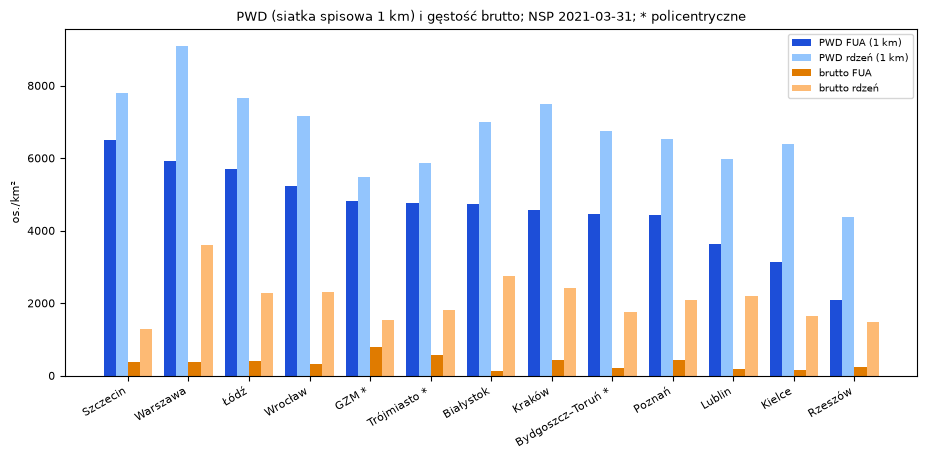
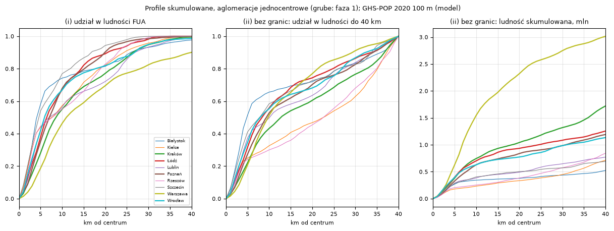

# Zwartość i potencjał transportowy polskich aglomeracji: raport (fazy 0–1)

Stan na 2026-11-23. Raport zbiera wyniki fazy 0 i wskazuje decyzje, które muszą zapaść przed fazą 1. Nie zawiera żadnego wyniku gęstościowego ani transportowego: takie wyniki jeszcze nie istnieją. Wszystkie liczby poniżej są liczbami inwentaryzacyjnymi, przepisanymi z plików w `results/qa/phase0/`, `data/manifest.csv` i `config.yaml`; przy każdej podano plik źródłowy. Gdzie czegoś nie sprawdzono, stoi „nie zweryfikowano”; gdzie danych nie ma, „brak danych”.

Daty danych: ludność 2020 (GHSL) i 31.03.2021 (NSP), granice 2021, rozkłady jazdy 2026 (pobrane 2026-11-23), OSM stan na 2026-11-22. Każdy późniejszy wynik będzie podawał ludność i rozkład z osobnymi datami.

## 1. Stan prac

Faza 0 jest zakończona. Zgodnie z briefem (§9) potok zatrzymuje się tutaj i czeka na decyzje z sekcji 12.

| Faza | Zakres | Status |
|---|---|---|
| 0. Inwentaryzacja | pobranie źródeł, tabele feedów, warianty GZM, dzień referencyjny, zasięg miejsc pracy, integracja taryfowa | wykonana; STOP, czeka na decyzje (sekcja 12); pokrycie GTFS: sekcja 6 |
| 1. Gęstość | §4.1–4.4 briefu, kontrola GHSL vs NSP (§7.1) | wykonana 2026-11-23 dla 13 aglomeracji; sekcja 14 |
| 2. Częsta komunikacja i podaż | §4.5, §4.7 | nie rozpoczęta |
| 3. Dostępność | §4.6 | nie rozpoczęta |
| 4. Mapa | §8 | nie rozpoczęta |
| 5. Faza 2 miast | §4.1–4.3 dla Szczecina, Bydgoszczy–Torunia, Lublina, Rzeszowa, Kielc, Białegostoku | nie rozpoczęta |
| 6. Warstwy dodatkowe | §13 briefu | nie rozpoczęta; 6b (GTFS-RT) odłożona decyzją właściciela, sekcja 10 |

Dwa elementy fazy 0 pozostały niepełne i są opisane w sekcjach 4 i 9: pełna kontrola GHSL vs NSP należy do fazy 1, a wartości PNFT z Atlasu ITDP dla polskich miast nie zostały uzyskane.

## 2. Dane i wersje

Źródło: [`data/manifest.csv`](../data/manifest.csv) (URL, data pobrania, SHA-256 i licencja każdego pliku). Surowe dane leżą w `data/raw/` i nie są w repozytorium.

### 2.1 Dane inne niż GTFS

| Źródło | Wersja / data danych | Pobrano | Licencja | Do czego |
|---|---|---|---|---|
| GHS-POP R2023A, 100 m, Mollweide (2 kafle R3_C20, R4_C20) | epoka 2020 (model) | 2026-11-23 | CC BY 4.0 (JRC GHSL) | ludność 100 m i 250 m: dostępność, warstwy, kontrola z NSP |
| GHS-BUILT-S R2023A, 100 m (kafle R3_C20, R4_C20) | epoka 2020 | 2026-11-23 | CC BY 4.0 (JRC GHSL) | maska terenu zabudowanego netto (§4.3–4.4) |
| NSP 2021, siatka 1 km, zmienna `RES` (GUS, ATOM PD.GRID.2021, EPSG:2180) | 2021-03-31 | 2026-11-23 | GUS INSPIRE: brak warunków dostępu i użycia; cytować GUS NSP 2021 | główna ludność do miar gęstości (§4.1–4.4) |
| Eurostat GISCO Urban Audit (URAU) 2021, skala 100K: FUA, miasta, punkty, atrybuty | 2021 | 2026-11-23 | warunki GISCO, patrz sekcja 13 | granice FUA i rdzeni |
| Eurostat GISCO LAU 2021 (1:1 mln) | 2021 | 2026-11-23 | jak wyżej | granice i powierzchnie gmin, przypisanie gmin |
| Eurostat GISCO NUTS 2021, poziom 2 | 2021 | 2026-11-23 | „GISCO / EuroGeographics, free reuse with attribution” | pomocniczo: przypisanie przystanków OSM do województw |
| OSM, `poland-latest.osm.pbf` (Geofabrik), 2 121 958 441 B | stan danych 2026-11-22T21:20:48Z | 2026-11-23 | ODbL 1.0 | przystanki (maska pokrycia), później sieć piesza i rowerowa |
| Goliszek S. (IGiPZ PAN), miejsca pracy i ludność w wieku produkcyjnym, 7 miast, doi:10.17632/mr9ywkgd9t.1 | v1, 2026-09-29 | 2026-11-23 | CC BY 4.0 | miejsca pracy w dostępności (§4.6) |
| MobilityData gtfs-validator 8.0.1 | v8.0.1 | 2026-11-23 | Apache-2.0 | walidacja feedów |

### 2.2 Feedy GTFS (12)

Źródła: [`feeds_inventory.md`](qa/phase0/gtfs/feeds_inventory.md), [`validator_summary.csv`](qa/phase0/gtfs/validator_summary.csv), [`reference_day.md`](qa/phase0/gtfs/reference_day.md), [`duplicate_trips_check.csv`](qa/phase0/gtfs/duplicate_trips_check.csv). „Ważność” to pierwszy i ostatni dzień, w którym feed ma kursy (z `calendar.txt` i `calendar_dates.txt`), nie wartość z `feed_info.txt`. Kursy w dniu 2026-11-25 po usunięciu dokładnych duplikatów. Wszystkie pobrane 2026-11-23.

| Feed | Wydawca | Ważność (dni z kursami) | Licencja | Błędy walidatora | Kursy 2026-11-25 |
|---|---|---|---|---:|---:|
| `warsaw_ztm` | ZTM Warszawa, nieoficjalne przepakowanie M. Kuranowskiego (mkuran.pl) | 2026-11-23 – 2026-12-23 | warunki ZTM Warszawa + ODbL (kształty autobusów z OSM) | 289 | 35 603 |
| `warsaw_wkd` | Warszawska Kolej Dojazdowa (mkuran.pl) | 2025-12-14 – 2026-12-12 | CC0 1.0 | 0 | 192 |
| `krakow_bus` | ZTP Kraków | 2026-11-14 – 2028-01-31 | CC BY 4.0 | 0 | 10 280 |
| `krakow_tram` | ZTP Kraków | 2026-11-21 – 2027-02-19 | CC BY 4.0 | 0 | 3 710 |
| `krakow_mobilis` | ZTP Kraków (linie podmiejskie Mobilis) | 2026-11-18 – 2028-01-31 | CC BY 4.0 | 0 | 2 590 |
| `wroclaw` | UM Wrocławia, Wydział Transportu | 2026-11-23 – 2026-12-06 | CC0 1.0 | 0 | 12 849 |
| `poznan` | ZTM Poznań | 2026-11-24 – 2026-12-05 | zasady korzystania ZTM Poznań | 0 | 12 074 |
| `lodz` | Miasto Łódź, portal Otwarte dane (MPK-Łódź) | 2026-11-22 – 2026-12-31 | licencja portalu, nazwa niepodana (sekcja 13) | 64 | 10 229 |
| `gdansk` | ZTM w Gdańsku | 2026-11-23 – 2026-12-07 | CC BY 4.0 | 0 | 7 049 |
| `gdynia` | ZDiZ Gdynia (rozkłady ZKM) | 2026-11-23 – 2027-01-29 | CC BY 4.0 | 0 | 4 911 |
| `gzm` | ZTM GZM, mirror wersji rozszerzonej | 2026-11-08 – 2026-11-28 | CC BY 4.0 | 28 962 | 22 868 (surowo 30 561) |
| `polish_trains` | PKP PLK, przepakowanie mkuran.pl | 2026-11-21 – 2026-12-23 | warunki PKP PLK i Kolei Mazowieckich | 1 | 7 453 |

Liczba tras, przystanków i kursów oraz kompletność pól (kształty, `parent_station` i inne) są w [`feeds_inventory.md`](qa/phase0/gtfs/feeds_inventory.md). `krakow_mobilis` nie było w tabeli briefu; dodany w fazie 0 jako trzeci oficjalny feed ZTP (33 trasy).

**Znane defekty feedów:**

- **GZM, duplikaty kursów.** 15 117 kursów (23,18 % feedu) to dokładne duplikaty: to samo `service_id`, linia, kierunek, przystanki i czasy, inne `trip_id`, ten sam `block_id`. Wygląda to na sklejenie kilku dobowych plików w jeden zip. W dniu 2026-11-25 duplikatów jest 7 693 z 30 561 kursów (25,17 %); stąd 22 868 kursów po usunięciu. Liczby 23,18 % i 25,17 % dotyczą różnych zakresów (cały feed vs jeden dzień). Walidator zgłasza dla tego feedu 28 962 błędów, głównie `block_trips_with_overlapping_stop_times` (20 600) i `decreasing_or_equal_stop_time_distance` (8 353), co zgadza się z obrazem sklejonych plików, ale przyczyny w kodzie nie sprawdzano.
- **GZM, nieaktualny mirror.** Okno kursów kończy się 2026-11-28. Oficjalny portal publikuje 7 plików dobowych (po ok. 11 MB) generowanych codziennie; wg [`candidate_feeds.md`](qa/phase0/gtfs/candidate_feeds.md) mirror na GitHubie jest nieaktualny od 8.11.
- **Kraków, autobusy.** W `krakow_bus` i `krakow_mobilis` po 2 `service_id` z `calendar_dates.txt` nie ma żadnego kursu w `trips.txt`, więc 117 dat nie ma kursów: wszystkie czwartki i piątki od 26.11. Dni te nie nadają się na dzień referencyjny, dopóki ZTP nie poprawi feedu. Czwartek 2026-11-26 wypada przez to ze wspólnych kandydatów. Walidator tego nie zgłasza jako błędu (0 błędów); wykrył to dopiero test kalendarza (w ostrzeżeniach jest `service_has_no_active_day_of_the_week`).
- **Łódź, błędy walidatora.** 64 błędy: 61 `foreign_key_violation`, 2 `point_near_origin`, 1 `block_trips_with_overlapping_stop_times`. Treść naruszeń kluczy obcych nie została przeanalizowana (nie zweryfikowano, których plików dotyczą). Uwaga do wcześniejszego opisu: feed łódzki zawiera `calendar.txt` (potwierdzone w zipie i w kolumnie `calendar_txt` w `feeds_inventory.csv`); `calendar.txt` nie mają natomiast `warsaw_ztm`, `warsaw_wkd`, `gdansk`, `gdynia` i `polish_trains` (używają tylko `calendar_dates.txt`, co jest dopuszczalne).
- **Warszawa.** 289 błędów walidatora (`decreasing_or_equal_stop_time_distance` 163, `block_trips_with_overlapping_stop_times` 126); wpływu na liczenie nie oceniano.
- **Koleje.** `polish_trains` ma 1 błąd (`stop_time_with_arrival_before_previous_departure_time`). PKM Gdańsk (linie PolRegio `PR_PM_*`) kursuje dopiero od 2026-12-13, więc w dniu referencyjnym go nie ma.
- **Krótkie okna.** Poznań (12 dni), Wrocław (14), Gdańsk (15) i GZM (21) wygasną w ciągu dwóch–trzech tygodni; Łódź i Poznań publikują pod stałym URL i nadpisują plik. Jedyną gwarancją odtwarzalności jest kopia w `data/raw/gtfs/<feed>/<data>/` z SHA-256 w manifeście.

## 3. Granice

Źródła: [`agglomerations.md`](qa/phase0/boundaries/agglomerations.md), [`gzm_variants.md`](qa/phase0/boundaries/gzm_variants.md), [`centres.md`](qa/phase0/boundaries/centres.md). Podstawa: Eurostat URAU 2021 (skala 100K), kody FUA (`…F`) i rdzeni (`…C`).

| Aglomeracja | Kody FUA | Pow. FUA km² | Pow. rdzenia km² | Gmin w FUA |
|---|---|---|---:|---:|
| Warszawa | PL001F | 9 296 | 516,7 | 97 |
| Kraków | PL003F | 3 345 | 326,4 | 40 |
| Wrocław | PL004F | 3 107 | 292,5 | 21 |
| Poznań | PL005F | 2 279 | 261,7 | 19 |
| Łódź | PL002F | 2 520 | 292,9 | 26 |
| Trójmiasto | PL006F, PL053F | 1 918 | 413,2 | 19 |
| GZM (wariant (a), tymczasowo) | PL010F, PL055F, PL061F, PL070F | 2 592 | 1 062 | 39 |

Faza 2: Szczecin PL007F, Bydgoszcz–Toruń PL008F + PL013F, Lublin PL009F, Rzeszów PL015F, Kielce PL012F, Białystok PL011F; kody rdzeni i pola w pliku [`agglomerations.md`](qa/phase0/boundaries/agglomerations.md). Kody rdzeni: Warszawa PL001C, Kraków PL003C, Wrocław PL004C, Poznań PL005C, Łódź PL002C, Trójmiasto PL006C + PL053C (+ Sopot jako jednostka LAU), GZM 13 miast URAU (PL010C, PL054C, PL055C, PL056C, PL057C, PL059C, PL061C, PL066C, PL069C, PL070C, PL072C, PL074C, PL075C).

**Trójmiasto.** Eurostat nie ma jednej FUA: FUA Gdańsk (PL006F) obejmuje Sopot, a Gdynia ma własną FUA (PL053F). Aglomeracja w tym projekcie to suma dwóch FUA (1 918 km²). Sopot nie jest miastem URAU, więc rdzeń to Gdańsk + Gdynia (miasta URAU) + Sopot jako jednostka LAU. Miasto jest liniowe i nadmorskie, więc miary względem jednego centrum wymagają zastrzeżenia (brief §11); w `config.yaml` Trójmiasto ma dodatkowe centra: Gdynia Główna i Sopot.

**Bydgoszcz–Toruń** (faza 2) to również dwie FUA (PL008F, PL013F), rdzeń z dwóch miast, dwa centra w `config.yaml`.

**Pola rdzeni a pola administracyjne gmin.** Pole URAU i suma pól gmin rdzenia różnią się o ułamek procenta (np. Warszawa 516,7 vs 517,2 km²); powierzchnie administracyjne nie są więc źródłem rozbieżności, ale też nie wolno ich uznawać za miarę miasta (brief §2).

### 3.1 Warianty granicy GZM

Konurbacja nie jest jedną FUA: w URAU 2021 są tu cztery FUA w większości leżące w Metropolii (PL010F Katowice, PL055F Gliwice/Zabrze, PL061F Tychy, PL070F Dąbrowa Górnicza), a PL060F Rybnik dotyka Metropolii śladowo (ok. 0,1 km², artefakt różnicy skal LAU 1:1 mln i URAU 1:100 tys.). Metropolię tworzy 41 gmin (lista wg metropoliagzm.pl; Jaworzno nie należy). Wariant nie został wybrany; liczby tymczasowe używają wariantu (a).

| Wariant | Pow. km² | Gmin | Ludność NSP 2021 | Ludność GHSL 2020 | GHSL vs NSP | Ludność LAU 2021 (BDL) |
|---|---:|---:|---:|---:|---:|---:|
| (a) suma FUA z ≥ 5 % pola w GZM (PL010F, PL055F, PL061F, PL070F) | 2 592 | 39 | 2 057 054 | 2 150 295 | 4,5 % | 2 155 292 |
| (a′) wszystkie FUA dotykające GZM (dodatkowo PL060F Rybnik) | 2 877 | 46 | 2 258 716 | 2 363 791 | 4,7 % | 2 367 727 |
| (b) granica Metropolii GZM, 41 gmin | 2 551 | 41 | 2 129 249 | 2 221 625 | 4,3 % | 2 229 806 |

Różnica (a) minus (b): 404 km² i 46 187 mieszkańców (NSP) leżą w (a) poza GZM (gminy Miedźna, Toszek, Wielowieś, Łazy). Różnica (b) minus (a): 363 km² i 118 382 mieszkańców (NSP) leżą w GZM poza (a) (Mierzęcice, Ożarowice, Siewierz, Tarnowskie Góry, Łaziska Górne, Świerklaniec).

Kompromisy, bez rekomendacji (szczegóły w [`gzm_variants.md`](qa/phase0/boundaries/gzm_variants.md)):

- **(a)** jest spójny z resztą zbioru (wszędzie FUA Eurostatu), obejmuje strefy dojazdów i nie zależy od członkostwa gmin w związku, ale nie pokrywa się z żadną jednostką administracyjną (tabele gminne wymagają reguły przypisania) i zależy od tego, że Eurostat podzielił konurbację na kilka FUA.
- **(b)** odpowiada jednostce znanej odbiorcom, łatwo się sumuje z danymi gminnymi (BDL, LAU) i obejmuje obszar feedu ZTM GZM, ale odcina część stref dojazdów, jest mniej porównywalny z pozostałymi aglomeracjami i zawiera gminy wiejskie (np. Zbrosławice, Rudziniec, Sośnicowice), których FUA nie obejmuje. Zmiana składu Metropolii zmienia obszar.
- Dla obu wariantów obowiązuje bufor 15 km jako domena celów, więc różnica wpływa głównie na miary „na obszarze”.

### 3.2 Centra i węzły

[`centres.md`](qa/phase0/boundaries/centres.md) porównuje współrzędne z `config.yaml` z wynikiem Nominatim (OSM); próg zgłoszenia to 150 m. `config.yaml` nie został zmieniony. Siedem pozycji przekracza próg, a propozycje poprawek są w sekcji 12 (decyzja 2). Białystok (140 m) i Sosnowiec (132 m) są tuż pod progiem.

## 4. Ludność: GHSL 2020 vs NSP 2021 (pierwsze spojrzenie)

Źródło: [`agglomerations.md`](qa/phase0/boundaries/agglomerations.md). Przypisanie NSP: centroid komórki 1 km wewnątrz wielokąta; GHSL: suma komórek 100 m, których środek leży w wielokącie. To pierwsze spojrzenie, nie kontrola z §7.1 briefu: ta należy do fazy 1 (rozkład na 1 km, korelacja, największe różnice, BDL). Daty: GHSL epoka 2020, NSP stan na 31.03.2021. Flaga „TAK” oznacza |różnica| > 5 %.

| Aglomeracja | NSP 2021 FUA | GHSL 2020 FUA | GHSL/NSP FUA | >5 % | NSP 2021 rdzeń | GHSL 2020 rdzeń | GHSL/NSP rdzeń | >5 % |
|---|---:|---:|---:|---|---:|---:|---:|---|
| GZM | 2 057 054 | 2 150 295 | 1,045 | nie | 1 643 705 | 1 738 107 | 1,057 | TAK |
| Kraków | 1 411 779 | 1 350 286 | 0,9564 | nie | 793 392 | 760 841 | 0,959 | nie |
| Łódź | 1 044 086 | 1 045 886 | 1,002 | nie | 665 696 | 670 405 | 1,007 | nie |
| Poznań | 974 744 | 926 610 | 0,9506 | nie | 547 682 | 527 922 | 0,9639 | nie |
| Trójmiasto | 1 089 730 | 1 064 838 | 0,9772 | nie | 752 435 | 736 930 | 0,9794 | nie |
| Warszawa | 3 485 881 | 3 334 987 | 0,9567 | nie | 1 865 105 | 1 785 716 | 0,9574 | nie |
| Wrocław | 1 011 966 | 939 076 | 0,928 | TAK | 673 906 | 634 111 | 0,9409 | TAK |
| Białystok | 448 491 | 462 842 | 1,032 | nie | 281 830 | 298 928 | 1,061 | TAK |
| Bydgoszcz–Toruń | 855 995 | 892 951 | 1,043 | nie | 510 653 | 545 377 | 1,068 | TAK |
| Kielce | 386 456 | 405 621 | 1,05 | nie | 179 303 | 193 979 | 1,082 | TAK |
| Lublin | 664 078 | 680 102 | 1,024 | nie | 322 635 | 332 983 | 1,032 | nie |
| Rzeszów | 459 020 | 458 745 | 0,9994 | nie | 185 929 | 211 037 | 1,135 | TAK |
| Szczecin | 512 051 | 524 618 | 1,025 | nie | 384 375 | 398 002 | 1,035 | nie |

Odchylenia > 5 %: Wrocław (FUA i rdzeń), GZM, Białystok, Bydgoszcz–Toruń, Kielce i Rzeszów (tylko rdzeń). Przyczyn jeszcze nie zbadano. Układ: w pięciu z sześciu aglomeracji fazy 1 poza GZM (Kraków, Poznań, Trójmiasto, Warszawa, Wrocław) GHSL jest poniżej NSP, w Łodzi prawie równy, a w GZM i większości miast fazy 2 powyżej. Przy ocenie trzeba pamiętać, że granice URAU (100K) i siatka nie pokrywają się dokładnie, więc na brzegu FUA liczy się kilka komórek; oba zbiory mają inną datę.

### 4.1 Definicja ludności w siatce spisowej: ustalenie

Pytanie: czy pole `RES` siatki NSP 2021 to ludność rezydująca (usually resident, definicja siatki spisowej UE), a suma siatki 37 019 327 różni się od ok. 38,0 mln ludności wg definicji krajowej właśnie z powodu różnicy definicji.

Wynik: **tak, najpewniej, z jedną niedoskonałością w weryfikacji.**

- Suma siatki (37 019 327, według zadania i `agglomerations.md`: „ok. 37,0 mln”) jest równa co do jednostki liczbie ludności rezydującej z ostatecznych wyników NSP 2021: wyszukiwanie, które cytuje strony GUS, podaje „liczba ludności rezydującej w Polsce liczyła 37 019 327 osób”, a ludność wg definicji krajowej 38 036 118. Różnica to 1 016 791 osób; ludność rezydująca stanowi wg GUS 97,3 % ludności krajowej.
- Definicja GUS: ludność rezydująca to osoby mieszkające lub przebywające na danym terenie co najmniej 12 miesięcy; dane GUS pod nazwą „ludność” w publikacjach i bazach opierają się na krajowej definicji zamieszkania.
- Manifest opisuje źródło jako „siatka 1 km, rezydenci”.
- Źródła: [GUS, rezydenci – ludność rezydująca](https://stat.gov.pl/obszary-tematyczne/ludnosc/ludnosc/rezydenci-ludnosc-rezydujaca,19,1.html) oraz [GUS, NSP 2021 wyniki ostateczne](https://stat.gov.pl/spisy-powszechne/nsp-2021/nsp-2021-wyniki-ostateczne/). **Zastrzeżenie:** liczby 37 019 327, 38 036 118, 1 016 791 i 97,3 % pochodzą z wyników wyszukiwania cytujących te strony; bezpośredni odczyt stron GUS się nie powiódł (strona w PDF nie dała tekstu, druga nie zawierała liczb). Zgodność sumy siatki z liczbą rezydentów co do jednostki jest mocnym, ale pośrednim potwierdzeniem; dokumentacji samej siatki (ATOM PD.GRID.2021) pod kątem definicji pola `RES` nie czytano.

Konsekwencje:

1. Siatka NSP jest o ok. 2,7 % (1,0 mln) niższa od ludności krajowej niezależnie od jakiejkolwiek różnicy w rozkładzie przestrzennym.
2. Jeżeli GHS-POP R2023A jest kalibrowany do sum krajowych zgodnych z definicją krajową (**nie zweryfikowano**; hipoteza), to stosunek GHSL/NSP byłby przesunięty w górę o rząd kilku procent bez żadnego błędu rozkładu. Wtedy flaga 5 % jest zbyt „ostra” po stronie plus i zbyt łagodna po stronie minus. Faza 1 powinna sprawdzić kalibrację GHSL (suma dla Polski) i porównać też z BDL, który używa definicji krajowej.
3. Różnica nie jest równomierna przestrzennie (rezydenci a ludność wg definicji krajowej inaczej liczą osoby przebywające czasowo za granicą lub poza miejscem zameldowania); jej rozkładu nie badano. Obserwacja pomocnicza: ludność LAU 2021 (BDL) dla GZM jest wyższa od sumy siatki o ok. 4,7–4,8 % (wariant (a): 2 155 292 vs 2 057 054), czyli więcej niż średnio 2,7 %; definicji i daty pola LAU nie sprawdzono, więc to tylko sygnał do sprawdzenia w fazie 1.

## 5. Rozkłady jazdy

Źródła: [`reference_day.md`](qa/phase0/gtfs/reference_day.md), [`anomaly_test.csv`](qa/phase0/gtfs/anomaly_test.csv), [`service_by_day.csv`](qa/phase0/gtfs/service_by_day.csv), [`rail_overlap.md`](qa/phase0/gtfs/rail_overlap.md), [`top_stops_preview.csv`](qa/phase0/gtfs/top_stops_preview.csv), [`candidate_feeds.md`](qa/phase0/gtfs/candidate_feeds.md), [`calendar.md`](qa/phase0/research/calendar.md).

### 5.1 Proponowany dzień referencyjny

- **Dzień roboczy: środa 2026-11-25.** Jedyny dzień wt–czw, w którym wszystkie 12 feedów ma kursy, obok wtorku 2026-11-24; spośród nich wybrany o najmniejszym średnim odchyleniu wozokilometrów od mediany dni roboczych w ważności feedu (remis, rozstrzygnięty na środę).
- **Sobota: 2026-11-28**, jedyna wspólna sobota.
- Wspólne dni wt–czw: 2026-11-24 i 2026-11-25. Czwartek 2026-11-26 odpada, bo oba feedy autobusowe Krakowa nie mają kursów (defekt z sekcji 2.2).
- **Dlaczego okno jest tak wąskie.** Ograniczają je najkrótsze okna ważności: GZM kończy 2026-11-28, Poznań zaczyna 2026-11-24 i kończy 2026-12-05, Wrocław kończy 2026-12-06, Gdańsk 2026-12-07. W ważności feedu mieści się: Poznań 9 dni roboczych, Wrocław 10, Gdańsk 11, GZM 14.
- **Ferie i święta.** Terminy ferii zimowych 2027 (MEN, komunikat z 19.05.2026): 18–31.01 (dolnośląskie, łódzkie, opolskie, podkarpackie, podlaskie, śląskie), 1–14.02 (lubelskie, mazowieckie, pomorskie, świętokrzyskie), 15–28.02 (kujawsko-pomorskie, lubuskie, małopolskie, warmińsko-mazurskie, wielkopolskie, zachodniopomorskie). Zimowa przerwa świąteczna 23–31.12.2026. Wigilia jest dniem wolnym od 2025 r. (źródło wtórne; nie zweryfikowano w ustawie). Między 24.11 a 23.12.2026 nie ma świąt państwowych; dni 24–25.11 i sobota 28.11 nie wypadają w feriach żadnego z siedmiu województw. W kalendarzu wspólnym dla siedmiu województw (bez uwzględnienia ważności feedów) czyste są też m.in. 1–3.12, 8–10.12, 15–17.12.2026 oraz 12–14.01.2027; od 18.01 do 28.02.2027 każdy dzień wypada w feriach co najmniej jednego z nich. Szczegóły: [`calendar.md`](qa/phase0/research/calendar.md), który w rekomendacji roboczej wskazuje 1–3.12 (bo nie uwzględnia krótkiego okna GZM); wybór z [`reference_day.md`](qa/phase0/gtfs/reference_day.md) uwzględnia ważność feedów.
- **Alternatywa: odświeżenie GZM z oficjalnych plików dobowych.** Wtedy GZM przestaje ograniczać okno, a ograniczają je Poznań (do 2026-12-05) i Wrocław (do 2026-12-06). W tabeli [`reference_day.md`](qa/phase0/gtfs/reference_day.md) dni 2026-12-01 (wt) i 2026-12-02 (śr) mają kursy w 11 z 12 feedów (bez GZM, którego mirror tych dat nie obejmuje); po odświeżeniu GZM mogłyby stać się dniami wspólnymi. Czy oficjalne pliki dobowe pokryją 2026-12-01/02 w chwili pobrania, nie zweryfikowano (pliki są generowane codziennie i jest ich 7, więc pobranie musi nastąpić blisko tej daty). Czwartek 2026-12-03 nadal odpada z powodu Krakowa.
- Jeśli dzień roboczy i sobota nie wypadną w tym samym tygodniu, trzeba to jawnie odnotować (brief §5).

### 5.2 Test anomalii i jego słabość

Test porównuje wozokilometry w dniu referencyjnym z medianą dni roboczych w ważności feedu. Dla 2026-11-25 odchylenia mieszczą się w przedziale od −0,16 % (`polish_trains`) do +0,0 %; największe poniżej progu 5 % (flaga „nie” dla wszystkich 12 feedów). Dla soboty 2026-11-28 największe odchylenie to +0,06 % (`polish_trains`). Pełne dane: [`anomaly_test.csv`](qa/phase0/gtfs/anomaly_test.csv).

Moc testu jest słaba: mediana dla krótkich feedów pochodzi z tego samego 2–3-tygodniowego okna co dzień referencyjny (liczba dni w medianie 9–14 dla dni roboczych, 2–4 dla większości sobót), a dla feedów długich (Kraków, WKD, kolej) obejmuje okresy wakacyjne i feryjne. Test nie wykryje feedu, który jest „feryjny” lub objazdowy w całym oknie; do tego potrzebne jest porównanie z poprzednim rozkładem (archiwum `data/raw/gtfs/`).

### 5.3 Deduplikacja kolei

`polish_trains` zawiera m.in. Koleje Mazowieckie, SKM Warszawa, SKM Trójmiasto, Koleje Śląskie, Koleje Dolnośląskie, Koleje Małopolskie, Koleje Wielkopolskie (linie PKM1–PKM5), ŁKA, PolRegio, PKP Intercity, Arriva RP, RegioJet i Leo Express; nie zawiera WKD (osobny feed). SKM Warszawa występuje dwukrotnie: 284 kursy w `warsaw_ztm` i 284 w `polish_trains`; dopasowanie (linia, przystanek początkowy, minuta odjazdu) daje 100,0 %. Proponowana reguła ([`rail_overlap.md`](qa/phase0/gtfs/rail_overlap.md), §5):

1. Jednostka zliczania to kurs w dniu referencyjnym; klucz dopasowania: linia, znormalizowana nazwa przystanku początkowego w promieniu 100 m, minuta odjazdu.
2. SKM Warszawa: zostaje wersja z `warsaw_ztm`, agencja `SKM` z `polish_trains` jest odrzucana przed zliczaniem.
3. Pozostała kolej regionalna: jedyne źródło to `polish_trains`, kursy liczone raz po przycięciu do FUA + bufor.
4. WKD tylko z `warsaw_wkd`.
5. Autobusową komunikację zastępczą (route_type 3) z `polish_trains` wyłączyć z miar kolejowych.
6. Ogólnie: przy powtórzeniu kursu wygrywa feed miejski; odrzucone kursy zapisywane w `results/qa/` z liczbą per aglomeracja.

PKM Gdańsk trzeba wybierać po `route_id` (`PR_PM_*`), nie po `agency_id`.

### 5.4 Podgląd przystanków o największej liczbie odjazdów

[`top_stops_preview.csv`](qa/phase0/gtfs/top_stops_preview.csv): po 10 przystanków na aglomerację, odjazdy 6:00–20:00 w dniu 2026-11-25, wszystkie linie i oba kierunki zsumowane (po 14 godzin). Zastrzeżenia:

- To podgląd kontrolny z §7.3 briefu, nie miara częstotliwości. Liczba odjazdów na godzinę to suma po liniach i kierunkach, nie odstęp.
- We wszystkich 70 wierszach kolumny `deps_metro` i `deps_rail` wynoszą 0, także dla przystanków o nazwach typu „Metro Młociny” i „Dw. Centralny”. Podgląd nie zawiera więc metra ani kolei (feed `polish_trains` nie występuje w kolumnie `feeds`). Przyczyna sprawdzona na przykładzie „Centrum” w `warsaw_ztm`: perony metra mają własną stację nadrzędną (`parent_station` = `7013M`), a przystanki naziemne o tej samej nazwie jej nie mają, więc podgląd tworzy z nich dwa osobne klastry; sam klaster metra lub kolei nie mieści się w pierwszej dziesiątce pod względem liczby odjazdów. To ograniczenie podglądu, a nie brak kursów w danych. Właściwe scalanie słupków i peronów w promieniu ok. 100 m (brief §4.5) należy do fazy 2.
- GZM: liczniki po usunięciu duplikatów (kolumna surowa je zawiera), udział duplikatów w wierszach top-10 od 22,9 % do 46,7 %; wiersze oznaczone flagą. Dodatkowo wiersze GZM 1, 3 i 10 oraz Trójmiasto (Łostowice Świętokrzyska 04, 10,7 %) mają flagę „możliwe zdublowane odjazdy tej samej linii w tej samej minucie” (`dup_same_feed_pct`).
- Współrzędne zaokrąglone do dwóch miejsc po przecinku.
- W Trójmieście osobne feedy Gdańska i Gdyni nie są łączone w jeden przystanek.

### 5.5 Kandydaci na dodatkowe feedy

Żaden nie jest w `config.yaml` ani w `data/raw/`; sprawdzono tylko odpowiedź serwera 2026-11-23 (zawartości nie analizowano). Pełna lista z URL i licencjami: [`candidate_feeds.md`](qa/phase0/gtfs/candidate_feeds.md). Do decyzji (sekcja 12):

| Aglomeracja | Kandydaci | Uwagi |
|---|---|---|
| Kraków | Skawina, Niepołomice, Koleje Małopolskie ALD (autobusy dowozowe do SKA) | |
| Wrocław | Polbus, Oleśnica, Oborniki Śląskie | Oborniki: nie sprawdzono; KD wymaga ręcznego pobrania (HTTP 401) |
| Poznań | PKS Poznań, Środa Wlkp. | Kombus Kórnik jest już agencją w feedzie ZTM Poznań |
| Łódź | Zgierz, Pabianice, Aleksandrów Łódzki, Stryków, ŁKA bus, zbiór społecznościowy | ryzyko duplikatów z MPK Łódź; zbiór społecznościowy ma nieznaną licencję |
| Trójmiasto | Tczew, Wejherowo/Rumia/Reda | Wejherowo: brak URL, nie sprawdzono |
| GZM | pliki dobowe z portalu GZM (odświeżenie), Rybnik, Jastrzębie-Zdrój, Bielsko-Biała | trzy ostatnie poza GZM; tylko jeśli FUA wejdzie do wariantu |
| Warszawa | Pruszków, GPA, Mińsk Maz., Łomianki, Ząbki i inne | ryzyko dublowania z `warsaw_ztm` |

Licencje agregatorów (`zbiorkom.live`, `files.girlc.at`) to licencje powtórnej publikacji, nie warunki organizatora; przed użyciem trzeba je sprawdzić.

## 6. Pokrycie GTFS (wstępne)

Metoda, tabele i ograniczenia: [`coverage.md`](qa/phase0/coverage/coverage.md); dane: [`coverage_summary.csv`](qa/phase0/coverage/coverage_summary.csv), [`coverage_by_gmina.csv`](qa/phase0/coverage/coverage_by_gmina.csv), [`coverage_by_ring.csv`](qa/phase0/coverage/coverage_by_ring.csv), [`unmatched_operators.csv`](qa/phase0/coverage/unmatched_operators.csv), [`population_coverage_preliminary.csv`](qa/phase0/coverage/population_coverage_preliminary.csv). Mapy i histogramy odległości per aglomeracja: `qa/phase0/coverage/map_<id>.png`, `nn_hist_<id>.png`. Kod: `pipeline/stop_coverage.py`. Przystanki OSM: stan 2026-11-22; rozkłady: dzień 2026-11-25; GZM w tymczasowym wariancie sumy FUA.

Wskaźnik pokrycia to odsetek przystanków OSM (po deduplikacji, w granicach FUA), które mają odpowiednik wśród przystanków GTFS obsługiwanych w dniu referencyjnym. Mierzy obecność przystanku w danych, nie liczbę kursów: przystanek z jednym kursem dziennie liczy się tak samo jak przystanek z dwustoma.

### 6.1 Wynik

Pokrycie w %, wszystkie tryby; w nawiasie liczba przystanków OSM w FUA (mianownik).

| Aglomeracja | FUA | Rdzeń | Poza rdzeniem | Autobus (FUA) | Tramwaj (FUA) | Kolej (FUA; liczba stacji) |
|---|---|---|---|---|---|---|
| Warszawa | 59,9 (12 781) | 97,2 | 35,8 | 56,6 | 99,1 | 98,6 (207) |
| Kraków | 59,8 (6 419) | 96,1 | 36,9 | 56,3 | 91,5 | 95,9 (73) |
| Wrocław | 71,1 (3 491) | 97,7 | 35,2 | 70,5 | 98,3 | 100 (83) |
| Poznań | 86,2 (3 770) | 94,9 | 78,9 | 87,5 | 97,1 | 100 (62) |
| Łódź | 68,2 (3 756) | 96,3 | 29,9 | 62,8 | 89,9 | 100 (56) |
| Trójmiasto | 71,1 (3 968) | 96,5 | 35,8 | 68,1 | 96,0 | 93,5 (62) |
| GZM | 94,7 (6 246) | 96,9 | 89,2 | 94,8 | 95,4 | 93,5 (77) |

Rdzenie są pokryte w 95–98 %. Poza rdzeniem dobrze pokryte są tylko GZM (89 %) i Poznań (79 %), czyli aglomeracje, w których organizator obejmuje gminy ościenne. W Warszawie, Krakowie, Łodzi, Wrocławiu i Trójmieście poza rdzeniem odpowiednik w GTFS ma 30–37 % przystanków: brakuje przewoźników gminnych i prywatnych. Kolej (feed ogólnopolski) jest pokryta niemal w całości.

### 6.2 Ludność w obszarze pokrytym (wstępnie)

Odsetek ludności FUA (NSP 2021, siatka 1 km, komórki przypisane centroidem) mieszkającej w gminach o pokryciu co najmniej równym progowi. Definicja właściwej maski należy do fazy 2; tu pokazano wrażliwość na próg.

| Aglomeracja | próg 50 % | próg 70 % | próg 85 % |
|---|---|---|---|
| Warszawa | 73,2 | 66,6 | 60,0 |
| Kraków | 71,1 | 67,3 | 65,6 |
| Wrocław | 78,5 | 74,5 | 68,5 |
| Poznań | 92,7 | 92,7 | 86,6 |
| Łódź | 68,3 | 67,4 | 65,7 |
| Trójmiasto | 77,7 | 77,7 | 75,0 |
| GZM | 98,7 | 97,5 | 96,3 |

Regułę briefu (§6: poniżej ok. 85 % ludności FUA w obszarze pokrytym wynik jest niepełny) spełniają tylko GZM i, w wariancie gminnym, Poznań (w wariancie komórkowym przy progu 85 % Poznań spada do 80,5 %). **Pięć z siedmiu aglomeracji będzie miało wyniki transportowe z §4.5–4.7 oznaczone jako niepełne dla FUA niezależnie od wyboru progu**; do porównań między miastami trzeba będzie użyć wariantu „obszar pokryty” albo „rdzeń”. Udział ludności FUA w gminach o pokryciu poniżej 50 %: Warszawa 26,6 %, Kraków 28,7 %, Łódź 31,7 %, Trójmiasto 22,3 %, Wrocław 21,4 %, Poznań 7,3 %, GZM 1,3 %.

### 6.3 Promień dopasowania

- **Autobus i tramwaj: 50 m (jak w briefie) oraz dopasowanie zapasowe po nazwie lub kodzie przystanku w promieniu 200 m.** Histogram odległości ma dwie wyraźne grupy: ostry szczyt poniżej ok. 20 m (ten sam przystanek) i długi ogon setek metrów (brak odpowiednika). Test kontrolny z losowym przesunięciem punktów OSM o 200–400 m daje 2–4 % przypadkowych dopasowań przy 50 m, 10–11 % przy 100 m i ok. 20 % przy 150 m, więc większy promień dodaje głównie sąsiednie przystanki. Z dopasowaniem zapasowym pokrycie zmienia się o 1–2,5 pkt proc. między 30 a 150 m: wybór promienia nie zmienia wniosków.
- **Kolej: 200 m oraz nazwa w promieniu 500 m.** Pokrycie kolejowe liczone samą odległością przestaje rosnąć przy 150–200 m; 300 m daje ten sam wynik.
- Dopasowanie uwzględnia tryb: przystanek autobusowy nie jest „pokryty” przez sam przystanek tramwajowy obok. Wyjątek: 35 przystanków tramwajowych w Krakowie i 42 w Łodzi nie ma w dniu referencyjnym kursów tramwajowych, ale ma obsługiwany przystanek autobusowy 5–20 m dalej (prawdopodobnie komunikacja zastępcza na czas remontu; wniosek z danych, nie zweryfikowano). W pokryciu „wszystkie tryby” liczą się jako pokryte, w kolumnie „tramwaj” nie.

### 6.4 Brakujący przewoźnicy

Na podstawie znaczników `network`/`operator` niedopasowanych przystanków OSM. Większość takich przystanków nie ma żadnego znacznika, więc to próba, nie inwentarz.

| Aglomeracja | Przewoźnicy i obszary bez danych |
|---|---|
| Warszawa | Grodziskie Przewozy Autobusowe (262 przystanki), PKS Grójec (248), Nadwiślańska Komunikacja Autobusowa (160), Pruszkowska Komunikacja Miejska (ok. 137), BKM Otwock (79), Nowodworska KA (66), powiat legionowski; bez znaczników: Mińsk Mazowiecki, Błonie, Brwinów, Żyrardów |
| Kraków | Małopolskie Linie Dowozowe (871), Niepołomicka Komunikacja Gminna (ok. 140), Skawińska KG; bez znaczników: Miechów, Krzeszowice, Myślenice, Dobczyce |
| Łódź | MZK Pabianice (miasto Pabianice pokryte w 16 %) i MUK Zgierz (miasto Zgierz 40 %): to miejskie sieci, nie linie wiejskie; także Łask, Koluszki, Stryków, Tuszyn, Brójce |
| Trójmiasto | MZK Wejherowo (163; Wejherowo 16 %, Reda 20 %), PKS Gdynia (51), Albatros (Żukowo); bez znaczników: Trąbki Wielkie, Przywidz, Cedry Wielkie, Kolbudy, gmina wiejska Pruszcz Gdański |
| Wrocław | Siechnicka Komunikacja Publiczna, autobusy gminne Czernicy i Kobierzyc; bez znaczników: Oleśnica, Trzebnica, Oborniki Śląskie, Żmigród |
| Poznań | Pobiedziska, Kostrzyn, Stęszew, Łubowo |
| GZM | tylko gminy skrajne: Rudziniec (22 %), Miedźna (25 %), Sośnicowice, Łazy |

Czy ci przewoźnicy publikują GTFS, nie sprawdzano poza listą kandydatów z sekcji 5.5; najwięcej dałyby MZK Pabianice, MUK Zgierz i MZK Wejherowo.

### 6.5 Ograniczenia

- **OSM jako mianownik.** Obsługiwane przystanki GTFS bez przystanku OSM tego samego trybu w promieniu 50 m: przedmieścia Poznania ok. 15 %, Wrocławia ok. 16 %, GZM ok. 7 %, gdzie indziej 1–6 %, kolej prawie 0. Tam, gdzie OSM jest tak niepełny, wskaźnik pokrycia jest zawyżony, bo w OSM zapewne brakuje też przystanków przewoźników nieobecnych w GTFS.
- **Błędne znaczniki peronów.** Wiele obiektów `railway=platform` w OSM to perony tramwajowe lub autobusowe. Perony w promieniu kolejowym od stacji OSM są łączone ze stacją, pozostałe traktowane jako tryb nieznany (2–56 na aglomerację, 56 w GZM). Koleje wąskotorowe, parkowe i drezynowe oraz kolej linowa w Gdyni są wyłączone z mianownika regułami po nazwie i operatorze (35 stacji). To heurystyki dodane w module pokrycia; sama ekstrakcja OSM jest bez zmian.
- Niedopasowane przystanki w rdzeniach (np. ok. 90 ze znacznikiem „ZTM Warszawa”) leżą zwykle 50–300 m od najbliższego przystanku GTFS: prawdopodobnie czasowo nieobsługiwane, przeniesione albo nieaktualne w OSM (nie zweryfikowano).
- Nie wyjaśniono: braku kursów tramwajowych na części przystanków w Krakowie i Łodzi w dniu referencyjnym; niedopasowanych przystanków ze znacznikiem „Wrocław” w Siechnicach i Długołęce oraz „ZTM Warszawa” w Sulejówku; położenia stacji Szczepanowice (w GTFS ok. 1 km od węzła OSM). Nie sprawdzono, jak granica „metropolia” zmieniłaby wynik skrajnych gmin GZM.

### 6.6 Po dodaniu feedów podmiejskich (2026-11-23)

Sekcje 6.1–6.5 opisują stan na 12 feedach z briefu. Zgodnie z decyzją 12 (sekcja 12.0) dodano 30 feedów przewoźników podmiejskich i powtórzono kontrolę. Dziennik decyzji per kandydat (dodany, odrzucony, nie znaleziono; URL, licencja, powód): [`candidate_feeds.md`](qa/phase0/gtfs/candidate_feeds.md). Zmiana pokrycia per gmina: [`coverage_change.md`](qa/phase0/coverage/coverage_change.md). Pliki CSV w `qa/phase0/coverage/` odpowiadają już stanowi po dodaniu (42 feedy).

Pokrycie w %, wszystkie tryby, przed → po:

| Aglomeracja | FUA | Rdzeń | Poza rdzeniem | Ludność w gminach o pokryciu ≥ 85 % |
|---|---|---|---|---|
| Warszawa | 59,9 → 81,0 | 97,2 → 97,2 | 35,8 → 70,6 | 60,0 → 77,8 |
| Kraków | 59,8 → 80,1 | 96,1 → 97,8 | 36,9 → 69,0 | 65,6 → 73,1 |
| Wrocław | 71,1 → 77,9 | 97,7 → 97,7 | 35,2 → 51,2 | 68,5 → 71,5 |
| Łódź | 68,2 → 89,1 | 96,3 → 96,3 | 29,9 → 79,4 | 65,7 → 84,2 |
| Trójmiasto | 71,1 → 76,4 | 96,5 → 96,5 | 35,8 → 48,5 | 75,0 → 81,2 |
| Poznań | bez zmian | bez zmian | bez zmian | 86,6 |
| GZM | bez zmian | bez zmian | bez zmian | 96,3 |

Regułę 85 % z briefu §6 nadal spełniają tylko Poznań i GZM; Łódź jest najbliżej (84,2 %). Wyniki transportowe dla FUA pozostałych pięciu aglomeracji będą oznaczone jako niepełne, ale luka jest wyraźnie mniejsza.

**Zastrzeżenie o pochodzeniu danych.** Z 30 dodanych feedów tylko dwa pochodzą od wydawcy lub mają jawnie podaną licencję u źródła (`krakow_ald`: Koleje Małopolskie, linie dowozowe; `trojmiasto_wejherowo`: MZK Wejherowo z mkuran.pl, CC0). Pozostałe 28 to nieoficjalne przepakowania rozkładów (girlc.at, zbiorkom.live, feed.gtfs.cc, kasznia.net, repozytoria GitHub). Licencje CC0, MIT lub CC BY podane w katalogach transitous i Mobility Database dotyczą samego przepakowania; warunków przewoźników nie udało się odczytać. Zgodności tych feedów z oficjalnymi rozkładami nie zweryfikowano. Trzy są ułożone ręcznie ze stałym tygodniowym wzorcem (`warsaw_czosnow`, `warsaw_zakroczym`, `wroclaw_oborniki`), a `lodz_suburban_qbx` (sześciu prywatnych przewoźników) nie ma żadnej licencji i jest oznaczony jako niskiej wiarygodności. Surowych feedów repo nie redystrybuuje; liczone są z nich tylko agregaty. Faza 2 powinna pokazać każdy wynik w dwóch wariantach: na feedach oficjalnych oraz na wszystkich, żeby było widać, ile zależy od danych nieoficjalnych.

Pozostałe ustalenia:

- Wszystkie 42 feedy mają kursy w środę 2026-11-25. W sobotę 2026-11-28 pięć feedów nie ma kursów w rozkładzie (`warsaw_halinow`, `warsaw_sulejowek`, `lodz_strykow`, `wroclaw_olesnica`, `wroclaw_oborniki`).
- Jedyny stwierdzony dubel: linie 6 i 61 MUK Zgierz to te same kursy co linie 6 i 61 MPK Łódź (148 z 447 kursów, identyczne minuty odjazdu). Są odfiltrowane kluczem `drop_routes` w `config.yaml` i liczą się raz, w feedzie `lodz`. Test dublowania: linia + nazwa pierwszego przystanku + minuta odjazdu, wobec 12 feedów bazowych i pozostałych kandydatów.
- Odrzucono 15 kandydatów (duplikaty istniejących feedów, obszary poza FUA, feed wygasły lub z licencją NC). PKS Poznań nie dał się pobrać (błąd TLS po przekierowaniu); nie obchodzono tego.
- Feedu nie znaleziono m.in. dla: PKS Grójec, Nadwiślańskiej Komunikacji Autobusowej, Legionowa (Warszawa); Miechowa, Krzeszowic, Wieliczki (Kraków); Łasku (Łódź); PKS Gdynia, Żukowa, Kolbud, Pruszcza Gdańskiego (Trójmiasto); Siechnic, Czernicy, Kobierzyc, Trzebnicy (Wrocław); Pobiedzisk, Kostrzyna, Stęszewa (Poznań). „Nie znaleziono” oznacza wynik wyszukiwania, nie dowód, że feed nie istnieje.
- Większość przepakowanych feedów ma ważność do 2026-11-28 lub kilka tygodni dłużej; surowe pliki z datą pobrania zostają w `data/raw/gtfs/` jako podstawa liczenia.

## 7. Miejsca pracy (zbiór Goliszek)

Źródło: [`jobs_inventory.md`](qa/phase0/jobs/jobs_inventory.md). Goliszek S. (IGiPZ PAN), *Spatially disaggregated working-age population and job estimates for seven Polish cities with a 2025 allocation horizon*, Mendeley Data v1, doi:10.17632/mr9ywkgd9t.1, CC BY 4.0, publikacja 2026-09-29.

**Pliki.** `Jobs_2025_7_Cities.gpkg` (50 631 obiektów, pole `Jobs_25`, suma 3 252 262 miejsc pracy) i `Workers_2025_7_Cities.gpkg` (138 601 obiektów, `Workers_25`, suma 3 618 940 osób w wieku produkcyjnym; to ludność w wieku produkcyjnym, nie zatrudnieni). Wartości ułamkowe, tylko komórki z wartością dodatnią. Pliki łączy się geometrią, nie polem `Id`.

**Siatka.** Komórki 100 m w Mollweide (siatka GHSL R2023A), zapisane w EPSG:2180 (ESRI:102173); 11 % komórek Jobs i 13 % Workers jest niepełnych. Część obiektów to kilka scalonych komórek (2 %), więc przed połączeniem z siatką 250 m trzeba rasteryzować i rozdzielać proporcjonalnie do pola. Horyzont 2025 dotyczy epoki kubatury GHSL, nie roku danych o pracy; ludność do dostępności pochodzi z epoki 2020, co trzeba wpisać w ograniczenia.

**Metoda autora.** Dane wejściowe to strefy modeli ruchu miast; rozkład wewnątrz strefy wg kubatury niemieszkaniowej GHSL (miejsca pracy) i mieszkaniowej (ludność); bez masek terenu; autor nie waliduje dokładności względem spisu ani zatrudnienia. Wyniki to estymaty alokacyjne.

| Miasto | Miejsca pracy | Wiek produkcyjny | Praca / ludność w w.p. | Lata wejściowe (wg autora) | Pokrycie miasta | Pokrycie FUA |
|---|---:|---:|---:|---|---:|---:|
| Gdańsk | 235 656 | 215 091 | 1,10 | nie podano | 58 % | 10 % |
| Kraków | 294 608 | 480 058 | 0,61 | nie podano | 70 % | 7 % |
| Łódź | 299 571 | 457 829 | 0,65 | 2023 | 71 % | 8 % |
| Poznań | 346 243 | 305 088 | 1,13 | 2019, aktualizacja do 2025 zmianą kubatury GHSL 2020–2025 | 60 % | 7 % |
| Szczecin | 125 018 | 371 441 | 0,34 | prognoza na 2025 z badania ruchu z 2016 | 33 % | 7 % |
| Warszawa | 1 506 972 | 1 343 650 | 1,12 | nie podano | 73 % | 4 % |
| Wrocław | 444 195 | 445 783 | 1,00 | nie podano | 60 % | 6 % |
| Razem | 3 252 262 | 3 618 940 | 0,90 | | | |

„Pokrycie” to udział powierzchni miasta (FUA wg URAU 2021, bez bufora) przykryty footprintem komórek z danymi. Pokrycie miasta poniżej 100 % oznacza prawdopodobnie tereny bez kubatury GHSL (lasy, wody, pola), ale to hipoteza, nie sprawdzona względem pokrycia terenu.

**Zasięg przestrzenny: kluczowe ograniczenie.** Dane obejmują miasta w granicach administracyjnych (100 % sumy w mieście, nie więcej niż 1 % footprintu poza miastem w Gdańsku), nie FUA, i nie obejmują GZM. Dla Trójmiasta jest tylko Gdańsk, bez Gdyni i Sopotu. Skutki dla miary z §4.6 briefu:

- dla GZM i Gdyni/Sopotu wynik miejsc pracy to „brak danych”;
- dla pozostałych miast dostępność miejsc pracy z gmin podmiejskich spoza footprintu jest nieobliczalna („brak danych”, nie 0), a miejsca pracy leżące poza footprintem nie są wliczone do liczby osiągalnych w 30/45 min, co zaniża wynik w pobliżu granicy zasięgu;
- porównania między miastami wymagają adnotacji o różnych latach i różnym stopniu modelowania.

**Do wyjaśnienia przed użyciem.**

- Szczecin: footprint obejmuje tylko 33 % powierzchni miasta (Jobs 62 km², Workers 94 km² przy 301 km² miasta). Przyczyna niewyjaśniona: zakres stref modelu ruchu z 2016 r. albo rozległe tereny niezabudowane; nie sprawdzono. Dane Szczecina to prognoza na 2025, co prawdopodobnie tłumaczy niski stosunek miejsc pracy do ludności (0,34).
- Brak roku danych wejściowych dla czterech miast: Gdańsk, Kraków, Warszawa, Wrocław. Opis zbioru podaje tylko ogólny horyzont 2025; rok trzeba ustalić z manuskryptu towarzyszącego, który nie jest dołączony.
- Poznań: sumy po aktualizacji nie muszą zgadzać się ze źródłowymi (autor nie renormalizował).
- Raport zasięgu liczono na surowych granicach URAU; po pojawieniu się `results/web/fua.geojson` trzeba go przeliczyć (`python -m pipeline.jobs_inventory`).

## 8. Integracja taryfowa

Źródło: [`fare_integration.md`](qa/phase0/research/fare_integration.md) (wersja CSV: `fare_integration.csv`), dostęp do źródeł 2026-11-23. Wszystkie konstrukcje są częściowe: bilet miejski honorowany na kolei obejmuje zwykle tylko bilety okresowe lub czasowe i tylko wybrany obszar. R5 traktuje przesiadkę jako darmową niezależnie od biletu, więc wariant „sieć objęta wspólnym biletem” musi uwzględniać zakres obszarowy i typ biletu.

| Aglomeracja | Co jest zintegrowane (stan wg źródeł) | Bilety jednorazowe z koleją | Zweryfikowano |
|---|---|---|---|
| Warszawa | Wspólny Bilet ZTM-KM-WKD: bilety okresowe ZTM ważne w KM (strefy 1/2, lista stacji granicznych) i WKD (Śródmieście WKD – Opacz) | nie (wyjątek: odcinek lotniskowy Lotnisko Chopina – Płudy na linii KM RL) | częściowo (strona miasta; strony ZTM nie otwarto) |
| Kraków | Bilet WSPÓLNY 70-min z KMŁ na wąskich odcinkach (stan 2021: Olszanica – Wieliczka Rynek Kopalnia, Batowice, Lubocza, Nowa Huta); Zintegrowany Bilet; bilet metropolitalny od 2023-08-01 (okresowy, KMŁ, Polregio, Koleje Śląskie) | tylko 70-min na wąskich odcinkach; zakres obecny nie zweryfikowano | częściowo; część źródeł z 2021 jest nieaktualna |
| Wrocław | Urbancard ważna w KD i Polregio między stacjami z „Wrocław” w nazwie i Iwinami (od 2024-08-01; umowa 2026–2030) | nie wymieniono | tak |
| Poznań | BTK (miesięczny, KW + Polregio REGIO + ZTM, strefy kolejowe A–G); bilety sieciowe stref A ZTM w kolejowej strefie A | nie | tak, stan XII 2024; nowszej wersji nie znaleziono |
| Łódź | WBA (miesięczny; ŁKA, Sprinter, Polregio wg warunków Polregio, komunikacja miejska Łodzi i miast aglomeracji); bilety MPK w ŁKA tylko na stacjach Lublinek, Radogoszcz Zachód/Wschód, Arturówek, Andrzejów | nie (bilety z automatu powiązane z kartą płatniczą i płatności zbliżeniowe nie są honorowane); od 2025-12-14 WBA nieważny w PKP IC | tak; zmiana oferty od 2026-09-01: nie zweryfikowano |
| Trójmiasto | MZKZG: bilety komunalne i kolejowo-komunalne (SKM + Polregio) 24 h, 72 h, 30-dniowy; FALA jako nośnik | nie (24 h i dłuższe); PKM, jednorazowe z koleją i dokładne strefy: nie zweryfikowano | częściowo |
| GZM | Metrobilet (Metro 24 h, Miasto 30, 2 Miasta 30, Obszar 30, Sieć 30): Koleje Śląskie i Polregio w GZM, 30-dniowe także PKP IC na tych trasach | nie stwierdzono | tak (zakres), nie (daty zmian) |

**Propozycja „sieci objętej wspólnym biletem” (do potwierdzenia przez właściciela).** Zasada: zachować agencje miejskie i tych przewoźników kolejowych, których bilet organizatora jest ważny, a kolej ograniczyć do stacji w obszarze ważności (R5 nie zna stref taryfowych). Nazwy agencji GTFS trzeba zmapować w fazie 1. Dla Krakowa, Poznania, Wrocławia i Łodzi wariant „bilet jednorazowy” i „bilet okresowy” dają różne sieci, więc proponowane są dwa warianty: ścisły (jednorazowy/czasowy) i szeroki (okresowy).

| Aglomeracja | Zachować | Ograniczenie obszarowe kolei | Wyłączyć |
|---|---|---|---|
| Warszawa | ZTM, KM (osobowe/aglomeracyjne), WKD, SKM | KM w obszarze stref 1/2 ZTM; WKD tylko Śródmieście – Opacz | KM dalekobieżne, przyspieszone poza strefą 1, WKD poza Opaczem, PKP IC, Polregio |
| Kraków | MPK Kraków (+ Mobilis), KMŁ | szeroki: KMŁ w strefach I–III; ścisły: tylko odcinki biletu 70-min | PKP IC, KMŁ poza strefą III |
| Wrocław | MPK Wrocław, KD, Polregio | stacje z „Wrocław” w nazwie + Iwiny | KD/Polregio poza miastem, PKP IC |
| Poznań | ZTM Poznań, KW, Polregio | podstawowy: kolej w strefie kolejowej A (miasto + Kiekrz); wariant BTK: strefy ZTM A–C i kolejowe A–G | PKP IC; KW/Polregio poza strefami BTK |
| Łódź | MPK-Łódź, ŁKA (w tym Sprinter), Polregio | podstawowy: stacje Lublinek, Radogoszcz, Arturówek, Andrzejów; wariant WBA: ŁKA i Polregio w strefach WBA | PKP IC (od 2025-12-14), pociągi dalekobieżne |
| Trójmiasto | ZTM Gdańsk, ZKM Gdynia, MZK Wejherowo (opcjonalnie), SKM, PKM, Polregio | SKM/Polregio w obszarze MZKZG (strefy do doprecyzowania) | PKP IC |
| GZM | ZTM GZM, Koleje Śląskie, Polregio | „Sieć 30”: cały obszar GZM | PKP IC poza trasą z biletem 30-dniowym, pociągi poza GZM |

**Nie zweryfikowano:** zakres obecny biletu WSPÓLNEGO w Krakowie i lista gmin biletu metropolitalnego; Taryfa Aglomeracyjna Kraków (dokumenty z lat 2020–2022); honorowanie biletów MPK przez KD poza granicami Wrocławia w 2026; wersja warunków BTK nowsza niż z 2024-12-15; zmiana oferty WBA od 2026-09-01; bilety jednorazowe z koleją i strefy w Trójmieście, w tym PKM; daty zmian ofert w GZM; strony ZTM Warszawa (czytano portal miasta); nazwa „Lokalny Transport Zbiorowy” użyta w briefie nie występuje w odczytanych źródłach.

## 9. Punkty odniesienia z literatury

### 9.1 ITDP, People Near Frequent Transport (PNFT)

Źródło: [`itdp_pnft.md`](qa/phase0/research/itdp_pnft.md). Definicja odczytana z kodu `ITDP/pedestriansfirst` (commit `b124b7ffe04a61b27dc2a594ef06b793f44a8c0a`, stan na 2026-11-23) i z tekstu metodologii Atlasu (repo `ITDP/atlas`, commit `0afefe9426c89a484a5f0ad7afe0fcf001560bb7`).

| Parametr | Wartość w kodzie / metodologii |
|---|---|
| Dojście | 500 m po sieci pieszej OSM (+ 100 m bufor, dziury < 10 000 m² wypełniane) |
| Próg | średni odstęp ≤ 10 min (`headway <= headwaylim`, `headwaylim = 10`) |
| Okno godzin | 07:00–21:00 |
| Dzień | pon–pt pierwszego tygodnia ważności feedu, średnia z 5 dni |
| Kierunki | nie rozdzielane (`split_directions = False`); opis publiczny („both directions”) nie ma odzwierciedlenia w kodzie |
| Agregacja | wszystkie linie i oba kierunki sumowane na `stop_id` |
| Wielu przewoźników | każdy feed osobno; przystanki z różnych feedów nie są łączone (metodologia to przyznaje) |
| Ludność | GHS-POP wydanie 2022, siatka 1 km |
| Granice | obiekty GHS-UCDB (> 500 tys.), nie FUA |

Co to zmienia względem założeń briefu (§4.5):

- Okno ITDP jest jawne (07:00–21:00), więc rezerwowe okno 6:00–20:00 nie jest potrzebne dla wariantu ITDP; okno DG REGIO (6:00–20:00) różni się o godzinę.
- Brief zakładał podział na kierunki; kod ITDP go nie robi. Efekt zależy od tego, czy feed ma osobne `stop_id` per kierunek (w polskich feedach zwykle tak). Proponowane: raportować wariant zgodny z kodem i wariant per kierunek.
- Odstęp jest średnią z różnic między kolejnymi odjazdami w oknie; nie wymaga równomierności w ciągu dnia (wniosek z kodu).
- Atlas używa „najnowszych” feedów z Mobility Database i pierwszego tygodnia ważności, a nie konkretnego dnia, więc nasza replikacja na dniu referencyjnym nie będzie dokładnie porównywalna.
- ITDP klasyfikuje „light rail” i „tramway” jako LRT, więc w PNRT tramwaje mogą wchodzić (o ile system jest w Transit Explorer). Różnica wobec naszego wariantu „tylko szynowe” jest mniejsza, niż zakładał brief. Czy konkretne polskie sieci tramwajowe są tam sklasyfikowane jako LRT: nie zweryfikowano.
- **Wartości Atlasu dla polskich miast: brak danych.** Aplikacja Shiny nie wystawia plików bez sesji; wiadomo (źródło wtórne), że Praga i Wrocław są na czele rankingu PNFT, procentów brak. Do odczytania ręcznie z https://atlas.itdp.org/ albo od `data@itdp.org`.

### 9.2 DG REGIO, transport performance

Źródło: [`dgregio_benchmark.md`](qa/phase0/research/dgregio_benchmark.md). **Poprawny tytuł pracy:** Poelman H., Dijkstra L., Ackermans L. (2020), *How many people can you reach by public transport, bicycle or on foot in European cities? Measuring urban accessibility for low-carbon modes*, DG REGIO Working Paper 01/2020, doi:10.2776/021137. Brief nazywa ją „Sustainable and inclusive urban transport”, co jest błędem. Próba: 42 miasta (urban centres).

Średnie próby: PT 30 min 24, PT 45 min 57, pieszo 30 min 52, rower 30 min 75.

W próbie są trzy polskie miasta (nie ma Krakowa, Wrocławia, Gdańska ani Katowic). Wartości **odczytane z wykresów** (rys. 7, 9, 10; dokładność ok. ±1 pkt; praca nie zawiera tabeli):

| Miasto | PT 30 min | PT 45 min | Pieszo 30 min | Rower 30 min |
|---|---:|---:|---:|---:|
| Warszawa | ok. 31 | ok. 62 | ok. 49 | ok. 70,5 |
| Poznań | ok. 26 | ok. 75 | ok. 43 | ok. 81 |
| Łódź | ok. 25,5 | ok. 75 | ok. 54 | ok. 81 |

Różnice metodyczne, które ograniczają porównanie (porównywać tylko rząd wielkości i kolejność):

- cele tylko w urban centre (u nas FUA + bufor 15 km);
- ludność 2011 z poligonów Urban Atlas 2012 (u nas GHSL 2020, komórki 250 m);
- router OpenTripPlanner 1.2.0, 9 odjazdów co 15 min w dwugodzinnym szczycie, średnia z 9 przebiegów (u nas R5, mediana z odjazdów co minutę);
- rozkłady z 2018 r. (u nas 2026);
- maksymalne dojście 5 km w OTP (u nas 1 km);
- kolej z UIC MERITS tam, gdzie brak w feedach miejskich; spójność dla polskich miast nie zweryfikowano;
- sposób agregacji performance po komórkach nie jest podany wprost w tekście.

Karty miast DG REGIO (przypis 15 pracy) nie zostały sprawdzone; mogą podawać dokładne wartości.

### 9.3 Kompleksowe badania ruchu (KBR), podział modalny

Źródło: [`kbr_modal_split.md`](qa/phase0/research/kbr_modal_split.md). Definicje różnią się: „wszystkie podróże” (Wrocław 2024: 21,6 %, Gdańsk 2022/23: 28,7 %, Poznań 2018: 33,7 % mieszkańców miasta) vs „podróże niepieszych” (Kraków 2023: 54 %; Poznań 2018: 42,4 %). Dla Łodzi i GZM brak zweryfikowanego badania, dla Warszawy brak jednego udziału na stronie miasta; wyłącznie opis, bez regresji (brief §7.5).

## 10. Co odrzucono lub odłożono i dlaczego

| Pozycja | Decyzja | Powód |
|---|---|---|
| Kolektor GTFS-RT i warstwa 6b (rzeczywista prędkość i punktualność) | odłożone decyzją właściciela z 2026-11-23 | czasy rozkładowe uznano za wystarczające na obecnym etapie; kod pozostaje w `collector/`, nie jest uruchamiany (`collector.enabled: false` w `config.yaml`). Przegląd feedów czasu rzeczywistego (8 miast, stan 2026-11-23) jest w `collector/FEEDS.md`; GZM ma tylko TripUpdates, a dla Wrocławia, Łodzi i Gdyni nie znaleziono lub nie zweryfikowano użytecznego feedu. |
| Projekcja GHSL 2025 | nie używana | brief §3; do ludności tylko epoka 2020 |
| GHS-SMOD do maski zabudowy | nie używany | brief §4.3: definiowany progiem ludności, obejmuje parki; maska z GHS-BUILT-S |
| Narzędzie `osmium` (CLI) | niedostępne na Windows | przystanki OSM wyciągane biblioteką pyosmium (`pipeline/osm_stops.py`); przycinanie PBF do FUA + bufor w fazie 3 do rozstrzygnięcia przy konfiguracji R5 |
| Dodatkowe feedy podmiejskie (sekcja 5.5) | nie dodane | niepobrane i nieprzeanalizowane; licencje agregatorów to licencje powtórnej publikacji; ryzyko duplikatów (Kombus Kórnik jest już w ZTM Poznań, linie wokół Warszawy w `warsaw_ztm`, część linii MPK Łódź dojeżdża do Zgierza i Pabianic); Rybnik, Jastrzębie-Zdrój i Bielsko-Biała leżą poza GZM; KD wymaga ręcznego pobrania (HTTP 401); dla Wejherowa brak URL |
| Własne feedy przewoźników kolejowych | nie dodane | KM, SKM, KŚ, KD, KMŁ, KW, ŁKA i SKM Trójmiasto są już w `polish_trains`; osobne feedy mają sens tylko dla autobusów KMŁ ALD i ŁKA |
| Feed zbiorczy PKS | nie dodany | brak ogólnopolskiego feedu; sens ma tylko PKS Poznań; Krajowy Punkt Dostępu (MMTIS) nie daje kompletnego zbioru |
| Wariant „tylko szynowe” jako „PNRT” | nazwa odrzucona | brief §4.5 i §11: PNRT to 1 km od metra, LRT lub BRT; własna nazwa |
| Wyniki PNFT z Atlasu ITDP jako punkt odniesienia | odłożone | wartości dla polskich miast nie zostały uzyskane (sekcja 9.1) |

## 11. Narzędzia i build

- **Python 3.12.10** w `.venv` (`requirements.txt`: m.in. geopandas, rasterio, rioxarray, pyarrow, matplotlib, pyyaml, requests, osmium, scipy, snakemake, openpyxl).
- **Java 21**: lokalny JDK Eclipse Temurin 21.0.13.1 w `.tools/jdk21` (dla walidatora GTFS, później dla R5).
- **MobilityData gtfs-validator 8.0.1** (`.tools/gtfs-validator-8.0.1-cli.jar`, Apache-2.0), raporty w `results/qa/gtfs_validator/`.
- **Orkiestracja: Snakemake** (`Snakefile`). Uzasadnienie: brief (§14.2) wymaga jawnych wejść i wyjść oraz przeliczania tylko tego, co się zmieniło, i rekomenduje Snakemake; działa na Windows. Kroki z wieloma plikami wyjściowymi są śledzone plikami-stemplami w `data/interim/_stamps`; krok uruchamia się ponownie, gdy zmieni się jego kod, `config.yaml` lub stempel kroku nadrzędnego. Pobieranie feedów (`fetch_gtfs`) jest uruchamiane tylko celowo (`snakemake -c1 -R fetch_gtfs`), bo okna ważności są krótkie, a niejawne ponowne pobranie zmieniłoby dane. Komendy fazy 0: `snakemake -c1 fetch`, `snakemake -c1 inventory`, `snakemake -c1 all`.
- Liczenie jest lokalne, wyniki trafiają do repo jako artefakty; GitHub Actions ma tylko wdrażać stronę (brief §14).
- **Test range requests na GitHub Pages (brief §14.4) nie może być wykonany**, dopóki nie powstanie pierwsza warstwa PMTiles; do wykonania w Firefoksie, Chrome i Safari (iOS) przed pierwszym publicznym linkiem.
- Kroki `_meta.json` (git SHA, hashe wejść) są zapisywane; w `results/qa/phase0/boundaries/_meta.json` pole `git_sha` jest puste (katalog projektu nie jest repozytorium git).

## 12. Decyzje dla Bartora

### 12.0 Decyzje podjęte 2026-11-23

| Nr | Sprawa | Decyzja |
|---|---|---|
| 1 | Granica GZM | wariant (a): suma czterech FUA (PL010F, PL055F, PL061F, PL070F) |
| 2 | Centra i węzły | sześć punktów przesuniętych na pozycję z OSM (węzeł Kraków Główny, Gdynia Główna, Bytom Rynek, Zabrze, Dąbrowa Górnicza, Kielce Rynek); Tychy i Ruda Śląska bez zmian; węzeł Warszawy to Metro Centrum |
| 3 | Dzień referencyjny | środa 2026-11-25 i sobota 2026-11-28, na feedach pobranych 2026-11-23; duplikaty kursów GZM usuwane regułą |
| 4 | Próg zabudowy | bez decyzji: faza 1 liczy indeks Bertauda dla progów 10, 20, 30 i 50 % i pokazuje wrażliwość; wybór po obejrzeniu wyników |
| 7 | Warstwa 6b (GTFS-RT) | odłożona: rozkłady przyjęte jako wystarczające przybliżenie; kolektor nie działa |
| 10 | Trójmiasto | suma dwóch FUA (PL006F + PL053F), rdzeń Gdańsk + Gdynia + Sopot |
| 12 | Feedy podmiejskie | przed fazą 2 poszukać i dodać GTFS największych brakujących przewoźników (sekcja 6.4), każdy po walidacji i teście dublowania, potem powtórzyć kontrolę pokrycia |
| – | Brief w repo | opublikowany (`zwartosc-miast-brief.md`) |

Otwarte pozostają: 5 (integracja taryfowa), 6 (linkowanie mapy), 8, 9 (podkład i domena), 11 (odświeżenie GZM: przy wybranym dniu referencyjnym niepotrzebne), 13 (reguła deduplikacji kolei) i 14 (okno ITDP). Dla 13 i 14 fazy 2–3 przyjmą rekomendacje z listy poniżej jako założenie robocze, opisane przy wynikach, do czasu potwierdzenia.

### 12.1 Lista pytań z fazy 0 (stan sprzed decyzji)

Numeracja zgodna z briefem §12; punkty 10–14 to nowe pytania z fazy 0. Rekomendacje są oznaczone wyraźnie i są propozycjami agenta, nie ustaleniami.

1. **Granica GZM.** Warianty (a) suma czterech FUA (2 592 km², 39 gmin, NSP 2 057 054), (a′) z Rybnikiem (nie rekomendowany: ślad 0,1 km² to artefakt), (b) 41 gmin (2 551 km², NSP 2 129 249). Kompromisy w sekcji 3.1. Rekomendacja: brak jednoznacznej; (a) wybrać, jeśli priorytetem jest porównywalność z pozostałymi aglomeracjami, (b), jeśli odbiorcą ma być region i dane gminne. Do czasu decyzji wyniki tymczasowe używają (a) i są tak oznaczone.
2. **Centra i węzły.** Zatwierdzić współrzędne z `config.yaml` albo zastąpić propozycjami z [`centres.md`](qa/phase0/boundaries/centres.md) (lon, lat) dla pozycji powyżej progu 150 m: Kraków, węzeł: 19.9479, 50.0684 (176 m); Gdynia Główna: 18.5268, 54.5218 (216 m); Bytom Rynek: 18.9234, 50.3470 (208 m); Zabrze: 18.7883, 50.3038 (213 m); Tychy: 18.9837, 50.1261 (330 m; wynik OSM to stacja roweru miejskiego przy placu Baczyńskiego, nie środek); Dąbrowa Górnicza: 19.1883, 50.3255 (287 m); Ruda Śląska (Nowy Bytom): 18.8740, 50.2869 (185 m; wynik OSM to granica administracyjna dzielnicy); Kielce Rynek: 20.6321, 50.8716 (170 m). Dla placów i rynków odchylenia 100–200 m mogą być różnicą między „środkiem obiektu” a zamierzonym punktem. **Warszawa, węzeł „Metro Centrum / Warszawa Centralna” jest dwuznaczny:** współrzędne odpowiadają stacji metra Centrum (38 m), a stacja kolejowa Warszawa Centralna leży ok. 540 m dalej na zachód (21,0032; 52,2288). Trzeba wybrać jedną z dwóch i zmienić nazwę. Rekomendacja: dla punktów z pozycją OSM będącą stacją, placem lub rynkiem (Kraków, Gdynia, Bytom, Zabrze, Dąbrowa, Kielce) przyjąć propozycje; dla Tychów i Rudy Śląskiej zostawić obecne punkty lub wskazać własne, bo wynik OSM nie jest środkiem.
3. **Dzień referencyjny.** Środa 2026-11-25 i sobota 2026-11-28 (sekcja 5.1). Alternatywa: najpierw odświeżyć GZM z plików dobowych i wybrać dzień z 1–2.12 (decyzja 11). Rekomendacja: 2026-11-25 i 2026-11-28 (jedyne dni wspólne dla wszystkich 12 feedów bez ponownego pobierania). Feedy Poznania (do 2026-12-05), Wrocławia (do 2026-12-06) i Gdańska (do 2026-12-07) wygasną wkrótce, więc surowe pliki z `data/raw/gtfs/` muszą zostać jako podstawa liczenia.
4. **Próg zabudowy w masce netto.** `config.yaml` proponuje `built_up_threshold: 0.20`. GHS-BUILT-S R2023A zapisuje powierzchnię zabudowaną w m² na komórkę 100 m (zakres 0–10 000), więc 0,20 oznacza 2 000 m² na komórkę; wg dokumentacji produktu, nie sprawdzano tego w plikach fazy 0 i warto potwierdzić przed użyciem. Rekomendacji agent nie ma; faza 1 może pokazać wrażliwość wyniku na próg.
5. **Tabela integracji taryfowej** (sekcja 8): potwierdzić lub poprawić, w tym dwa warianty (ścisły i szeroki) dla Krakowa, Wrocławia, Poznania, Łodzi.
6. **Czy mapa ma być publicznie linkowana od początku**, czy dopiero po kontrolach z §7 briefu. Rekomendacja: nie linkować do czasu kontroli §7.
7. **Warstwy fazy 6.** Zgoda per warstwa, osobno. 6b jest odłożona (sekcja 10), więc pytanie o maszynę dla kolektora jest nieaktualne do czasu wznowienia.
8. **Scraping RWDZ i wniosek o dane SEWIK:** bez zmian, tylko po decyzji.
9. **Podkład i domena.** Obecnie zewnętrzny podkład OpenFreeMap z własnym stylem; alternatywa to własny wycinek (Protomaps, `pmtiles extract`) z rozmiarem pokazanym przed commitem. Domena: subdomena bartor.net przez CNAME albo `*.github.io`. Rekomendacji agent nie ma.
10. **Trójmiasto jako suma dwóch FUA** (PL006F + PL053F, 1 918 km²) z rdzeniem Gdańsk + Gdynia + Sopot (LAU). Alternatywa: tylko FUA Gdańsk (PL006F, 1 466 km²), która zawiera Sopot, ale nie Gdynię. Rekomendacja: suma dwóch FUA, bo Gdynia jest drugim biegunem aglomeracji.
11. **Odświeżenie feedu GZM z oficjalnych plików dobowych.** Opcje: zostać przy nieaktualnym mirrorze (okno do 2026-11-28, tylko dzień 2026-11-25 i sobota 2026-11-28) albo pobrać pliki dobowe z otwartedane.metropoliagzm.pl (CC BY 4.0). Rekomendacja: odświeżyć, bo mirror ma 23,18 % duplikatów kursów i 28 962 błędów walidatora, a źródło oficjalne może je mieć mniej (nie sprawdzono; nie pobrano).
12. **Dodatkowe feedy podmiejskie** (sekcja 5.5): które dodać. Rekomendacja: zacząć od tych, których luki są najlepiej udokumentowane i które nie dublują istniejących feedów (np. Skawina i Niepołomice dla Krakowa, Polbus dla Wrocławia, PKS Poznań, Tczew); każdy po pobraniu przejść przez walidator i test dublowania jak w `rail_overlap.md`.
13. **Reguła deduplikacji kolei** (sekcja 5.3): potwierdzić, w szczególności wybór wersji SKM Warszawa z `warsaw_ztm` i wyłączenie autobusowej komunikacji zastępczej z miar kolejowych.
14. **Okno godzin dla wariantu ITDP.** Zgodnie z kodem ITDP 07:00–21:00 (sekcja 9.1) zamiast 6:00–20:00 przyjętego w `config.yaml` (`frequency_window`); wariant szynowy wzorowany na DG REGIO zostaje przy 6:00–20:00. Rekomendacja: dwa okna, każde przypisane do swojego wariantu i opisane na wykresie.

## 13. Licencje i atrybucje

| Źródło | Licencja / warunki | Uwagi |
|---|---|---|
| OpenStreetMap (Geofabrik) | ODbL 1.0 | atrybucja „© współtwórcy OpenStreetMap”; kształty autobusów w `warsaw_ztm` pochodzą z OSM (ODbL) |
| JRC GHSL: GHS-POP, GHS-BUILT-S R2023A | CC BY 4.0 | atrybucja JRC GHSL; Schiavina i in., doi:10.2905/2FF68A52-5B5B-4A22-8F40-C41DA8332CFE |
| GUS, NSP 2021, siatka 1 km | INSPIRE: brak warunków dostępu i użycia | cytować GUS NSP 2021 |
| Eurostat GISCO: URAU 2021, LAU 2021 | warunki GISCO: wskazać „(c) EuroGeographics for the administrative boundaries”; strona mówi o użyciu niekomercyjnym | **otwarte:** redystrybucja danych pochodnych (uproszczone granice FUA w kaflach i w repo) nie jest wprost uregulowana; sprawdzić przed publikacją |
| Eurostat GISCO NUTS 2021 | swobodne ponowne użycie z atrybucją | użyte pomocniczo |
| Goliszek (IGiPZ PAN), doi:10.17632/mr9ywkgd9t.1 | CC BY 4.0 | atrybucja obowiązkowa |
| GTFS: `krakow_*`, `gdansk`, `gdynia`, `gzm` | CC BY 4.0 | atrybucja wydawców |
| GTFS: `wroclaw`, `warsaw_wkd` | CC0 1.0 | |
| GTFS: `warsaw_ztm` | warunki ZTM Warszawa + ODbL (kształty OSM) | atrybucja: ZTM Warszawa, Mikołaj Kuranowski, OpenStreetMap contributors; warunki ZTM dla danych pochodnych do sprawdzenia przed publikacją (brief §14.3) |
| GTFS: `poznan` | zasady korzystania ZTM Poznań | do sprawdzenia przed publikacją pod kątem danych pochodnych |
| GTFS: `lodz` | licencja portalu Otwarte dane Łodzi, wymagana atrybucja, **nazwa licencji nie jest podana na stronie zbioru** | **otwarte:** ustalić licencję przed publikacją wyników opartych na tym feedzie |
| GTFS: `polish_trains` | warunki PKP PLK i Kolei Mazowieckich (dane sektora publicznego) | przepakowanie mkuran.pl |
| gtfs-validator | Apache-2.0 | |
| ITDP `pedestriansfirst`, `atlas` (odczyt kodu) | licencji repozytoriów nie sprawdzano (nie zweryfikowano) | z kodu przepisano tylko parametry definicji |

Surowych feedów nie redystrybuujemy; w repo trafiają wyniki zagregowane (brief §14.3). Atrybucje na mapie: © współtwórcy OpenStreetMap, JRC GHSL, GUS, IGiPZ PAN (Goliszek), Eurostat GISCO / © EuroGeographics, wydawcy GTFS.

## 14. Faza 1: gęstość (2026-11-23)

Pełny opis metody (każda reguła, którą trzeba było doprecyzować), wszystkie tabele, kontrola §7.1, ograniczenia i lista zaskoczeń: [`qa/density/density.md`](qa/density/density.md). Liczby: [`metrics/metrics.csv`](metrics/metrics.csv) i `metrics.json` (765 wierszy; kolumna `tier` mówi, czy liczba może iść na grafikę: `main`, tylko do tabeli: `table`, czy jest wyłącznie kontrolna: `qa`). Dane pod wykresy: [`charts/pwd.json`](charts/pwd.json), [`charts/profile_cumulative_monocentric.json`](charts/profile_cumulative_monocentric.json), [`charts/profile_cumulative_polycentric.json`](charts/profile_cumulative_polycentric.json). Szkice kontrolne: `qa/density/*.png`. Kod: `pipeline/grid250.py`, `density.py`, `density_control.py`, `density_qa.py`. Dwa pełne przebiegi dały pliki identyczne co do bajta (poza `_meta.json` z czasem uruchomienia). Policzono wszystkie 13 aglomeracji (dla sześciu miast fazy 2 to ten sam kod), FUA i rdzeń.

### 14.1 Gęstość ważona populacją (§4.1)

Siatka spisowa 1 km, NSP 2021 (ludność rezydująca, 31.03.2021), os./km². Gwiazdka: układ policentryczny lub liniowy.

| Aglomeracja | PWD FUA | PWD rdzeń | Brutto FUA | Brutto rdzeń |
|---|---|---|---|---|
| Warszawa | 5 910 | 9 103 | 375 | 3 606 |
| Kraków | 4 580 | 7 505 | 421 | 2 427 |
| Wrocław | 5 220 | 7 159 | 325 | 2 302 |
| Poznań | 4 421 | 6 538 | 427 | 2 091 |
| Łódź | 5 711 | 7 658 | 414 | 2 270 |
| Trójmiasto* | 4 749 | 5 872 | 567 | 1 819 |
| GZM* | 4 809 | 5 466 | 792 | 1 546 |
| Szczecin | 6 506 | 7 810 | 376 | 1 279 |
| Bydgoszcz–Toruń* | 4 461 | 6 761 | 201 | 1 751 |
| Lublin | 3 634 | 5 976 | 187 | 2 188 |
| Rzeszów | 2 087 | 4 377 | 236 | 1 468 |
| Kielce | 3 140 | 6 397 | 166 | 1 635 |
| Białystok | 4 733 | 6 999 | 116 | 2 760 |

- Gęstość komórki liczona z jej własnej powierzchni, przypisanie do obszaru centroidem. Wariant z nominalnym 1 km² albo z ważeniem komórek brzegowych zmienia PWD najwyżej o 0,65 %.
- Najwyższe PWD w FUA ma Szczecin (6 506). Sprawdzono: najgęstsza komórka spisowa w Polsce leży w centrum Szczecina (26 043 os./km²), a GHSL daje dla niej 22 411, więc to nie artefakt spisu. Wynik zostaje.
- Liczb z siatki 1 km nie wolno porównywać z PWD z GHSL 250 m (w `metrics.csv` jako `pwd_ghsl_250m`, poziom `table`).

### 14.2 Profil skumulowany (§4.2)

Policzono dwa warianty, pierścienie co 1 km do 40 km, GHS-POP 2020 100 m (dane modelowane): (i) ludność w FUA, udział w ludności FUA; (ii) bez granic: cała ludność w promieniu r od centrum. **Rekomendacja agenta na grafikę: wariant (ii) jako bezwzględna ludność skumulowana, dla pięciu jednocentrowych miast fazy 1.** Wariant (i) ustawia miasta według tego, jak duże FUA narysował Eurostat: Warszawa z ogromnym FUA wypada ostatnia na 10 km (46 %), choć w (ii) jest w środku stawki (51 %). Udział w wariancie (ii) wymaga arbitralnego mianownika (ludność do 40 km), a dla Rzeszowa i Kielc mierzy wtedy gęsto zaludniony region wiejski. Zgodność z siatką spisową co 5 km: różnice krzywych do 3–4,5 pkt proc. (Rzeszów 7,4). GZM, Trójmiasto i Bydgoszcz–Toruń są w osobnym pliku, z wariantem „odległość do najbliższego z N centrów”, oznaczonym jako inna miara. Gradient Clarka: tylko tabela i QA.

### 14.3 Indeks Bertauda ρ i próg zabudowy (§4.3): do decyzji

ρ dla FUA; maska: komórki GHS-BUILT-S 100 m o udziale zabudowy ≥ X, spójne z centrum. „brak” = w masce jest mniej niż 5 % ludności.

| Aglomeracja | ρ 10 % | ρ 20 % | ρ 30 % | ρ 50 % |
|---|---|---|---|---|
| Warszawa | 1,17 | 1,40 | 1,60 | brak |
| Kraków | 1,35 | 1,46 | 1,85 | brak |
| Wrocław | 1,05 | 1,23 | 1,53 | brak |
| Poznań | 1,17 | 1,32 | 1,64 | brak |
| Łódź | 1,20 | 1,39 | 1,81 | brak |
| Trójmiasto* | 2,45 | 3,14 | 4,30 | brak |
| GZM* | 1,68 | 2,12 | 2,98 | brak |
| Szczecin | 1,54 | 1,68 | 1,63 | brak |
| Bydgoszcz–Toruń* | 4,05 | 5,18 | 6,53 | brak |
| Lublin | 1,41 | 1,38 | 1,76 | brak |
| Rzeszów | 1,55 | 1,52 | 1,51 | brak |
| Kielce | 1,51 | 1,46 | 1,51 | brak |
| Białystok | 1,04 | 1,22 | 1,52 | brak |

- **Reguła maski (doprecyzowanie agenta):** komórki z centrum w FUA; zostają skupiska 8-spójne, które sięgają komórek w promieniu 1 km od któregoś ze skonfigurowanych centrów, po zmostkowaniu przerw do ok. 600 m (przy 200 m Wisła odcina całą Pragę, a Szczecin traci Prawobrzeże; ceną 600 m jest przyłączenie Polic do Szczecina i Łańcuta do Rzeszowa przez zabudowę wzdłuż dróg). Wody nie trzeba maskować osobno: mają ok. 0 zabudowy.
- **Udział ludności FUA w masce:** 69–89 % przy progu 10 %, 46–73 % przy 20 %, 24–46 % przy 30 %; przy 50 % maska ma 0–6 km².
- **Ranking miast jednocentrowych** jest zgodny między progami 10 % i 20 % (korelacja rang 0,90), a przy 30 % się rozpada (−0,09). **Rekomendacja agenta: 10 % albo 20 %, nie 30 % ani 50 %.** Decyzja należy do Bartora (punkt 4 z sekcji 12).
- **ρ > 1 prawie wszędzie** (wyjątek: rdzeń Rzeszowa przy 10 %). Sprawdzono mapy masek, wrażliwość na mostkowanie (Warszawa ok. 1,4 dla 0–1400 m) i zakres wartości GHS-BUILT-S; wynik zostaje. Maska netto jest mała i gwiaździsta, więc poziom ρ **nie jest porównywalny z wartościami opublikowanymi przez Bertauda i Malpezziego** i nie należy go tak przedstawiać. Zgodnie z briefem ρ = 1 to walec o równomiernej gęstości, nie optimum.
- GZM w wariancie „najbliższe z 9 centrów”: 0,60 przy progu 20 % (inna miara). ρ ok. 5 dla Bydgoszczy–Torunia to po prostu dwa ośrodki oddalone o ok. 42 km; tam ma sens tylko wariant „najbliższe z N”. Trójmiasto: wynik z zastrzeżeniem (miasto liniowe).
- Gini i η (§4.4) są w `metrics.csv` z poziomem `qa` i nie idą na grafiki.

### 14.4 Kontrola GHSL 2020 vs NSP 2021 (§7.1)

- Suma siatki spisowej równa się co do osoby ludności rezydującej z BDL (37 019 327; zmienna BDL 1644331, NSP 2021, gminy, 31.03.2021). Ludność według definicji krajowej: zmienna 1639271. Zmiennej na 31.12.2020 nie udało się pobrać: po ok. 90 zapytaniach zapora GUS zablokowała API; pobieranie przerwano.
- **GHSL 2020 umieszcza w Polsce 38,47 mln osób**: 1,1 % powyżej definicji krajowej i 3,9 % powyżej ludności rezydującej. Na czym JRC kalibrował model dla Polski, nie zweryfikowano.
- Rozkład odchyleń per FUA i rdzeń (GHSL/NSP = reszta modelu × definicja krajowa/rezydująca × przypisanie komórek): we Wrocławiu (FUA −7 %, rdzeń −6 %) definicja ludności nie wyjaśnia prawie nic (czynnik ok. 1,007), reszta modelu to 0,92; Kraków, Poznań, Trójmiasto i Warszawa mają ten sam znak z resztą 0,94–0,96. W rdzeniach GZM, Bydgoszczy–Torunia, Kielc i Białegostoku (+6–8 %) definicja wyjaśnia +2–4 %, reszta jest poniżej 4 %. Rdzeń Rzeszowa (+13,5 %): definicja 1,038 × model 1,077, skupione w kilku komórkach.
- **Na poziomie komórek 1 km GHSL i spis rozchodzą się wyraźnie.** Korelacja Pearsona 0,78–0,94, ale indeks niepodobieństwa 16–26 %: GHSL lokuje inaczej co czwartą do co szóstej osoby. GHSL umieszcza ludność w hutach, portach i rafineriach, gdzie spis ma zero (Nowa Huta do ok. 5 300 osób na komórkę, Huta Katowice, Okęcie, rafineria w Gdańsku, port w Gdyni, parki logistyczne), zawyża centra (Stare Miasto w Krakowie 14 946 wobec 5 662 w spisie) i zaniża wielkie osiedla do 35–60 % wartości spisowej (Ursynów, Nowa Huta, Zaspa, Retkinia, Winogrady). Nazwy miejsc pochodzą z samych współrzędnych; nie sprawdzano ich na ortofotomapie.
- Skutek: PWD liczone z GHSL na tych samych komórkach 1 km jest o 15–29 % niższe niż spisowe (poza Rzeszowem). Dlatego wynikiem głównym jest siatka spisowa, zgodnie z briefem.

### 14.5 Co z tego wynika dla faz 2–3

Brief przewiduje GHSL (100 m i 250 m) jako siatkę ludności dla częstej komunikacji (§4.5) i dostępności (§4.6). Kontrola pokazuje, że GHSL systematycznie zaniża wielkie osiedla i zawyża centra oraz tereny przemysłowe, a właśnie te miejsca różnią się obsługą komunikacyjną. Wyniki z §4.5–4.6 liczone na GHSL trzeba więc traktować jako obciążone w nieznanym kierunku, dopóki nie powstanie siatka skorygowana. **Do decyzji Bartora:** czy przesunąć warstwę 6c (rozprowadzenie ludności spisowej z siatki 1 km na budynki z BDOT10k, potem agregacja do 250 m; brief §13) przed fazę 2, czy liczyć fazy 2–3 na GHSL z tym zastrzeżeniem i powtórzyć je po 6c. Siatka 250 m z GHSL jest już zbudowana (`data/interim/grid250/`, sumy per FUA zgodne ze źródłem 100 m do 0,035 %).

### 14.6 Nie zweryfikowano

Danych wejściowych JRC dla Polski; nazw miejsc przy największych różnicach komórek; błędu próbkowania η (próba 4 000 komórek); wrażliwości miar na dokładne współrzędne centrów.
