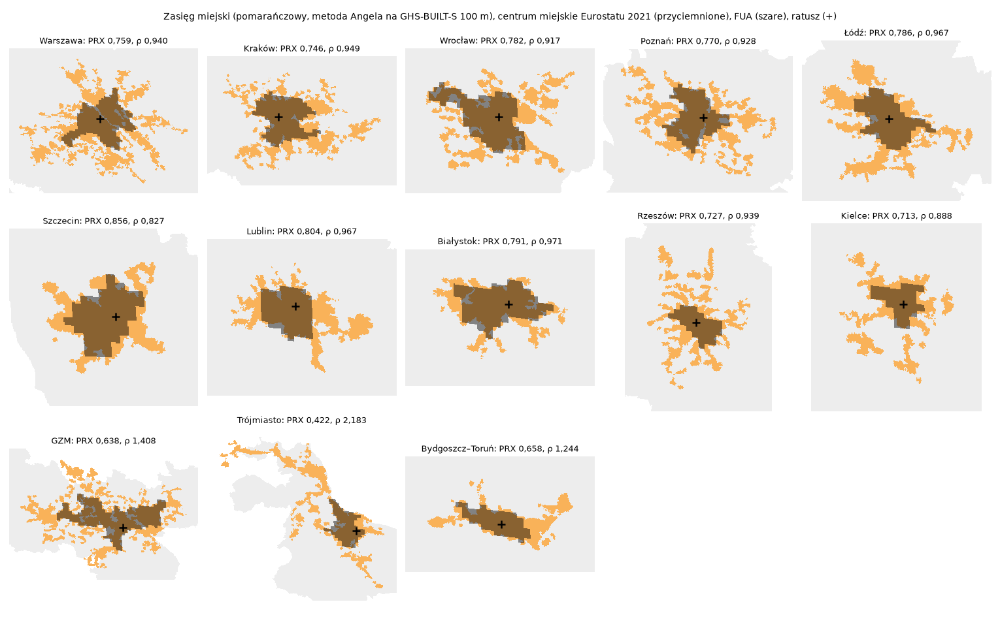
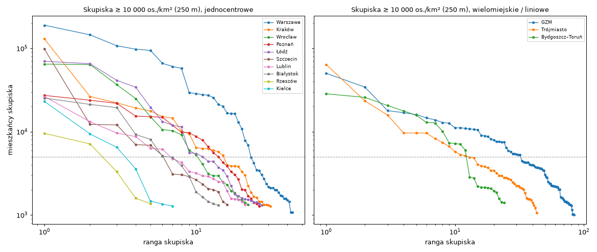
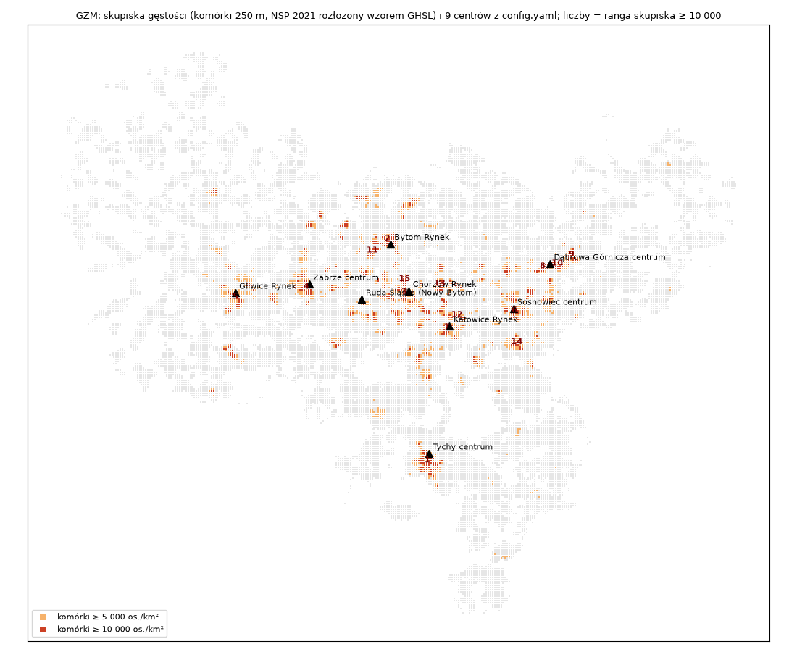
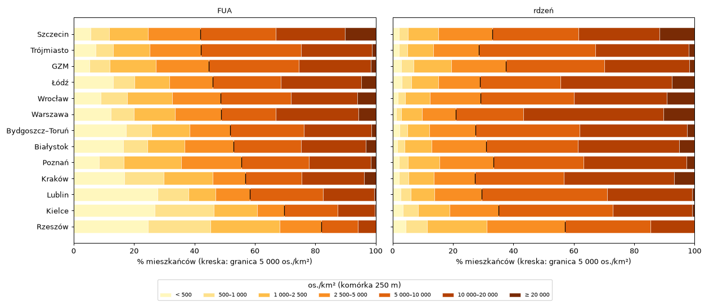

# Forma miasta: indeks bliskości Angela, policentryczność, stopień urbanizacji, klasy gęstości

Wygenerowano: 2026-11-24 (`python -m pipeline.form_extra`, potem `python -m pipeline.form_md`). Liczby w tabelach są przepisywane przez kod z `data/interim/form/*.json`, więc zgadzają się z `results/metrics/metrics_form.csv`. Daty: **ludność NSP 2021 stan na 31.03.2021** (siatka 1 km; wewnątrz komórek 1 km rozkład wzorem GHS-POP 2020), **zabudowa GHS-BUILT-S epoka 2020**, centra miejskie Eurostatu 2021 (wydanie 2024-11-19), ratusze z OSM (stan 2026-11-22). Rozkładów jazdy ten krok nie używa. Aglomeracje z * są wielomiejskie lub liniowe (GZM, Trójmiasto, Bydgoszcz–Toruń).

Spis treści: 1. Definicje · 2. Indeks bliskości Angela i ρ · 3. Policentryczność · 4. Stopień urbanizacji · 5. Klasy gęstości · 6. Lektura krytyczna · 7. Nie zweryfikowano · 8. Pliki

## 1. Definicje

### 1.1 Zasięg miejski (urban extent)

Indeks Angela wymaga zasięgu miejskiego narysowanego według opublikowanej reguły. Dane pozwalają na dwie:

- **Zasięg główny: metoda Atlas of Urban Expansion (Angel i in.) odtworzona na GHS-BUILT-S 100 m.**
  1. komórka zabudowana: co najmniej 10 % powierzchni komórki 100 m pod budynkami (GHS-BUILT-S 2020);
  2. „miejskość” komórki zabudowanej = udział komórek zabudowanych w kole o polu 1 km² wokół niej (promień 564 m; liczone tylko komórki w Polsce): miejska ≥ 50 %, podmiejska 25–50 %, wiejska < 25 %;
  3. otwarta przestrzeń na obrzeżu: komórki niezabudowane do 100 m od zabudowy miejskiej lub podmiejskiej;
  4. enklawy: dziury w tym obszarze mniejsze niż 200 ha (spójne 4-kierunkowo);
  5. zasięg = zabudowa miejska + podmiejska + obrzeże + enklawy; skupiska spójne 8-kierunkowo po połączeniu przerw do 600 m (ta sama reguła co maska ρ w kroku density; bez niej Wisła odcina ratusz Warszawy od Pragi); zasięg miasta to skupisko, w którym leży ratusz.
  Dlaczego ta reguła: to ta sama konstrukcja, na której Angel i in. policzyli indeksy dla 200 miast, więc wartości są z nimi zestawialne co do rzędu wielkości. Różnice wobec Atlasu: Atlas używa pikseli 30 m z Landsata, w których „zabudowa” obejmuje też drogi, parkingi i utwardzone podwórza; GHS-BUILT-S liczy tylko budynki. Próg 10 % na komórce 100 m wybrano jako najbliższy (komórka z ok. 1 000 m² dachów to w obrazie Landsata zwykle kilka pikseli zabudowanych); wrażliwość: 5 % i 20 % (tabela 2). Nie ma warstwy wód. Atlas łączy kilka skupisk w jedno miasto według własnych reguł; tu zastępuje je łączenie przerw do 600 m (wrażliwość: bez łączenia, tabela 2).
- **Zasięg kontrolny: centrum miejskie Eurostatu 2021** (`HDENS_CLST_2021`, komórki 1 km, ≥ 1 500 os./km², ≥ 50 000 mieszkańców, spis 2021), to, w którym leży ratusz. Reguła jest opublikowana i niezależna od naszych wyborów, ale opiera się na ludności, nie na zabudowie, i ma rozdzielczość 1 km.

**Centrum:** ratusz (siedziba prezydenta) miasta rdzenia z `pipeline.density_centres` (Angel i in. ustalają centrum właśnie jako ratusz). Dla Gdyni ratusz wybrano tą samą regułą, dla Torunia ręcznie (tabela 2a).

### 1.2 Indeksy

Dla zasięgu o polu A (liczba komórek 100 m × 0,01 km²; Mollweide jest równopolowe) i R = √(A/π):

- **Indeks bliskości (PRX, Angel):** ⅔R / średnia odległość wszystkich komórek zasięgu od ratusza. 1 = koło z ratuszem w środku; niższy = teren miasta leży dalej od ratusza niż w kole o tym samym polu (kształt wydłużony, postrzępiony albo ratusz z boku). Angel i in. nie znaleźli w próbie 200 miast wartości poniżej 0,35.
- **Indeks spójności (Angel):** średnia odległość między dwoma punktami koła (128R/45π ≈ 0,905R) / średnia odległość między wszystkimi parami komórek zasięgu (liczona dokładnie, po wszystkich parach). Nie zależy od centrum.
- **ρ Bertauda na tym samym zasięgu:** średnia odległość mieszkańca od ratusza / ⅔R. To odwrotność PRX, tyle że ważona ludnością. Iloczyn PRX × ρ = średnia odległość terenu / średnia odległość mieszkańca: > 1, gdy ludzie mieszkają bliżej ratusza niż leży teren (gęstość maleje od centrum).
- **Co dodaje każda miara:** PRX mówi o kształcie śladu zabudowy względem centrum (sam teren, bez ludności); ρ na tym samym zasięgu dodaje rozkład ludności w tym śladzie. ρ z kroku density (maska ≥ 20 %, FUA) mierzy coś trzeciego: rozkład mieszkańców gęstej zabudowy względem centrum z config.yaml, na masce netto, która pomija luźną zabudowę.

### 1.3 Policentryczność

- **η (Volpati i Barthelemy 2018, wzór 6):** komórki 100 m maski zabudowy ≥ 20 % w FUA (jak w kroku density); „hotspoty” = komórki powyżej progu LouBar (styczna do krzywej Lorenza ludności w F = 1); η = średnia odległość między hotspotami / średnia odległość między wszystkimi komórkami. Bliżej 0: hotspoty w jednym miejscu; bliżej 1: rozrzucone po całym obszarze jak komórki w ogóle. Krok density liczył to na próbie 4 000 komórek; tu po wszystkich parach (obie wartości w tabeli 3).
- **Skupiska gęstości (ranga–wielkość):** komórki 250 m siatki przeskalowanej do NSP 2021 w FUA o gęstości ≥ 10 000 os./km² (klasa „10 000–20 000” i wyższa warstwy gęstości na mapie), połączone 8-kierunkowo. Liczymy skupiska z ≥ 5 000 mieszkańców, udział największego skupiska w ludności wszystkich skupisk, stosunek drugiego do największego i nachylenie prostej ln(ludność) od ln(ranga) (MNK, co najmniej 4 skupiska). Nachylenie bliskie 0: skupiska podobnej wielkości (wiele ośrodków); silnie ujemne: jedno dominuje. Wrażliwość: próg 5 000 os./km² i próg LouBar komórek 250 m danej FUA. Volpati i Barthelemy definiują hotspoty i η; wykres ranga–wielkość skupisk to propozycja z notatek do przeglądu literatury (`research_notes/.../urban_form_and_density.md`, Q4 pkt 6), nie metoda z tej pracy.

### 1.4 Stopień urbanizacji i klasy gęstości

- **Centra miejskie:** oficjalna warstwa Eurostatu 2021 (`HDENS_CLST_2021`, zbudowana na tej samej siatce spisowej 2021). Udział = ludność NSP 2021 komórek 1 km (środek w obszarze), które leżą w centrum miejskim.
- **Skupiska miejskie (uproszczenie projektu):** komórki ≥ 300 os./km², spójne 8-kierunkowo, skupisko ≥ 5 000 mieszkańców, poza centrami miejskimi; reszta = komórki wiejskie. Oficjalnej warstwy skupisk (klastry średniej gęstości) nie pobrano, poziomu 2 (gęste i półgęste skupiska, przedmieścia) nie liczono.
- **Klasy gęstości:** komórka 250 m siatki przeskalowanej do NSP 2021, gęstość = mieszkańcy / 0,0625 km², klasy jak warstwa gęstości na mapie (500, 1 000, 2 500, 5 000, 10 000, 20 000 os./km²). „Typowy mieszkaniec” = mediana gęstości komórki ważona ludnością.

## 2. Indeks bliskości Angela i ρ Bertauda

Tabela 1. Zasięg główny (GHSL, komórka zabudowana ≥ 10 %), centrum = ratusz; obok zasięg kontrolny (centrum miejskie Eurostatu 2021) i ρ z kroku density (centrum z config.yaml).

| Aglomeracja | pole zasięgu, km² | ludność FUA w zasięgu | PRX | spójność | ρ na zasięgu | PRX × ρ | centrum Eurostatu, km² | PRX (Eurostat) | spójność (Eurostat) | ρ (Eurostat) | ρ FUA ≥ 20 % (density) | ρ rdzeń ≥ 10 % (density) |
|---|---|---|---|---|---|---|---|---|---|---|---|---|
| Warszawa | 853 | 76 % | 0,759 | 0,744 | 0,940 | 1,402 | 326 | 0,878 | 0,873 | 1,010 | 1,406 | 1,094 |
| Kraków | 300 | 64 % | 0,746 | 0,763 | 0,949 | 1,412 | 132 | 0,913 | 0,930 | 1,085 | 1,442 | 1,168 |
| Wrocław | 218 | 72 % | 0,782 | 0,759 | 0,917 | 1,394 | 126 | 0,820 | 0,861 | 0,970 | 1,287 | 1,152 |
| Poznań | 298 | 77 % | 0,770 | 0,761 | 0,928 | 1,400 | 131 | 0,864 | 0,902 | 0,979 | 1,330 | 1,059 |
| Łódź | 265 | 80 % | 0,786 | 0,771 | 0,967 | 1,316 | 111 | 0,922 | 0,916 | 0,990 | 1,391 | 1,046 |
| Szczecin | 87 | 64 % | 0,856 | 0,860 | 0,827 | 1,412 | 52 | 0,869 | 0,915 | 0,890 | 1,670 | 1,356 |
| Lublin | 130 | 56 % | 0,804 | 0,804 | 0,967 | 1,286 | 65 | 0,896 | 0,981 | 1,019 | 1,402 | 1,069 |
| Białystok | 89 | 67 % | 0,791 | 0,818 | 0,971 | 1,301 | 66 | 0,858 | 0,897 | 1,052 | 1,240 | 1,108 |
| Rzeszów | 128 | 50 % | 0,727 | 0,700 | 0,939 | 1,465 | 38 | 0,895 | 0,905 | 0,975 | 1,645 | 1,030 |
| Kielce | 80 | 50 % | 0,713 | 0,697 | 0,888 | 1,581 | 27 | 0,880 | 0,881 | 1,099 | 1,448 | 1,038 |
| GZM * | 590 | 85 % | 0,638 | 0,678 | 1,408 | 1,112 | 299 | 0,684 | 0,738 | 1,486 | 2,102 | 1,774 |
| Trójmiasto * | 305 | 88 % | 0,422 | 0,479 | 2,183 | 1,086 | 99 | 0,723 | 0,868 | 1,354 | 3,077 | 2,345 |
| Bydgoszcz–Toruń * | 93 | 39 % | 0,658 | 0,656 | 1,244 | 1,222 | 46 | 0,825 | 0,834 | 1,012 | 5,290 | 4,747 |

Tabela 2. Wrażliwość zasięgu głównego: próg komórki zabudowanej, centrum, skład zasięgu.

| Aglomeracja | PRX ≥ 5 / 10 / 20 % | pole, km² ≥ 5 / 10 / 20 % | ρ na zasięgu ≥ 5 / 10 / 20 % | PRX, centrum z config.yaml | skład, km²: miejska / podmiejska / obrzeże / enklawy | część zasięgu poza FUA | dotyka brzegu okna |
|---|---|---|---|---|---|---|---|
| Warszawa | 0,750 / 0,759 / 0,760 | 1 248 / 853 / 448 | 0,880 / 0,940 / 1,071 | 0,765 | 416 / 144 / 250 / 44 | 0,0 % | nie |
| Kraków | 0,721 / 0,746 / 0,777 | 643 / 300 / 140 | 0,867 / 0,949 / 1,127 | 0,743 | 117 / 64 / 101 / 18 | 0,0 % | nie |
| Wrocław | 0,802 / 0,782 / 0,777 | 275 / 218 / 126 | 0,853 / 0,917 / 1,019 | 0,782 | 100 / 42 / 65 / 11 | 0,0 % | nie |
| Poznań | 0,756 / 0,770 / 0,757 | 388 / 298 / 193 | 0,921 / 0,928 / 0,995 | 0,769 | 139 / 57 / 89 / 12 | 0,0 % | nie |
| Łódź | 0,791 / 0,786 / 0,767 | 373 / 265 / 162 | 0,894 / 0,967 / 1,112 | 0,768 | 136 / 40 / 78 / 11 | 0,0 % | nie |
| Szczecin | 0,713 / 0,856 / 0,853 | 123 / 87 / 59 | 0,901 / 0,827 / 0,909 | 0,802 | 44 / 13 / 26 / 4 | 0,0 % | nie |
| Lublin | 0,789 / 0,804 / 0,874 | 220 / 130 / 71 | 0,819 / 0,967 / 1,018 | 0,802 | 60 / 23 / 41 / 6 | 0,0 % | nie |
| Białystok | 0,783 / 0,791 / 0,798 | 134 / 89 / 63 | 0,891 / 0,971 / 1,109 | 0,822 | 47 / 13 / 26 / 3 | 0,0 % | nie |
| Rzeszów | 0,654 / 0,727 / 0,873 | 310 / 128 / 45 | 1,058 / 0,939 / 0,971 | 0,727 | 44 / 34 / 46 / 4 | 0,0 % | nie |
| Kielce | 0,622 / 0,713 / 0,892 | 150 / 80 / 37 | 0,911 / 0,888 / 0,991 | 0,711 | 34 / 17 / 26 / 3 | 0,0 % | nie |
| GZM * | 0,690 / 0,638 / 0,527 | 733 / 590 / 328 | 1,277 / 1,408 / 1,740 | 0,638 | 261 / 113 / 188 / 29 | 7,7 % | nie |
| Trójmiasto * | 0,465 / 0,422 / 0,734 | 429 / 305 / 105 | 1,899 / 2,183 / 1,340 | 0,423 | 141 / 56 / 96 / 12 | 5,7 % | nie |
| Bydgoszcz–Toruń * | 0,657 / 0,658 / 0,659 | 107 / 93 / 71 | 1,172 / 1,244 / 1,365 | 0,660 | 52 / 14 / 25 / 2 | 0,0 % | nie |

Tabela 2a. Drugie miasto aglomeracji wielomiejskiej: zasięg z jego ratuszem.

| Aglomeracja | ratusz | to samo skupisko co pierwszy ratusz | pole, km² | PRX | spójność | ρ na zasięgu |
|---|---|---|---|---|---|---|
| Trójmiasto * | Gdynia: Urząd Miasta Gdyni (way/125912675; nazwa) | tak | 305 | 0,404 | 0,479 | 2,205 |
| Bydgoszcz–Toruń * | Toruń: Urząd Miasta Torunia (way/86490360; ręcznie: 6 obiektów z townhall:type=city; wybrano Wały gen. Sikorskiego 8 (siedziba prezydenta; pozostałe to punkty obsługi, USC, filie)) | nie | 62 | 0,711 | 0,764 | 1,094 |

Ratusze pierwszego miasta (`pipeline.density_centres`, density.md §4b): Warszawa: Urząd Miasta Stołecznego Warszawy (way/29388083, reguła nazwy); Kraków: Urząd Miasta Krakowa (node/4017203772, wybór ręczny); Wrocław: Urząd Miejski (way/101131393, reguła nazwy); Poznań: Urząd Miasta Poznania (relation/5442363, wybór ręczny); Łódź: Urząd Miasta Łodzi (node/1880701425, wybór ręczny); Szczecin: Urząd Miasta Szczecin (relation/537297, townhall:type=city); Lublin: Urząd Miasta Lublin (way/66264120, reguła nazwy); Białystok: Urząd Miejski w Białymstoku (way/548685792, wybór ręczny); Rzeszów: Ratusz Miejski (way/149933478, townhall:type=city); Kielce: Urząd Miasta Kielce (node/6588785827, wybór ręczny); GZM: Urząd Miasta Katowice (way/202209404, wybór ręczny); Trójmiasto: Urząd Miejski w Gdańsku (node/14330910588, townhall:type=city); Bydgoszcz–Toruń: Urząd Miasta Bydgoszczy (way/88520891, wybór ręczny).

**Jak czytać.**

- **PRX w miastach jednocentrowych mieści się w wąskim paśmie 0,713–0,856** (centrum miejskie Eurostatu: 0,820–0,922). Wszystkie wartości są powyżej dolnej granicy 0,35 z próby Angela i in. Kolejność miast w tym paśmie nie jest odporna na regułę zasięgu: korelacja rang (Spearman, 10 miast) PRX głównego z wariantem bez łączenia przerw wynosi -0,05, z progiem 20 % -0,05, z progiem 5 % 0,55, z PRX centrum miejskiego Eurostatu -0,20. Różnice między miastami jednocentrowymi są więc mniejsze niż niepewność samej definicji zasięgu; nie należy ich rankingować.
- **Odporne jest tylko to, co odstaje:** Trójmiasto (0,422; zasięg od Gdańska po Gdynię i Wejherowo, 305 km²), GZM (0,638) i Bydgoszcz–Toruń (0,658) mają najniższe PRX przy każdej regule. Dla Trójmiasta PRX z ratuszem Gdyni wynosi 0,404 (to samo skupisko). To potwierdza, że indeks z jednym centrum mierzy tam kształt pasma, a nie zwartość miasta: dla Trójmiasta jest **bez znaczenia jako miara zwartości**, dla GZM opisuje konurbację względem Katowic, dla Bydgoszczy–Torunia tylko Bydgoszcz (Toruń w tabeli 2a ma własny zasięg).
- **Warszawa pokazuje, czemu potrzebne jest łączenie przerw:** bez niego Wisła odcina ratusz (pl. Bankowy, blisko rzeki) od Pragi, zasięg ma 358 km² zamiast 853 km², a PRX spada do 0,648. Łączenie przerw do 600 m (ta sama reguła co maska ρ w kroku density) ma swoją cenę: w Kielcach i Rzeszowie dołącza wsie wzdłuż dróg (PRX 0,863 → 0,713 i 0,787 → 0,727).
- **ρ Bertauda na zasięgu Angela jest poniżej 1 w każdym mieście jednocentrowym (0,827–0,971)**, a ρ z kroku density (maska ≥ 20 %, FUA) jest powyżej 1 wszędzie (1,240–1,670). Na zasięgu narysowanym opublikowaną regułą mieszkańcy mieszkają więc bliżej ratusza niż przy równomiernym rozkładzie na kole o tym samym polu; ρ > 1 z kroku density wynika z maski netto (gwiaździstej, bez luźnej zabudowy), co density.md §4 już opisuje. Poziom ρ na zasięgu Angela jest tego samego rzędu co wartości Bertauda i Malpezziego dla Warszawy i Krakowa (0,99 i 1,18, lata 90.): tu 0,940 i 0,949. Kolejność miast według obu ρ się nie zgadza (Spearman -0,50): to różne obszary i różne centra.
- **Co dodaje każda miara.** PRX × ρ (średnia odległość terenu / średnia odległość mieszkańca) jest > 1 w każdej aglomeracji (1,086–1,581): ludzie mieszkają bliżej ratusza niż leży teren zasięgu, czyli gęstość maleje od centrum. PRX opisuje sam kształt śladu zabudowy (np. pasma wzdłuż dróg w Warszawie, Kielcach, Rzeszowie), ρ dokłada rozkład ludzi w tym śladzie. Dla miast jednocentrowych obie miary leżą blisko siebie i blisko 1 (PRX 0,713–0,856, 1/ρ 1,030–1,209), więc żadna nie rozróżnia ich lepiej niż gęstość ważona populacją albo udział mieszkańców w gęstych komórkach (sekcja 5).
- **Spójność** zachowuje się jak PRX (Trójmiasto 0,479, GZM 0,678, miasta jednocentrowe 0,697–0,860) i nie zależy od centrum; to jej jedyna przewaga.
- **Najniższe PRX wśród miast jednocentrowych:** Kielce 0,713, Rzeszów 0,727, Kraków 0,746; na mapie (extents.png) widać, że to miasta z długimi pasmami zabudowy wzdłuż dróg dołączonymi do zasięgu, a nie z rzadszym centrum.

## 3. Policentryczność

Tabela 3. η i skupiska gęstości (FUA).

| Aglomeracja | η (dokładnie) | η (próba 4 000, density) | próg LouBar 100 m, os./km² | skupiska ≥ 10 000 os./km² z ≥ 5 000 mieszk. | udział największego | drugie / największe | nachylenie ranga–wielkość | ludność FUA w skupiskach | największe skupisko | próg 5 000: liczba / udział największego / nachylenie | próg LouBar 250 m: wartość: liczba / udział / nachylenie |
|---|---|---|---|---|---|---|---|---|---|---|---|
| Warszawa | 0,446 | 0,445 | 13 780 | 22 | 16 % | 0,766 | -1,093 (n = 22) | 33 % | Warszawa, 189 637 os., 4,1 km od: Rondo Dmowskiego | 22 / 46 % / -1,613 | 7 346: 18 / 39 % / -1,615 |
| Kraków | 0,487 | 0,481 | 14 961 | 15 | 37 % | 0,204 | -1,059 (n = 15) | 25 % | Kraków, 129 702 os., 6,3 km od: Rynek Główny | 6 / 64 % / -2,523 | 7 895: 14 / 39 % / -1,302 |
| Wrocław | 0,499 | 0,495 | 12 980 | 10 | 23 % | 0,990 | -1,205 (n = 10) | 28 % | Wrocław, 64 618 os., 1,5 km od: Rynek | 16 / 61 % / -1,152 | 8 699: 9 / 34 % / -1,348 |
| Poznań | 0,465 | 0,460 | 10 184 | 14 | 13 % | 0,875 | -0,652 (n = 14) | 22 % | Poznań, 27 228 os., 3,1 km od: Stary Rynek | 8 / 61 % / -1,787 | 5 517: 7 / 63 % / -1,908 |
| Łódź | 0,632 | 0,630 | 13 367 | 11 | 21 % | 0,937 | -1,238 (n = 11) | 31 % | Łódź, 69 917 os., 4,9 km od: pl. Wolności | 11 / 61 % / -1,478 | 7 607: 9 / 59 % / -1,397 |
| Szczecin | 0,686 | 0,686 | 13 797 | 6 | 58 % | 0,124 | -1,523 (n = 6) | 33 % | Szczecin, 98 200 os., 1,6 km od: Brama Portowa | 6 / 67 % / -1,858 | 8 691: 6 / 54 % / -1,428 |
| Lublin | 0,822 | 0,818 | 10 482 | 6 | 23 % | 0,497 | -0,815 (n = 6) | 17 % | Lublin, 26 430 os., 4,3 km od: pl. Litewski | 8 / 60 % / -1,662 | 5 031: 8 / 60 % / -1,664 |
| Białystok | 0,561 | 0,558 | 9 717 | 6 | 23 % | 0,839 | -0,878 (n = 6) | 25 % | Białystok, 25 286 os., 0,8 km od: Rynek Kościuszki | 3 / 70 % / brak | 5 503: 3 / 68 % / brak |
| Rzeszów | 0,303 | 0,301 | 7 056 | 2 | 35 % | 0,747 | brak (n = 2) | 6 % | Rzeszów, 9 538 os., 1,6 km od: Rynek | 3 / 33 % / brak | 2 691: 2 / 83 % / brak |
| Kielce | 0,339 | 0,341 | 9 361 | 3 | 47 % | 0,407 | brak (n = 3) | 13 % | Kielce, 23 054 os., 2,6 km od: Rynek | 2 / 85 % / brak | 3 787: 1 / 92 % / brak |
| GZM * | 0,857 | 0,848 | 11 834 | 32 | 10 % | 0,683 | -0,602 (n = 32) | 25 % | Tychy, 50 154 os., 1,1 km od: Tychy centrum | 49 / 8 % / -0,840 | 7 592: 44 / 8 % / -0,760 |
| Trójmiasto * | 0,780 | 0,780 | 12 484 | 12 | 24 % | 0,365 | -0,944 (n = 12) | 25 % | Gdańsk, 64 098 os., 5,4 km od: Sopot | 22 / 22 % / -1,067 | 7 775: 19 / 24 % / -0,934 |
| Bydgoszcz–Toruń * | 0,852 | 0,846 | 11 909 | 12 | 14 % | 0,907 | -0,668 (n = 12) | 24 % | Toruń, 28 446 os., 5,0 km od: Toruń, Rynek Staromiejski | 9 / 43 % / -1,725 | 6 440: 6 / 47 % / -1,533 |

Tabela 4. GZM: dziewięć centrów z config.yaml a skupiska gęstości (najbliższa komórka skupiska, ranga i ludność skupiska).

| Centrum | ≥ 10 000: odległość, km | ranga | ludność | gmina | ≥ 5 000: odległość, km | ranga | ludność |
|---|---|---|---|---|---|---|---|
| Katowice Rynek | 0,11 | 7 | 13 832 | Katowice | 0,11 | 8 | 37 903 |
| Gliwice Rynek | 0,14 | 5 | 16 009 | Gliwice | 0,14 | 6 | 49 057 |
| Sosnowiec centrum | 0,04 | 6 | 14 651 | Sosnowiec | 0,04 | 7 | 43 950 |
| Bytom Rynek | 0,11 | 2 | 34 260 | Bytom | 0,11 | 5 | 52 885 |
| Zabrze centrum | 0,14 | 4 | 16 892 | Zabrze | 0,13 | 4 | 55 276 |
| Tychy centrum | 0,13 | 1 | 50 154 | Tychy | 0,13 | 2 | 80 733 |
| Chorzów Rynek | 0,15 | 3 | 17 842 | Chorzów | 0,15 | 1 | 89 008 |
| Dąbrowa Górnicza centrum | 0,23 | 10 | 11 109 | Dąbrowa Górnicza | 0,05 | 3 | 59 829 |
| Ruda Śląska (Nowy Bytom) | 0,37 | 73 | 1 449 | Ruda Śląska | 0,12 | 41 | 6 760 |

Tabela 4a. GZM: 15 największych skupisk ≥ 10 000 os./km².

| Ranga | mieszkańcy | komórki 250 m | gmina (środek ciężkości) | najbliższe centrum | km |
|---|---|---|---|---|---|
| 1 | 50 154 | 58 | Tychy | Tychy centrum | 1,1 |
| 2 | 34 260 | 37 | Bytom | Bytom Rynek | 0,5 |
| 3 | 17 842 | 20 | Chorzów | Chorzów Rynek | 0,7 |
| 4 | 16 892 | 21 | Zabrze | Zabrze centrum | 0,6 |
| 5 | 16 009 | 20 | Gliwice | Gliwice Rynek | 0,7 |
| 6 | 14 651 | 16 | Sosnowiec | Sosnowiec centrum | 0,5 |
| 7 | 13 832 | 18 | Katowice | Katowice Rynek | 0,5 |
| 8 | 12 862 | 16 | Dąbrowa Górnicza | Dąbrowa Górnicza centrum | 1,0 |
| 9 | 12 639 | 16 | Dąbrowa Górnicza | Dąbrowa Górnicza centrum | 2,7 |
| 10 | 11 109 | 14 | Dąbrowa Górnicza | Dąbrowa Górnicza centrum | 0,9 |
| 11 | 11 106 | 12 | Bytom | Bytom Rynek | 2,4 |
| 12 | 10 975 | 14 | Katowice | Katowice Rynek | 1,4 |
| 13 | 10 787 | 13 | Siemianowice Śląskie | Chorzów Rynek | 3,7 |
| 14 | 10 664 | 13 | Mysłowice | Sosnowiec centrum | 4,2 |
| 15 | 10 513 | 11 | Chorzów | Chorzów Rynek | 1,3 |

**Jak czytać.**

- **η dokładne a z próby:** różnica najwyżej 0,009, czyli błąd próbkowania z kroku density (4 000 komórek) jest pomijalny.
- **η wysokie w obszarach wielomiejskich:** GZM 0,857, Bydgoszcz–Toruń 0,852, Trójmiasto 0,780. Ale wysokie ma też Lublin (0,822): jego hotspoty to osiedla rozrzucone po mieście i Świdnik (skupisko 13 143 os. ok. 11 km od centrum). Najniższe η: Rzeszów 0,303, Kielce 0,339, Warszawa 0,446. η mówi więc, czy gęste miejsca są rozrzucone po obszarze, a nie, czy obszar ma kilka centrów; samo nie odróżnia konurbacji od miasta z rozproszonymi blokowiskami.
- **Skupiska gęstości.** Najbardziej płaska zależność ranga–wielkość: GZM -0,602, Poznań -0,652, Bydgoszcz–Toruń -0,668, Lublin -0,815; najbardziej stroma: Wrocław -1,205, Łódź -1,238, Szczecin -1,523. GZM ma najwięcej skupisk (32 z ≥ 5 000 mieszkańców) i najmniejszy udział największego (10 %); to jedyna aglomeracja, w której oba wskaźniki wskazują wiele podobnych ośrodków przy obu progach (5 000: 49 skupisk, największe 8 %). Poznań ma nachylenie podobne do GZM, ale z innego powodu: kilkanaście osiedli podobnej wielkości (Winogrady, Piątkowo, Rataje według położenia; nazw nie sprawdzano) w jednym mieście. Przy progu 5 000 osiedla Poznania, Krakowa i Warszawy zlewają się z centrum w jedno duże skupisko (udział największego: 61 %, 64 %, 46 %), a GZM nie. Nachylenie zależy od progu bardziej niż od miasta, więc do tabel idzie z progiem w nazwie.
- **Największe skupiska miast jednocentrowych to blokowiska, nie śródmieścia:** w 5 z 10 miast największe skupisko ≥ 10 000 os./km² leży ≥ 3 km od centrum (np. Kraków: 129 702 os., 6,3 km od centrum; Łódź: 69 917 os., 4,9 km od centrum; Lublin: 26 430 os., 4,3 km od centrum). To zgodne z §14.4 RAPORTU (gęstość spisowa największa w wielkich osiedlach). Wzór wewnątrz komórek 1 km pochodzi z GHSL, który osiedla zaniża, więc skupiska osiedli mogą być w rzeczywistości jeszcze większe.
- **Kontrola GZM wobec 9 centrów z config.yaml:** 8 centrów ma komórkę skupiska ≥ 10 000 os./km² w odległości do 0,25 km, a jej skupisko jest w pierwszej dziesiątce (rangi 1–10). Wyjątek: Ruda Śląska (Nowy Bytom) (skupisko rangi 73, 1 449 os.); Ruda Śląska nie ma wyraźnego gęstego śródmieścia (miasto z kilku dzielnic). Największe skupisko GZM to Tychy (osiedla z lat 60.–80.), drugie Bytom, a Katowice są dopiero na miejscu 7: pod względem gęstości zamieszkania konurbacja nie ma jednego środka, a lista centrów w config.yaml zgadza się z delineacją skupisk (poza Rudą Śląską; za to Tychy i Bytom są ważniejsze, niż sugeruje kolejność listy). Skupisk, które nie leżą przy żadnym z 9 centrów, jest w pierwszej piętnastce 3 (odległość > 2,5 km; tabela 4a): to osiedla na obrzeżach miast, nie osobne ośrodki.

## 4. Stopień urbanizacji: uproszczona klasyfikacja a oficjalne centra miejskie Eurostatu 2021

Tabela 5. Udział ludności (NSP 2021, komórki 1 km o środku w obszarze). „Projekt” = uproszczona klasyfikacja z kroku density; „Eurostat” = oficjalne centra miejskie 2021; skupiska i komórki wiejskie liczone z oficjalnymi centrami.

| Aglomeracja | FUA: centrum (Eurostat) | FUA: centrum (projekt) | różnica, pp | FUA: skupisko | FUA: wiejskie | rdzeń: centrum (Eurostat) | różnica, pp | rdzeń: skupisko | rdzeń: wiejskie | FUA: ludność tylko w centrach Eurostatu | FUA: ludność tylko w centrach projektu |
|---|---|---|---|---|---|---|---|---|---|---|---|
| Warszawa | 57,5 % | 57,5 % | 0,0 | 26,1 % | 16,4 % | 91,9 % | 0,0 | 7,6 % | 0,5 % | 2 561 | 2 634 |
| Kraków | 50,1 % | 50,1 % | 0,0 | 26,0 % | 23,9 % | 88,6 % | 0,0 | 9,8 % | 1,6 % | 0 | 0 |
| Wrocław | 56,7 % | 56,5 % | -0,2 | 24,8 % | 18,6 % | 84,6 % | -0,2 | 14,4 % | 0,9 % | 1 653 | 0 |
| Poznań | 54,9 % | 54,9 % | 0,0 | 31,9 % | 13,2 % | 89,2 % | 0,0 | 9,6 % | 1,2 % | 0 | 0 |
| Łódź | 62,6 % | 62,6 % | 0,0 | 21,7 % | 15,6 % | 90,3 % | 0,0 | 6,5 % | 3,2 % | 0 | 0 |
| Szczecin | 55,3 % | 55,3 % | 0,0 | 33,4 % | 11,3 % | 72,0 % | 0,0 | 25,4 % | 2,6 % | 0 | 0 |
| Lublin | 44,4 % | 44,4 % | 0,0 | 19,2 % | 36,4 % | 91,3 % | 0,0 | 6,4 % | 2,3 % | 0 | 0 |
| Białystok | 61,3 % | 60,3 % | -1,0 | 14,5 % | 24,2 % | 94,1 % | 0,0 | 5,4 % | 0,5 % | 4 594 | 0 |
| Rzeszów | 31,1 % | 31,1 % | 0,0 | 30,0 % | 38,9 % | 76,8 % | 0,0 | 20,8 % | 2,4 % | 0 | 0 |
| Kielce | 38,0 % | 38,0 % | 0,0 | 13,1 % | 48,9 % | 81,9 % | 0,0 | 15,1 % | 3,0 % | 0 | 0 |
| GZM * | 66,1 % | 64,8 % | -1,4 | 25,4 % | 8,5 % | 80,9 % | 0,2 | 16,5 % | 2,6 % | 34 826 | 6 821 |
| Trójmiasto * | 52,6 % | 52,5 % | -0,1 | 37,4 % | 10,0 % | 75,8 % | -0,2 | 22,8 % | 1,5 % | 1 406 | 0 |
| Bydgoszcz–Toruń * | 53,9 % | 53,7 % | -0,1 | 18,4 % | 27,7 % | 88,8 % | -0,2 | 9,3 % | 1,9 % | 1 242 | 0 |

Cała Polska: centra Eurostatu obejmują 28,2 % ludności siatki, centra projektu 28,0 %; komórek 2 249 i 2 214, wspólnych 2 194. Ludność oficjalnych klastrów w Polsce równa się sumie NSP 2021 w ich komórkach co do osoby w 51 z 55 klastrów; pozostałe 2 to klastry przygraniczne. Skąd różnice:

- tylko w centrach Eurostatu: 55 komórek, 93 175 os.:
  - 34 komórek o gęstości < 1 500 (18 706 os.; w tym 9 bez mieszkańców): wypełnienie luk albo reguła zabudowy ≥ 50 %, której projekt nie stosuje;
  - 37 767 os. w komórkach ≥ 1 500 os./km² w dwóch klastrach przygranicznych (Słubice z Frankfurtem nad Odrą i Zgorzelec z Görlitz według współrzędnych; nazw nie sprawdzano na mapie): po stronie polskiej mają mniej niż 50 000 mieszkańców, razem z niemiecką więcej;
  - 36 702 os. w komórkach ≥ 1 500 os./km², których własne skupisko (spójne 4-kierunkowo) ma poniżej 50 000 mieszkańców, a w warstwie Eurostatu jest częścią dużego klastra (Warszawa, GZM, Łódź, Trójmiasto): połączenie przez komórki rzadsze niż 1 500, zapewne przez regułę zabudowy;
- tylko w centrach projektu: 20 komórek, 9 455 os., wszystkie poniżej 1 500 os./km² (dołączone przez wypełnienie luk w projekcie, a nie u Eurostatu).

**Jak czytać.**

- **Uproszczona klasyfikacja projektu daje te same udziały centrów miejskich co oficjalna warstwa** w 8 z 13 FUA (różnica < 0,05 pp). Różnice: GZM -1,4 pp, Białystok -1,0 pp, Wrocław -0,2 pp, Bydgoszcz–Toruń -0,1 pp, Trójmiasto -0,1 pp. Największa jest w GZM, gdzie Eurostat dołącza do klastra katowickiego mniejsze gęste skupiska połączone komórkami rzadszymi niż 1 500 os./km².
- **Do tabel proponujemy udział w centrach miejskich z oficjalnej warstwy** (bez uproszczeń), a skupiska i komórki wiejskie z regułą projektu, z tym zastrzeżeniem w opisie. Wiersze `degurba_share_*` z kroku density zostają jako kontrola.
- **Co mówią liczby:** w FUA od 31 % (Rzeszów) do 66 % (GZM) mieszkańców żyje w centrum miejskim; w komórkach wiejskich od 8 % do 49 %. Udział zależy od tego, jak duże FUA narysował Eurostat (Kielce i Rzeszów mają rozległe FUA z gęstą wsią), więc porównuje się go między miastami tylko razem z rdzeniem.
- Porównania z liczbą OECD (43 % mieszkańców polskich FUA w strefach dojazdów) nie da się zrobić wprost: strefa dojazdów to część FUA poza miastem (granica gmin), a nie klasa komórek. Na granicach URAU odpowiednikiem jest 1 − ludność rdzenia / ludność FUA (krok density), nie stopień urbanizacji.

## 5. Mieszkańcy według gęstości komórki 250 m

Tabela 6. Udział mieszkańców w klasach gęstości (FUA), udział mieszkańców komórek ≥ 5 000 i ≥ 10 000 os./km² w FUA i rdzeniu oraz gęstość komórki typowego mieszkańca.

| Aglomeracja | FUA < 500 | FUA 500–1 000 | FUA 1 000–2 500 | FUA 2 500–5 000 | FUA 5 000–10 000 | FUA 10 000–20 000 | FUA ≥ 20 000 | FUA ≥ 5 000 | rdzeń ≥ 5 000 | FUA ≥ 10 000 | rdzeń ≥ 10 000 | typowy mieszkaniec FUA, os./km² | typowy mieszkaniec rdzenia, os./km² |
|---|---|---|---|---|---|---|---|---|---|---|---|---|---|
| Szczecin | 6 % | 6 % | 13 % | 17 % | 25 % | 23 % | 10 % | 58,1 % | 66,9 % | 33,0 % | 38,4 % | 6 427 | 7 757 |
| Trójmiasto * | 7 % | 6 % | 12 % | 17 % | 33 % | 23 % | 1 % | 57,9 % | 71,4 % | 24,8 % | 32,8 % | 6 105 | 7 787 |
| GZM * | 5 % | 7 % | 15 % | 18 % | 30 % | 24 % | 2 % | 55,2 % | 62,6 % | 25,5 % | 29,9 % | 5 825 | 6 973 |
| Łódź | 13 % | 7 % | 12 % | 14 % | 23 % | 27 % | 5 % | 53,9 % | 71,1 % | 31,4 % | 44,4 % | 5 901 | 8 996 |
| Wrocław | 9 % | 9 % | 15 % | 16 % | 23 % | 22 % | 6 % | 51,3 % | 70,8 % | 28,0 % | 40,0 % | 5 232 | 8 235 |
| Warszawa | 12 % | 8 % | 14 % | 15 % | 18 % | 27 % | 6 % | 51,2 % | 79,1 % | 33,1 % | 56,8 % | 5 208 | 11 350 |
| Bydgoszcz–Toruń * | 17 % | 8 % | 13 % | 13 % | 24 % | 22 % | 1 % | 48,1 % | 72,6 % | 23,8 % | 38,0 % | 4 575 | 8 169 |
| Białystok | 16 % | 8 % | 12 % | 16 % | 22 % | 22 % | 3 % | 47,1 % | 69,0 % | 24,8 % | 38,7 % | 4 441 | 8 371 |
| Poznań | 8 % | 8 % | 19 % | 20 % | 22 % | 20 % | 2 % | 44,5 % | 66,6 % | 22,1 % | 36,8 % | 4 073 | 8 057 |
| Kraków | 17 % | 13 % | 16 % | 11 % | 19 % | 21 % | 4 % | 43,1 % | 72,7 % | 24,6 % | 43,4 % | 3 213 | 8 882 |
| Lublin | 28 % | 10 % | 9 % | 12 % | 24 % | 17 % | 0 % | 41,6 % | 70,4 % | 17,4 % | 28,9 % | 3 174 | 7 207 |
| Kielce | 27 % | 20 % | 14 % | 9 % | 18 % | 12 % | 0 % | 30,3 % | 65,0 % | 12,6 % | 27,1 % | 1 145 | 7 105 |
| Rzeszów | 25 % | 21 % | 23 % | 14 % | 12 % | 6 % | 0 % | 18,0 % | 43,0 % | 5,9 % | 14,6 % | 1 157 | 4 286 |

Kontrola krzyżowa z `results/web/class_shares.json` (warstwa `density_250m`, osobny kod z `pipeline.class_shares`): 26 par aglomeracja × obszar, największa różnica liczby mieszkańców klasy 24,2 os. (zaokrąglenie do pełnych osób w tamtym pliku).

Dane pod wykres: `results/charts/form.json` (dla FUA i rdzenia: mieszkańcy i udziały w klasach, udział „w komórkach o gęstości co najmniej X” dla każdej granicy klas, mediana; oraz lista skupisk do wykresu ranga–wielkość).

**Jak czytać.**

- W FUA w komórkach ≥ 5 000 os./km² mieszka od 18 % (Rzeszów) do 58 % (Szczecin) mieszkańców, w rdzeniach od 43 % (Rzeszów) do 79 % (Warszawa).
- Szczecin i Trójmiasto są na czele w FUA (58 % i 58 %), bo ich FUA są małe względem rdzenia; w rdzeniach prowadzi Warszawa (79 %; typowy mieszkaniec rdzenia w komórce 11 350 os./km²). Ta sama zależność od granicy FUA, co przy PWD (density.md §8 pkt 4).
- Rzeszów odstaje w dół w obu domenach (FUA 18 %, rdzeń 43 %): rdzeń z dużym udziałem zabudowy jednorodzinnej po przyłączeniach gmin (wyjaśnienie prawdopodobne, nie sprawdzane). Wynik zgodny z najniższym PWD rdzenia (4 377 os./km², RAPORT §14.1).
- Kolejność FUA według udziału ≥ 5 000: Szczecin, Trójmiasto, GZM, Łódź, Wrocław, Warszawa, Bydgoszcz–Toruń, Białystok, Poznań, Kraków, Lublin, Kielce, Rzeszów.
- Wskaźnik jest prosty i sprawdzony krzyżowo (osobny kod `pipeline.class_shares`), ale liczy tylko mieszkańców i dziedziczy wzór GHSL wewnątrz komórek 1 km.

## 6. Lektura krytyczna

Wartości zaskakujące, sprawdzone przed pozostawieniem:

1. **PRX Warszawy 0,648 w pierwszej wersji** (jedno skupisko bez łączenia przerw): mapa pokazała, że Wisła odcina ratusz od Pragi. Poprawione regułą łączenia przerw do 600 m; wariant bez niej zostaje jako wrażliwość (tabela 2, poziom `qa`).
2. **PRX Trójmiasta 0,422**, blisko dolnej granicy 0,35 z próby Angela. Sprawdzone na mapie: zasięg to pasmo od Pruszcza po Wejherowo, ratusz Gdańska w jego południowej części. Wynik zostaje, z opisem, że dla miasta liniowego indeks z jednym centrum nie mierzy zwartości.
3. **ρ na zasięgu Angela < 1, a ρ z kroku density > 1** w tych samych miastach. Sprawdzone: to różnica obszaru (zasięg z obrzeżem i enklawami zamiast maski netto) i centrum (ratusz zamiast punktu z config.yaml; PRX z centrum z config.yaml w tabeli 2 różni się o 0,054 najwyżej). Zostaje.
4. **Lublin z η jak konurbacja**: sprawdzone na liście skupisk (Świdnik, osiedla). Zostaje z opisem.
5. **Tychy jako największe skupisko GZM**: komórki 250 m w centrum Tychów (osiedla z wielkiej płyty) mają ≥ 10 000 os./km² na dużym, zwartym obszarze. Sprawdzone na siatce spisowej (2026-11-24): w promieniu 3 km od centrum Tychów leżą cztery sąsiednie komórki NSP 1 km z 10 369–14 048 mieszkańcami, więcej niż przy Bytomiu (do 13 098). Zostaje.

Gdzie miara nie ma sensu:

- PRX, spójność i ρ z ratuszem Gdańska dla Trójmiasta: opisują pasmo, nie zwartość; nie zestawiać z innymi miastami (flaga w `metrics_form.csv`).
- PRX i ρ GZM względem Katowic: opisują konurbację względem jednego z dziewięciu ośrodków; do porównań policentryczności lepsze są η i skupiska.
- Bydgoszcz–Toruń: zasięgi obu miast są osobne; wartości dotyczą każdego miasta osobno, a nie aglomeracji.
- Nachylenie ranga–wielkość przy mniej niż 4 skupiskach ≥ 5 000 mieszkańców (Kielce, Rzeszów): brak.
- Ranking 10 miast jednocentrowych według PRX: nieodporny (sekcja 2).

## 7. Nie zweryfikowano

- Metody Atlas of Urban Expansion nie odtworzono co do szczegółu: progi (komórka zabudowana ≥ 10 % w GHSL zamiast pikseli Landsata), łączenie przerw 600 m i wybór jednego skupiska to decyzje projektu. Wartości PRX dla polskich miast z Atlasu (jeśli w próbie są) nie zostały znalezione ani porównane.
- Średnia PRX z próby 200 miast Angela i in. nie była czytana; znamy tylko dolną granicę 0,35 (notatki).
- Ratusze: siedziby prezydentów według wiedzy ogólnej, nie sprawdzane w BIP (w tym Toruń, Wały gen. Sikorskiego 8, wybór ręczny w `pipeline.form_extra.SECOND_PICK`).
- Nazwy osiedli i miejsc przy skupiskach gęstości (Nowa Huta, Winogrady, Tychy, Świdnik) przypisano z położenia i nazwy gminy, bez ortofotomapy.
- Przyczyna różnic między centrami miejskimi projektu i Eurostatu (reguła zabudowy ≥ 50 %, kolejność wypełniania luk): wniosek z charakteru komórek, nie z kodu Eurostatu.
- Nazwy klastrów przygranicznych (Słubice–Frankfurt, Zgorzelec–Görlitz) z samych współrzędnych.
- Oficjalnej warstwy skupisk miejskich (klastry średniej gęstości) i poziomu 2 stopnia urbanizacji nie pobrano; udziały skupisk i obszarów wiejskich są z reguły uproszczonej.
- Wpływ wzoru GHSL wewnątrz komórek 1 km na klasy gęstości 250 m i na skupiska (GHSL zaniża wielkie osiedla): kierunek znany, wielkość nieznana do czasu warstwy z BDOT10k.
- Wybór progu skupisk (10 000 os./km²) i minimum 5 000 mieszkańców nie ma podstawy w literaturze; pokazano wrażliwość na 5 000 i na próg LouBar.

## 8. Pliki

- Kod: `pipeline/form_extra.py` (obliczenia), `pipeline/form_md.py` (ta notatka i wykresy), `pipeline/form_text.py` (komentarze do tabel; asercje sprawdzają, że po ponownym przebiegu nadal są prawdziwe).
- Wyniki: `results/metrics/metrics_form.csv` i `.json` (krok `form`; poziom `table` albo `qa`), `results/charts/form.json`, `_meta_form.json` w obu katalogach.
- QA: `results/qa/form/form.md`, `extents.png`, `hotspots_gzm.png`, `rank_size.png`, `density_classes.png`.
- Pośrednie: `data/interim/form/<aglomeracja>.json` i `.npz` (maski zasięgów), `degurba_national.json`.
- Polecenia: `python -m pipeline.form_extra`, potem `python -m pipeline.form_md` (wymaga wcześniej `pipeline.density` i `pipeline.popgrid`).
