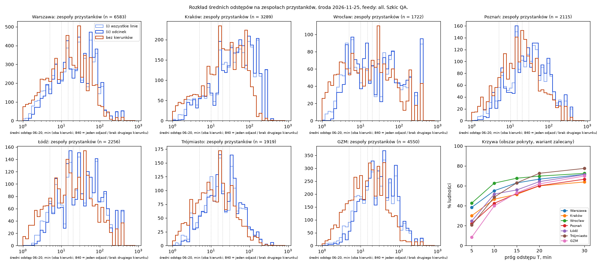
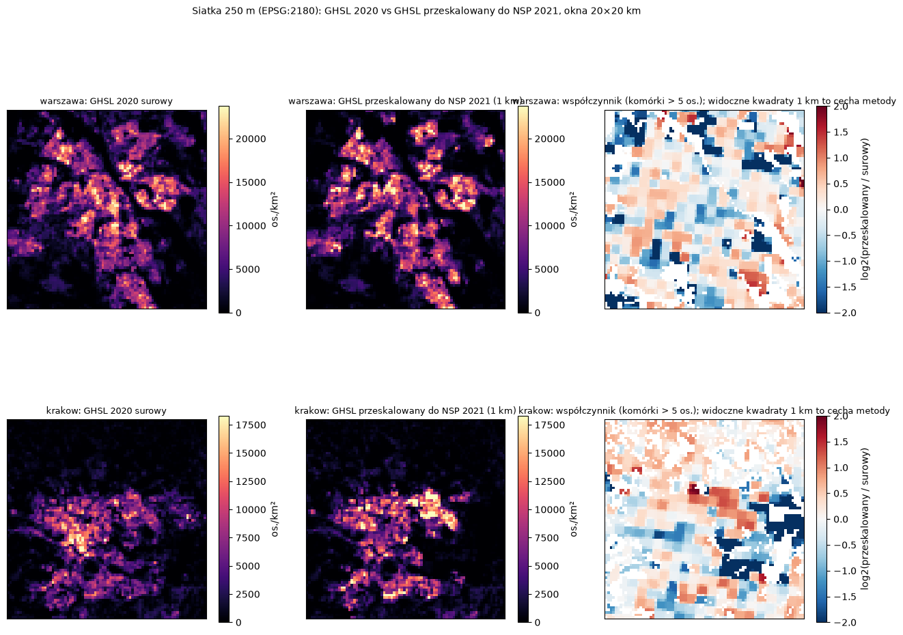

# Ludność przy częstej komunikacji (faza 2, brief §4.5)

Krok `python -m pipeline.frequent` (wywołuje też `pipeline.frequent_qa` i `pipeline.frequent_md`); wejścia: `pipeline.popgrid`, `pipeline.walk_network`, `pipeline.gtfs_service`, `pipeline.stop_coverage`. **Rozkłady: środa 2026-11-25** (dzień referencyjny z `config.yaml`); **OSM: 2026-11-22**; **ludność: NSP 2021 (31.03.2021) na siatce 1 km, rozłożona wzorem GHSL 2020** (wariant zalecany) albo surowy GHSL 2020. Siedem aglomeracji fazy 1, FUA i rdzeń. Dane i liczby: `results/metrics/metrics_frequent.csv`, `results/charts/frequent_curve.json`, `frequent_rail.json`; warstwy: `results/layers/`; szkice: `results/qa/transit/frequent/`.

## W skrócie

- **Konfiguracja zalecana:** dojście 500 m po sieci pieszej OSM, zespoły przystanków 100 m, średni odstęp
  06:00–20:00 w środę 2026-11-25, **oba kierunki, agregacja (ii) „najczęstszy odcinek do następnego przystanku”**,
  **wszystkie feedy** (z nieoficjalnymi; maska liczona dla tego zbioru), **siatka GHSL przeskalowana do NSP 2021**,
  domena do porównań: **obszar pokryty danymi** (i rdzeń). Tylko te wiersze mają w `metrics_frequent.csv`
  `tier = main` (70 wierszy: 7 aglomeracji × 2 domeny × 5 progów).
- **Dlaczego „wszystkie feedy”:** w tym samym obszarze feedy nieoficjalne zmieniają wynik o 0–5 pkt proc.
  (najwięcej przy progu 30 min w Warszawie i Łodzi, bo dokładają rzadkie linie podmiejskie), a powiększają obszar
  pokryty: Warszawa 69 → 82,5 %, Łódź 71 → 89 % ludności FUA. Wariant oficjalny jest w tabeli obok, żeby było
  widać, ile zależy od danych nieweryfikowanych.
- **Wynik:** w rdzeniach przy progu ≤ 10 min od 46 % (GZM) do 80 % (Warszawa) mieszkańców; w obszarze pokrytym
  od 40 % (GZM) do 63 % (Wrocław). Przy ≤ 5 min różnice są największe (Warszawa 38,5 %, GZM 8,5 % obszaru
  pokrytego). GZM i Trójmiasto to układy wielobiegunowe; miara od centrum nie zależy, ale granice FUA są umowne.
- **Pokrycie:** wynik dla całej FUA jest niepełny (< 85 % ludności w masce) w Warszawie, Krakowie, Wrocławiu i
  Trójmieście; Poznań (85,5 %), Łódź (89 %) i GZM (95 %) mieszczą się w progu. Rdzenie 95,5–99 %.
- **Co najbardziej zmienia wynik** (pkt proc., ≤ 10 min, obszar pokryty): wymóg dwóch kierunków (+8 do +26 bez
  niego), sposób liczenia drugiego kierunku przy przystankach rozsuniętych > 100 m (−5 do −12 bez reguły
  partnera), odległość w linii prostej zamiast sieci (+9 do +14), agregacja (i) zamiast (ii) (+2 do +11, najwięcej
  w GZM), siatka surowa zamiast przeskalowanej (−1 do −7; zawsze w dół), feedy oficjalne w tym samym obszarze
  (0 do −3). Reprezentacja komórki (środek vs 9 punktów) < 1,5 pkt proc.
- **Kolej:** ≤ 1 km od stacji z ≥ 4 odjazdami/h mieszka 31 % (Warszawa, z metrem) i 27 % (Trójmiasto, SKM)
  ludności obszaru pokrytego, ale tylko 4,7–10,6 % w pozostałych pięciu aglomeracjach.


**Krzywa w konfiguracji zalecanej** (odsetek ludności ≤ 500 m pieszo od zespołu przystanków ze średnim odstępem ≤ T min w obu kierunkach, 06:00–20:00, wariant (ii) „odcinek”, wszystkie feedy, siatka przeskalowana do NSP 2021). „Pokrycie” = udział ludności domeny w masce pokrycia GTFS; „niepełne” = pokrycie < 85 % (wynik zaniżony, nie do porównań).

| aglomeracja | domena | ≤5 min | ≤10 min | ≤15 min | ≤20 min | ≤30 min | pokrycie % | flaga |
|---|---|---|---|---|---|---|---|---|
| Warszawa | obszar pokryty danymi | 38,5 | 55,2 | 63,0 | 66,7 | 71,5 | 82,5 |  |
| Warszawa | rdzeń | 58,8 | 80,4 | 87,5 | 89,5 | 90,6 | 99,0 |  |
| Warszawa | FUA | 31,9 | 46,3 | 53,5 | 57,3 | 62,2 | 82,5 | niepełne |
| Kraków | obszar pokryty danymi | 30,0 | 46,6 | 51,5 | 60,0 | 63,9 | 78,8 |  |
| Kraków | rdzeń | 44,0 | 66,1 | 72,4 | 83,1 | 85,0 | 96,5 |  |
| Kraków | FUA | 24,6 | 38,1 | 42,3 | 49,3 | 52,9 | 78,8 | niepełne |
| Wrocław | obszar pokryty danymi | 42,7 | 62,8 | 67,7 | 69,8 | 72,5 | 79,6 |  |
| Wrocław | rdzeń | 51,4 | 75,8 | 81,1 | 83,2 | 86,0 | 97,9 |  |
| Wrocław | FUA | 34,1 | 50,4 | 54,4 | 56,9 | 60,0 | 79,6 | niepełne |
| Poznań | obszar pokryty danymi | 22,3 | 42,5 | 52,2 | 60,1 | 66,7 | 85,5 |  |
| Poznań | rdzeń | 34,8 | 66,0 | 75,2 | 82,6 | 85,9 | 95,5 |  |
| Poznań | FUA | 19,4 | 37,3 | 45,9 | 53,9 | 60,6 | 85,5 |  |
| Łódź | obszar pokryty danymi | 24,7 | 51,8 | 55,9 | 64,2 | 71,3 | 89,2 |  |
| Łódź | rdzeń | 35,0 | 69,6 | 73,0 | 82,2 | 87,5 | 96,6 |  |
| Łódź | FUA | 22,4 | 47,2 | 51,3 | 59,6 | 66,5 | 89,2 |  |
| Trójmiasto | obszar pokryty danymi | 20,6 | 48,7 | 63,1 | 72,6 | 77,5 | 83,2 |  |
| Trójmiasto | rdzeń | 25,3 | 59,2 | 71,7 | 79,5 | 81,6 | 95,9 |  |
| Trójmiasto | FUA | 17,2 | 41,2 | 53,5 | 62,5 | 67,0 | 83,2 | niepełne |
| GZM | obszar pokryty danymi | 8,5 | 40,0 | 53,0 | 62,0 | 69,9 | 95,1 |  |
| GZM | rdzeń | 10,1 | 45,6 | 59,2 | 67,7 | 75,4 | 97,9 |  |
| GZM | FUA | 8,1 | 38,6 | 51,3 | 60,0 | 67,9 | 95,1 |  |



## 1. Definicje w postaci zaimplementowanej

### 1.1 Siatka ludności (`pipeline.popgrid`)

**Po co.** Kontrola z fazy 1 (RAPORT §14.4) pokazała, że GHSL 2020 zaniża wielkie osiedla (do 35–60 % wartości
spisowej) i zawyża centra oraz tereny przemysłowe, czyli dokładnie miejsca, które różnią się obsługą komunikacją.
Dlatego wynik zalecany liczony jest na GHSL przeskalowanym do spisu.

**Metoda.** Komórki spisowe NSP 2021 (pole `RES`, ludność rezydująca, 31.03.2021) to siatka 1 km w EU LAEA
(EPSG:3035); siatka 250 m jest w EPSG:2180, więc kwadraty się nie pokrywają. Skalowanie jest robione na pikselach
źródłowych GHSL 100 m (Mollweide), a dopiero wynik jest sumowany do 250 m tym samym jądrem co w fazie 1
(GDAL `Resampling.sum`, dokładny transformator):

1. każdy piksel 100 m o środku w Polsce dzielony na 4 × 4 podpiksele; środek podpiksela rzutowany do EPSG:3035
   i przypisany komórce spisowej, w której leży (piksel na krawędzi dwóch komórek dzieli się między nie
   proporcjonalnie do pola, z rozdzielczością 1/16);
2. G_j = ludność GHSL przypisana komórce j, C_j = NSP; współczynnik C_j / G_j dla każdego podpiksela w j;
3. C_j = 0: ludność GHSL w tej komórce jest usuwana (łącznie 738 tys. osób w 43293 komórkach: huty,
   porty, lotniska, centra logistyczne, ale też komórki z zabudową nowszą niż spis);
4. C_j > 0 i G_j = 0: rezerwowo według powierzchni zabudowy GHS-BUILT-S 2020 (2 komórki, 4 osoby),
   a bez zabudowy równomiernie po 400 punktach komórki (335 komórek, 1102 osób): zaniedbywalne;
5. piksele poza Polską bez zmian (nie ma tam spisu).

**Kontrole.** (1) Suma przeskalowanych podpikseli w każdej komórce spisowej = C_j (maks. błąd 1.7e-10 osoby).
(2) Po zsumowaniu do 250 m i rozbiciu każdej komórki 250 m na 5 × 5 części przypisanych do komórek spisowych
4,1 % ludności „przesuwa się” przez krawędzie komórek spisowych (komórki 250 m przecinające krawędź mieszają dwa
współczynniki); dla porównania surowy GHSL różni się od spisu rozkładem o 19,7 % (indeks niepodobieństwa).
Średni błąd względny w komórkach spisowych ≥ 500 osób 6,5 %, 95. percentyl 18,3 %: to resztkowy błąd metody na
1 km. (3) Sumy per FUA zgodne ze spisem (tabela niżej; różnice to przypisanie komórek brzegowych, Trójmiasto
+0,65 % przez komórki przybrzeżne). (4) Okna 20 × 20 km: brak prążków; we współczynniku widać kwadraty 1 km
(rys. niżej, prawa kolumna), co jest cechą metody, a nie błędem. Współczynniki C_j / G_j w zamieszkanych
komórkach: 5. percentyl 0,24, mediana 0,90, 95. percentyl 2,11.

**Granice metody.** Poprawia poziom na 1 km, nie wzór wewnątrz komórki: jeśli GHSL w komórce osiedla umieścił
ludzi na dachach pobliskiej hali, przeskalowanie to powtórzy. Data: poziom NSP 31.03.2021, wzór GHSL 2020. Nie
koryguje migracji po 2021 r. ani nowych osiedli podmiejskich (następnym krokiem byłaby warstwa 6c, BDOT10k).

| aglomeracja | domena | NSP (środki komórek 1 km) | NSP (ważone polem) | przeskalowana 250 m | różnica vs NSP ważone % | surowy GHSL vs NSP % |
|---|---|---|---|---|---|---|
| Warszawa | FUA | 3 485 880 | 3 485 180 | 3 488 210 | 0,09 | -4,3 |
| Warszawa | rdzeń | 1 865 100 | 1 861 170 | 1 864 240 | 0,16 | -4,1 |
| Kraków | FUA | 1 411 780 | 1 412 680 | 1 411 730 | -0,07 | -4,4 |
| Kraków | rdzeń | 793 392 | 791 826 | 790 845 | -0,12 | -4,0 |
| Wrocław | FUA | 1 011 970 | 1 011 820 | 1 011 510 | -0,03 | -7,2 |
| Wrocław | rdzeń | 673 906 | 669 333 | 672 115 | 0,42 | -5,3 |
| Poznań | FUA | 974 744 | 974 077 | 974 602 | 0,05 | -4,9 |
| Poznań | rdzeń | 547 682 | 550 460 | 544 753 | -1,04 | -4,2 |
| Łódź | FUA | 1 044 090 | 1 044 400 | 1 042 790 | -0,15 | 0,2 |
| Łódź | rdzeń | 665 696 | 665 943 | 666 261 | 0,05 | 0,6 |
| Trójmiasto | FUA | 1 089 730 | 1 088 830 | 1 095 890 | 0,65 | -2,2 |
| Trójmiasto | rdzeń | 752 435 | 738 542 | 745 405 | 0,93 | -0,3 |
| GZM | FUA | 2 057 050 | 2 057 320 | 2 057 130 | -0,01 | 4,5 |
| GZM | rdzeń | 1 643 700 | 1 640 100 | 1 648 000 | 0,48 | 5,9 |



### 1.2 Sieć piesza (`pipeline.walk_network`)

**Reguła znaczników** (jeden przebieg pyosmium po `poland-latest.osm.pbf` z 2026-11-22, drogi z lokalizacjami
węzłów). Pieszo dostępne są `highway` = footway, path, pedestrian, steps, living_street, residential, service,
unclassified, tertiary(_link), secondary(_link), primary(_link), track, road, corridor, platform; trunk(_link)
tylko z chodnikiem (`sidewalk*` = yes/both/left/right) albo jawnym `foot`; cycleway, bridleway i motorway tylko
z jawnym `foot=yes/designated/permissive` (w Polsce zwykła droga dla rowerów jest zamknięta dla pieszych);
perony (`railway=platform`, `public_transport=platform`) jako ciągi piesze. Wyłączone: `foot=no/private/use_sidepath`,
`access=no/private` bez jawnego `foot`, wartości cyklu życia (construction, proposed…). Tunele i przejścia na
stacjach wchodzą tak, jak są zmapowane (footway / corridor / steps). Relacje (obszary piesze jako multipoligony)
nie są czytane: obszar pieszy zmapowany jako zamknięta droga jest przechodni po obwodzie, nie na przełaj.

**Graf.** Na aglomerację: drogi z co najmniej jednym węzłem w FUA + 3 km; krawędź = para kolejnych węzłów,
długość w EPSG:2180, bez kierunku. Do dociągania używane są tylko składowe spójne o długości ≥ 2 km (mniejsze to
zwykle luki w mapowaniu, które uwięziłyby punkt). Przystanki dociągane do najbliższej krawędzi do 150 m (stacje
kolei i metra do 300 m), punkty komórek do 300 m; krawędź jest dzielona w miejscu dociągnięcia, więc przystanek
i punkt na tej samej długiej krawędzi mają poprawną odległość wzdłuż niej. Odległość = dociągnięcie punktu +
sieć + dociągnięcie przystanku. Liczenie: Dijkstra z wielu źródeł naraz (`scipy.sparse.csgraph.dijkstra`,
`min_only`, odcięcie 500 m lub 1 km), osobno dla każdego zbioru „zespołów spełniających próg”. Kontrola na Łodzi
(2 250 par przystanków 200–1 500 m): stosunek odległości po sieci do prostej: mediana 1,23, 5.–95. percentyl
1,04–1,50, żaden poniżej 1.

| aglomeracja | km sieci | w tym chodniki/ścieżki (footway+path+steps+pedestrian) km | węzły | składowe | największa składowa % km | km w małych składowych (< 2 km, bez dociągania) |
|---|---|---|---|---|---|---|
| Warszawa | 72 062 | 18 014 | 2 434 008 | 10283 | 99,2 | 526 |
| Kraków | 32 261 | 6 633 | 1 476 181 | 2742 | 99,1 | 265 |
| Wrocław | 26 432 | 5 606 | 1 019 708 | 1887 | 98,8 | 258 |
| Poznań | 20 491 | 5 829 | 808 618 | 4399 | 98,5 | 288 |
| Łódź | 21 343 | 5 423 | 733 983 | 1857 | 99,2 | 148 |
| Trójmiasto | 20 423 | 6 959 | 907 191 | 1415 | 99,1 | 159 |
| GZM | 34 394 | 11 040 | 1 430 448 | 3682 | 99,0 | 312 |

Dociąganie przystanków i punktów próbkowych:

| aglomeracja | słupki bez współrzędnych (pominięte) | ich odjazdy 06–20 | przystanki w FUA | nieprzyciągnięte w FUA | punkty próbkowe | punkty nieprzyciągnięte | ludność w nieprzyciągniętych punktach % | mediana dociągnięcia punktu m | p95 dociągnięcia punktu m | węzły grafu |
|---|---|---|---|---|---|---|---|---|---|---|
| Warszawa | 0 | 0 | 11461 | 0 | 800334 | 10487 | 0,06 | 50 | 208 | 3178749 |
| Kraków | 0 | 0 | 6357 | 0 | 340353 | 2473 | 0,03 | 44 | 182 | 1795968 |
| Wrocław | 0 | 0 | 3165 | 0 | 181377 | 949 | 0,03 | 37 | 170 | 1196271 |
| Poznań | 0 | 0 | 3408 | 0 | 172809 | 2749 | 0,01 | 42 | 199 | 972756 |
| Łódź | lodz:3876, lodz:3877 | 240 | 3938 | 0 | 236466 | 3635 | 0,03 | 51 | 211 | 958626 |
| Trójmiasto | 0 | 0 | 3141 | 4 | 158049 | 2380 | 0,07 | 39 | 193 | 1055471 |
| GZM | 0 | 0 | 6903 | 5 | 223821 | 1892 | 0,02 | 32 | 165 | 1654768 |

**Reprezentacja komórki 250 m.** Każda zamieszkana komórka FUA ma 3 × 3 punkty próbkowe (środki podkwadratów
83 m); ludność komórki liczy się w części równej udziałowi punktów w zasięgu (zakładamy równomierny rozkład w
komórce). Wariant „tylko środek komórki” jest w `metrics_frequent.csv` jako `…_centroid` i w kolumnie „komórka =
środek” tabel z rozdziału 2: zmienia wynik aglomeracji o mniej niż 1,5 pkt proc., bo błędy w obie strony się
znoszą; dla pojedynczych komórek na skraju zasięgu różnica jest pełna (0 albo 100 %), więc w wariancie zalecanym
zostaje 9 punktów. Punkty, których nie da się dociągnąć (> 300 m od sieci), liczą się jako poza zasięgiem; to
≤ 0,1 % ludności. „Nieprzyciągnięte przystanki w FUA” to pojedyncze słupki na nabrzeżach i w terenie bez dróg.

### 1.3 Zespoły przystanków, odjazdy, kierunki, odstęp (`pipeline.frequent`)

1. **Kursy:** wyłącznie z warstwy usług `pipeline.gtfs_service` (`stop_times`, `active_trips`, `stops`) dla
   środy 2026-11-25, po jej deduplikacji (SKM Warszawa raz, duplikaty GZM usunięte, kolej przycięta do FUA +
   15 km). Moduł nie powiela tych reguł. Wersja reguł warstwy usług: `RULES_VERSION = 2026-11-24.4` (z regułą
   duplikatów blokowych GZM, 242 kursy, i z brakującymi współrzędnymi zamiast zerowych).
   **Słupki bez współrzędnych** są pomijane we wszystkich krokach przestrzennych (zespoły, kierunek, dociąganie,
   KD-drzewa): kurs „przejeżdża” przez nie, jakby ich nie było. Dotyczy to dwóch prawdziwych, obsługiwanych
   słupków w Łodzi, `lodz:3876` i `lodz:3877` na pl. Niepodległości (w źródle `stop_lat = stop_lon = 0`):
   387 zdarzeń, w tym 240 odjazdów 06–20. To lokalne zaniżenie: główny zespół pl. Niepodległości (5 słupków,
   642 odjazdy, (ii) 3,8 min) zostaje, więc klasa okolicznych komórek się nie zmienia, ale częstotliwość tego
   węzła jest o te odjazdy niższa. Zestawienie w tabeli dociągania (kolumna „słupki bez współrzędnych”).
2. **Zespół przystanków:** obsługiwane słupki (z kursami w którymkolwiek wariancie feedów) grupowane najpierw po
   `parent_station`, potem łączone **wiązaniem zupełnym** w promieniu 100 m (`stop_cluster_radius_m`): żadne
   dwie grupy w zespole nie są dalej niż 100 m od siebie, więc nie powstają łańcuchy wzdłuż ulicy. Słupki różnych
   feedów (np. stacja z `polish_trains` i przystanek miejski) łączą się tą samą regułą. Zespoły liczone raz, na
   zbiorze „all”, i używane w obu wariantach feedów.
3. **Wizyta i odjazd:** kolejne przystanki kursu w tym samym zespole to jedna wizyta; odjazd = wizyta, która nie
   jest ostatnią w kursie, z odjazdem w oknie 06:00–20:00 (koniec otwarty). Ostatnie wizyty to przyjazdy.
4. **Kierunek z geometrii, nie z `direction_id`** (w części feedów pole jest puste, a między feedami nie znaczy
   tego samego): azymut od poprzedniej do następnej wizyty kursu (dla pierwszego przystanku kursu: od tego
   przystanku do następnego). Oś zespołu = średni azymut jego najczęstszego odcinka (zespół → następny zespół).
   Odjazdy w granicach 90° od osi to kierunek A, pozostałe B.
5. **Średni odstęp** = 840 min / liczba odjazdów w oknie (średnia z dnia, jak DG REGIO; bez wymogu równomierności).
6. **Agregacje** (każda wymaga obu kierunków; odstęp zespołu = gorszy z dwóch kierunków):
   - **(i) „wszystkie linie”**: wszystkie odjazdy w kierunku zsumowane. Kilka rzadkich linii rozchodzących się
     zaraz za przystankiem liczy się jak jeden częsty korytarz.
   - **(ii) „odcinek” (zalecana)**: w każdym kierunku najczęstszy odcinek do następnego zespołu; linie jadące
     wspólnym pniem do następnego przystanku liczą się razem, linie rozchodzące się zaraz za przystankiem osobno.
     Wybrana, bo odpowiada odstępowi, jaki widzi pasażer jadący w konkretną stronę, i nie daje się zawyżyć
     rozchodzącym się liniom, a jednocześnie nie karze pni obsługiwanych przez kilka linii (co robi wariant
     „jedna linia”). Wada: linie przyspieszone omijające następny przystanek liczą się jako osobny odcinek.
   - „jedna linia”: najczęstsza pojedyncza linia (tryb + `route_short_name`) w kierunku, tylko do porównania;
     w polskich miastach częstotliwość robią nakładające się linie, więc ten wariant prawie zeruje progi 5–10 min.
   - „bez kierunków”: wszystkie odjazdy razem, bez wymogu dwóch kierunków; izoluje wpływ samej reguły kierunków.
7. **Zespoły jednokierunkowe.** Gdy zespół ma odjazdy tylko w jednym kierunku:
   - **pętla / początek kursów** (≥ 50 % odjazdów zaczyna tu kurs albo przyjazdy kończące kurs ≥ 50 % odjazdów):
     odstęp = odstęp jedynego kierunku;
   - **partner**: zespół ≤ 300 m dalej, który obsługuje co najmniej jedną z tych samych linii w kierunku
     przeciwnym do osi (przystanki przeciwnych kierunków dalej niż 100 m od siebie, ulice jednokierunkowe);
     odstęp = max(odstęp tutaj, odstęp przeciwnego kierunku u najlepszego partnera);
   - w przeciwnym razie zespół nie spełnia warunku „oba kierunki” (status one_way).
8. **Miara:** punkt próbkowy jest w zasięgu progu T, jeśli ≤ 500 m pieszo po sieci leży słupek należący do
   zespołu z odstępem ≤ T, który ma odjazdy w oknie. Wynik = ludność w zasięgu / ludność domeny. Domeny: FUA,
   rdzeń, „obszar pokryty” (komórki FUA w masce pokrycia danego wariantu feedów).


Status kierunkowy zespołów (two_way: oba kierunki na miejscu; paired: drugi kierunek u partnera ≤ 300 m; terminal: pętla / początek kursów; one_way: jeden kierunek bez partnera, odpada z miary „oba kierunki”), oraz kontrola dubli (ta sama linia, ten sam następny zespół, ta sama minuta odjazdu):

| aglomeracja | feedy | zespoły z odjazdami | two_way | paired | terminal | one_way | odjazdy 06–20 | dubel linia+odcinek+minuta % |
|---|---|---|---|---|---|---|---|---|
| Warszawa | official | 4571 | 2027 | 2229 | 167 | 148 | 765232 | 0,06 |
| Warszawa | all | 6583 | 3259 | 2794 | 201 | 329 | 855182 | 0,06 |
| Kraków | official | 3132 | 2271 | 688 | 95 | 78 | 314056 | 0,00 |
| Kraków | all | 3289 | 2384 | 718 | 99 | 88 | 321378 | 0,00 |
| Wrocław | official | 1412 | 898 | 406 | 74 | 34 | 254770 | 0,01 |
| Wrocław | all | 1722 | 1120 | 446 | 84 | 72 | 258879 | 0,01 |
| Poznań | official | 2115 | 1296 | 621 | 79 | 119 | 210151 | 0,02 |
| Poznań | all | 2115 | 1296 | 621 | 79 | 119 | 210151 | 0,02 |
| Łódź | official | 1370 | 840 | 435 | 53 | 42 | 202858 | 0,01 |
| Łódź | all | 2256 | 1460 | 614 | 77 | 105 | 230550 | 0,01 |
| Trójmiasto | official | 1919 | 935 | 783 | 88 | 113 | 239469 | 0,02 |
| Trójmiasto | all | 1919 | 935 | 783 | 88 | 113 | 239469 | 0,02 |
| GZM | official | 4550 | 3049 | 1096 | 170 | 235 | 447920 | 0,75 |
| GZM | all | 4550 | 3049 | 1096 | 170 | 235 | 447920 | 0,75 |

### 1.4 Maska pokrycia GTFS (§6)

**Definicja (komórka 250 m, nie gmina).** Dla każdej komórki brane są przystanki OSM w promieniu 1 km od jej
środka, pogrupowane w **miejsca** (słupki ≤ 100 m od siebie, wiązanie zupełne; dworzec autobusowy z 9
stanowiskami to jedno miejsce, nie dziewięć). Miejsce ma „dane” w udziale swoich słupków, które mają odpowiednik
GTFS w danym wariancie feedów (dopasowanie z fazy 0, `pipeline.stop_coverage`: 50 m / kolej 200 m + nazwa lub kod
do 200 / 500 m, z regułą „zastępczy”) albo są w feedzie, ale bez kursów w dniu referencyjnym (dane są, kursów
nie ma). Komórka jest w masce, jeśli średni udział miejsc z danymi ≥ 0,85, albo jeśli w promieniu 1 km nie ma
żadnego przystanku OSM (wtedy „brak komunikacji” jest informacją, nie brakiem danych; udział takiej ludności w
tabeli). Poza maską komórka ma wartość null („brak danych”), nigdy 0. Wynik dla całej FUA wlicza to, co wiadomo,
jest więc dolną granicą i ma flagę „niepełne pokrycie GTFS” przy pokryciu < 85 %.

**Dlaczego komórka, a nie gmina.** Brief §6 wymaga maski z przystanków („gmina z jedną linią ZTM nie może wyjść
jako pokryta”). Wariant gminny jest zgrubny w obie strony: gmina wiejska z dobrze pokrytym miastem gminnym wypada
w całości, a gmina z jedną dobrze pokrytą częścią wchodzi w całości. Promień 1 km jest szerszy niż zasięg miary
(500 m), żeby udział liczył się z kilku–kilkunastu miejsc, a nie z jednego. Próg 0,85 to ta sama liczba co próg
ludnościowy briefu; tabela pokazuje wrażliwość (0,5 / 0,7 / 0,85 / 0,95) i wariant gminny (ten sam udział liczony
na gminę). Maska jest liczona osobno dla wariantu feedów „official” i „all”.

**Pierwsza wersja maski** liczyła pojedyncze słupki i traktowała „w feedzie, bez kursów” jako brak danych.
Kontrola znanych miejsc wyrzuciła wtedy z maski komórkę Gdańska Głównego: 9 stanowisk dworca autobusowego (w
feedzie, bez kursów) i przystanki autokarowe przy Podwalu Grodzkim dawały 83 % zamiast ≥ 85 %. Po zmianie na
miejsca i uznaniu „w feedzie, bez kursów” za dane udział ludności rdzeni w masce wynosi 95,5–99 % (Poznań wzrósł
z 89 do 95,5 %), a udziały FUA zmieniły się o mniej niż 1 pkt proc.

Warstwa do mapy: `results/layers/gtfs_coverage_mask.parquet` (wszystkie komórki 250 m o środku w FUA, także
niezamieszkane, rozpuszczone w wielokąty per aglomeracja × wariant feedów × status).

| aglomeracja | feedy | siatka | FUA w masce % | rdzeń w masce % | bez przyst. OSM w 1 km % | próg 0.5 | próg 0.7 | próg 0.85 | próg 0.95 | gminy ≥ 0,85 |
|---|---|---|---|---|---|---|---|---|---|---|
| Warszawa | official | przeskal. | 69,1 | 98,9 | 4,5 | 77,8 | 73,6 | 69,1 | 53,3 | 60,1 |
| Warszawa | official | surowy | 68,6 | 98,4 | 5,0 | 77,8 | 73,2 | 68,6 | 52,1 | 59,7 |
| Warszawa | all | przeskal. | 82,5 | 99,0 | 4,5 | 92,9 | 88,8 | 82,5 | 62,5 | 78,1 |
| Warszawa | all | surowy | 81,8 | 98,5 | 5,0 | 92,6 | 88,2 | 81,8 | 61,1 | 77,0 |
| Kraków | official | przeskal. | 75,3 | 96,5 | 3,2 | 88,1 | 82,3 | 75,3 | 63,0 | 68,1 |
| Kraków | official | surowy | 74,2 | 94,5 | 3,7 | 88,3 | 82,4 | 74,2 | 60,3 | 67,7 |
| Kraków | all | przeskal. | 78,8 | 96,5 | 3,2 | 90,1 | 85,1 | 78,8 | 66,1 | 73,3 |
| Kraków | all | surowy | 77,6 | 94,6 | 3,7 | 90,2 | 85,1 | 77,6 | 63,3 | 72,9 |
| Wrocław | official | przeskal. | 75,6 | 97,9 | 3,1 | 81,0 | 79,0 | 75,6 | 51,5 | 68,3 |
| Wrocław | official | surowy | 75,9 | 98,1 | 3,6 | 80,6 | 78,7 | 75,9 | 51,6 | 69,0 |
| Wrocław | all | przeskal. | 79,6 | 97,9 | 3,1 | 86,2 | 83,4 | 79,6 | 55,2 | 71,3 |
| Wrocław | all | surowy | 79,8 | 98,1 | 3,6 | 86,0 | 83,2 | 79,8 | 55,2 | 72,2 |
| Poznań | official | przeskal. | 85,5 | 95,5 | 1,8 | 94,4 | 92,2 | 85,5 | 64,1 | 86,6 |
| Poznań | official | surowy | 84,9 | 95,3 | 2,3 | 93,9 | 91,6 | 84,9 | 62,3 | 85,5 |
| Poznań | all | przeskal. | 85,5 | 95,5 | 1,8 | 94,4 | 92,2 | 85,5 | 64,1 | 86,6 |
| Poznań | all | surowy | 84,9 | 95,3 | 2,3 | 93,9 | 91,6 | 84,9 | 62,3 | 85,5 |
| Łódź | official | przeskal. | 70,9 | 96,5 | 4,9 | 79,0 | 75,3 | 70,9 | 54,7 | 67,5 |
| Łódź | official | surowy | 70,5 | 96,2 | 5,1 | 77,9 | 74,6 | 70,5 | 54,6 | 67,6 |
| Łódź | all | przeskal. | 89,2 | 96,6 | 4,9 | 95,9 | 94,0 | 89,2 | 70,1 | 84,3 |
| Łódź | all | surowy | 88,8 | 96,4 | 5,1 | 96,0 | 93,8 | 88,8 | 70,0 | 84,8 |
| Trójmiasto | official | przeskal. | 83,2 | 95,9 | 1,3 | 90,2 | 88,4 | 83,2 | 68,1 | 81,4 |
| Trójmiasto | official | surowy | 81,3 | 92,0 | 1,4 | 90,7 | 88,4 | 81,3 | 64,2 | 82,7 |
| Trójmiasto | all | przeskal. | 83,2 | 95,9 | 1,3 | 90,2 | 88,4 | 83,2 | 68,1 | 81,4 |
| Trójmiasto | all | surowy | 81,3 | 92,0 | 1,4 | 90,7 | 88,4 | 81,3 | 64,2 | 82,7 |
| GZM | official | przeskal. | 95,1 | 97,9 | 0,4 | 98,7 | 97,4 | 95,1 | 80,3 | 96,4 |
| GZM | official | surowy | 93,9 | 96,2 | 0,5 | 97,9 | 96,6 | 93,9 | 80,0 | 96,5 |
| GZM | all | przeskal. | 95,1 | 97,9 | 0,4 | 98,7 | 97,4 | 95,1 | 80,3 | 96,4 |
| GZM | all | surowy | 93,9 | 96,2 | 0,5 | 97,9 | 96,6 | 93,9 | 80,0 | 96,5 |

### 1.5 Wariant w stylu kodu ITDP

**To nie jest wskaźnik ITDP**, tylko odtworzenie tego, co robi kod ITDP (`ITDP/pedestriansfirst`, commit
`b124b7f`, opis w RAPORT §9.1), na naszych danych, żeby było widać różnicę między „naszą definicją” a
„implementacją ITDP”. Zgodnie z kodem: dla każdego `stop_id` każdego feedu osobno (bez łączenia słupków w zespoły
i bez łączenia feedów) wszystkie wiersze `stop_times` z odjazdem 07:00–21:00 (oba końce włącznie, także
przyjazdy kończące kurs), wszystkie linie i oba kierunki w jednej sekwencji; odstęp = średnia z różnic między
kolejnymi odjazdami, czyli (ostatni − pierwszy) / (n − 1), a nie 840 / n; przystanek częsty, gdy
0 < odstęp ≤ 10 min; 500 m po sieci. Czego nie odtwarzamy: średniej z pon–pt pierwszego tygodnia feedu (mamy
jeden dzień); duplikatów (nasze kursy są po deduplikacji, ITDP liczyłby ok. 23 % zdublowanych kursów GZM dwa
razy); bufora +100 m wokół sieci i wypełniania dziur; ludności GHS-POP 1 km i granic GHS-UCDB. Skutek średniej z
przerw: przystanek z dwoma odjazdami w odstępie 5 min (i żadnymi innymi) przechodzi próg; takich przystanków jest
mało, ale to cecha kodu, nie naszej definicji.

### 1.6 Wariant kolejowy i „tylko szynowe”

**Wariant kolejowy** (wzorowany na klasach DG REGIO, nie ich replika): zespoły z kursami kolei lub metra
(`route_class` rail / metro; WKD jest w klasie rail; autobusowa komunikacja zastępcza `is_replacement_bus`
wyłączona), odjazdy 06:00–20:00 ze wszystkich kierunków razem, podzielone przez 14 h = odjazdy na godzinę. Klasa
komórki = najlepsza stacja w zasięgu 1 km pieszo (`rail_station_radius_m`): > 10, 4–10, < 4 odjazdów/h, brak
stacji. Wynik główny wariantu: ludność ≤ 1 km od stacji z ≥ 4 odjazdami/h. Tramwaj tu nie wchodzi.

**„Tylko szynowe”** (tramwaj + metro + kolej, bez autobusów i ZKA): ta sama definicja co krzywa główna (500 m,
oba kierunki, agregacja (ii) i (i)), ograniczona do kursów szynowych. **To nie jest ITDP PNRT** (PNRT to 1 km
od metra, LRT lub BRT z oceną, z danych Transit Explorer); w tabelach pod własną nazwą (`freq_railbound_*`).

## 2. Wpływ każdego wyboru

Każda tabela pokazuje różnicę jednego wariantu względem konfiguracji zalecanej, przy pozostałych parametrach bez
zmian. Główne wnioski:

- **Siatka ludności — po raz pierwszy wybór siatki ma znaczenie.** Na surowym GHSL wynik jest niższy w każdym
  mieście i przy każdym progu w rdzeniach (do −9,4 pkt proc. w rdzeniu Łodzi przy ≤ 10 min; Poznań −7,8, Trójmiasto
  −8,2, Kraków i GZM −6,1, Wrocław −3,4, Warszawa −2,0). Mechanizm jest ten, który pokazała kontrola z fazy 1:
  GHSL zaniża wielkie osiedla (dobrze obsłużone tramwajem i autobusem) i dokłada ludzi w terenach przemysłowych,
  kolejowych i portowych (słabo obsłużonych). Spis przenosi ludzi tam, gdzie są przystanki. Łódź ma największy
  efekt, choć jej suma GHSL prawie równa się spisowi: liczy się rozkład, nie suma.
- **Feedy nieoficjalne:** w tej samej domenie (maska „all”) 0 do −5 pkt proc., głównie przy progach 20–30 min
  (rzadkie linie podmiejskie). Kolumna „własna maska” porównuje wyniki na różnych obszarach: obszar pokryty
  feedami oficjalnymi jest mniejszy i bardziej miejski, więc odsetek wychodzi wyższy (Warszawa +8,3, Łódź +9,8);
  tej kolumny nie należy czytać jako „feedy oficjalne dają lepszy wynik”.
- **Agregacja:** (i) „wszystkie linie” daje +2 do +11 pkt proc. przy ≤ 10 min, najwięcej w GZM (+10,8) i
  Trójmieście (+7,8), gdzie wiele linii rozchodzi się na węzłach; przy ≤ 30 min różnica spada do 0,5–2,7.
  „Jedna linia” zeruje próg ≤ 10 min we Wrocławiu i Poznaniu (pojedyncze linie jeżdżą tam co 10–15 min; częsty
  korytarz tworzą nakładające się linie), więc nie nadaje się na definicję.
- **Kierunki:** bez wymogu dwóch kierunków wynik rośnie o 8–26 pkt proc. (≤ 10 min). To nie tylko przystanki
  jednokierunkowe: liczenie odjazdów z obu kierunków razem podwaja częstotliwość (dwa kierunki po 20 min dają
  „10 min”). Reguła partnera (drugi kierunek u przystanku ≤ 300 m dalej z tą samą linią) dotyczy 22–42 % zespołów z
  odjazdami (Warszawa 2 794 z 6 583, Kraków 22 %); bez niej wynik spada o 5–17 pkt proc. Partnerzy leżą w medianie 134–141 m od siebie,
  a w Warszawie 83 % par ma tę samą nazwę zespołu przystankowego (ZTM numeruje słupki 01/02 po obu stronach
  skrzyżowania), więc to są te same przystanki rozsunięte na skrzyżowaniu, a nie przypadkowe pary.
- **Odległość:** bufor w linii prostej zawyża o 4–17 pkt proc.; stosunek odległości po sieci do prostej to
  mediana 1,23 (kontrola na Łodzi), czyli 500 m po sieci to ok. 400 m w prostej.
- **Reprezentacja komórki:** środek komórki zamiast 9 punktów zmienia wynik aglomeracji o −0,2 do +1,3 pkt proc.


**Domena: obszar pokryty danymi, próg ≤ 10 min.** Różnica wariantu względem zalecanego, pkt proc. (pełna tabela dla wszystkich progów i domen: `frequent/effects.csv`).

| aglomeracja | wariant zalecany % | siatka: GHSL surowy | feedy: oficjalne (ta sama domena) | feedy: oficjalne (własna maska) | agregacja (i): wszystkie linie | agregacja: jedna linia | bez wymogu dwóch kierunków | bez reguły partnera | odległość euklidesowa | komórka = środek |
|---|---|---|---|---|---|---|---|---|---|---|
| Warszawa | 55,2 | -1,3 | -1,6 | +8,3 | +3,7 | -18,1 | +11,9 | -12,2 | +9,0 | +0,0 |
| Kraków | 46,6 | -4,1 | -0,1 | +1,8 | +4,0 | -20,5 | +13,2 | -8,4 | +11,3 | -0,2 |
| Wrocław | 62,8 | -2,0 | +0,0 | +3,3 | +2,2 | -62,4 | +7,6 | -7,7 | +9,9 | +0,4 |
| Poznań | 42,5 | -4,4 | 0,0 | 0,0 | +6,0 | -42,5 | +18,5 | -6,2 | +9,0 | +0,7 |
| Łódź | 51,8 | -7,2 | -2,8 | +9,8 | +4,6 | -41,5 | +15,3 | -5,2 | +9,6 | +0,6 |
| Trójmiasto | 48,7 | -5,1 | 0,0 | 0,0 | +7,8 | -41,6 | +24,6 | -11,2 | +13,8 | +0,6 |
| GZM | 40,0 | -4,5 | 0,0 | 0,0 | +10,8 | -38,5 | +25,8 | -8,6 | +13,8 | +0,8 |

**Domena: obszar pokryty danymi, próg ≤ 30 min.** Różnica wariantu względem zalecanego, pkt proc. (pełna tabela dla wszystkich progów i domen: `frequent/effects.csv`).

| aglomeracja | wariant zalecany % | siatka: GHSL surowy | feedy: oficjalne (ta sama domena) | feedy: oficjalne (własna maska) | agregacja (i): wszystkie linie | agregacja: jedna linia | bez wymogu dwóch kierunków | bez reguły partnera | odległość euklidesowa | komórka = środek |
|---|---|---|---|---|---|---|---|---|---|---|
| Warszawa | 71,5 | -1,6 | -5,1 | +5,1 | +1,2 | -3,6 | +5,8 | -10,4 | +9,0 | +0,3 |
| Kraków | 63,9 | -3,5 | -0,9 | +1,3 | +1,8 | -5,2 | +8,9 | -8,0 | +9,7 | +0,2 |
| Wrocław | 72,5 | -1,2 | -0,0 | +3,8 | +0,5 | -2,6 | +3,4 | -5,6 | +8,9 | +0,5 |
| Poznań | 66,7 | -3,9 | 0,0 | 0,0 | +1,6 | -8,2 | +9,3 | -7,5 | +10,7 | +0,9 |
| Łódź | 71,3 | -4,0 | -4,5 | +6,6 | +1,6 | -3,2 | +5,9 | -4,7 | +7,6 | +0,2 |
| Trójmiasto | 77,5 | -5,3 | 0,0 | 0,0 | +1,5 | -6,0 | +6,9 | -12,3 | +12,8 | +0,9 |
| GZM | 69,9 | -4,9 | 0,0 | 0,0 | +2,7 | -18,6 | +10,1 | -9,6 | +15,1 | +0,7 |

**Domena: rdzeń, próg ≤ 10 min.** Różnica wariantu względem zalecanego, pkt proc. (pełna tabela dla wszystkich progów i domen: `frequent/effects.csv`).

| aglomeracja | wariant zalecany % | siatka: GHSL surowy | feedy: oficjalne (ta sama domena) | feedy: oficjalne (własna maska) | agregacja (i): wszystkie linie | agregacja: jedna linia | bez wymogu dwóch kierunków | bez reguły partnera | odległość euklidesowa | komórka = środek |
|---|---|---|---|---|---|---|---|---|---|---|
| Warszawa | 80,4 | -2,0 | +0,0 | +0,0 | +2,9 | -23,6 | +8,1 | -17,3 | +11,6 | -0,1 |
| Kraków | 66,1 | -6,1 | 0,0 | 0,0 | +5,2 | -27,8 | +16,0 | -12,1 | +15,8 | -0,2 |
| Wrocław | 75,8 | -3,4 | +0,0 | +0,0 | +2,4 | -75,4 | +8,0 | -9,3 | +12,4 | +0,4 |
| Poznań | 66,0 | -7,8 | 0,0 | 0,0 | +4,6 | -66,0 | +16,1 | -9,6 | +14,4 | +1,3 |
| Łódź | 69,6 | -9,5 | -0,1 | -0,1 | +4,2 | -54,7 | +13,9 | -6,5 | +12,5 | +0,7 |
| Trójmiasto | 59,2 | -8,2 | 0,0 | 0,0 | +7,2 | -50,8 | +19,7 | -13,4 | +16,4 | +0,9 |
| GZM | 45,6 | -6,1 | 0,0 | 0,0 | +11,1 | -43,9 | +26,4 | -9,5 | +15,7 | +1,0 |

### 2.1 Nasza definicja vs replika ITDP vs odległość w linii prostej (≤ 10 min)

| aglomeracja | domena | nasza (ii) sieć | nasza (i) sieć | nasza bez kierunków | nasza (ii) prosta | styl ITDP sieć | styl ITDP prosta |
|---|---|---|---|---|---|---|---|
| Warszawa | rdzeń | 80,4 | 83,3 | 88,5 | 91,9 | 84,5 | 94,7 |
| Warszawa | obszar pokryty danymi | 55,2 | 58,9 | 67,0 | 64,2 | 59,9 | 68,9 |
| Kraków | rdzeń | 66,1 | 71,2 | 82,0 | 81,9 | 71,3 | 85,5 |
| Kraków | obszar pokryty danymi | 46,6 | 50,6 | 59,8 | 57,9 | 50,5 | 61,0 |
| Wrocław | rdzeń | 75,8 | 78,3 | 83,8 | 88,2 | 78,8 | 90,4 |
| Wrocław | obszar pokryty danymi | 62,8 | 65,0 | 70,3 | 72,6 | 65,5 | 74,9 |
| Poznań | rdzeń | 66,0 | 70,7 | 82,2 | 80,4 | 72,6 | 85,5 |
| Poznań | obszar pokryty danymi | 42,5 | 48,5 | 61,1 | 51,5 | 50,1 | 60,1 |
| Łódź | rdzeń | 69,6 | 73,8 | 83,5 | 82,1 | 76,1 | 87,2 |
| Łódź | obszar pokryty danymi | 51,8 | 56,4 | 67,1 | 61,4 | 57,6 | 66,6 |
| Trójmiasto | rdzeń | 59,2 | 66,4 | 78,9 | 75,6 | 70,7 | 86,8 |
| Trójmiasto | obszar pokryty danymi | 48,7 | 56,5 | 73,3 | 62,5 | 61,3 | 76,0 |
| GZM | rdzeń | 45,6 | 56,7 | 72,0 | 61,3 | 58,3 | 75,3 |
| GZM | obszar pokryty danymi | 40,0 | 50,8 | 65,8 | 53,7 | 52,6 | 68,5 |

Replika kodu ITDP (okno 07–21, średnia przerw, bez podziału na kierunki, per `stop_id`) wychodzi **wyżej** od
naszej definicji o 4–13 pkt proc. (rdzenie: Warszawa 84,5 vs 80,4; GZM 58,3 vs 45,6), a poniżej wariantu „bez
kierunków” na zespołach. Dwa efekty działają przeciwnie: brak wymogu kierunków podnosi wynik ITDP (polskie feedy
mają zwykle osobny `stop_id` na kierunek, więc efekt jest mniejszy niż przy wspólnych słupkach, ale na pętlach i
słupkach wspólnych dla obu kierunków działa), a brak łączenia słupków i feedów go obniża (linie zatrzymujące się na
sąsiednich słupkach jednego węzła nie sumują się). W linii prostej replika ITDP daje 75–95 % w rdzeniach. Wartości
Atlasu ITDP dla polskich miast nadal nie są znane (RAPORT §9.1), więc porównanie z Atlasem jest otwarte; nie
podawać żadnej z tych liczb jako „PNFT ITDP”.

## 3. Wariant kolejowy (klasy wzorowane na DG REGIO)

Klasa = najlepsza stacja kolei lub metra ≤ 1 km pieszo. Kolumny „> 10”, „4–10”, „< 4” i „brak stacji” sumują się
do 100 %. Ostatnia kolumna to wariant „tylko szynowe” (tramwaj + metro + kolej) z definicją krzywej głównej przy
≤ 10 min, pod własną nazwą (to nie ITDP PNRT).

Warszawa (metro: Metro Świętokrzyska 75,6 odjazdu/h, Warszawa Zachodnia 54/h) i Trójmiasto (SKM) są jedynymi
aglomeracjami, gdzie kolej jest szkieletem dla ponad jednej czwartej mieszkańców obszaru pokrytego (31 i 27 % przy
≥ 4/h). W Krakowie, Poznaniu, Wrocławiu i GZM to 4,7–9,1 %, w Łodzi 10,6 % (ŁKA; Łódź Widzew 17/h). We Wrocławiu i Poznaniu
więcej ludzi mieszka przy stacjach z < 4 odjazdami/h niż przy stacjach z ≥ 4/h: sieć stacji jest, ale rzadko
obsłużona. Przy klasach DG REGIO wariant kolejowy nie wycina już kolei aglomeracyjnej (KD, ŁKA, SKA), co robił
próg ≤ 10 min. „Tylko szynowe” jest najwyższe we Wrocławiu (39 % obszaru pokrytego) i najniższe w GZM (9 %), gdzie
większość częstych korytarzy jest autobusowa.

| aglomeracja | domena | > 10/h | 4–10/h | < 4/h | ≥ 4/h razem | brak stacji w 1 km | ≥ 4/h, prosta 1 km | tylko szynowe (ii) ≤ 10 min, 500 m |
|---|---|---|---|---|---|---|---|---|
| Warszawa | obszar pokryty danymi | 25,6 | 5,8 | 1,7 | 31,4 | 66,9 | 43,4 | 26,1 |
| Warszawa | rdzeń | 37,6 | 4,0 | 0,5 | 41,6 | 57,9 | 55,8 | 40,3 |
| Warszawa | FUA | 22,2 | 6,2 | 2,6 | 28,4 | 69,1 | 39,7 | 21,6 |
| Kraków | obszar pokryty danymi | 1,5 | 4,8 | 2,9 | 6,3 | 90,8 | 13,4 | 25,2 |
| Kraków | rdzeń | 3,8 | 5,9 | 2,1 | 9,7 | 88,2 | 19,6 | 37,5 |
| Kraków | FUA | 2,1 | 4,0 | 3,1 | 6,2 | 90,7 | 12,3 | 21,0 |
| Wrocław | obszar pokryty danymi | 2,1 | 5,9 | 9,1 | 8,0 | 82,8 | 18,5 | 39,1 |
| Wrocław | rdzeń | 2,6 | 6,6 | 9,2 | 9,2 | 81,6 | 21,8 | 46,9 |
| Wrocław | FUA | 1,7 | 4,9 | 11,1 | 6,6 | 82,2 | 15,4 | 31,2 |
| Poznań | obszar pokryty danymi | 1,6 | 3,1 | 6,2 | 4,7 | 89,1 | 11,6 | 24,9 |
| Poznań | rdzeń | 2,4 | 3,2 | 4,4 | 5,6 | 90,0 | 14,3 | 39,6 |
| Poznań | FUA | 1,4 | 2,7 | 8,0 | 4,1 | 87,9 | 10,3 | 22,1 |
| Łódź | obszar pokryty danymi | 1,6 | 9,0 | 5,2 | 10,6 | 84,2 | 20,8 | 34,4 |
| Łódź | rdzeń | 1,3 | 10,7 | 4,5 | 12,0 | 83,5 | 24,5 | 48,7 |
| Łódź | FUA | 1,4 | 8,6 | 5,3 | 10,1 | 84,6 | 19,7 | 31,1 |
| Trójmiasto | obszar pokryty danymi | 17,0 | 9,6 | 1,6 | 26,6 | 71,8 | 39,7 | 18,6 |
| Trójmiasto | rdzeń | 20,0 | 5,4 | 2,0 | 25,4 | 72,6 | 38,0 | 23,6 |
| Trójmiasto | FUA | 14,3 | 8,4 | 1,9 | 22,7 | 75,4 | 33,9 | 16,0 |
| GZM | obszar pokryty danymi | 0,8 | 8,3 | 5,3 | 9,1 | 85,5 | 16,0 | 8,8 |
| GZM | rdzeń | 0,9 | 9,9 | 5,1 | 10,8 | 84,0 | 19,1 | 10,8 |
| GZM | FUA | 0,8 | 7,9 | 5,4 | 8,7 | 85,9 | 15,3 | 8,6 |

## 4. Kontrole

### 4.1 Znane miejsca

| aglomeracja | miejsce | oczekiwane | klasa komórki | udział punktów ≤5 min | najlepszy zespół ≤ 600 m | wynik |
|---|---|---|---|---|---|---|
| Warszawa | Marszałkowska / Świętokrzyska | ≤ 5 | 5 | 100 % | Centrum (ii) 1,6 min, (i) 1,6 min | OK |
| Warszawa | Marszałkowska / pl. Konstytucji | ≤ 5 | 5 | 100 % | Pl. Konstytucji (ii) 2,0 min, (i) 2,0 min | OK |
| Wrocław | Rynek | ≤ 5 | 5 | 100 % | Pl. Nowy Targ (ii) 2,6 min, (i) 2,6 min | OK |
| Kraków | Rynek Główny | ≤ 5 | 5 | 100 % | Poczta Główna (ii) 2,3 min, (i) 1,5 min | OK |
| Poznań | Stary Rynek | ≤ 5 | 5 | 100 % | Aleje Marcinkowskiego (ii) 1,7 min, (i) 1,7 min | OK |
| Łódź | Piotrkowska Centrum | ≤ 5 | 5 | 100 % | Piłsudskiego-Sienkiewicza (ii) 1,9 min, (i) 1,9 min | OK |
| Trójmiasto | Gdańsk Główny | ≤ 5 | 5 | 100 % | Dworzec Główny 01 (ii) 1,8 min, (i) 0,8 min | OK |
| GZM | Katowice Rynek | ≤ 5 | 5 | 100 % | Katowice Plac Wolności (ii) 1,5 min, (i) 1,3 min | OK |
| Warszawa | Otwock Szpital Powiatowy (rzadki przystanek, 3 odj./dobę, ≥ 1,5 km od częstego) | > 30 lub brak danych | brak danych | – |  | OK |
| Warszawa | Nasielsk Rynek (rzadki przystanek, 3 odj./dobę, ≥ 1,5 km od częstego) | > 30 lub brak danych | brak danych | – |  | OK |
| Kraków | Krzeszowice Most Kościuszki (rzadki przystanek, 6 odj./dobę, ≥ 1,5 km od częstego) | > 30 lub brak danych | brak danych | – |  | OK |
| Kraków | Przebieczany Kaplica (rzadki przystanek, 6 odj./dobę, ≥ 1,5 km od częstego) | > 30 lub brak danych | brak danych | – |  | OK |
| Wrocław | Oborniki Śląskie Parkowa (rzadki przystanek, 5 odj./dobę, ≥ 1,5 km od częstego) | > 30 lub brak danych | >30 | – |  | OK |
| Wrocław | Sobótka - Św. Anny (rzadki przystanek, 4 odj./dobę, ≥ 1,5 km od częstego) | > 30 lub brak danych | brak danych | – |  | OK |
| Poznań | Mosina/Krosińska/Sosnowa (rzadki przystanek, 6 odj./dobę, ≥ 1,5 km od częstego) | > 30 lub brak danych | >30 | – |  | OK |
| Poznań | Jerzykowo/pl. Piastowski (rzadki przystanek, 6 odj./dobę, ≥ 1,5 km od częstego) | > 30 lub brak danych | brak danych | – |  | OK |
| Łódź | Stryków ul. Żeromskiego (szkoła) (rzadki przystanek, 1 odj./dobę, ≥ 1,5 km od częstego) | > 30 lub brak danych | >30 | – |  | OK |
| Łódź | Dłutów Pabianicka / Polna (rzadki przystanek, 6 odj./dobę, ≥ 1,5 km od częstego) | > 30 lub brak danych | >30 | – |  | OK |
| Trójmiasto | Kielno Rondo 11 (rzadki przystanek, 6 odj./dobę, ≥ 1,5 km od częstego) | > 30 lub brak danych | brak danych | – |  | OK |
| Trójmiasto | Kielno Sikorskiego 22 (rzadki przystanek, 6 odj./dobę, ≥ 1,5 km od częstego) | > 30 lub brak danych | brak danych | – |  | OK |
| GZM | Maczki Skwerowa (rzadki przystanek, 4 odj./dobę, ≥ 1,5 km od częstego) | > 30 lub brak danych | >30 | – |  | OK |
| GZM | Kozłów Szkoła (rzadki przystanek, 6 odj./dobę, ≥ 1,5 km od częstego) | > 30 lub brak danych | >30 | – |  | OK |

Wszystkie znane miejsca w centrach dają klasę ≤ 5 min (100 % punktów próbkowych), w tym Rynek we Wrocławiu i
Rynek Główny w Krakowie, które same są strefami pieszymi (przystanki przy pl. Nowy Targ i Poczcie Głównej w
zasięgu 500 m). Rzadkie przystanki (1–6 odjazdów na dobę, ≥ 1,5 km od zespołu z odstępem ≤ 30 min, wybrane
automatycznie, po dwa najludniejsze na aglomerację) mają klasę „> 30” albo leżą poza maską („brak danych”), nigdy
klasę częstą: arytmetycznie 6 odjazdów w 14 h daje średnio 140 min. Gdańsk Główny w pierwszej wersji maski wypadał
z maski — opis i poprawka w 1.4.

### 4.2 Dziesięć zespołów o największej liczbie odjazdów (brief §7.3)

Pięć pierwszych na aglomerację (pełna lista 10: `frequent/top10_clusters.csv`).

| aglomeracja | zespół | słupki | odjazdy 06–20 | odj./h | (i) min | (ii) min | linia min | dubel % | tryby |
|---|---|---|---|---|---|---|---|---|---|
| Warszawa | Marszałkowska | 3 | 2238 | 159,9 | 1,0 | 2,2 | 7,2 | 0,0 | bus;tram |
| Warszawa | Dw. Centralny | 4 | 1977 | 141,2 | 1,0 | 1,6 | 4,8 | 0,0 | bus;tram |
| Warszawa | Pl. Na Rozdrożu | 3 | 1915 | 136,8 | 1,0 | 1,0 | 7,4 | 0,1 | bus |
| Warszawa | Rondo Waszyngtona | 5 | 1896 | 135,4 | 0,9 | 3,2 | 4,8 | 0,0 | bus;tram |
| Warszawa | Rozbrat | 4 | 1843 | 131,6 | 0,9 | 2,0 | 7,4 | 0,1 | bus |
| Kraków | Politechnika | 10 | 2254 | 161,0 | 0,8 | 2,4 | 6,0 | 0,0 | bus;tram |
| Kraków | Jubilat | 4 | 1863 | 133,1 | 0,9 | 1,1 | 8,7 | 0,0 | bus |
| Kraków | Plac Inwalidów | 6 | 1708 | 122,0 | 1,0 | 1,8 | 8,7 | 0,0 | bus |
| Kraków | Konopnickiej | 4 | 1473 | 105,2 | 1,1 | 1,7 | 8,7 | 0,0 | bus |
| Kraków | Szpital Narutowicza | 6 | 1397 | 99,8 | 1,2 | 2,4 | 6,0 | 0,0 | bus;tram |
| Wrocław | PL. GRUNWALDZKI | 8 | 1703 | 121,6 | 1,0 | 2,1 | 10,4 | 0,0 | bus;tram |
| Wrocław | Arkady (Capitol) | 5 | 1543 | 110,2 | 1,6 | 2,6 | 12,5 | 0,0 | bus;tram |
| Wrocław | Kwiska | 4 | 1424 | 101,7 | 1,3 | 3,2 | 12,9 | 0,0 | bus;tram |
| Wrocław | Strzegomska (Krzyżówka) | 6 | 1361 | 97,2 | 1,3 | 1,7 | 13,3 | 0,0 | bus;tram |
| Wrocław | PL. JANA PAWŁA II 05 | 4 | 1281 | 91,5 | 1,4 | 3,3 | 12,9 | 0,0 | bus;tram |
| Poznań | Szymanowskiego | 5 | 1263 | 90,2 | 1,3 | 2,9 | 11,7 | 0,1 | bus;tram |
| Poznań | Głogowska/Hetmańska | 4 | 1168 | 83,4 | 1,4 | 2,3 | 11,5 | 0,1 | tram |
| Poznań | Aleje Solidarności | 4 | 1160 | 82,9 | 1,7 | 2,9 | 11,7 | 0,1 | bus;tram |
| Poznań | Kórnicka | 4 | 1036 | 74,0 | 1,6 | 2,8 | 11,2 | 0,0 | tram |
| Poznań | Pl. Wiosny Ludów | 4 | 1008 | 72,0 | 1,7 | 2,3 | 11,5 | 0,0 | tram |
| Łódź | Legionów-Zachodnia | 4 | 978 | 69,9 | 2,6 | 3,1 | 15,3 | 0,0 | bus;tram |
| Łódź | Włókniarzy-Mickiewicza (Dw. Ł. Kaliska) | 4 | 947 | 67,6 | 2,0 | 4,6 | 14,7 | 0,0 | bus;tram |
| Łódź | Rzgowska-cm. Rzgowska | 4 | 945 | 67,5 | 1,8 | 3,1 | 12,5 | 0,0 | bus;tram |
| Łódź | Mickiewicza-Żeromskiego | 3 | 921 | 65,8 | 2,2 | 3,1 | 12,9 | 0,0 | tram |
| Łódź | Zachodnia-Manufaktura | 5 | 888 | 63,4 | 2,0 | 3,1 | 10,0 | 0,0 | bus;tram |
| Trójmiasto | Dworzec Główny 01 | 10 | 2119 | 151,4 | 0,8 | 1,8 | 10,8 | 0,0 | bus;tram |
| Trójmiasto | Brama Wyżynna 01 | 5 | 1656 | 118,3 | 1,0 | 2,8 | 11,4 | 0,0 | bus;tram |
| Trójmiasto | Obłuże Centrum 01 | 3 | 1245 | 88,9 | 1,4 | 3,6 | 9,3 | 0,0 | bus;trolleybus |
| Trójmiasto | Centrum Nauki Experyment 01 | 3 | 1153 | 82,4 | 1,5 | 2,3 | 13,8 | 0,0 | bus;trolleybus |
| Trójmiasto | Stocznia SKM - Morska 01 | 2 | 991 | 70,8 | 1,7 | 1,9 | 14,7 | 0,1 | bus;trolleybus |
| GZM | Gliwice Centrum Przesiadkowe | 14 | 1749 | 124,9 | 1,0 | 2,5 | 20,5 | 0,1 | bus |
| GZM | Katowice Sądowa | 4 | 1629 | 116,4 | 1,4 | 1,6 | 10,8 | 1,7 | bus |
| GZM | Katowice AWF | 2 | 1431 | 102,2 | 1,2 | 1,8 | 10,6 | 0,0 | bus |
| GZM | Katowice Dworzec | 6 | 1359 | 97,1 | 1,4 | 1,9 | 10,8 | 0,0 | bus |
| GZM | Brynów Centrum Przesiadkowe | 4 | 1277 | 91,2 | 1,4 | 3,5 | 10,2 | 0,0 | bus;tram |

Kontrola z briefu §7.3: na szczycie listy są węzły tramwajowo-autobusowe (Marszałkowska, Politechnika w Krakowie,
pl. Grunwaldzki, Dworzec Główny w Gdańsku, Centrum Przesiadkowe w Gliwicach), 60–160 odjazdów/h w sumie. Udział
odjazdów zdublowanych (ta sama linia, ten sam następny przystanek, ta sama minuta) wynosi 0–0,1 % we wszystkich
aglomeracjach poza GZM (0,75 % wszystkich odjazdów; najwięcej w zespole Katowice Sądowa, 1,7 %). To resztka
duplikatów feedu GZM, których reguła dokładnych duplikatów warstwy usług nie łapie (kursy różniące się np.
`block_id` albo sekwencją przystanków); wpływ na wynik jest pomijalny (< 1 % odjazdów), ale jest zgłoszony
autorowi warstwy usług. Kolej nie dubluje się (SKM Warszawa tylko z `warsaw_ztm`).

### 4.3 Mapy kontrolne

[Warszawa](frequent/map_warszawa.png) [Kraków](frequent/map_krakow.png) [Wrocław](frequent/map_wroclaw.png) [Poznań](frequent/map_poznan.png) [Łódź](frequent/map_lodz.png) [Trójmiasto](frequent/map_trojmiasto.png) [GZM](frequent/map_gzm.png)

Mapy pokazują klasę komórki wg zasady „≥ 50 % punktów próbkowych w zasięgu” (ta sama zasada co w warstwie
`frequent_cells.parquet`), szarą szrafurą obszar poza maską. Częste korytarze widać jako pasma wzdłuż linii
tramwajowych i kolei (SKM w Trójmieście, WKD i linie KM pod Warszawą); obszary poza maską leżą tam, gdzie RAPORT §6.4
wskazał przewoźników bez GTFS (np. pas na południe i zachód od Warszawy, północ i południowy wschód FUA Krakowa,
południowy zachód Trójmiasta); nazw gmin z map nie odczytywano, więc to zgodność kierunków, nie weryfikacja
gmina po gminie.

### 4.4 Powtarzalność

`pipeline.popgrid`, `pipeline.walk_network` i `pipeline.frequent` uruchomione dwa razy od zera na tej samej
wersji warstwy usług: wszystkie pliki wynikowe (GeoTIFF, Parquet, CSV, JSON, GeoParquet, PNG, `frequent.md`)
identyczne co do bajta poza `_meta*.json` (czas uruchomienia). Wynik nie zależy od losowego ziarna haszowania
Pythona (sprawdzone `PYTHONHASHSEED` = 1 i 2). Jedna wcześniejsza para przebiegów różniła się w warstwie zespołów
i histogramie: między przebiegami przebudowano cache warstwy usług (nowa wersja reguł), więc to nie była
niedeterministyczność kodu. Liczby w CSV/JSON zaokrąglone do 4 cyfr znaczących, wiersze posortowane.

## 5. Co zaskoczyło i co wyszło przy sprawdzeniu

1. **Gdańsk Główny poza maską** (pierwsza wersja). Sprawdzenie: w promieniu 1 km 99 słupków OSM, z czego 17 bez
   danych — 9 stanowisk dworca autobusowego (w feedzie, bez kursów w środę) i przystanki autokarowe. To artefakt
   liczenia słupków, nie brak danych miejskich. **Poprawione** (miejsca 100 m, „w feedzie bez kursów” = dane).
2. **Reguła drugiego kierunku zmienia wynik o 5–17 pkt proc.** Sprawdzenie: odległości i nazwy par partnerów
   (mediana ok. 135 m, 83 % tej samej nazwy w Warszawie). **Zostaje** jako część definicji, z wariantem bez niej
   w tabeli.
3. **Pojedyncze linie prawie nigdy nie jeżdżą co ≤ 10 min** (Wrocław, Poznań: 0 % ludności przy „jednej linii”).
   Sprawdzenie: najczęstsza linia w top-10 zespołów ma 10–15 min (Wrocław pl. Grunwaldzki 10,4 min, Poznań
   Szymanowskiego 11,7 min). **Zostaje**; to argument za agregacją (ii), a nie (ii-linia).
4. **Surowy GHSL obniża wynik w każdym mieście**, najmocniej w Łodzi, gdzie suma GHSL równa się spisowi.
   Sprawdzenie: mechanizm zgodny z kontrolą fazy 1 (osiedla zaniżone, przemysł zawyżony); obraz współczynników w
   `popgrid_windows.png` (Nowa Huta: osiedla w górę, kombinat w dół). **Zostaje.**
5. **GZM ma najniższy wynik przy ≤ 5 i ≤ 10 min**, mimo najlepszego pokrycia danymi (95 %). Sprawdzenie:
   top-10 zespołów GZM ma 90–125 odjazdów/h (tyle co w innych miastach), ale najczęstsza pojedyncza linia ma
   10–20 min, a sieć jest rozproszona na wiele ośrodków; agregacja (i) dodaje tu najwięcej (+11), czyli wiele
   rzadkich linii rozchodzi się na węzłach. Resztkowe duplikaty kursów GZM (0,75 % odjazdów) za mało, by to
   wyjaśnić. **Zostaje.**
6. **Kraków ma tylko 6 % ludności obszaru pokrytego przy stacji z ≥ 4 odjazdami/h**, mniej niż Łódź (11 %).
   Sprawdzenie: stacje wewnętrzne są obsłużone gęsto (Kraków Główny 19,5/h, Grzegórzki i Zabłocie po 12,9/h,
   Płaszów 10,6/h), ale jest ich mało i leżą przy centrum lub w terenach poprzemysłowych, a dalsze przystanki SKA
   mają zwykle < 4/h. Wynik opisuje rozmieszczenie stacji względem mieszkańców, nie częstotliwość pociągów.
   **Zostaje.**

## 6. Ograniczenia

- **Ludność 2020–2021, rozkłady 2026.** Nowe osiedla po 2021 r. (szczególnie podmiejskie) nie są w siatce.
- **Przeskalowanie poprawia tylko poziom na 1 km**; wzór wewnątrz komórki to nadal GHSL (z jego błędami).
- **Jeden dzień** (środa 2026-11-25); remonty w dniu referencyjnym (np. tramwaje w Krakowie i Łodzi zastąpione
  autobusami, RAPORT §6.3) wchodzą do wyniku tak, jak są w rozkładzie.
- **Średnia z okna** nie mówi o równomierności: korytarz z gęstym szczytem i dziurą w południe może przejść próg.
- **Kierunek z geometrii** może źle przypisać odjazdy na pętlach w kształcie litery U i na skrzyżowaniach, gdzie
  linie skręcają o ~90°; reguły pętli i partnera łagodzą, ale nie usuwają tego efektu.
- **Agregacja (ii)** rozdziela linie zwykłe i przyspieszone, jeśli te drugie omijają następny przystanek.
- **Sieć piesza OSM** bez relacji (place piesze na przełaj) i bez kontroli przejść przez tory / arterie poza tym,
  co jest zmapowane; stopnie i windy traktowane jak zwykłe odcinki.
- **Maska** zależy od kompletności OSM jako mianownika (RAPORT §6.5): gdzie OSM nie ma przystanków przewoźnika bez
  GTFS, maska jest zbyt optymistyczna; komórki bez przystanku OSM w 1 km są w masce z założenia.
- **Feedy nieoficjalne** (28 z 30 dodanych) nie były porównane z rozkładami przewoźników.
- **Replika ITDP** to jeden dzień, kursy po deduplikacji i nasza siatka, więc nie jest porównywalna 1:1 z Atlasem.

## 7. Propozycje do `config.yaml`

Proponowane klucze (dziś stałe w `pipeline/frequent.py`, `walk_network.py`; do decyzji właściciela):

```yaml
frequent:
  aggregation: segment            # (ii) najczęstszy odcinek do następnego przystanku; alternatywy: all_lines, line
  recommended_feed_variant: all
  pair_radius_m: 300              # partner dla zespołów jednokierunkowych
  terminal_share: 0.5             # zespół = pętla, gdy >= 50 % odjazdów zaczyna kurs / tyle samo przyjazdów kończy
  cell_sample_points: 9           # 3 x 3 punkty na komórkę 250 m
  stop_max_snap_m: {default: 150, rail: 300}
  point_max_snap_m: 300
  itdp_window: {start: "07:00", end: "21:00"}   # tylko dla repliki ITDP (RAPORT §12.1 pkt 14)
coverage_mask:
  unit: cell250
  radius_m: 1000
  place_merge_m: 100
  min_place_share: 0.85
  no_stop_cells: in_mask
  in_feed_not_served_counts_as_data: true
walk_network:
  buffer_m: 3000
  min_component_m: 2000
```

## 8. Pliki i polecenia

- Kod: `pipeline/popgrid.py`, `pipeline/walk_network.py`, `pipeline/frequent.py` (+ `frequent_qa.py`,
  `frequent_md.py`, `frequent_text.py`).
- Polecenia (z katalogu repo), czasy na tej maszynie: `python -m pipeline.popgrid` (ok. 3 min),
  `python -m pipeline.walk_network` (ok. 4,5 min, jeden przebieg po PBF), `python -m pipeline.frequent` (ok. 8 min;
  wymaga zbudowanych cache `pipeline.gtfs_service`); `python -m pipeline.frequent --report-only` przelicza tylko
  tabele, QA i ten plik z `data/interim/frequent/results.pkl`.
- Wyniki: `results/metrics/metrics_frequent.csv` / `.json` (kolumny jak `metrics.csv` + `feed_variant`,
  `population_grid`; `_meta_frequent.json` obok, bo `_meta.json` w tym katalogu należy do kroku gęstości),
  `results/charts/frequent_curve.json`, `frequent_rail.json` (+ `_meta_frequent.json`), warstwy w
  `results/layers/` (`frequent_cells.parquet` 5,8 MB, `frequent_stop_clusters.parquet` 1,0 MB, `gtfs_coverage_mask.parquet` 2,2 MB; CRS EPSG:4326, opis w `_meta.json`), QA w `results/qa/transit/frequent/`.
- Pośrednie: `data/interim/popgrid/`, `data/interim/walk/`, `data/interim/frequent/results.pkl`.

