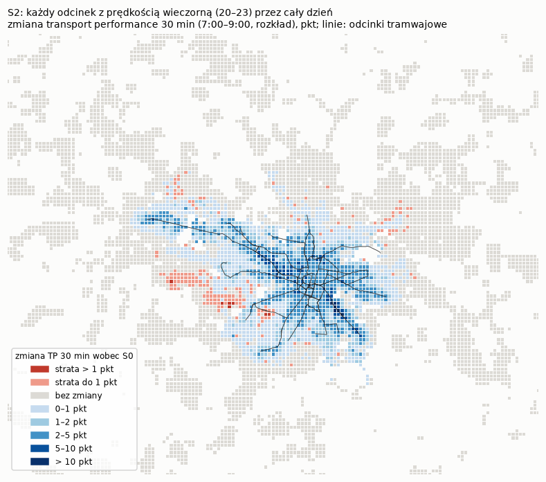

# Wrocław: co dałyby szybsze tramwaje (scenariusze what-if)

Plik generuje `python -m pipeline.whatif_tram aggregate`. Kod: `pipeline/whatif_tram.py` (rozkłady scenariuszy, routing), `whatif_tram_out.py` (wyniki), `whatif_tram_md.py` i `whatif_tram_text.py` (ta nota). Liczby: `results/metrics/metrics_whatif.csv`, tabele w tym katalogu, warstwa komórek `results/layers/whatif_wroclaw_cells.parquet`.

**Pytanie.** Tramwaje we Wrocławiu mają w rozkładzie niższą prędkość niż w pozostałych dużych miastach (16,2 km/h na odcinkach w szczycie porannym; 34,5 % wozokilometrów 7–9 na odcinkach wolniejszych niż 15 km/h; speed.md §3.4). O ile wzrósłby zasięg mieszkańców komunikacją zbiorową, gdyby te odcinki jeździły z realistyczną prędkością docelową, a w jednym wariancie także częściej?

**Czym to jest, a czym nie.** Wszystko jest liczone na **rozkładzie jazdy**, nie na rzeczywistych przejazdach. Scenariusz mówi, ile byłoby warte szybsze (albo częstsze) kursowanie tramwajów w mierze dostępności z fazy 3. Nie mówi, jak to osiągnąć (priorytet, torowiska, rozkład), ile to kosztuje ani czy da się to zrobić; nie modeluje też reakcji pasażerów i przewoźnika.

## 1. Scenariusze

| Id | Co się zmienia |
|---|---|
| S0 | nic (kontrola: ten sam rozkład przepuszczony przez ten sam kod) |
| S1 | odcinek × pasmo godzin wolniejszy niż 15 km/h dostaje 15 km/h |
| S2 | każdy odcinek jedzie przez cały dzień z własną prędkością wieczorną (20–23), „szczyt jak wieczór” |
| S3 | każdy odcinek dostaje medianę prędkości 7–9 porównywalnych odcinków Krakowa i Poznania (reguła niżej) |
| S4 | S2 + na każdej linii kursy co 10 min zamiast co 12 min (pierwsze odjazdy 05:45–10:00) |
| S4h | same kursy co 10 min, bez przyspieszenia (oddziela efekt krótszego czekania od efektu prędkości) |

We wszystkich scenariuszach odcinek nigdy nie zwalnia (cel niższy od obecnej prędkości nic nie zmienia), żaden przejazd między przystankami nie staje się szybszy niż jazda swobodna z modelu speed.md §3.3 (przyspieszenie i hamowanie 1,0 m/s², 50 km/h, postój 20 s), a autobusy, kolej i pozostałe feedy zostają bez zmian. Cel stosowany jest w każdym paśmie dnia roboczego; do wyniku liczą się pasma, w których tramwaje jeżdżą w oknie 7:00–10:00 (szczyt poranny i początek międzyszczytu).

**Reguła porównywalności w S3.** Odcinek jest „w jezdni”, gdy co najmniej 15 % jego długości biegnie w jezdni albo w strefie pieszej (reguła speed.md §3.2), inaczej „wydzielony”; odstęp przystanków = długość / liczba przejazdów, granica 450 m (mediana Wrocławia). Odcinki odniesienia: Kraków i Poznań, co najmniej 5 min, co najmniej 8 kursów 7–9. Cel = mediana ich prędkości 7–9 w tej samej klasie (`s3_classes.csv`):

| Torowisko | Odstęp przystanków | Odcinki odniesienia (Kraków / Poznań) | Cel, km/h | Kwartyle, km/h |
|---|---|---|---|---|
| w jezdni | < 450 m | 14 (6 / 8) | 15,5 | 13,6–16,9 |
| w jezdni | ≥ 450 m | 22 (14 / 8) | 16,4 | 15,9–17,9 |
| wydzielone | < 450 m | 22 (2 / 20) | 19,7 | 17,0–21,7 |
| wydzielone | ≥ 450 m | 49 (36 / 13) | 22,9 | 19,3–25,5 |

Każda klasa ma co najmniej 14 odcinków odniesienia, więc wariantu zapasowego (18 km/h na torowisku wydzielonym, 15 km/h w jezdni) nie użyto. Zastrzeżenie: reguła „w jezdni” zaniża udział jazdy w jezdni na szerokich ulicach (Świdnicka we Wrocławiu, Święty Marcin w Poznaniu; speed.md §3.2), więc część wrocławskich odcinków w jezdni trafia do klasy „wydzielone” z wyższym celem; S3 jest przez to raczej górnym wariantem.

## 2. Jak przepisano rozkład

- **Źródło:** produkcyjny oczyszczony GTFS Wrocławia, wariant „wszystkie feedy” (`data/interim/r5/wroclaw/gtfs_all/`, tylko do odczytu). Zmienia się tylko `stop_times.txt` (w S4 i S4h także `trips.txt`) pliku `wroclaw.zip`, i tylko dla kursów tramwajowych środy; pozostałe pliki zip są kopiowane bajt w bajt. Zmienione rozkłady leżą w `data/interim/whatif/gtfs/<scenariusz>/`, nigdy w `results/`.
- **Przejazdy i odcinki:** przejazdy (przystanek → następny przystanek) z pamięci warstwy prędkości (`data/interim/speed/hops_wroclaw_2026-11-25`), z długością wzdłuż kształtu trasy i pasmem godziny odjazdu; para przystanków → odcinek z `tram_stretch_stop_pairs.csv`. 109 158 z 109 541 przejazdów leży na odcinkach; pozostałe (krańcowe przejazdy między peronami jednej pętli: 4, krawędzie poza odcinkami) się nie zmieniają. Sumy czasu i długości odcinek × pasmo zgadzają się z `tram_stretch_bands.csv` (te same liczby przejazdów; różnice do 20 s czasu i 0,05 % długości wynikają z zaokrąglenia tabeli do 4 cyfr znaczących).
- **Ile czasu zabrać:** dla odcinka × pasma suma czasu docelowego S* = max(L / v*, F), gdzie L to suma długości przejazdów, v* prędkość docelowa, F suma czasów jazdy swobodnej (z postojem 20 s). Jeśli S* jest mniejsze od obecnej sumy S, różnica S − S* jest odejmowana z czasu ponad jazdę swobodną poszczególnych przejazdów (max(0, t − czas swobodny)), proporcjonalnie do niego. Dzięki temu postój z modelu nie jest skracany, przejazd nie staje się szybszy od własnej jazdy swobodnej, a czas zabierany jest tam, gdzie rozkład ma zapas.
- **Pełne minuty bez obciążenia:** oszczędności kolejnych przejazdów są sumowane wzdłuż kursu; przystanek k przesuwa się o 60 × floor(skumulowana oszczędność / 60 + u) s, gdzie u ∈ [0, 1) to stała liczba kursu (z SHA-1 identyfikatora kursu). Wartość oczekiwana floor(x + u) równa się x, więc przesunięcie na każdym przystanku jest średnio równe oszczędności ciągłej (sprawdzenie: wozogodziny w pełnych minutach a ciągłe w §4), czasy zostają niemalejące, a pierwszy odjazd się nie zmienia (skumulowana oszczędność 0), więc częstotliwość na pierwszym przystanku jest ta sama. Przyjazd i odjazd na przystanku przesuwają się razem. Zwykłe zaokrąglenie do najbliższej minuty byłoby obciążone: kurs z oszczędnością 20 s nie zyskiwałby nic, a takich kursów jest dużo.
- **Częstsze kursy (S4, S4h):** wszystkie linie tramwajowe jeżdżą w szczycie co 12 min (`s4_headways.csv`), więc dokładanie kopii kursów dałoby odstępy 6/12 min, a nie 10. Zamiast tego główny wzorzec każdej linii i kierunku (najczęstszy ciąg przystanków) jest w oknie pierwszych odjazdów 05:45–10:00 przeplanowany na odjazdy co 10 min: faza pierwszego odjazdu po 7:00 w cyklu 12 min jest przeskalowana do cyklu 10 min (w pełnych minutach), każdy nowy kurs kopiuje czasy przejazdu kursu oryginalnego najbliższego w czasie. Kursy skrócone (zjazdy, wyjazdy z zajezdni) zostają bez zmian. Koordynacja linii na wspólnych odcinkach nie jest zachowana dokładnie (fazy skalowane są na pierwszym przystanku, czasy przejazdu nie); routing pokazuje, co z tego wynika.
- **Walidacja każdego rozkładu** (`data/interim/whatif/gtfs/<s>/build.json`): te same kursy (S4, S4h: kursy przeplanowane zastąpione nowymi), te same ciągi przystanków, czasy niemalejące, odjazd ≥ przyjazd, pierwsze odjazdy bez zmian, wiersze kursów nietramwajowych i pozostałe pliki identyczne. Wszystkie scenariusze przechodzą.
- **Routing:** ustawienia produkcyjne (`pipeline.access`, scenariusz `pt_am`): R5 v7.5.1, środa 2026-11-25, odjazdy co minutę 7:00–9:00, mediana, maks. 60 min, pieszo 5 km/h, dojście i odejście ≤ 12 min, do 8 przejazdów, reguła min(komunikacja, sam spacer) z produkcyjną pamięcią spacerów; te same starty (20 153 komórki) i cele (42 554) co produkcja. Sieć R5 każdego scenariusza zbudowana od nowa (`data/interim/whatif/r5/<s>/`). Z jednego routingu liczone są rdzeń, obszar pokryty, FUA i urban centre (cele urban centre jako osobna waga, jak `access_uc`).

## 3. Kontrola (S0)

S0 to rozkład bez zmian przepuszczony przez ten sam czytnik i zapis co scenariusze. Plik `wroclaw.zip` S0 jest **bajtowo identyczny** z plikiem produkcyjnym, sieć R5 zbudowano od nowa w katalogu scenariusza i policzono wszystkie starty.

- Komórki: 20 153; suma ludności osiągalnej (siatka spisowa i surowy GHSL, progi 5–60 min) różni się od produkcji w 0 i 0 komórkach, maks. różnica 0,000 i 0,000 os.; sam wynik R5 (bez reguły pieszej) maks. różnica 0,000 (30 min) i 0,000 (45 min).
- Urban centre (porównanie z osobnym routingiem `access_uc`): maks. różnica 0,031 os.
- Wartości opublikowane (4 cyfry znaczące) a S0:

| Obszar | Miara | S0 | Opublikowane | Zgodne |
|---|---|---|---|---|
| rdzeń | `tp_pt_am_30min` | 27,59 | 27,59 | tak |
| rdzeń | `tp_pt_am_30min_ratio_of_means` | 29,44 | 29,44 | tak |
| rdzeń | `tp_pt_am_45min` | 53,01 | 53,01 | tak |
| rdzeń | `tp_pt_am_45min_ratio_of_means` | 54,53 | 54,53 | tak |
| obszar pokryty | `tp_pt_am_30min` | 24,64 | 24,64 | tak |
| obszar pokryty | `tp_pt_am_30min_ratio_of_means` | 29,06 | 29,06 | tak |
| obszar pokryty | `tp_pt_am_45min` | 45,54 | 45,54 | tak |
| obszar pokryty | `tp_pt_am_45min_ratio_of_means` | 52,36 | 52,36 | tak |
| FUA | `tp_pt_am_30min` | 24,52 | 24,52 | tak |
| FUA | `tp_pt_am_30min_ratio_of_means` | 28,47 | 28,47 | tak |
| FUA | `tp_pt_am_45min` | 40,72 | 40,72 | tak |
| FUA | `tp_pt_am_45min_ratio_of_means` | 49,79 | 49,79 | tak |
| urban centre | `tp_pt_am_30min` | 31,94 | 31,94 | tak |
| urban centre | `tp_pt_am_30min_ratio_of_means` | 33,35 | 33,35 | tak |
| urban centre | `tp_pt_am_45min` | 64,79 | 64,79 | tak |
| urban centre | `tp_pt_am_45min_ratio_of_means` | 65,71 | 65,71 | tak |

**Wniosek:** kontrola przechodzi dokładnie: S0 odtwarza produkcję komórka po komórce i co do cyfry w wartościach opublikowanych, więc różnice scenariuszy wobec S0 to wyłącznie skutek zmiany rozkładu.

## 4. Zmieniony rozkład: prędkość i wozogodziny

Prędkość rozkładowa na odcinkach (suma długości / suma czasu przejazdów, czasy po zaokrągleniu do pełnych minut), środa, km/h; w nawiasie wariant bez zaokrąglenia (ciągłe sekundy), który pokazuje, że zaokrąglenie nie przesuwa wyniku.

| Pasmo | S0 | S1 | S2 | S3 |
|---|---|---|---|---|
| noc 23–05 | 17,4 | 18,2 (18,3) | 18,2 (18,2) | 19,2 (19,2) |
| wczesny ranek 05–07 | 16,7 | 17,7 (17,6) | 18,0 (18,0) | 18,7 (18,7) |
| szczyt poranny 07–09 | 16,2 | 17,4 (17,4) | 17,9 (17,9) | 18,5 (18,5) |
| międzyszczyt 09–15 | 16,4 | 17,5 (17,5) | 17,9 (17,9) | 18,6 (18,6) |
| szczyt popołudniowy 15–18 | 16,0 | 17,3 (17,3) | 17,9 (17,9) | 18,5 (18,5) |
| wczesny wieczór 18–20 | 16,6 | 17,6 (17,6) | 18,0 (17,9) | 18,6 (18,6) |
| wieczór 20–23 | 17,9 | 18,6 (18,6) | 17,9 (17,9) | 19,3 (19,2) |

| Scenariusz | Wozokm 7–9 na odcinkach < 15 km/h | Wozogodziny oszczędzone w dobie (pełne minuty / ciągłe) | Kursy skrócone | Maks. skrócenie kursu, min | Grupy odcinek × pasmo zmienione | W tym ograniczone jazdą swobodną | Przejazdy 0 min (S4, S4h: kursy nieprzeplanowane) |
|---|---|---|---|---|---|---|---|
| S0 | 34,5 % | 0,0 / 0,0 | 0 z 4 168 | 0 | 0 z 795 | 0 | 345 z 109 541 |
| S1 | 16,5 % | 176,8 / 177,1 | 3 933 z 4 168 | 9 | 342 z 795 | 0 | 778 z 109 541 |
| S2 | 20,8 % | 224,4 / 224,7 | 3 532 z 4 168 | 10 | 527 z 795 | 43 | 943 z 109 541 |
| S3 | 0,9 % | 332,9 / 332,6 | 4 116 z 4 168 | 10 | 532 z 795 | 17 | 1 209 z 109 541 |
| S4 | 20,8 % | 224,4 / 224,7 | 3 532 z 4 168 | 10 | 527 z 795 | 43 | 711 z 83 198 |
| S4h | 34,5 % | 0,0 / 0,0 | 0 z 4 168 | 0 | 0 z 795 | 0 | 266 z 83 198 |

- S2 podnosi prędkość tramwajów w szczycie porannym do 17,9 km/h, czyli do poziomu wieczoru (17,9 km/h) – tak jak zamierzono. Część odcinków ma wieczorem prędkość niższą niż rano i się nie zmienia, część jest ograniczona jazdą swobodną.
- Wozogodziny w pełnych minutach i ciągłe różnią się o mniej niż 1 %, więc reguła zaokrąglenia nie zawyża ani nie zaniża oszczędności.
- Przejazdów 0-minutowych przybywa (w S0 jest ich 345 na ok. 110 tys.): to ten sam artefakt pełnych minut co w oryginalnym rozkładzie; suma czasu kursu jest poprawna.
- S4 i S4h: 48 wzorców (linia × kierunek) przeplanowanych z 12 na 10 min; w oknie 05:45–10:00 958 → 1223 kursów, +184 wozogodzin (28 % pracy tych wzorców w oknie). Na granicach okna odstęp do kursu oryginalnego wynosi 1–23 min (mediana 12); w środku okna dokładnie 10 min.

## 5. Wyniki: transport performance

Stosunek średnich (wynik główny), w nawiasie średnia stosunków (typowy mieszkaniec); środa 7:00–9:00, wszystkie feedy, siatka spisowa. Zmiana wobec S0 w punktach.

**30 min**

| Scenariusz | Rdzeń | Zmiana | Obszar pokryty | Zmiana | Urban centre | Zmiana |
|---|---|---|---|---|---|---|
| S0 | 29,4 (27,6) |  | 29,1 (24,6) |  | 33,4 (31,9) |  |
| S1 | 31,1 (29,0) | +1,67 (+1,38) | 30,7 (25,8) | +1,64 (+1,15) | 35,3 (33,7) | +1,99 (+1,75) |
| S2 | 31,5 (29,4) | +2,08 (+1,81) | 31,1 (26,1) | +2,05 (+1,50) | 35,8 (34,2) | +2,41 (+2,22) |
| S3 | 32,5 (30,2) | +3,10 (+2,61) | 32,1 (26,8) | +3,05 (+2,17) | 37,0 (35,2) | +3,65 (+3,25) |
| S4 | 32,3 (30,1) | +2,89 (+2,52) | 31,9 (26,7) | +2,84 (+2,10) | 36,7 (35,0) | +3,31 (+3,06) |
| S4h | 30,1 (28,1) | +0,63 (+0,56) | 29,7 (25,1) | +0,62 (+0,47) | 34,0 (32,6) | +0,69 (+0,64) |

**45 min**

| Scenariusz | Rdzeń | Zmiana | Obszar pokryty | Zmiana | Urban centre | Zmiana |
|---|---|---|---|---|---|---|
| S0 | 54,5 (53,0) |  | 52,4 (45,5) |  | 65,7 (64,8) |  |
| S1 | 56,4 (54,8) | +1,92 (+1,82) | 54,2 (47,0) | +1,82 (+1,50) | 67,9 (67,0) | +2,21 (+2,16) |
| S2 | 57,3 (55,7) | +2,73 (+2,66) | 55,0 (47,7) | +2,60 (+2,20) | 68,9 (67,9) | +3,18 (+3,16) |
| S3 | 58,3 (56,6) | +3,75 (+3,61) | 55,9 (48,5) | +3,57 (+2,98) | 70,0 (69,0) | +4,28 (+4,20) |
| S4 | 58,0 (56,4) | +3,44 (+3,34) | 55,6 (48,3) | +3,27 (+2,77) | 69,6 (68,7) | +3,94 (+3,90) |
| S4h | 55,1 (53,6) | +0,58 (+0,56) | 52,9 (46,0) | +0,55 (+0,46) | 66,3 (65,4) | +0,64 (+0,63) |

Mieszkańcy, u których transport performance rośnie (obszar pokryty; komórki 250 m):

| Scenariusz | Próg | > 2 pkt, os. | > 2 pkt, % | > 5 pkt, os. | > 5 pkt, % | Jakikolwiek spadek, % | Spadek > 1 pkt, os. | Maks. przyrost / spadek, pkt |
|---|---|---|---|---|---|---|---|---|
| S1 | 30 min | 206 997 | 25,7 | 35 087 | 4,4 | 9,2 | 1 356 | +8,5 / −1,9 |
| S1 | 45 min | 280 445 | 34,8 | 12 509 | 1,6 | 2,5 | 303 | +6,5 / −2,0 |
| S2 | 30 min | 262 583 | 32,6 | 37 807 | 4,7 | 3,4 | 1 199 | +11,9 / −1,6 |
| S2 | 45 min | 400 472 | 49,8 | 60 697 | 7,5 | 1,1 | 272 | +11,7 / −6,5 |
| S3 | 30 min | 299 428 | 37,2 | 151 341 | 18,8 | 2,4 | 0 | +10,9 / −0,9 |
| S3 | 45 min | 477 483 | 59,3 | 179 505 | 22,3 | 0,9 | 234 | +11,5 / −5,0 |
| S4 | 30 min | 328 695 | 40,8 | 114 930 | 14,3 | 1,3 | 0 | +13,7 / −0,8 |
| S4 | 45 min | 473 137 | 58,8 | 124 455 | 15,5 | 1,0 | 130 | +12,4 / −4,4 |
| S4h | 30 min | 27 680 | 3,4 | 0 | 0,0 | 7,0 | 1 175 | +3,7 / −1,7 |
| S4h | 45 min | 12 839 | 1,6 | 0 | 0,0 | 8,2 | 2 609 | +3,3 / −6,3 |

- **Skala.** Przyspieszenie tramwajów podnosi transport performance rdzenia (stosunek średnich) przy 30 min o 1,7 pkt (S1), 2,1 pkt (S2) i 3,1 pkt (S3), przy 45 min o 1,9, 2,7 i 3,8 pkt. Dla porównania: różnica między Wrocławiem a Krakowem w rdzeniu przy 30 min wynosi dziś 3,6 pkt. Same częstsze kursy (S4h, 12 → 10 min) dają 0,6 pkt przy 30 i 45 min, oba razem (S4) 2,9 i 3,4 pkt.
- **Prędkość waży więcej niż częstotliwość w tej skali zmian.** Skrócenie odstępu z 12 do 10 min zmniejsza średnie czekanie na pierwszy tramwaj o ok. 1 min, a przyspieszenie S2 (+11 % prędkości w szczycie) skraca 20-minutowy przejazd tramwajem o ok. 2 min. Oba efekty prawie się sumują: S2 + S4h osobno = 2,71 pkt przy 30 min wobec 2,89 pkt razem (przy 45 min 3,32 wobec 3,44); razem jest trochę więcej, bo szybszy tramwaj z krótszym odstępem częściej mieści się w progu.
- **Przy 45 min przyspieszenie daje więcej niż przy 30 min** (S2: 2,7 wobec 2,1 pkt): dłuższa jazda tramwajem to więcej zaoszczędzonych minut, a pierścień celów na granicy progu jest większy. Częstotliwość (S4h) działa odwrotnie, bo oszczędza stałą minutę czekania niezależnie od długości podróży.
- **Ilu mieszkańców zyskuje wyraźnie.** W S2 transport performance 30 min rośnie o ponad 2 pkt u 262 583 mieszkańców obszaru pokrytego (32,6 %), o ponad 5 pkt u 37 807; w S3 u 299 428 i 151 341.
- **Średnia stosunków rośnie mniej niż stosunek średnich**, bo zysk koncentruje się w gęstym centrum, które w stosunku średnich waży więcej (duża liczba ludzi w promieniu); mieszkańcy przedmieść bez tramwaju nie zyskują nic.

## 6. Kto zyskuje i gdzie

**Odległość od Rynku, km** (obszar pokryty; średni przyrost ważony ludnością, pkt; w nawiasie udział mieszkańców z przyrostem > 2 pkt)

| Przedział | Mieszkańcy | S1 30 | S2 30 | S3 30 | S4 30 | S4h 30 | S2 45 |
|---|---|---|---|---|---|---|---|
| 0–2 | 130 231 | +3,62 (89 %) | +3,81 (96 %) | +6,13 (99 %) | +5,04 (99 %) | +0,86 (5 %) | +2,66 (68 %) |
| 2–4 | 187 145 | +2,25 (49 %) | +2,46 (51 %) | +3,91 (73 %) | +3,48 (70 %) | +0,86 (7 %) | +3,00 (77 %) |
| 4–6 | 177 807 | +0,18 (0 %) | +1,03 (17 %) | +1,03 (17 %) | +1,48 (28 %) | +0,39 (3 %) | +3,34 (72 %) |
| 6–8 | 89 984 | +0,01 (0 %) | +0,37 (5 %) | +0,27 (2 %) | +0,64 (9 %) | +0,18 (0 %) | +1,86 (27 %) |
| 8–10 | 50 700 | −0,02 (0 %) | +0,18 (3 %) | +0,05 (1 %) | +0,25 (5 %) | +0,07 (1 %) | +0,78 (5 %) |
| 10–15 | 85 803 | −0,02 (0 %) | +0,32 (6 %) | +0,09 (1 %) | +0,52 (11 %) | +0,16 (4 %) | +0,70 (13 %) |
| ≥ 15 | 83 182 | 0,00 (0 %) | 0,00 (0 %) | 0,00 (0 %) | 0,00 (0 %) | 0,00 (0 %) | +0,01 (0 %) |

**Gęstość zaludnienia komórki, os./km²** (obszar pokryty; średni przyrost ważony ludnością, pkt; w nawiasie udział mieszkańców z przyrostem > 2 pkt)

| Przedział | Mieszkańcy | S1 30 | S2 30 | S3 30 | S4 30 | S4h 30 | S2 45 |
|---|---|---|---|---|---|---|---|
| 0–1000 | 102 416 | +0,05 (1 %) | +0,13 (2 %) | +0,14 (2 %) | +0,21 (4 %) | +0,05 (0 %) | +0,42 (8 %) |
| 1000–2500 | 99 362 | +0,24 (4 %) | +0,48 (9 %) | +0,59 (11 %) | +0,70 (14 %) | +0,16 (1 %) | +1,25 (26 %) |
| 2500–5000 | 130 538 | +0,49 (11 %) | +0,98 (18 %) | +1,14 (20 %) | +1,40 (26 %) | +0,35 (3 %) | +2,06 (42 %) |
| 5000–10000 | 206 991 | +1,13 (24 %) | +1,61 (34 %) | +2,34 (41 %) | +2,29 (44 %) | +0,55 (5 %) | +2,56 (58 %) |
| ≥ 10000 | 265 546 | +2,25 (52 %) | +2,58 (59 %) | +3,92 (66 %) | +3,53 (70 %) | +0,73 (4 %) | +3,03 (72 %) |

**Odległość od najbliższego przystanku tramwajowego, m** (obszar pokryty; średni przyrost ważony ludnością, pkt; w nawiasie udział mieszkańców z przyrostem > 2 pkt)

| Przedział | Mieszkańcy | S1 30 | S2 30 | S3 30 | S4 30 | S4h 30 | S2 45 |
|---|---|---|---|---|---|---|---|
| 0–500 | 401 243 | +2,22 (51 %) | +2,80 (64 %) | +4,13 (73 %) | +3,85 (79 %) | +0,84 (7 %) | +3,33 (80 %) |
| 500–1000 | 96 635 | +0,26 (4 %) | +0,66 (5 %) | +0,76 (6 %) | +0,97 (11 %) | +0,23 (1 %) | +2,64 (63 %) |
| 1000–2000 | 90 739 | +0,05 (0 %) | +0,21 (1 %) | +0,17 (1 %) | +0,42 (1 %) | +0,11 (0 %) | +1,34 (18 %) |
| 2000–5000 | 88 937 | +0,01 (0 %) | +0,03 (0 %) | +0,02 (0 %) | +0,10 (1 %) | +0,06 (0 %) | +0,62 (3 %) |
| ≥ 5000 | 127 298 | 0,00 (0 %) | 0,00 (0 %) | 0,00 (0 %) | 0,00 (0 %) | 0,00 (0 %) | +0,02 (0 %) |

- **Gdzie.** Przy 30 min zyskuje przede wszystkim śródmieście i pierwszy pierścień: do 2 km od Rynku średnio 3,8 pkt w S2 (przyrost > 2 pkt u 96 % mieszkańców), 2–4 km 2,5 pkt, dalej niż 6 km poniżej 0,5 pkt. Przy 45 min zysk przesuwa się na zewnątrz (4–6 km: 3,3 pkt): z osiedli na końcu linii do centrum jedzie się dłużej, więc dopiero dłuższy próg zbiera zaoszczędzone minuty. Zyskują gęsto zaludnione komórki (≥ 10 000 os./km²: 2,6 pkt w S2 przy 30 min) i komórki do 500 m od przystanku tramwajowego (2,8 pkt).
- **Kontrola: daleko od tramwaju prawie nic się nie zmienia.** Komórki ponad 5 km od przystanku tramwajowego: S2 przy 30 min średnio 0,00 pkt (od 0,00 do 0,00), przy 45 min 0,02 pkt; 2–5 km od tramwaju przy 30 min 0,03 pkt. Niewielki przyrost daleko od tramwaju przy 45 min to podróże z przesiadką z autobusu albo pociągu na tramwaj, więc jest uzasadniony.
- **Spadki** (`losses.csv`, kolumna „Jakikolwiek spadek” w §5) są małe i lokalne, ale obecne w każdym scenariuszu. Mechanizm: tramwaj przyjeżdża na przystanek pośredni wcześniej, a autobus, pociąg albo inna linia tramwajowa jeżdżą jak dotąd; przesiadka zgrana w obecnym rozkładzie może się rozjechać i trzeba czekać na następny kurs. Przykład: komórka E347500N356500 (ok. 10 km od tramwaju; trasy podróży nie sprawdzano, prawdopodobnie autobus z przesiadką na tramwaj) traci w S2 przy 45 min 6,5 pkt, ale przy 55 i 60 min zyskuje: cele, które były tuż poniżej 45 min, wypadają tuż ponad próg, a dalsze się przybliżają. To efekt progu, nie gorsza sieć. W S4h udział mieszkańców z jakimkolwiek spadkiem jest największy (7–8 %), bo zmieniają się fazy odjazdów wszystkich linii (koordynacja na wspólnych odcinkach i z autobusami). Do tego dochodzi zaokrąglenie do pełnych minut. Mediana po minutach odjazdu łagodzi, ale nie usuwa tych efektów; w modelu z przeplanowaniem przesiadek spadków by nie było.

## 7. Miejsce Wrocławia wśród siedmiu miast

Stosunek średnich; pozostałe miasta z wyników produkcyjnych (`metrics_access.csv`, `metrics_access_uc.csv`), bez zmian.

| Obszar | Próg | S0 | S1 | S2 | S3 | S4 | S4h | Pozostałe miasta |
|---|---|---|---|---|---|---|---|---|
| rdzeń | 30 min | 29,4 (5.) | 31,1 (5.) | 31,5 (5.) | 32,5 (3.) | 32,3 (3.) | 30,1 (5.) | Warszawa 35,7; Kraków 33,0; Trójmiasto 32,0; Poznań 31,7; Łódź 28,3; GZM 22,3 |
| rdzeń | 45 min | 54,5 (4.) | 56,4 (2.) | 57,3 (2.) | 58,3 (2.) | 58,0 (2.) | 55,1 (3.) | Warszawa 61,4; Poznań 55,6; Trójmiasto 54,5; Kraków 54,2; Łódź 52,1; GZM 35,8 |
| obszar pokryty | 30 min | 29,1 (5.) | 30,7 (4.) | 31,1 (4.) | 32,1 (2.) | 31,9 (3.) | 29,7 (4.) | Warszawa 34,2; Trójmiasto 32,0; Kraków 31,4; Poznań 29,2; Łódź 28,3; GZM 21,7 |
| obszar pokryty | 45 min | 52,4 (3.) | 54,2 (2.) | 55,0 (2.) | 55,9 (2.) | 55,6 (2.) | 52,9 (3.) | Warszawa 58,1; Trójmiasto 53,6; Kraków 49,3; Łódź 48,5; Poznań 47,4; GZM 34,2 |
| urban centre | 30 min | 33,4 (5.) | 35,3 (5.) | 35,8 (4.) | 37,0 (3.) | 36,7 (4.) | 34,0 (5.) | Warszawa 37,3; Trójmiasto 37,1; Kraków 36,7; Poznań 35,5; Łódź 32,5; GZM 26,0 |
| urban centre | 45 min | 65,7 (3.) | 67,9 (1.) | 68,9 (1.) | 70,0 (1.) | 69,6 (1.) | 66,3 (3.) | Poznań 67,0; Trójmiasto 66,7; Warszawa 65,1; Kraków 64,4; Łódź 61,7; GZM 43,2 |

- Rdzeń, 30 min: Wrocław jest dziś 5. z 7; w S2 5., w S3 3., w S4 3. Rdzeń, 45 min: dziś 4., w S2 2., w S4 2.
- Kolejności nie należy czytać jako rankingu (RAPORT §16.2, §17.8): różnice między miastami środka tabeli są tego samego rzędu co niepewność z wyboru siatki ludności i różnica rozkład–rzeczywistość. Pozostałe miasta liczone są na swoich obecnych rozkładach, więc porównanie mówi tylko, gdzie byłby Wrocław, gdyby przyspieszył tylko on.

## 8. Mapy (szkice QA)

Zmiana transport performance wobec S0 w komórkach 250 m obszaru pokrytego, rdzeń Wrocławia z otoczeniem; linie = odcinki tramwajowe. Niebieski = przyrost (ciemniej = więcej), szary = bez zmiany, czerwony = spadek.

- S2: [30 min](map_s2_d30.png), [45 min](map_s2_d45.png)
- S1: [30 min](map_s1_d30.png), [45 min](map_s1_d45.png)
- S3: [30 min](map_s3_d30.png), [45 min](map_s3_d45.png)
- S4: [30 min](map_s4_d30.png), [45 min](map_s4_d45.png)
- S4h: [30 min](map_s4h_d30.png), [45 min](map_s4h_d45.png)

## 9. Ograniczenia

- **Rozkład, nie rzeczywistość.** Wynik mówi, ile dałby szybszy rozkład tramwajów przy obecnej sieci i obecnych rozkładach pozostałych środków. Rzeczywiste przejazdy są wolniejsze niż rozkład (RAPORT §16.2), a przyspieszenie rozkładu bez zmian na ulicy (priorytet, torowiska) skończyłoby się opóźnieniami, nie zyskiem.
- **Jednolite cele.** S1 (15 km/h) i S3 (mediana klasy) traktują wszystkie odcinki jednej klasy tak samo; nie wiemy, które odcinki dałoby się przyspieszyć i o ile. S2 opiera się na własnym rozkładzie wieczornym Wrocławia, więc jest najlepiej uzasadniony, ale wieczorem jest też mniej pasażerów i krótsze postoje, czego w szczycie nie da się po prostu przenieść.
- **Bez kosztu i wykonalności.** Nie liczono kosztu przyspieszenia ani kosztu częstszych kursów (S4: ok. +28 % wozogodzin w oknie 05:45–10:00 na przeplanowanych wzorcach, po odjęciu oszczędności z przyspieszenia mniej), dostępności taboru i przepustowości węzłów.
- **Skutki uboczne nie są modelowane poza tym, co uchwyci routing.** Autobusy i koleje mają te same rozkłady; przesiadki skoordynowane w obecnym rozkładzie mogą się rozjechać (stąd spadki w §6). Nie ma reakcji popytu, zatłoczenia, zmiany obiegów i zjazdów do zajezdni.
- **Model jazdy swobodnej** ma parametry przyjęte, nie zmierzone (speed.md §3.3); od nich zależy, gdzie cel jest ograniczany.
- **Rozpoznanie torowiska w jezdni** jest dolnym oszacowaniem (speed.md §3.2), co wpływa na klasy S3.
- **Sobota i inne pory dnia** nie były liczone (zmieniony jest cały dzień roboczy, routing tylko 7:00–9:00).

## 10. Czas obliczeń

| Scenariusz | Budowa sieci R5, s | Routing 20 153 startów, s | Wątki |
|---|---|---|---|
| S0 | 44 | 431 | 4 |
| S1 | 33 | 403 | 4 |
| S2 | 44 | 427 | 4 |
| S3 | 33 | 423 | 4 |
| S4 | 31 | 386 | 4 |
| S4h | 33 | 370 | 4 |

Budowa rozkładu scenariusza: 20–40 s; JVM z limitem pamięci 8 GB, jedna naraz.

## 11. Pliki

- `scenario_table.csv` – wartości i zmiany na obszar, próg i scenariusz; `gainers.csv` – mieszkańcy z przyrostem i spadkiem;
- `by_distance.csv`, `by_density.csv`, `by_tram_distance.csv` – rozkład zmian; `ranking.csv` – miejsce wśród 7 miast; `losses.csv` – najgorsze komórki;
- `tram_speed_bands.csv` – prędkość tramwajów na pasmo i scenariusz; `s3_classes.csv` – klasy S3; `s4_headways.csv` – przeplanowane wzorce;
- `control.json` – kontrola S0; `map_<s>_d30.png`, `map_<s>_d45.png` – mapy;
- `results/layers/whatif_wroclaw_cells.parquet` – komórka: ludność, rdzeń, maska, TP S0, zmiany wszystkich scenariuszy (30 i 45 min), odległość od Rynku i od tramwaju;
- `results/metrics/metrics_whatif.csv/.json` – wiersze w schemacie pozostałych kroków (krok `whatif_tram`, metryki `whatif_<s>_…`).

## 12. Nie zweryfikowano

- Czy cele są osiągalne w rzeczywistości (żadnych pomiarów, GTFS-RT odłożone).
- Przyczyn pojedynczych spadków komórka po komórce (sprawdzono tylko, gdzie leżą i jakiej są wielkości).
- Czy przeplanowanie S4 zachowuje sensowną koordynację linii na wspólnych odcinkach; nie porównano z żadnym rzeczywistym rozkładem co 10 min.
- Klas S3 wobec stanu w terenie (ręczna kontrola reguły „w jezdni” obejmowała tylko 16 odcinków w pięciu miastach).
- Wyników dla soboty i innych okien czasu.
- Recenzji metody przez badacza transportu.

